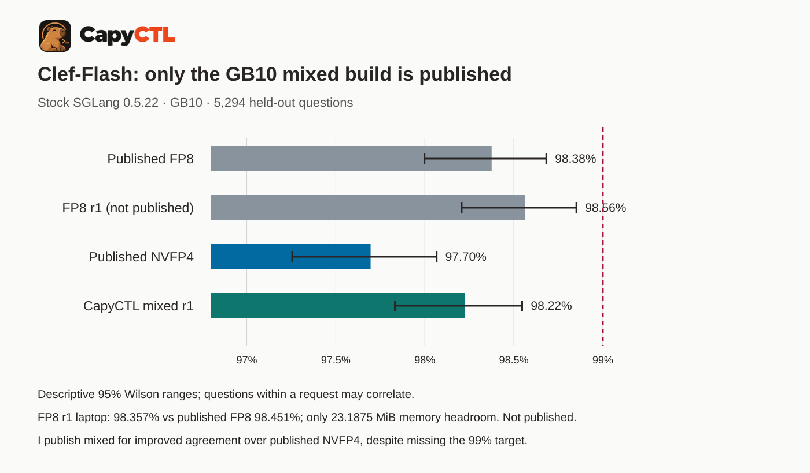

# Clef-Flash: published mixed build and measured FP8 candidate

I publish **only the GB10 mixed NVFP4 / FP8 build**, because its BF16 agreement improves on published NVFP4. **Its 98.224% held-out agreement misses the 99% target.** This is an explicit publication judgement, not a passing qualification gate or a claim of improved task accuracy.

- [Published mixed NVFP4 / FP8 recipe, GB10](../../sglang/clef-flash-capyctl-mixed-gb10/)

FP8 r1 is **not published**. Its GB10 agreement is 98.564%, but the same-laptop comparison regresses to 98.357% versus published FP8's 98.451%, and the measured run leaves only 23.1875 MiB device-memory headroom. I retain FP8 r1 below as measured experimental evidence, not an offered checkpoint or deployment recipe.

The only staged Hugging Face source is `capyctl/clef-flash-NVFP4-FP8`. Upload is staged, not performed. Its deployment revision remains `1e72872e4c70b563038336637391e05704f2ccb4` until an immutable upload revision exists.

## Agreement with BF16

The pinned BF16 checkpoint is `Cloudflare/clef-flash@17f0b0ad64efb65d273590632833508766b2aae6`. The held-out cohort contains 2,192 requests and 5,294 questions. Agreement means the same highest-probability option, not gold-label accuracy. The intervals are descriptive question-level 95% Wilson intervals; questions within a request can be correlated.

| Build / device | Same top | Agreement (95% Wilson) | Mean KL | Mean TV |
|---|---:|---:|---:|---:|
| Published FP8 / Ada | 5,212/5,294 | 98.451% (98.082–98.750%) | 0.00167357 | 0.0117097 |
| Published FP8 / GB10 | 5,208/5,294 | 98.376% (97.998–98.683%) | 0.00164187 | 0.0116312 |
| CapyCTL FP8 r1 / GB10 — not published | 5,218/5,294 | 98.564% (98.207–98.851%) | 0.00172332 | 0.0119396 |
| Published NVFP4 / GB10 | 5,172/5,294 | 97.696% (97.255–98.066%) | 0.00344258 | 0.0179021 |
| CapyCTL mixed r1 / GB10 | 5,200/5,294 | 98.224% (97.832–98.547%) | 0.00242694 | 0.0150904 |
| CapyCTL FP8 r1 / Ada — not published | 5,207/5,294 | 98.357% (97.977–98.666%) | 0.00186977 | 0.0125225 |

On GB10, FP8 r1 improves top agreement slightly but worsens mean KL/TV versus published FP8; it is not published. Mixed improves agreement and KL/TV versus published NVFP4, but does not match published FP8. The overlapping Wilson intervals do not establish statistical superiority. KL is KL(BF16 || candidate), uses natural logarithms and a candidate probability floor of 1e-9. TV is half the summed absolute probability difference. BF16 top-two margin at most 0.05 defines the low-margin slice: FP8 flips 51/164 and mixed 59/164 on GB10.

## What changed

ModelOpt 0.47.0 calibrates and rounds weights; a compressed-tensors exporter emits the stock SGLang loader format. FP8 uses static activation scales selected by calibration-only scale search and diagnostic-only comparisons. Mixed uses 31 NVFP4 and 33 FP8 layer families, retaining FP8 in NVFP4-sensitive families. Calibration comprises 18 synthetic decision requests, disjoint by state/question hash from held-out data. Held-out data is not used for calibration or layout selection.

The separate joint head and lexical `lm_head.weight` remain byte-identical BF16. The joint-head SHA-256 is `19cdcec8c81dc9212be320fff47462ab342fbc1278be4368fb3da71241cf5ba0`; lexical-head tensor SHA-256 is `6d6ff4dbf261f833246d32e7c6088f87f4ab40ddb58516d90c931aa6ae61d5e7`. FP8 package size is 12,174,115,680 bytes; mixed is 10,649,663,746 bytes. The latter is 3.46% larger than published NVFP4.

### Sensitivity method: simulation

Sensitivity and layout-selection experiments are **BF16-arithmetic quantize/dequantize simulations**, not quantized-kernel equivalence tests or engine qualification. All 64 layer families were simulated individually with dynamic/static FP8 and NVFP4. Every individual FP8 family preserved all 104 diagnostic tops; this does not rule out cumulative interactions. NVFP4 top flips identified sensitive DeltaNet, MLP and full-attention families. The final agreement and timing rows above and below come from actual stock-loader engines, not the simulations.

All 200 published FP8 linear modules round-tripped with identical FP8 values, shapes, dtypes and scales before candidate export. Published and newly exported NVFP4 fused DeltaNet qkv/z pairs passed shared-scale equality checks. No published shared-scale defect was found.

## GB10 latency and resources

Direct SGLang 0.5.22, one running request, context and token pool 16,384, FP8 E4M3 KV, BF16 Mamba state, static memory fraction 0.50. Three rounds use five warmups and 100 timed requests per grid point; reported p50/p95 pool 300 requests. Latency spans request send through whole-response receipt. Input sizes are approximate, not token-identical; the 3/5-question short rows are schema floors, not 200-token inputs. Full 1/3/5-question grids and actual-token ranges are in `results/capyctl-build-summary.json`.

| Build | 1q ~200 tokens p50/p95 ms | 1q ~2k | 1q ~8k | 1q near-16k |
|---|---:|---:|---:|---:|
| BF16 | 89.83 / 91.18 | 441.57 / 471.77 | 1,735.87 / 1,784.23 | 3,574.23 / 3,616.71 |
| CapyCTL FP8 r1 — not published | 57.07 / 58.38 | 320.08 / 330.61 | 2,481.41 / 2,558.32 | 5,162.97 / 5,229.42 |
| CapyCTL mixed r1 | 49.35 / 50.75 | 277.21 / 286.74 | 1,794.37 / 1,827.83 | 3,934.74 / 3,985.80 |

Long-input FP8 latency regresses versus BF16. Both candidates completed the diagnostic and held-out captures, all timing rounds and concurrency points without request errors. Higher client concurrency measures queueing under the single-running-request limit, not parallel batching. Minimum sampled MemAvailable: FP8 95.229 GiB; mixed 97.197 GiB. GB10 GPU-memory peaks are unmeasured because NVML does not support that query; system-memory availability is not a GPU allocation measurement.

## Ada / 16 GB: measured FP8 r1, not published

The RTX 4090 Laptop GPU run used the same approved SGLang 0.5.22 environment, private held-out bytes, filler seeds, full 1/3/5-question latency grid, three rounds and concurrency grid as published FP8. Static memory fraction is 0.85 rather than GB10's 0.50; cache/state precision and context/token pool match. All 41 diagnostic requests / 104 questions and 2,192 held-out requests / 5,294 questions completed without request errors, as did every timing point. Diagnostic agreement is 103/104, 99.038% (94.753–99.830% Wilson), mean KL 0.000511592 and TV 0.00761376.

Held-out agreement is 5,207/5,294, **98.357% (97.977–98.666%)**: below both 99% and the earlier published laptop FP8's 98.451%. Mean KL/TV are 0.00186977 / 0.0125225; low-margin flips are 60/164. Together with the 23.1875 MiB sampled device-memory headroom, this is why I do not publish FP8 r1. Its GB10 result does not establish an Ada agreement improvement.

| One-question input class | Actual tokens median (range) | p50 ms | p95 ms |
|---|---|---:|---:|
| 200 | 204 (200–210) | 76.46 | 78.97 |
| 2k | 2,043 (1,938–2,142) | 248.76 | 264.50 |
| 8k | 8,186 (7,841–8,496) | 1,083.72 | 1,117.65 |
| near-16k | 16,188 (15,569–16,377) | 2,471.89 | 2,508.66 |

The full 1/3/5-question grid is in `results/laptop-capyctl-fp8-r1-summary.json`. Median three-question ~2k throughput is 4.007 / 4.150 / 4.147 / 4.139 requests/s at client concurrency 1/2/4/8, respectively, with 12.022 / 12.449 / 12.442 / 12.417 answered questions/s and zero errors. This remains single-request engine queueing.

Startup was 50.060 seconds. Device-wide NVML samples every 250 ms measured startup peak 13,314.5625 MiB and whole-run peak **16,352.8125 MiB**, only **23.1875 MiB below the reported 16,376 MiB capacity**. Minimum sampled MemAvailable was 18.529 GiB. I describe this as a completed direct-engine run with extremely thin observed memory headroom, not a safe general-purpose 16 GB deployment guarantee. A sampled peak can miss shorter spikes. The copied checkpoint passed all 17 source file sizes and SHA-256 hashes; free disk after copy was 129,616,965,632 bytes, above the 5 GB floor.

The owned engine received SIGINT after successful measurements; its exit code 1 is retained. Final compute inventory was empty and device usage was 47 MiB. The laptop's existing node remained stopped and was not modified. Detailed agreement evidence is `results/laptop-capyctl-fp8-r1-vs-bf16-heldout.json`.

## Private data and reproducibility

`cohort-manifest.json` records pinned sources, selection seed and private artifact hashes. `decision_eval.py` uses the existing pinned dataset loaders and question constructors. Private request texts and dataset caches are not redistributed. Captures retain ordered-payload hashes, question order and output distributions; comparisons require the same request hashes and option ordering. Diagnostic: 41 requests / 104 questions, SHA-256 `d102a8a6632159d5c8f30171b73533a53acc3bd3f7732ff52dadebcbac0290a7`. Held-out SHA-256: `5fc442b5a5df40b6f8847f79fcc7160e022dbb6394917e55d28255a2a9e4c5d9`.

The older 20-state / four-question artifact was not recovered. Historical aggregate scores are not newly reproduced evidence. Private working notes and Python caches are archived outside this repository. See `publication-audit.json` for publication exclusions and judgement calls, and `upload/` for staged checkpoint inventories. The source checkpoint license applies unchanged.
