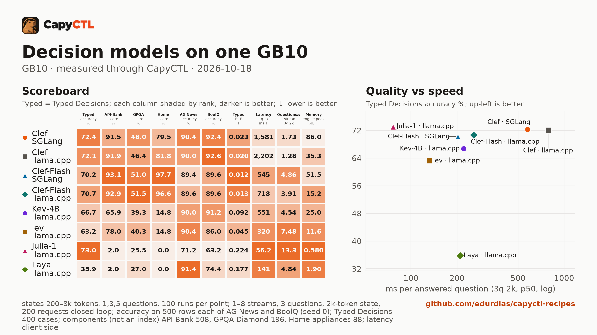

# Decision models on one GB10

**Read the analysis:** [Decision models at home: six open models measured on one GB10](analysis.md),
what these numbers mean for routing, triage and agent gates, with charts.

| | |
|---|---|
| Hardware | 1x NVIDIA GB10 (DGX Spark class), compute capability 12.1, 128 GB unified memory, aarch64 |
| System | Ubuntu 24.04, NVIDIA driver 580.173.02, CUDA 13.0 toolkit in `/usr/local/cuda` |
| Engines | llama.cpp `llama-server` v0.7.0 (commit `620d222`); SGLang 0.5.22 |
| CapyCTL | `main` at `075023d7` (Julia-1 and Laya: a build of PR #148, `a33c4f0d`, merged as `8824b622`), `capyctl start standalone`, managed limit 108 GiB |
| Benchmark | capyctl-bench 0.3.0, `run --decisions --accuracy --accuracy-sets all --concurrency 1,2,4,8` |
| Measured | 2026-10-17 to 2026-10-18 |

A decision model does not write text. It reads a text (the *state*) and answers
typed questions about it (`POST /v1/systemone`): pick one of these options, yes or
no, a score on a scale. Each answer comes back as a probability for every option, in
one forward pass. CapyCTL 0.1.5 serves them on llama.cpp v0.7.0 and SGLang 0.5.22,
the first releases of each that do.

This comparison runs six open decision models, eight deployments, through CapyCTL
on one GB10, with the same benchmark for every one: speed at three input sizes and
three question counts, throughput for 1 to 8 users, and quality on five public test
sets, about 4,200 requests per deployment.

## What we found

- **Clef-Flash is the one to run on a GB10.** On llama.cpp it holds 15 GiB, answers
  a question about a 200-token text in 203 ms, and is within 3 points of Clef 27B on
  every test and ahead of it on API-Bank, GPQA and Home appliances. Clef 27B adds 0.4
  to 3 points on Typed Decisions, AG News and BoolQ for three times the latency and
  more than twice the memory.
- **Our numbers match the published ones.** Clef scores 91.9% on API-Bank, exactly
  Cloudflare's number; Clef-Flash 93.1% on SGLang (Cloudflare: 93.1%); Julia-1 73.0%
  on Typed Decisions (its card: 73.15%); base Laya 35.9% (its card: 36.2%). The
  harness rebuilds the Decision Index requests byte for byte (the kit's own sha256 of
  each set) and its Typed Decisions scorer matches a published third-party scorer to
  5e-7.
- **Small models are fast and narrow.** Julia-1 (144M parameters) answers in 20 ms
  and gets the best Typed Decisions accuracy of the field, 73.0%, but scores 2% on
  API-Bank and 0% on Home appliances, and its probabilities are badly overconfident
  (ECE 0.224). Accuracy alone would rank it first; calibration and the other sets
  say it is a specialist.
- **SGLang reads long inputs twice as fast; llama.cpp starts in seconds and uses a
  third of the memory.** At 8k tokens Clef-Flash takes 1.8 s on SGLang and 3.8 s on
  llama.cpp, Clef 5.7 s and 12.2 s. SGLang holds 52 and 86 GiB against 15 and 35, and
  takes 3 and 7 minutes to start against 21 and 78 seconds. Quality is the same on
  both, within the noise.
- **More users do not add throughput.** Reading the input keeps the GPU busy: on
  llama.cpp decisions/s stays flat from 1 to 8 users, on SGLang it rises 7% to 18%.
  Each extra user waits in line. A request that repeats a text is at most 5% faster:
  neither engine reuses a cached prefix for decisions.
- **CapyCTL adds 12 to 26 ms per request.** Measured against llama-server launched
  directly with the same arguments. That is most of Julia-1's 20 ms and about a tenth
  of Clef-Flash's 200 ms on a short text; at 8 users it vanishes.

## Scoreboard

| Deployment | Typed Decisions | API-Bank | GPQA Diamond | Home appliances | AG News | BoolQ | Typed ECE ↓ | 1 question, 2k-token text ↓ | Decisions/s, 1 user | Peak memory ↓ |
|---|---|---|---|---|---|---|---|---|---|---|
| Clef · SGLang | 72.4% | 91.5% | 48.0% | 79.5% | 90.4% | 92.4% | 0.023 | 1,581 ms | 0.58 | 86.0 GiB |
| Clef · llama.cpp | 72.1% | 91.9% | 46.4% | 81.8% | 90.0% | **92.6%** | 0.020 | 2,202 ms | 0.43 | 35.3 GiB |
| Clef-Flash · SGLang | 70.2% | **93.1%** | 51.0% | **97.7%** | 89.4% | 89.6% | **0.012** | 545 ms | 1.62 | 51.5 GiB |
| Clef-Flash · llama.cpp | 70.7% | 92.9% | **51.5%** | 96.6% | 89.6% | 89.6% | 0.013 | 718 ms | 1.30 | 15.2 GiB |
| Kev-4B · llama.cpp | 66.7% | 65.9% | 39.3% | 14.8% | 90.0% | 91.2% | 0.092 | 551 ms | 1.51 | 25.0 GiB |
| lev · llama.cpp | 63.2% | 78.0% | 40.3% | 14.8% | 90.4% | 86.0% | 0.045 | 320 ms | 2.49 | 11.6 GiB |
| Julia-1 · llama.cpp | **73.0%** | 2.0% | 25.5% | 0.0% | 71.2% | 63.2% | 0.224 | **56 ms** | **4.43** | **0.58 GiB** |
| Laya · llama.cpp | 35.9% | 2.0% | 27.0% | 0.0% | **91.4%** | 74.4% | 0.177 | 141 ms | 1.61 | 1.9 GiB |

Decisions/s counts requests of 3 questions about a 2k-token text. Peak memory is
CapyCTL's measured peak of the engine process (`startup.measured`). Chance is 25% on
GPQA Diamond and about 2% on API-Bank; the chance-corrected skill is in the
[tables](bench/summary.md#decision-index-components).

### Speed

Latency p50, one request at a time, request sent to the whole answer read:

| Deployment | 1 question, 200 tokens | 1 question, 2k | 1 question, 8k | 5 questions, 2k | Ready, cold | Ready, warm |
|---|---|---|---|---|---|---|
| Clef · SGLang | 395 ms | 1,581 ms | 5,731 ms | 1,904 ms | 424 s | 386 s |
| Clef · llama.cpp | 560 ms | 2,202 ms | 12,176 ms | 2,567 ms | 78 s | 6.1 s |
| Clef-Flash · SGLang | 155 ms | 545 ms | 1,837 ms | 678 ms | 180 s | 127 s |
| Clef-Flash · llama.cpp | 203 ms | 718 ms | 3,813 ms | 839 ms | 21 s | 3.6 s |
| Kev-4B · llama.cpp | 88 ms | 551 ms | 2,604 ms | 1,223 ms | 16 s | 3.6 s |
| lev · llama.cpp | 158 ms | 320 ms | 995 ms | 753 ms | 32 s | – |
| Julia-1 · llama.cpp | 20 ms | 56 ms | 392 ms* | 337 ms | 3.1 s | 1.6 s |
| Laya · llama.cpp | 28 ms | 141 ms | 1,004 ms* | 944 ms | 7 s | – |

\* Julia-1 and Laya run an 8,192-token context; 8 of the 100 inputs at that point
ran just over it and were refused (`502 engine_error`), and are left out.

Ready times come from the [recipes](#recipes) (cold includes measuring the
checkpoint's digest on first deploy); lev's and Laya's are from this run, cold only.
The full grid (1, 3 and 5 questions; p50 and p95; amortized per question; input
tokens) is in the [tables](bench/summary.md#latency).

### CapyCTL's overhead

The same launch measured directly at llama-server (same arguments, its own port) and
through CapyCTL's endpoint, one after the other, 100 requests per point
([report](bench/overhead/summary.md)):

| Point, p50 | Julia-1 direct | Julia-1 via CapyCTL | Clef-Flash direct | Clef-Flash via CapyCTL |
|---|---|---|---|---|
| 1 question, 200 tokens | 7.5 ms | 19.1 ms | 184 ms | 206 ms |
| 1 question, 2k | 45.1 ms | 57.9 ms | 704 ms | 724 ms |
| 3 questions, 200 tokens | 15.2 ms | 26.9 ms | 220 ms | 242 ms |
| 3 questions, 2k | 204 ms | 230 ms | 757 ms | 778 ms |
| Decisions/s, 1 user | 4.83 | 4.44 | 1.32 | 1.28 |
| Decisions/s, 8 users | 4.92 | 4.93 | 1.33 | 1.34 |

## How it compares with published numbers

Different hardware and request shapes, so these are references, not a ranking. Our
latencies are through CapyCTL on a GB10; the others are on an RTX PRO 6000 or not
stated.

| Number | Published | Ours |
|---|---|---|
| Clef, API-Bank (Decision Index 0.2.1, [Clef card](https://huggingface.co/Cloudflare/clef#results)) | 91.9% | 91.9% (llama.cpp Q8_0), 91.5% (SGLang BF16) |
| Clef-Flash, API-Bank (same source) | 93.1% | 92.9% (llama.cpp Q8_0), 93.1% (SGLang BF16) |
| Laya, API-Bank (same source) | 11.5% | 2.0% |
| Julia-1, Typed Decisions ([card](https://huggingface.co/SupersonicLabs/Julia-1)) | 73.15% | 73.0% |
| Laya (base), Typed Decisions ([card](https://huggingface.co/convaiinnovations/laya-typed-decisions)) | 36.2% | 35.9% |
| One question, median ([llama.cpp blog](https://huggingface.co/blog/ggml-org/decision-models-in-llamacpp), RTX PRO 6000, input size not stated) | Julia-1 3 ms, Laya 5, Kev-4B 12, lev 36 | 200-token text: Julia-1 20 ms (7.5 direct), Laya 28, Kev-4B 88, lev 158 |
| Clef-Flash request median (Clef card, hardware not stated) | 38.8 ms | 155 ms (SGLang), 203 ms (llama.cpp), 200-token text |

Laya's API-Bank score is the one number we do not reproduce, and we have not found
why; the community board lists a Laya revision (`1e28ac20`) other than the one we
ran, and ours is the Q8_0 GGUF. We did not compute a Decision Index: its public score needs 37 benchmarks
(about 140,000 requests) and its full score private tests. Three of its components
are here, scored the way its kit scores them; read them as components.

## Method

Every deployment ran alone on the machine, one after the other, through
`capyctl start standalone` with these [deployment files](deployments/). llama.cpp
reads a decision request's whole input in one batch, so each llama.cpp deployment
sets `--batch-size` and `--ubatch-size` to its context (16,384 tokens; 8,192 for
Julia-1 and Laya). A longer input is refused.

| Part | What it sends | What it reports |
|---|---|---|
| Latency | texts of about 200, 2,000 and 8,000 tokens, each new, with 1, 3 and 5 questions; 100 timed requests per point after 5 warm-up | p50 and p95, ms per answered question, input tokens |
| Cache | 100 new texts, then one text 100 times (3 questions, 2k tokens) | whether a repeated text is faster |
| Throughput | 1, 2, 4 and 8 users, each sending its next request when the last returns, 200 requests per level | decisions/s, questions/s, latency, errors |
| AG News, BoolQ | 500 test and 500 validation rows, one question each | accuracy, macro-F1, Brier, NLL, ECE |
| Typed Decisions | all 400 test cases, five questions per case in one request | accuracy against the hard label, KL and Brier against the soft gold, ECE, score error |
| Decision Index components | API-Bank (508), GPQA Diamond (196), Home appliances (88), rebuilt as the kit at `f5a6e4fd` builds them | the kit's score and chance-corrected skill |

Dataset revisions, row hashes and licences are listed at the end of the
[tables](bench/summary.md). The results files keep row ids, hashes and answers,
never the rows' text. The capyctl-bench [README](../../tools/capyctl-bench/)
defines every metric.

Checkpoints, all Apache-2.0:

| Model | Checkpoint | Size |
|---|---|---|
| Clef | [`ggml-org/Clef-GGUF`](https://huggingface.co/ggml-org/Clef-GGUF) `d2aa75cb` (Q8_0); [`Cloudflare/clef`](https://huggingface.co/Cloudflare/clef) `0b331204` (BF16) | 28.7 GB; 55 GB |
| Clef-Flash | [`ggml-org/Clef-Flash-GGUF`](https://huggingface.co/ggml-org/Clef-Flash-GGUF) `6b4fe4c5` (Q8_0); [`Cloudflare/clef-flash`](https://huggingface.co/Cloudflare/clef-flash) `8b2e5fd1` (BF16) | 9.7 GB; 19.1 GB |
| Kev-4B | [`ggml-org/Kev-4B-GGUF`](https://huggingface.co/ggml-org/Kev-4B-GGUF) `d924f2e2` (Q8_0) | 4.5 GB |
| lev | [`ggml-org/lev-GGUF`](https://huggingface.co/ggml-org/lev-GGUF) `3e9286a7` (Q8_0) | 4.5 GB |
| Julia-1 | [`ggml-org/Julia-1-GGUF`](https://huggingface.co/ggml-org/Julia-1-GGUF) `16fee179` (Q8_0) | 0.17 GB |
| Laya | [`ggml-org/Laya-GGUF`](https://huggingface.co/ggml-org/Laya-GGUF) `22265007` (Q8_0) | 0.45 GB |

Not run: vLLM (no release serves `/v1/systemone` yet), TensorFold, the full Decision
Index, TypeSafe's workflow evaluations, and decision models that need more than one
machine.

## What the run fixed in CapyCTL

- **SGLang 0.5.22 could not start** under CapyCTL: it installs plugins of its own,
  which CapyCTL's launch guard refused. Fixed in
  [#147](https://github.com/edurdias/capyctl/pull/147).
- **An engine's errors could lock a deployment.** llama.cpp answers an input longer
  than its batch with HTTP 500. CapyCTL kept each such request counted against the
  deployment's 32 outstanding requests, and after 32 of them refused everything with
  `429 queue_full`; Julia-1's and Laya's first runs lost their throughput and quality
  tests to it. Now a complete engine error frees its slot once the engine is idle,
  and the client gets the engine's message. Fixed in
  [#148](https://github.com/edurdias/capyctl/pull/148).

## Recipes

| Recipe | Ready, warm | Peak memory |
|---|---|---|
| [llamacpp/clef-flash-gb10](../../llamacpp/clef-flash-gb10/) | 3.6 s | 15.8 GiB |
| [llamacpp/clef-gb10](../../llamacpp/clef-gb10/) | 6.1 s | 35.4 GiB |
| [llamacpp/kev-4b-gb10](../../llamacpp/kev-4b-gb10/) | 3.6 s | 25.9 GiB |
| [llamacpp/julia-1-gb10](../../llamacpp/julia-1-gb10/) | 1.6 s | 1.4 GiB |
| [sglang/clef-flash-gb10](../../sglang/clef-flash-gb10/) | 127 s | 51.9 GiB |
| [sglang/clef-gb10](../../sglang/clef-gb10/) | 386 s | 87.5 GiB |
