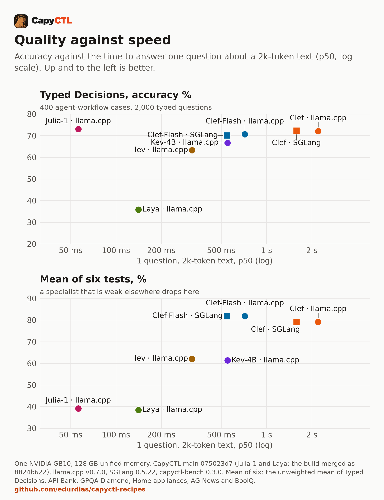
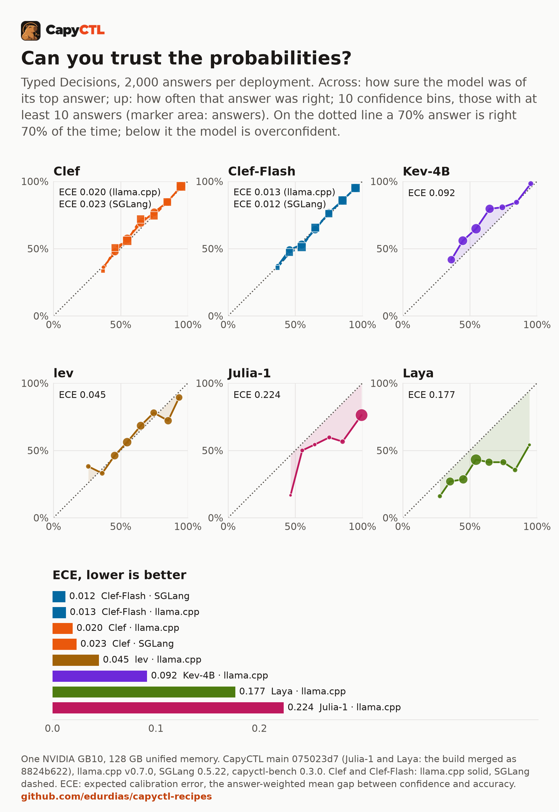
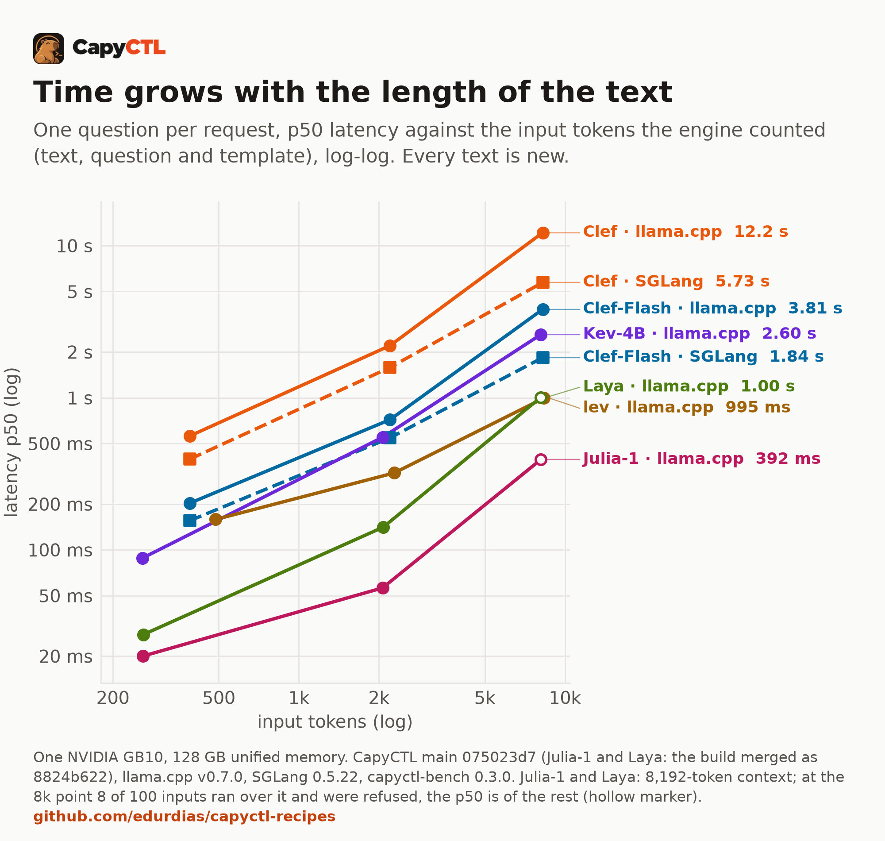
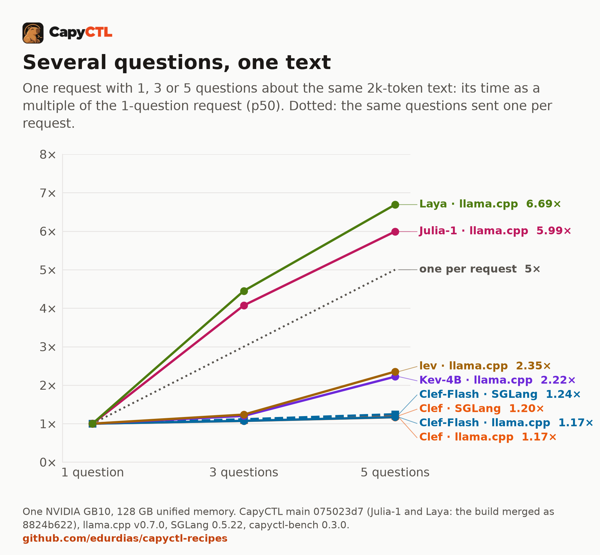
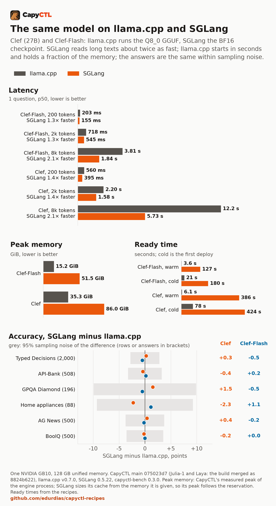
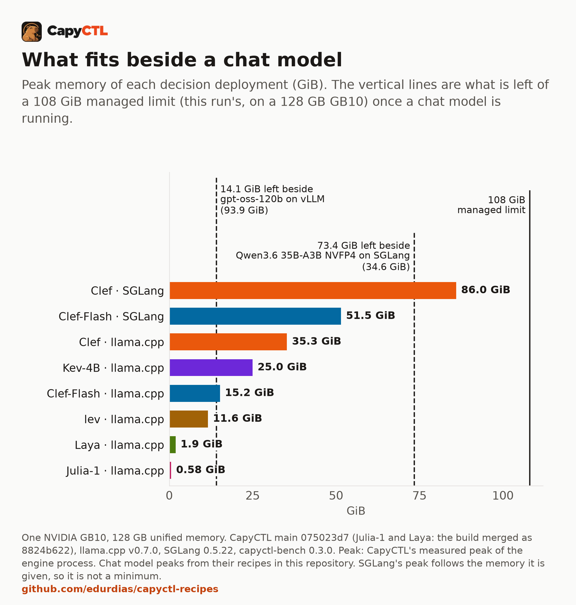
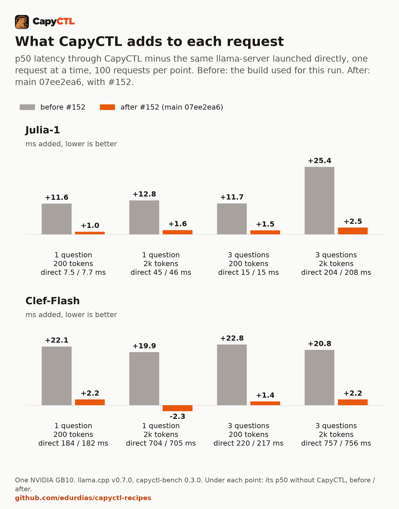

# Decision models at home: six open models measured on one GB10

A chat model writes. A decision model reads a text and answers questions about
it, each answer a probability for every option, in one pass and without writing
a word. That makes it a small, fast, checkable part of a home AI setup: it can
route a request, triage a ticket or decide whether an agent may go on.

We ran six open decision models, eight deployments, on one NVIDIA GB10 through
CapyCTL, with the same benchmark for each: how often they are right, whether
their confidence means anything, how fast they answer, how they behave with
several users, and how much memory they take. This article is what we learned,
including where the numbers are weak.

Every number here comes from the results files in this directory
([bench/results](bench/results/), [bench/overhead/results](bench/overhead/results/),
[bench/overhead2/results](bench/overhead2/results/)) or from a source linked next
to it. The charts are drawn by [analysis/make_charts.py](analysis/make_charts.py)
from those files. The full tables are in the [comparison](README.md) and its
[summary](bench/summary.md).

## In short

- **Clef-Flash on llama.cpp is the one to start with.** 15.2 GiB, 203 ms for a
  question about a 200-token text, 718 ms for a 2k-token text, the best mean
  over our six tests (81.8%), and probabilities you can use as they are
  (calibration error 0.013).
- **Clef 27B does not beat Clef-Flash.** It is three times slower than
  Clef-Flash on a 2k-token text and takes more than twice the memory, and it is
  ahead on three of six tests, by 0.4 to 3.0 points.
- **The tiny models are specialists.** Julia-1 (144M parameters, 0.58 GiB,
  20 ms) has the best Typed Decisions score of the field and is at chance or
  zero on three other tests. Its stated confidence is far too high.
- **Long texts, not users, set the speed.** Time grows with the length of the
  text. More users add at most 18% throughput from 1 to 8 users; each extra
  user waits in line. Clef and Clef-Flash answer five questions about one text
  in 1.2 times the time of one; the other four models take 2.2 to 6.7 times.
- **SGLang reads long texts about twice as fast as llama.cpp**, gives the same
  answers, and costs 2.4 to 3.4 times the memory and minutes to start.
- **CapyCTL now adds about 1 to 2.5 ms per decision request**, within the
  noise for Clef-Flash. In this run it added 12 to 25 ms, most of it two
  synchronous SQLite commits per request at 4.6 ms each, which
  [#152](https://github.com/edurdias/capyctl/pull/152) changed.



## What a decision model is

You send a text (the *state*) and typed questions to `POST /v1/systemone`:
pick one of these options, yes or no, or a score on a scale. This is the
request and the answer from the [Clef-Flash recipe](../../llamacpp/clef-flash-gb10/):

```bash
curl -s http://127.0.0.1:8443/v1/systemone \
  -H "Authorization: Bearer $KEY" -H 'Content-Type: application/json' \
  -d '{"model": "clef-flash",
       "state": "The ticket says: my card was charged twice for one order.",
       "questions": {
         "team": {"type": "choice", "instructions": "Which team should handle this ticket?",
                  "criteria": {"billing": "charges, refunds, invoices",
                               "shipping": "deliveries and tracking",
                               "technical": "bugs and errors"}},
         "urgent": {"type": "noul", "instructions": "Is the customer losing money right now?"}}}'
```

```text
"team":   {"choice": "billing", "probabilities": {"billing": 0.864, "shipping": 0.025, "technical": 0.111}}
"urgent": {"noul": 0.897}
"usage":  {"input_tokens": 247, "output_tokens": 0}
```

There is no generated text to parse and nothing to stream. The answer is one
of the options you listed, always, with a probability. Several questions about
the same text can go in one request.

## Why it is useful at home

If you run a chat model on your own GPU, a decision model can sit in front of
it or beside it:

- **Routing.** Send a request to the small chat model or the large one, to a
  tool or to a person.
- **Triage.** Label incoming mail, tickets or notes by topic and urgency.
- **Agent gates.** Before an agent acts: is this step safe, is the task done,
  does a person need to look?

What makes it fit these jobs is the probability. With a calibrated model you
can accept answers above a threshold automatically and send the rest to a
slower path or to yourself. That only works if a 90% answer is right about 90%
of the time, which is why this article measures calibration as well as
accuracy.

## The setup

| | |
|---|---|
| Machine | One NVIDIA GB10 (DGX Spark class), 128 GB unified memory, Ubuntu 24.04 |
| Engines | llama.cpp `llama-server` v0.7.0 (`620d222`), Q8_0 GGUF checkpoints; SGLang 0.5.22, BF16 checkpoints |
| CapyCTL | `main` at `075023d7` (Julia-1 and Laya: the build merged as `8824b622`), standalone, managed limit 108 GiB |
| Benchmark | capyctl-bench 0.3.0, about 4,200 requests per deployment |
| Measured | 2026-10-17 to 2026-10-18; CapyCTL overhead after #152 on 2026-10-19 |

| Model | Parameters | Engines run |
|---|---|---|
| [Clef](https://huggingface.co/Cloudflare/clef) | 27B | llama.cpp, SGLang |
| [Clef-Flash](https://huggingface.co/Cloudflare/clef-flash) | smaller sibling of Clef (9.7 GB as Q8_0) | llama.cpp, SGLang |
| [Kev-4B](https://huggingface.co/ggml-org/Kev-4B-GGUF) | 4B | llama.cpp |
| [lev](https://huggingface.co/ggml-org/lev-GGUF) | 4.5 GB as Q8_0 | llama.cpp |
| [Julia-1](https://huggingface.co/SupersonicLabs/Julia-1) | 144M | llama.cpp |
| [Laya](https://huggingface.co/ggml-org/Laya-GGUF) | 0.45 GB as Q8_0 | llama.cpp |

Each deployment ran alone on the machine, one after the other. The tests:

| Test | What it is | Size |
|---|---|---|
| Typed Decisions | agent-workflow states with five typed questions each (choice, yes/no, score) | 400 cases, 2,000 answers |
| API-Bank | pick the right tool from a 53-tool catalog for a dialogue | 508 |
| GPQA Diamond | hard science multiple choice, four options | 196 |
| Home appliances | fill a whole form about a household correctly | 88 |
| AG News | news topic, four classes | 500 |
| BoolQ | yes/no question about a passage | 500 |

API-Bank, GPQA Diamond and Home appliances are three components of the
Decision Index, rebuilt request for request the way its kit builds them. Speed
uses generated texts of about 200, 2,000 and 8,000 tokens, each one new, with 1,
3 or 5 questions, 100 timed requests per point. Throughput runs 1, 2, 4 and 8
users, each sending its next request when the last returns, 200 requests per
level. The [comparison's method](README.md#method) has the details and every
pin.

## Quality

| Deployment | Typed Decisions | API-Bank | GPQA Diamond | Home appliances | AG News | BoolQ | Mean of six |
|---|---|---|---|---|---|---|---|
| Clef · SGLang | 72.4% | 91.5% | 48.0% | 79.5% | 90.4% | 92.4% | 79.0% |
| Clef · llama.cpp | 72.1% | 91.9% | 46.4% | 81.8% | 90.0% | 92.6% | 79.1% |
| Clef-Flash · SGLang | 70.2% | 93.1% | 51.0% | 97.7% | 89.4% | 89.6% | 81.8% |
| Clef-Flash · llama.cpp | 70.7% | 92.9% | 51.5% | 96.6% | 89.6% | 89.6% | 81.8% |
| Kev-4B · llama.cpp | 66.7% | 65.9% | 39.3% | 14.8% | 90.0%* | 91.2%* | 61.3% |
| lev · llama.cpp | 63.2% | 78.0% | 40.3% | 14.8% | 90.4% | 86.0% | 62.1% |
| Julia-1 · llama.cpp | 73.0% | 2.0% | 25.5% | 0.0% | 71.2% | 63.2% | 39.2% |
| Laya · llama.cpp | 35.9% | 2.0% | 27.0% | 0.0% | 91.4% | 74.4% | 38.4% |

\* Kev-4B's model card lists AG News and BoolQ among its training datasets.

The mean of six is a plain average, a rough guide to how general a model is,
not a score anyone publishes. Chance is 25% on GPQA Diamond and about 2% on
API-Bank. On 500 rows, a score near 90% is uncertain by about ±2.6 points
(95%), so small differences on AG News and BoolQ mean little.

### Generalists and specialists

Clef and Clef-Flash are generalists: no test where they fall apart. Clef-Flash
is ahead of Clef on API-Bank, GPQA Diamond and especially Home appliances
(96.6% against 81.8% on llama.cpp); Clef is ahead on Typed Decisions (72.1%
against 70.7%), AG News (90.0% against 89.6%) and BoolQ (92.6% against 89.6%).

Kev-4B and lev are in the middle. They are good at the simple classic tests and
at picking a tool (lev 78.0% on API-Bank), but they get only 14.8% of the Home
appliances forms entirely right, even though they get 91% to 92% of the
individual fields right. A form needs every field.

Julia-1 and Laya are specialists. Julia-1 has the best Typed Decisions score
in the field, 73.0%, the test its own card reports. Laya has the best AG News
score, 91.4%. Outside their task both are at chance on GPQA Diamond, 2.0% on
API-Bank and 0% on Home appliances. The right question for them is not
"how good is it" but "is my task like the one it was built for".

### Training overlap

Kev-4B's card names AG News and BoolQ as training data, so its 90.0% and
91.2% there are not a test of reading something new. We do not know the
training data of every other model; treat the two classic tests as a sanity
check rather than a ranking.

Typed Decisions has a caveat of its own: its gold answers come from agreement
between teacher models, not from human-checked truth
([dataset card](https://huggingface.co/datasets/LocalLLaMA/typed-decisions)).

### Published numbers we reproduce

Different hardware and request shapes, so these are checks, not a ranking.

| Number | Published | Ours |
|---|---|---|
| Clef, API-Bank ([Clef card](https://huggingface.co/Cloudflare/clef#results), Decision Index 0.2.1) | 91.9% | 91.9% (llama.cpp), 91.5% (SGLang) |
| Clef-Flash, API-Bank (same source) | 93.1% | 92.9% (llama.cpp), 93.1% (SGLang) |
| Laya, API-Bank (same source) | 11.5% | 2.0% |
| Julia-1, Typed Decisions ([card](https://huggingface.co/SupersonicLabs/Julia-1)) | 73.15% | 73.0% |
| Laya (base), Typed Decisions ([card](https://huggingface.co/convaiinnovations/laya-typed-decisions)) | 36.2% | 35.9% |
| A hosted Jev 1.13, Typed Decisions ([dataset card](https://huggingface.co/datasets/LocalLLaMA/typed-decisions)) | 72.7%, ECE 0.144 | Clef 72.1% to 72.4%, ECE 0.020 to 0.023 |

The four model-card numbers we re-measured match within half a point, and the
hosted reference sits within a point of Clef. Laya's API-Bank score is the exception,
and we have not found why. We ran its Q8_0 GGUF; the community board lists a
different Laya revision. A Laya fine-tuned on Typed Decisions reports 76.6%
([card](https://huggingface.co/convaiinnovations/laya-typed-decisions)); we ran
the base model.

For orientation only: the
[community Decision Index board](https://huggingface.co/spaces/multimodalart/jev-decision-index)
(edition 0.3.2) orders these models Clef 61.71, Clef-Flash 56.15, lev 39.20,
Kev 4B 37.95, Laya 6.19, Julia-1 4.24 index points. That index needs 37
benchmarks, about 140,000 requests; we ran three of its components, so our
numbers are not index points.

## Calibration: can you trust the probabilities?



Each panel sorts the 2,000 Typed Decisions answers by how sure the model was
of its top answer, and plots how often that answer was right. On the dotted
line, a model that says 80% is right 80% of the time. The expected calibration
error (ECE) is the average gap, weighted by how many answers sit in each bin.

Clef and Clef-Flash are close to the line on both engines (ECE 0.012 to
0.023). In practice: of the 370 Clef-Flash answers on llama.cpp given with 90%
or more, 95.1% were right, at a mean confidence of 94.8%. You can set an
auto-accept threshold on these numbers and get roughly what it says.

Julia-1 is the opposite. It gave 1,715 of its 2,000 answers with 90% or more,
at a mean confidence of 99.4%, and those were right 76.3% of the time. A
threshold of 0.9 would accept 86% of its answers and let about one in four
through wrong. Its accuracy is the best in the field; its probabilities say
almost nothing. Use its choice, not its confidence.

Laya is overconfident (ECE 0.177). Kev-4B leans the other way: it is right
more often than it says in the middle bins (79.6% right at 64.8% confidence),
which is safer but wastes answers you could have accepted. lev sits in between
(ECE 0.045).

On AG News and BoolQ Julia-1's ECE is 0.160 and 0.299, Clef's and
Clef-Flash's 0.018 to 0.041 ([tables](bench/summary.md#ag-news-and-boolq)).

## Speed



| Deployment | 200-token text | 2k-token text | 8k-token text |
|---|---|---|---|
| Clef · SGLang | 395 ms | 1,581 ms | 5,731 ms |
| Clef · llama.cpp | 560 ms | 2,202 ms | 12,176 ms |
| Clef-Flash · SGLang | 155 ms | 545 ms | 1,837 ms |
| Clef-Flash · llama.cpp | 203 ms | 718 ms | 3,813 ms |
| Kev-4B · llama.cpp | 88 ms | 551 ms | 2,604 ms |
| lev · llama.cpp | 158 ms | 320 ms | 995 ms |
| Julia-1 · llama.cpp | 20 ms | 56 ms | 392 ms* |
| Laya · llama.cpp | 28 ms | 141 ms | 1,004 ms* |

One question per request, p50, request sent to answer read, through CapyCTL.
\* Julia-1 and Laya run an 8,192-token context; 8 of the 100 inputs at that
point ran just over it and were refused, and are left out.
The rows were measured before
[#152](https://github.com/edurdias/capyctl/pull/152), when CapyCTL added 12 to
25 ms to each request (see [What CapyCTL itself costs](#what-capyctl-itself-costs)).
On current CapyCTL the short-text numbers are lower by about that much: in the
overhead test after #152, Julia-1 answered a question about a 200-token text
in 8.74 ms through CapyCTL.

A decision is all reading, so the time follows the length of the text. From a
200-token text to an 8k-token one (about 20 times the tokens) Clef-Flash on
llama.cpp goes from 203 ms to 3.8 s. On a short text Julia-1 and Laya answer
in 20 to 30 ms; on a long one, lev is the fastest of the larger models
(995 ms).

### Several questions about one text



Clef and Clef-Flash read the text once for all the questions in a request. Five
questions about a 2k-token text take 1.17 to 1.24 times as long as one, so each
answer costs 136 ms on Clef-Flash with SGLang and 168 ms with llama.cpp. The
engine counts the input once: 2,554 tokens for five questions against 2,201 for
one.

The other four models count the text once per question (about 10,300 input
tokens for five questions on Kev-4B, Julia-1 and Laya, 7,913 on lev). Kev-4B and
lev still answer five questions in 2.2 and 2.4 times the time of one. Julia-1
and Laya take 6.0 and 6.7 times, more than five separate requests would (five
one-question requests to Julia-1 take 5 × 56 = 281 ms; one five-question
request takes 337 ms).

So: with Clef or Clef-Flash, put all your questions about a text in one
request. With Julia-1 or Laya, it saves nothing.

### More users do not add throughput

| Deployment | Decisions/s, 1 user | Decisions/s, 8 users | Change | p50 latency, 8 users |
|---|---|---|---|---|
| Clef · SGLang | 0.577 | 0.620 | +7% | 11.4 s |
| Clef · llama.cpp | 0.425 | 0.430 | +1% | 11.6 s |
| Clef-Flash · SGLang | 1.62 | 1.91 | +18% | 4.2 s |
| Clef-Flash · llama.cpp | 1.30 | 1.36 | +4% | 3.7 s |
| Kev-4B · llama.cpp | 1.51 | 1.60 | +5% | 5.0 s |
| lev · llama.cpp | 2.49 | 2.74 | +10% | 2.6 s |
| Julia-1 · llama.cpp | 4.43 | 4.95 | +12% | 1.5 s |
| Laya · llama.cpp | 1.61 | 1.64 | +2% | 4.4 s |

Each request has 3 questions about a new 2k-token text.

A chat model gains a lot from several users: it writes one token at a time,
which leaves the GPU's compute mostly idle, and batching fills it. A decision
model writes nothing. Reading a 2k-token text is already a full load for the
GB10, so a second request mostly waits for the first. Throughput stays where
it was and latency grows with the queue: Clef-Flash on llama.cpp goes from
766 ms with one user to 3.7 s with eight. SGLang batches a little better
(+18% for Clef-Flash).

One more thing the p50 hides. On llama.cpp with 4 or 8 users, Clef and
Clef-Flash each had two or three requests that waited until every other
request of the level was done: up to 147 s for Clef-Flash and 465 s for Clef,
the whole length of the level. lev, Julia-1 and Laya had smaller stalls
(5 to 14 s). SGLang had none.

This is llama.cpp, not CapyCTL: it happens the same way without CapyCTL. In
the overhead test, Clef-Flash with 8 users had a p50 of 3.75 s and a slowest
request of 149.9 s talking to llama-server directly, and 3.73 s and 149.4 s
through CapyCTL, with three requests over three times the p50 in both. Julia-1
with 8 users: slowest request 4.7 s directly, 4.6 s through CapyCTL
([results](bench/overhead/results/)). Our reading is that llama.cpp v0.7.0,
running 4 slots here, leaves a few slots starved while the others keep taking
new requests; that is an inference from the timings, we did not trace it
inside llama.cpp.

Since parallel requests add almost no throughput to a decision model anyway,
give a llama.cpp decision deployment one slot (`max_concurrent_requests: 1` in
its `engine_config`) so requests are answered in turn. If several users must
each see a bounded wait, use SGLang.

### A repeated text is not faster

Sending the same 2k-token text 100 times after its first sight was at most 5%
faster than new texts (repeated p50 over new p50: 0.95 to 1.00). Neither
engine reused work from a text it had already read. If your application asks
about the same document again later, it pays the full reading cost again; ask
all the questions at once instead.

## The same model on llama.cpp and SGLang



Clef and Clef-Flash ran on both engines: llama.cpp with the Q8_0 GGUF, SGLang
with the BF16 checkpoint.

- **Quality is the same.** The largest difference on any test is 2.3 points
  (Clef, Home appliances, 88 cases), well inside the sampling noise of that
  test.
- **SGLang is faster, more so on long texts**: 1.3 to 1.4 times on a 200-token
  or 2k-token text, 2.1 times on an 8k-token one. SGLang's reading rate (input
  tokens over latency) holds as the text grows (Clef-Flash: about 4,000
  tokens/s at 2k, 4,500 at 8k); llama.cpp's drops (3,100 at 2k, 2,200 at 8k).
- **llama.cpp uses a fraction of the memory**: 15.2 against 51.5 GiB for
  Clef-Flash, 35.3 against 86.0 GiB for Clef. SGLang sizes its cache from the
  memory it is given, so its peak follows the reservation; we did not measure
  how low it can go.
- **llama.cpp starts in seconds, SGLang in minutes.** Warm restart: 3.6 against
  127 s for Clef-Flash, 6.1 against 386 s for Clef. SGLang compiles and
  captures CUDA graphs on every start. Decision models in CapyCTL are stopped,
  not parked, when their memory is needed, so this is paid on every return.

On a home machine shared with a chat model, llama.cpp is the better default.
SGLang pays off when long texts are common and the decision model stays up.

## Memory: what fits beside a chat model



The GB10 has 128 GB of unified memory; this run gave CapyCTL a managed limit of
108 GiB. Two chat models from this repository's recipes set the scene: Qwen3.6
35B-A3B NVFP4 on SGLang peaks at 34.6 GiB
([recipe](../../sglang/qwen3.6-35b-a3b-nvfp4-32gib-gb10/)), gpt-oss-120b on
vLLM at 93.9 GiB ([recipe](../../vllm/gpt-oss-120b-gb10/)).

- Beside the 35B chat model, 73.4 GiB is left: every llama.cpp deployment fits,
  and Clef-Flash on SGLang (51.5 GiB). Clef on SGLang (86.0 GiB) does not.
- Beside gpt-oss-120b, 14.1 GiB is left: Julia-1 (0.58 GiB), Laya (1.9 GiB) and
  lev (11.6 GiB) fit. Clef-Flash on llama.cpp (15.2 GiB) misses by about a
  gigabyte.

These peaks are CapyCTL's measurement of the engine process during this run.
The recipes, measured separately, report slightly higher peaks for some (for
example 15.8 GiB for Clef-Flash on llama.cpp), so leave a margin.

## What CapyCTL itself costs



We launched llama-server with the same arguments directly and through CapyCTL,
one after the other, 100 requests per point, twice: with the CapyCTL build
used for this run ([report](bench/overhead/summary.md)), and again with
`main` at `07ee2ea6`, after [#152](https://github.com/edurdias/capyctl/pull/152)
([results](bench/overhead2/results/)).

| Point, p50 | Julia-1 added, before | Julia-1 added, after | Clef-Flash added, before | Clef-Flash added, after |
|---|---|---|---|---|
| 1 question, 200 tokens | 11.6 ms | 1.0 ms | 22.1 ms | 2.2 ms |
| 1 question, 2k tokens | 12.8 ms | 1.6 ms | 19.9 ms | −2.3 ms |
| 3 questions, 200 tokens | 11.7 ms | 1.5 ms | 22.8 ms | 1.4 ms |
| 3 questions, 2k tokens | 25.4 ms | 2.5 ms | 20.8 ms | 2.2 ms |

Before, CapyCTL added 11.6 to 25.4 ms per request: Julia-1 took 19.1 ms for
a question about a 200-token text through CapyCTL against 7.5 ms directly, most
of the answer. Clef-Flash took 206 ms against 184 ms, about a tenth.

Most of it was bookkeeping: CapyCTL made two synchronous SQLite commits per
request, each 4.6 ms on the GB10's NVMe drive. #152 changes that: the
standalone's ledger commits with `synchronous=NORMAL`, the request's lease is
closed after the reply is sent, and the request history has indexes.

After #152, CapyCTL adds 1.0 to 2.5 ms to a Julia-1 request (8.74 ms against
7.74 ms directly on a 200-token text). For Clef-Flash the difference is −2.3 to
+2.2 ms, smaller than the run-to-run spread of a request that takes 0.2 to
0.8 s. Throughput with one user is the same either way (Julia-1 4.86 requests/s
through CapyCTL, 4.84 directly; Clef-Flash 1.32 and 1.31), and with 8 users the
two paths are within about 1% of each other, before and after.

## What the run fixed in CapyCTL

- **SGLang 0.5.22 could not start.** It installs plugins of its own, which
  CapyCTL's launch guard refused. Fixed in
  [#147](https://github.com/edurdias/capyctl/pull/147).
- **Engine errors could lock a deployment.** llama.cpp answers an input longer
  than its batch with HTTP 500. CapyCTL kept each such request counted against
  the deployment's 32 outstanding requests, and after 32 of them refused
  everything. Now a complete engine error frees its slot and the client gets
  the engine's message. Fixed in
  [#148](https://github.com/edurdias/capyctl/pull/148).
- **Per-request cost.** Two synchronous SQLite commits per request, 4.6 ms
  each, made CapyCTL add 12 to 25 ms to every decision. Changed in
  [#152](https://github.com/edurdias/capyctl/pull/152); it now adds 1 to 2.5 ms.

## Which model for which job

| Job | Pick | Why, from this run |
|---|---|---|
| A general router or gate beside a chat model | Clef-Flash · llama.cpp | 15.2 GiB, 203 ms on a short text, mean of six 81.8%, ECE 0.013, warm start 3.6 s |
| Auto-accept above a confidence threshold | Clef-Flash or Clef, either engine | ECE 0.012 to 0.023; 95.1% right in Clef-Flash's 90%+ bin |
| Long inputs (8k tokens) all day, memory to spare | Clef-Flash · SGLang | 1.84 s at 8k against 3.81 s; 51.5 GiB; 2 to 3 minutes to start |
| Yes/no questions about passages | Clef · llama.cpp | BoolQ 92.6%, Typed Decisions 72.1%; 35.3 GiB and 2.2 s on a 2k-token text |
| Picking a tool from a catalog | Clef-Flash | API-Bank 92.9% to 93.1%; lev (78.0%, 11.6 GiB) if memory is tight |
| Beside a very large chat model | lev, or Julia-1 for agent-workflow questions | 11.6 and 0.58 GiB fit in the 14.1 GiB left beside gpt-oss-120b |
| Typed questions about agent steps at a high rate, little memory | Julia-1 · llama.cpp | 73.0% Typed Decisions, 20 ms, 0.58 GiB; use the choice, not the confidence; nothing else |
| News-style topic labels on short texts | Laya · llama.cpp | AG News 91.4%, 28 ms, 1.9 GiB; weak at anything else |
| Several clients sharing one decision model | any llama.cpp pick with `max_concurrent_requests: 1`, or SGLang | llama.cpp's parallel slots starved a few requests for up to 465 s; SGLang had no stalls |

We have no job where Kev-4B is the clear choice in this run. It is the fastest
mid-size model on a 200-token text (88 ms), but lev is smaller (11.6 against
25.0 GiB), faster on 2k and 8k texts and better at picking tools, and Clef-Flash
on llama.cpp is better on four of six tests in less memory (15.2 GiB).

## Limits

- **One machine, one run.** Every number is from one GB10. Speed on a
  discrete GPU will differ, and the published latencies we compare against are
  from an RTX PRO 6000 or unstated hardware.
- **Samples, not whole sets.** AG News and BoolQ use 500 rows each; GPQA
  Diamond has 196 and Home appliances 88, so their scores move by several
  points on a handful of answers.
- **Different checkpoints per engine.** llama.cpp ran Q8_0 GGUFs, SGLang BF16.
  The quality match says the quantization costs nothing measurable here; it
  does not separate engine from checkpoint.
- **Laya's API-Bank** (2.0% against a published 11.5%) is unexplained.
- **The llama.cpp stalls** with 4 and 8 users reproduce without CapyCTL; that
  they come from starved slots is our inference, not traced inside llama.cpp,
  and the one-slot setting we advise was not measured in this run.
- **Memory on SGLang** follows what it is given; smaller reservations were not
  tried.
- **The speed and throughput tables predate #152.** The eight
  deployments ran on a build that added 12 to 25 ms per request; on `main`
  after #152 the short-text latencies are lower by about that much (Julia-1's
  19.1 ms through CapyCTL in the overhead test became 8.74 ms). The long-text
  numbers and the throughput are not visibly affected.
- **Not run:** vLLM (no release serves `/v1/systemone` yet), the full Decision
  Index, and models that need more than one machine.

## Reproduce it

Pins: llama.cpp `v0.7.0` (`620d222`, built with `-DGGML_CUDA=ON
-DCMAKE_CUDA_ARCHITECTURES=121a-real`), SGLang 0.5.22,
CapyCTL 0.1.5 or later, capyctl-bench 0.3.0 from this repository. Checkpoint
revisions are in the [comparison](README.md#method) and in each
[deployment file](deployments/).

```bash
# CapyCTL with room for the largest deployment
capyctl start standalone --set host.resource_policy.memory.system.managed_limit=108GiB
capyctl engine add ~/llamacpp-v0.7.0/build/bin/llama-server --name llamacpp

# one deployment at a time
capyctl deploy model --file comparisons/decision-models-gb10/deployments/clefflash-lc.yaml
capyctl start deployment clefflash-lc --wait

python3 tools/capyctl-bench/capyctl_bench.py run --decisions \
  --accuracy --accuracy-sets all --concurrency 1,2,4,8 \
  --api-key-file ~/.local/state/capyctl/identity/credentials \
  --model clefflash-lc --label clefflash-lc \
  --memory-cmd "free -b | awk '/^Mem:/ {print \$3 / 2^30}'" \
  --meta gpu=GB10 --out comparisons/decision-models-gb10/bench/results/clefflash-lc.json

# the charts of this article, from the results files
uv run -q --with matplotlib --with pillow \
  python3 comparisons/decision-models-gb10/analysis/make_charts.py
```

The [per-model recipes](README.md#recipes) have the download commands and the
SGLang setup.
