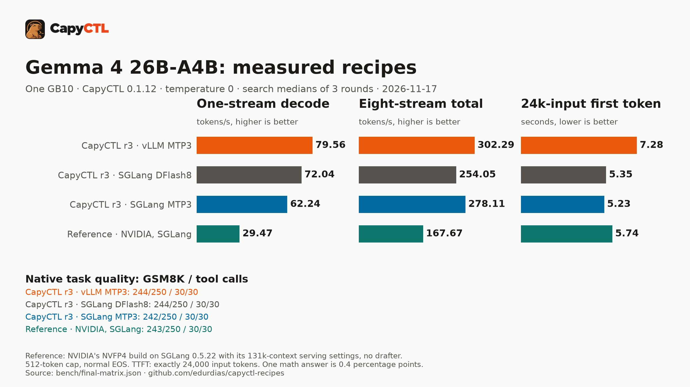

# Gemma 4 26B-A4B builds on one GB10: CapyCTL NVFP4 against the published ones

`capyctl/Gemma-4-26B-A4B-NVFP4` is the r3 checkpoint: searched NVFP4 routed experts,
FP8 dense MLP, attention and untied output head, made with
[`convert/`](../../vllm/gemma-4-26b-a4b-capyctl-nvfp4-gb10/convert/).
This comparison measures local serving through CapyCTL on one GB10, first without drafts,
then with Google assistant MTP, DFlash, DSpark and EAGLE3. The final results:

- **Leading vLLM recipe:** r3 with Google MTP depth 3, **79.56 tokens/s at 1 stream and
  302.29 at 8**, GSM8K **244/250**, tools **30/30**. NVIDIA's NVFP4 build on SGLang 0.5.22
  with its 131k-context serving settings, no drafter, measures **29.47 / 167.67**, **243/250 / 30/30**. The speed difference
  combines checkpoint, engine and drafting; one extra math answer does not establish
  an accuracy gain. The [vLLM recipe](../../vllm/gemma-4-26b-a4b-capyctl-nvfp4-gb10/)
  ships these settings.
- **SGLang alternative:** r3 with DFlash width 8, **72.04 / 254.05**, **244/250 / 30/30**,
  and lower 24k-input TTFT (**5.348 / 13.836 s at 1 / 4 streams**) than vLLM MTP3's
  **7.277 / 18.857 s**. The [SGLang recipe](../../sglang/gemma-4-26b-a4b-capyctl-nvfp4-gb10/)
  ships it. For more load, SGLang MTP depth 3 gives **278.11 at 8**, but **62.24 at 1**.
- **Without drafts:** r3 on vLLM gives **58.53 / 216.26**, against NVIDIA's **29.73 / 164.89**
  on that engine. r3 on SGLang gives **56.99 / 210.78**. vLLM is nominally ahead for decode;
  SGLang has lower long-input TTFT. There is no checkpoint-independent engine winner.
- **Closer to BF16:** on **62,658 reference next-token positions**, stored r3 agrees on
  **97.177%**, NVIDIA **97.132%**, Unsloth **96.018%**, RedHat **94.476%**. FP8 dense MLP
  and attention recover most of the all-NVFP4 layout's gap. This is a weights-only offline
  comparison, not native task accuracy or an engine qualification.
- **The output head matters:** r3 versus r3e (same body, tied BF16 head) on SGLang without
  drafts gives **56.99 versus 43.67 tokens/s** at 1 stream, with offline agreement
  **97.177% versus 97.191%**. The head/tie representation changes decode more than agreement.
- **Quality gates are not just scores:** DFlash width 4 scores **243/250 / 30/30**, but
  repeats a phrase through the output cap on one math answer and is rejected. Width 8
  has a separate passing native task and output-review gate. Historical exact-output
  failures are retained, not treated as final quality verdicts.



The chart uses the JSON below. It compares measured recipes, not a common-engine
checkpoint-only experiment. Missing cells are not zeros.

[`bench/final-matrix.json`](bench/final-matrix.json) is the numeric source;
[`bench/runs/`](bench/runs/) holds per-request results, rendered deployments and selected
native logs. The final measurement record is [`bench/final-matrix.json`](bench/final-matrix.json),
with underlying observations in [`bench/runs/`](bench/runs/). All requested final
measurements are complete; unmeasured controls are labeled as such.

## Setup

| | |
|---|---|
| Hardware | 1x NVIDIA GB10, compute capability 12.1, 128 GB unified memory, aarch64 |
| System | Kernel 6.17.0-1031-nvidia, NVIDIA driver 580.173.02, CUDA 13.0 |
| CapyCTL | 0.1.12 release, standalone; explicit `lmcache: off` |
| vLLM | 0.32.0, torch 2.13.0+cu130, flashinfer-python 0.7.0.post1, transformers 5.19.0; LMCache 0.5.6 installed but disabled |
| SGLang | 0.5.22, torch 2.14.1, flashinfer-python 0.7.1, transformers 5.19.0 |
| Source identity | Installed engine source commits unknown; package versions and inspected source hashes retained with the benchmark evidence |
| Benchmark | `measure.py` imports the repository's capyctl-bench helpers and fixed `tools/capyctl-bench/prompts.json`; no duplicate prompt corpus |
| Measured | 2026-11-16–17 |

One deployment at a time, TP1, 131,072-token context, 4,096-token prefill/batched-token
budget, Gemma4 reasoning/tool parsers, default graphs/request caps unless a row says
otherwise. SGLang uses `flashinfer_cutlass` MoE; vLLM's main path auto-selects
FLASHINFER_CUTLASS and TRITON_ATTN. The controlled memory grants are **80 GiB SGLang
request / 40 GiB vLLM KV cache**. They are neither minimum requirements nor equal KV
capacities. CapyCTL's managed limit is 100 GiB with 10 GiB free reserve. Parking is not
measured; deployments use `restart_only`. No environment packages or engine code are patched.

Both deployment files set `lmcache: off`. CapyCTL's automatic LMCache selection,
combined with a model path containing `@`, makes lookups time out
([issue #259](https://github.com/edurdias/capyctl/issues/259)).

### The checkpoints

| Checkpoint | Revision | Layout | Size, GB | Weight-read estimate, GB/token |
|---|---|---|---:|---:|
| CapyCTL r1 | Local build; manifest/shard hashes in build notes | NVFP4 experts, dense MLP and attention; tied BF16 head | 16.417 payload | 3.227 |
| CapyCTL r2 | Local searched-scale control | r1 layout, all NVFP4 block scales searched | 16.417 payload | 3.227 |
| **[CapyCTL r3](https://huggingface.co/capyctl/Gemma-4-26B-A4B-NVFP4)** | `241dbe0757d0fca815530e9216de6affb43565ff` | Searched NVFP4 experts; per-tensor FP8 dense MLP/attention/untied head | **17.875 payload** | **3.208** |
| CapyCTL r3e | Local tied-head control | r3 body; tied BF16 head | 17.137 payload | 3.947 |
| [NVIDIA NVFP4](https://huggingface.co/nvidia/Gemma-4-26B-A4B-NVFP4) | `a19cfe00be84568a6867111c9a68c9c44fdcffe6` | NVFP4 experts; BF16 dense MLP/attention/tied head | 18.782 payload | 5.592 |
| [RedHat NVFP4](https://huggingface.co/RedHatAI/gemma-4-26B-A4B-it-NVFP4) | `5557756b8dce33ac72f2bd702b11729fdba3b839` | Compressed-tensors NVFP4 experts/dense MLP/attention; tied BF16 head | 16.417 payload | 3.227 |
| [Unsloth NVFP4](https://huggingface.co/unsloth/gemma-4-26B-A4B-it-NVFP4) | `20df0542b1a86ce19f495ac2eca2c7c12bce82f9` | NVFP4 experts/dense MLP, per-channel FP8 attention; tied BF16 head | 16.910 safetensors files, including headers | 3.713 |
| [Google BF16 source](https://huggingface.co/google/gemma-4-26B-A4B-it) | `4d7ae4984b7db7de8f8457170b3f1a419ee76d52` | BF16, original tied head | 51.612 payload | 7.644 |

Sizes are decimal GB, not a memory reservation. r3's complete local directory is
17.924 GB; its safetensors files are 17.881 GB. Build sizes, formats and shard SHA-256s
are in the [conversion notes](../../vllm/gemma-4-26b-a4b-capyctl-nvfp4-gb10/convert/NOTES.md).
Unsloth's reported size is the pinned downloader's file total, not a tensor-payload figure.

**[INFERENCE] Weight-read arithmetic, not observed memory traffic:** one read of attention,
dense MLP, router and output head, plus eight of 128 experts in every layer. Include packed
weights and stored weight scales; exclude activation scales, other state, embedding lookup
rows, activations, KV traffic and cache/batch reuse. r1/r2/RedHat use the full-r2 payload
formula; Unsloth uses the matching D-channel layout formula; NVIDIA uses F. BF16 replaces
NVFP4 expert payload with 2,854,748,160 selected-expert bytes, giving 7,643,872,768 bytes
with the other families/head. The r3 estimate is 3,208,383,608 bytes. See
[the ablation byte tables](tensors/ablation/results/summary.md) and the conversion notes
for counts and omissions. This is not the dense-model assumption that every expert is read
each token, and it does not predict speed by itself.

**Arithmetic ceiling, not a benchmark:** at GB10's approximately 273 GB/s memory
bandwidth, dividing by the estimated bytes read per token gives roughly **85 tok/s**
for r3 and **49 tok/s** for NVIDIA. Measured vLLM no-draft decode is **58.5** and
**29.7 tok/s**, respectively. The estimate excludes KV and activation traffic,
kernel overhead and reuse; it is not an attainable-speed guarantee. The byte counts
come from the ablation above, not a memory-traffic profiler.

### Drafters

| Drafter | Revision | Safetensors file size |
|---|---|---:|
| [Google assistant](https://huggingface.co/google/gemma-4-26B-A4B-it-assistant) | `6e5aaaf4c42b98394530b8fda2e95cadd65c151c` | 0.839 GB |
| [makora DSpark](https://huggingface.co/makora-ai/gemma4-26b-a4b-dspark) | `e6f739231e892fe4512c470136490d5441ffe62f` | 2.412 GB |
| [RedHat EAGLE3](https://huggingface.co/RedHatAI/gemma-4-26B-A4B-it-speculator.eagle3) | `226b2692d48029aae52adc1d0021a9d58709d33c` | 1.856 GB |
| [z-lab DFlash](https://huggingface.co/z-lab/gemma-4-26B-A4B-it-DFlash) | `77d4202772dfe50b2396ec7bac9cfffc7b9e7057` | 0.859 GB |

## Method

- **Serving:** main matrix requests go through CapyCTL's inference endpoint. The separately
  labeled published-recipe pairs use native loopback launches. Explicit FP8 E4M3 KV and
  `lmcache: off` are the controlled main-matrix
  policy. Early r2 auto/BF16-KV measurements are historical controls, not mixed into the
  FP8 table. Native logs must confirm resolved KV dtype and cache policy.
- **Speed:** fixed eight capyctl-bench chat/code prompts, streaming chat completions,
  `temperature: 0`, normal EOS, source-template default thinking policy, up to 512 output
  tokens. One warm-up and three recorded rounds at 1, 2, 4 and 8 streams. c1 is median
  per-request decode after the first token; c2/c4/c8 are median aggregate completion
  tokens / round wall time. Different denominators explain c1 decode versus c1 aggregate.
- **Long input:** CPU tokenization prepares independent pseudo-English documents with
  exactly 24,000 complete chat-template input tokens, preserving the final request.
  Native usage must equal 24,000 on every request, at 1 and 4 streams, three rounds,
  up to 128 output tokens. The initial approximate-sizing failure is excluded, not
  repaired by widening the token-count tolerance.
- **Diagnostic guard:** eight fixed greedy prompts, seed 42, up to 256 output tokens at
  c1 and c8; plus three automatic weather-tool requests through the real Gemma4 parser.
  Draft reference must match engine, checkpoint, settings and environment. Exact
  reasoning/content/finish captures and first visible-token divergence are retained.
- **Why exact equality was replaced:** no-draft r3 c1 versus c8 differs 8/8 on both
  engines. SGLang same-shape repeats each match exactly; vLLM's fresh-process c1 repeat
  differs 8/8, median first divergence 25 visible tokens. The observed baseline varies,
  so exact wording cannot decide drafter quality. This does not prove speculative
  losslessness or identify the cause of vLLM's cross-process variation.
- **Decisive native quality gate:** the exact candidate's GSM8K rate must lie inside
  the same-engine/build/settings no-draft 95% Wilson interval; tools must equal its
  score; HTTP errors must be zero; case/helper/method hashes must match; outputs must
  pass explicit coherence/nonrepetition review. r3's no-draft 244/250 interval is
  94.864%–98.896% on both engines. Difference intervals are descriptive, not the gate.
  This finite-sample rule is not proof of equivalence. DFlash width 4 shows why output
  review remains a separate requirement.
- **Task sets:** unchanged Qwen helper, GSM8K's pinned 250-question test subset
  (SHA-256 `687da67051177239f32b9e9fe602a753edd241824a627d59008c879b7e0bed80`), c8,
  temperature zero, 2,048-token cap, final boxed number; 30 automatic tool cases,
  correct function, valid JSON and required arguments. Their SHA-256 is
  `f28cb41662cc3b68be694b61afcdd28ac4acf23cf3df988ad562311fdf1d8bfd`.
  Native accuracy uses the original helper's no-explicit-seed policy, not the diagnostic
  guard's seed 42. Truncations count as recorded failures, not excluded denominators.
- **Depth screening:** initial native task qualification admits a drafter-family sweep.
  Different depths/widths remain screening-only until an exact-setting task run passes.
  Native tasks at slower, unselected settings are deliberately skipped, not failed.
- **Acceptance:** median native periodic acceptance-length observations inside recorded
  speed spans, boundary interval excluded. These are not token-weighted whole-run means;
  vLLM MTP3 has only one c1 and three c8 observations. See each run's `acceptance.json`.
- **Readiness/memory:** new process, OS page caches and compiled kernels not cleared.
  `MemTotal - MemAvailable` sampled every 0.5 s during startup/serving, absolute peak
  and delta from prelaunch. Host-wide peaks are not model allocations or guaranteed
  sub-sample peaks. Startup is process-cold, not storage-cold.
- **Offline agreement:** the same 200 prompts, 40 each of chat, coding, math,
  multilingual and tool use. BF16 answers greedily with thinking disabled, up to 512
  tokens; all builds teacher-force the same 62,658 answer positions. Stored quantized
  weights are reconstructed into BF16, including the true head/tie representation,
  and evaluated with torch 2.13.0+cu130 / Transformers 5.14.1, SDPA and BF16 activations.
  The BF16 row is 100% by construction, not a self-consistency floor. No activation
  quantizer, FP8 KV or engine kernel is evaluated. See [`tensors/NOTES.md`](tensors/NOTES.md).

## Results

### Without drafts

Tokens/s; c2/c4/c8 are totals. — means not measured, not zero.

| Checkpoint, engine | 1 stream | 2 streams | 4 streams | 8 streams | 24k TTFT, 1 / 4 streams | GSM8K / tools |
|---|---:|---:|---:|---:|---|---|
| NVIDIA, SGLang 0.5.22 | 29.47 | 62.50 | 101.85 | 167.67 | 5.738 / 14.221 s | 243/250 / 30/30 |
| NVIDIA, vLLM 0.32.0 | 29.73 | 62.85 | 104.02 | 164.89 | 7.129 / 17.779 s | 244/250 / 30/30 |
| r2, SGLang 0.5.22 | 50.17 | 86.11 | 135.06 | 214.01 | 5.204 / 12.847 s | 243/250 / 30/30 |
| r2, vLLM 0.32.0 | 48.44 | — | — | 214.74 | 6.419 / 15.931 s | — / — |
| Unsloth, vLLM 0.32.0 | 45.74 | 84.02 | 128.98 | 202.29 | 6.602 / 16.463 s | 244/250 / 30/30 |
| r3e, SGLang 0.5.22 | 43.67 | — | — | 194.87 | 5.432 / 13.476 s | — / — |
| r3, SGLang 0.5.22 | 56.99 | 88.98 | 136.48 | 210.78 | 5.414 / 13.402 s | 244/250 / 30/30 |
| r3, vLLM 0.32.0 | 58.53 | 94.67 | 144.05 | 216.26 | 6.540 / 16.373 s | 244/250 / 30/30 |

The missing controlled-FP8 c2/c4 r2-vLLM cells do not borrow the older auto/BF16-KV run.
No native speed row exists for r1 or BF16. RedHat vLLM no-draft gives
50.12 / 90.04 / 138.43 / 207.80 tok/s and 6.449 / 16.082 s TTFT;
its SGLang task run scores 244/250 and 30/30. BF16 below is an offline reference.

### Drafters on vLLM 0.32.0

All rows use r3. MTP is the Google assistant; depth counts repeated assistant steps.
DSpark counts proposals; EAGLE3 counts depth. The selected recipe is MTP depth 3.

| Drafter: depth or width | 1 stream | 2 streams | 4 streams | 8 streams | 24k TTFT, 1 / 4 streams | Acceptance, 1 / 8 | GSM8K / tools; verdict |
|---|---:|---:|---:|---:|---|---|---|
| MTP 1 | 71.75 | 123.03 | 180.29 | 276.29 | 7.237 / 18.547 s | 1.780 / 1.800 | 242/250 / 30/30; passed exact setting; one cut |
| MTP 2 | 75.47 | 132.38 | 195.39 | 299.78 | 7.271 / 18.681 s | 2.200 / 2.400 | — / —; screening only; tasks not run |
| MTP 3 | 79.56 | 134.02 | 184.94 | 302.29 | 7.277 / 18.857 s | 2.680 / 2.760 | 244/250 / 30/30; passed exact setting |
| MTP 4 | 70.58 | 129.75 | 180.07 | 293.20 | 7.278 / 18.829 s | 2.850 / 3.130 | — / —; screening only; tasks not run |
| DSpark 6 | 74.66 | 129.28 | 167.38 | 261.01 | 6.568 / 16.595 s | not recorded | 242/250 / 30/30; passed exact setting |
| EAGLE3 1 | 71.79 | 118.57 | 173.75 | 264.30 | 6.723 / 16.780 s | not recorded | 244/250 / 30/30; passed exact setting |
| EAGLE3 2 | 72.49 | 120.20 | 177.24 | 282.56 | 6.710 / 16.934 s | not recorded | — / —; screening only; tasks not run |
| EAGLE3 3 | 69.54 | 114.40 | 170.59 | 272.58 | 6.661 / 16.765 s | not recorded | — / —; screening only; tasks not run |
| EAGLE3 4 | 67.30 | 113.79 | 155.30 | 267.00 | 6.723 / 16.926 s | not recorded | — / —; screening only; tasks not run |
| DSpark 1 | 62.62 | 109.94 | 160.73 | 248.01 | 6.592 / 16.596 s | not recorded | — / —; screening only; tasks not run |
| DSpark 2 | 71.57 | 130.33 | 174.99 | 270.36 | 6.611 / 16.602 s | not recorded | — / —; screening only; tasks not run |
| DSpark 4 | 70.05 | 126.63 | 165.21 | 260.25 | 6.562 / 16.559 s | not recorded | — / —; screening only; tasks not run |

MTP3 leads c1 and nominal c8; its c8 margin over MTP2 is small (302.29 versus 299.78,
three rounds). EAGLE3 depth 2 and DSpark width 2 lead their families' c8, but neither
beats MTP3. Their unselected depths have no inferred task approval. Stock Gemma DFlash
on vLLM is outside the pinned drafter card's unpatched support contract and was not run.

### Drafters on SGLang 0.5.22

MTP uses NEXTN, resolved to FROZEN_KV_MTP, top-k 1, draft tokens = steps + 1 and an
unquantized assistant. DFlash is unquantized, with Triton target/draft attention.
The shipped recipe is DFlash width 8; MTP3 is the higher-load alternative.

| Drafter: depth or width | 1 stream | 2 streams | 4 streams | 8 streams | 24k TTFT, 1 / 4 streams | Acceptance, 1 / 8 | GSM8K / tools; verdict |
|---|---:|---:|---:|---:|---|---|---|
| MTP 1 | 64.55 | 105.47 | 155.69 | 231.80 | 5.127 / 13.478 s | 1.810 / 1.795 | 244/250 / 30/30; passed exact setting |
| MTP 2 | 68.71 | 118.50 | 169.18 | 258.91 | 5.135 / 13.541 s | 2.260 / 2.410 | 243/250 / 30/30; passed exact setting |
| MTP 3 | 62.24 | 125.72 | 170.40 | 278.11 | 5.227 / 13.760 s | 2.525 / 2.890 | 242/250 / 30/30; passed exact setting |
| MTP 4 | 64.88 | 117.32 | 169.56 | 251.00 | 5.225 / 13.719 s | 2.940 / 3.160 | — / —; screening only; tasks not run |
| DFlash 4 | 68.14 | 126.07 | 165.07 | 258.65 | 5.234 / 13.765 s | 2.310 / 2.570 | 243/250 / 30/30; rejected: repetitive collapse; one cut |
| DFlash 8 | 72.04 | 118.65 | 161.20 | 254.05 | 5.348 / 13.836 s | 2.510 / 2.930 | 244/250 / 30/30; passed exact setting |
| DFlash 12 | 64.33 | 118.68 | 155.83 | 251.97 | 5.185 / 13.620 s | 2.560 / 2.985 | — / —; screening only; tasks not run |
| DFlash 16 | 68.65 | 113.78 | 153.50 | 236.65 | 5.242 / 13.834 s | 2.585 / 2.930 | 244/250 / 30/30; passed exact setting |
| EAGLE3 wrapper 1 | 49.26 | 80.02 | 120.58 | 177.57 | 5.457 / 13.776 s | not recorded | 243/250 / 30/30; passed exact setting |
| DSpark wrapper 6 | — | — | — | — | — / — s | not reached | — / —; native tensor-loader failure |
| EAGLE3 wrapper 2 | 46.30 | 75.19 | 109.66 | 169.00 | 5.525 / 13.897 s | not recorded | — / —; screening only; tasks not run |
| EAGLE3 wrapper 3 | 41.88 | 69.56 | 99.85 | 158.62 | 5.486 / 13.847 s | not recorded | — / —; screening only; tasks not run |
| EAGLE3 wrapper 4 | 36.64 | 62.96 | 94.21 | 147.05 | 5.551 / 14.053 s | not recorded | — / —; screening only; tasks not run |

DFlash8 leads qualified SGLang c1 at 72.04; MTP3 leads c8 at 278.11. Their geometric
means across c1 decode and c8 aggregate are 135.28 and 131.57 respectively: an arithmetic
selection score, not measured throughput at another concurrency. DFlash4's score gate
passes, but GSM8K index 93 repeats “let's use 36.36” through the cap. It is **rejected**.

The RedHat EAGLE3 speculators snapshot needs the metadata-only wrapper recorded in
[`bench/eagle3-wrapper-provenance.json`](bench/eagle3-wrapper-provenance.json): native
config, unchanged pinned weight files hardlinked rather than external symlinks. Depth 1
passes tasks but is slower than no drafts; deeper settings are slower still. DSpark's
metadata wrapper reaches a native Markov-vocabulary tensor mismatch, `[32000,256]`
versus `[262144,256]`; other widths cannot repair that loader contract. It has no speed
or task score on SGLang, not a failed quality score. No engine/tensor patch is applied.

### The recipes compared

| Recipe | 1 stream | 8 streams | 24k TTFT, 1 / 4 streams | GSM8K | Tools |
|---|---:|---:|---|---|---|
| **r3, vLLM MTP3** | **79.56** | **302.29** | 7.277 / 18.857 s | 244/250 | 30/30 |
| r3, SGLang DFlash8 | 72.04 | 254.05 | 5.348 / 13.836 s | 244/250 | 30/30 |
| r3, SGLang MTP3, load alternative | 62.24 | 278.11 | 5.227 / 13.760 s | 242/250 | 30/30 |
| Reference · NVIDIA, SGLang | 29.47 | 167.67 | 5.738 / 14.221 s | 243/250 | 30/30 |

vLLM MTP3 is about 170% faster at c1 and 80% at c8 than the reference.
That combines checkpoint, engine and drafting, not a same-recipe quantization gain.
Lower TTFT on SGLang can outweigh faster vLLM decode for long inputs and short outputs.

### Every recipe against the reference

The reference uses the settings described above.
Every row ran the same harness and prompts; changes are
against the reference, and ▼ marks a loss. [`recipe-table.py`](recipe-table.py) prints
these tables from the run files.

**Throughput, total tokens/s** (completion tokens / round wall time, median of three
rounds; the 1-stream column therefore differs slightly from per-request decode above):

| Recipe | 1 stream | 2 streams | 4 streams | 8 streams |
|---|---:|---:|---:|---:|
| Reference · NVIDIA, SGLang | 29.5 | 62.5 | 101.8 | 167.7 |
| NVIDIA, vLLM, no drafter | 29.7 (+1%) | 62.8 (+1%) | 104.0 (+2%) | 164.9 (-2% ▼) |
| NVIDIA, vLLM, MTP 3 | 56.0 (+90%) | 109.7 (+76%) | 158.9 (+56%) | 257.8 (+54%) |
| RedHat NVFP4, vLLM, no drafter | 49.9 (+69%) | 90.0 (+44%) | 138.4 (+36%) | 207.8 (+24%) |
| RedHat NVFP4, vLLM, MTP 3 | 66.9 (+127%) | 123.5 (+98%) | 183.4 (+80%) | 293.4 (+75%) |
| Unsloth NVFP4, vLLM, no drafter | 45.6 (+55%) | 84.0 (+34%) | 129.0 (+27%) | 202.3 (+21%) |
| Unsloth NVFP4, vLLM, MTP 3 | 69.6 (+136%) | 129.0 (+106%) | 178.9 (+76%) | 289.8 (+73%) |
| CapyCTL r2, SGLang, no drafter | 50.0 (+70%) | 86.1 (+38%) | 135.1 (+33%) | 214.0 (+28%) |
| CapyCTL r2, vLLM, MTP 3 | 72.4 (+146%) | 125.2 (+100%) | 180.7 (+77%) | 300.7 (+79%) |
| CapyCTL r3, SGLang, no drafter | 56.9 (+93%) | 89.0 (+42%) | 136.5 (+34%) | 210.8 (+26%) |
| CapyCTL r3, vLLM, no drafter | 58.3 (+98%) | 94.7 (+51%) | 144.1 (+41%) | 216.3 (+29%) |
| CapyCTL r3, SGLang, MTP 2 | 68.4 (+132%) | 118.5 (+90%) | 169.2 (+66%) | 258.9 (+54%) |
| CapyCTL r3, SGLang, MTP 3 | 62.0 (+110%) | 125.7 (+101%) | 170.4 (+67%) | 278.1 (+66%) |
| **CapyCTL r3, SGLang, DFlash 8 (shipped)** | 71.4 (+142%) | 118.6 (+90%) | 161.2 (+58%) | 254.1 (+52%) |
| **CapyCTL r3, vLLM, MTP 3 (shipped)** | 78.9 (+168%) | 134.0 (+114%) | 184.9 (+82%) | 302.3 (+80%) |

**Time to first token** (median over every request of those rounds; prompts of about 50
tokens), and the separate exactly-24,000-token runs. Lower is better:

| Recipe | 1 stream | 2 streams | 4 streams | 8 streams | 24k input, 1 stream | 24k input, 4 streams |
|---|---:|---:|---:|---:|---:|---:|
| Reference · NVIDIA, SGLang | 46 ms | 74 ms | 79 ms | 90 ms | 5.74 s | 14.22 s |
| NVIDIA, vLLM, no drafter | 68 ms (+47% ▼) | 81 ms (+9% ▼) | 129 ms (+63% ▼) | 170 ms (+88% ▼) | 7.13 s (+24% ▼) | 17.78 s (+25% ▼) |
| NVIDIA, vLLM, MTP 3 | 113 ms (+147% ▼) | 126 ms (+70% ▼) | 134 ms (+70% ▼) | 191 ms (+111% ▼) | 7.98 s (+39% ▼) | 20.44 s (+44% ▼) |
| RedHat NVFP4, vLLM, no drafter | 57 ms (+24% ▼) | 64 ms (-14%) | 102 ms (+29% ▼) | 123 ms (+37% ▼) | 6.45 s (+12% ▼) | 16.08 s (+13% ▼) |
| RedHat NVFP4, vLLM, MTP 3 | 95 ms (+108% ▼) | 100 ms (+35% ▼) | 113 ms (+43% ▼) | 126 ms (+39% ▼) | 7.36 s (+28% ▼) | 18.94 s (+33% ▼) |
| Unsloth NVFP4, vLLM, no drafter | 56 ms (+23% ▼) | 64 ms (-14%) | 115 ms (+46% ▼) | 140 ms (+55% ▼) | 6.60 s (+15% ▼) | 16.46 s (+16% ▼) |
| Unsloth NVFP4, vLLM, MTP 3 | 96 ms (+110% ▼) | 105 ms (+42% ▼) | 118 ms (+50% ▼) | 190 ms (+111% ▼) | 7.52 s (+31% ▼) | 19.39 s (+36% ▼) |
| CapyCTL r2, SGLang, no drafter | 46 ms (-1%) | 76 ms (+3% ▼) | 81 ms (+2% ▼) | 82 ms (-9%) | 5.20 s (-9%) | 12.85 s (-10%) |
| CapyCTL r2, vLLM, MTP 3 | 93 ms (+102% ▼) | 98 ms (+32% ▼) | 111 ms (+40% ▼) | 185 ms (+105% ▼) | 7.30 s (+27% ▼) | 18.84 s (+32% ▼) |
| CapyCTL r3, SGLang, no drafter | 39 ms (-14%) | 67 ms (-10%) | 74 ms (-6%) | 94 ms (+4% ▼) | 5.41 s (-6%) | 13.40 s (-6%) |
| CapyCTL r3, vLLM, no drafter | 52 ms (+13% ▼) | 66 ms (-11%) | 104 ms (+32% ▼) | 159 ms (+76% ▼) | 6.54 s (+14% ▼) | 16.37 s (+15% ▼) |
| CapyCTL r3, SGLang, MTP 2 | 50 ms (+10% ▼) | 84 ms (+13% ▼) | 80 ms (+1% ▼) | 90 ms (=) | 5.13 s (-11%) | 13.54 s (-5%) |
| CapyCTL r3, SGLang, MTP 3 | 50 ms (+8% ▼) | 81 ms (+9% ▼) | 86 ms (+9% ▼) | 102 ms (+13% ▼) | 5.23 s (-9%) | 13.76 s (-3%) |
| **CapyCTL r3, SGLang, DFlash 8 (shipped)** | 77 ms (+67% ▼) | 84 ms (+13% ▼) | 87 ms (+10% ▼) | 101 ms (+12% ▼) | 5.35 s (-7%) | 13.84 s (-3%) |
| **CapyCTL r3, vLLM, MTP 3 (shipped)** | 67 ms (+45% ▼) | 98 ms (+31% ▼) | 113 ms (+43% ▼) | 170 ms (+88% ▼) | 7.28 s (+27% ▼) | 18.86 s (+33% ▼) |

Throughput gains carry a cost in time to first token on vLLM: on short prompts it stays
under 200 ms everywhere, but a 24,000-token prompt waits about 1.5 s longer for its first
token than on SGLang. Other publishers' recipes ran on their own workloads and are compared
separately below.

### Public checkpoints under the same recipe

The requested common recipe is vLLM 0.32.0 + Google assistant MTP depth 3, with the same
131k context, 4,096 batched tokens, explicit FP8 E4M3 KV and cache-off policy. Do not
substitute the no-draft controls or reference numbers for these cells.

| Checkpoint | 1 stream | 8 streams | GSM8K / tools |
|---|---|---|---|
| r3 | 79.56 | 302.29 | 244/250 / 30/30 |
| NVIDIA | 56.66 | 257.75 | not measured / not measured |
| RedHat | 67.68 | 293.44 | not measured / not measured |
| Unsloth | 70.54 | 289.85 | not measured / not measured |
| r2 | 73.28 | 300.74 | not measured / not measured |

Native no-draft cross-build accuracy on SGLang: NVIDIA and r2 each score 243/250 and
30/30; r3 scores 244/250 and 30/30. Unsloth does not load on SGLang 0.5.22: its
compressed-tensors loader has no matching target for
`model.vision_tower.encoder.layers.0.mlp.gate_up_proj`. This is a native loader limitation,
not a task-quality failure. Unsloth and NVIDIA each score **244/250 and 30/30**
without drafts on vLLM. The four public MTP3 rows are speed screenings, not native
task qualifications. r3e has no GSM8K/tool qualification. One answer out of 250 is
0.4 percentage points, so these samples do not establish small accuracy differences.

### Other publishers' recipes, reproduced locally

These matched pairs change the target checkpoint, not the workload or recipe flags.
They use native vLLM 0.32.0 outside CapyCTL because the published utilization-based
memory policy is not equivalent to CapyCTL's explicit unified-memory KV grant.
They are separate from the common 131k recipe above. Sources are
`official_workload_runs`, `dspark_source_runs` and `published_recipe_comparison` in
[`bench/final-matrix.json`](bench/final-matrix.json), with exact outputs under `bench/runs/`.

**NVIDIA's official coding recipe:** NVIDIA **81.46 ± 7.63 tok/s**, r3
**98.79 ± 7.85** (mean ± population SD, ten requests after three warmups).
Both use the same pinned SPEED-Bench coding reconstruction, MTP4, 262144 context,
4096 batched tokens, eight maximum sequences, utilization 0.8 and InstantTensor.
Auto KV resolves to FP8 E4M3. This is a like-for-like **21.3%** decode increase.
The paired quality controls show no accuracy difference: each build scores
244/250 GSM8K and 30/30 tools on vLLM without drafts. No coding-correctness score
was collected for this timing workload, so that is not an accuracy claim about these
ten completions. NVIDIA publishes 78.10 with a development build and AIPerf;
the original row selection, sampling and dataset revision are not published.
The pinned first thirteen coding rows and the streaming client make this reconstruction
repeatable, not an exact reconstruction of the original 78.10.

**DSpark repository workload:** same code/essay/chat prompts and caps 700/700/300,
thinking off, three serial measurements per probe; c8 uses essay cap 700.
Shared decode is `(tokens − 1)/(last text − first text)`.
The publisher's formula is `tokens/(stream close − first SSE choices)`.

| Target / drafter | Shared code / essay / chat tok/s | Publisher-formula code / essay / chat tok/s | c8 tokens / wall second |
|---|---|---|---:|
| RedHat / MTP3 | 92.42 / 65.73 / 78.21 | 92.51 / 65.81 / 78.67 | 335.90 |
| r3 / MTP3 | 95.87 / 69.26 / 81.92 | 95.94 / 69.34 / 82.39 | 347.08 |
| RedHat / DSpark7 | 159.81 / 61.83 / 88.48 | 158.77 / 61.50 / 88.32 | 280.82 |
| r3 / DSpark7 | 159.43 / 59.25 / 95.23 | 157.80 / 58.83 / 94.82 | 277.19 |

The source uses a vLLM 0.26.1 development build, not this 0.32.0 environment.
Its committed c8 ladder's drafter provenance is unresolved; its 293.2 is not
assigned to both drafters as if that were known. The large code result is not a
general prose speed: r3 DSpark7 is 159.43 for code but 59.25 for essay.

**ai-muninn flags:** context 4096, MTP4, KV FP8, utilization 0.85 and no
image/audio/video inputs. Same mixed prompts, temperature zero, 512 output cap.

| Target | c1 median decode | c8 tokens / wall second | c8 mean request decode × 8 | Exact prime prompt, mean ± population SD |
|---|---:|---:|---:|---|
| RedHat FP8 | 56.26 | 207.47 | 260.98 | 71.42 ± 0.15 |
| r3 | 69.84 | 290.05 | 369.25 | 88.67 ± 3.21 |

Neither **108.78** nor **674.28** is reproduced. The historical preview used a
patched MTP implementation; this uses unpatched 0.32.0. Its “aggregate” sums request
speeds, not tokens divided by common wall time. Even that estimator is only 260.98
for the matched FP8 run. The exact prime prompt produces 183 tokens with FP8,
not the article's quoted 54-token answer; prompt/output shape and acceptance differ.
These are workload/runtime differences, not evidence that the historical result is false.

### Publishers' own numbers — not local replications

These claims belong to their cited publishers. They are not rows in the local ranking.
NR means not reported. The local replication evidence and source pins are recorded
in [`bench/runs/`](bench/runs/) and [`bench/final-matrix.json`](bench/final-matrix.json); other survey entries below link directly
to the publisher and retain their distinct hardware, metrics and limitations.

| Publisher / source | Published result | Comparability |
|---|---|---|
| [NVIDIA official 128-GB recipe](https://github.com/NVIDIA/local-ai-inference-recipes/tree/main/models/google/gemma-4-26b-a4b/dgx-spark/linux/vllm/128gb) | 78.10 mean decode tok/s; GB10, MTP4, 8192 output budget | Same hardware class/metric; coding workload and development runtime differ. Local matched pair above. |
| [NVIDIA 64-GB recipe](https://github.com/NVIDIA/local-ai-inference-recipes/tree/main/models/google/gemma-4-26b-a4b/dgx-spark/linux/vllm/64gb) | 82.9 decode tok/s | Different memory, OS and harness configuration. |
| [NVIDIA checkpoint card](https://huggingface.co/nvidia/Gemma-4-26B-A4B-NVFP4) | MMLU-Pro 84.80%, paired BF16 85.00% | B200/vLLM sampled task evaluation; not GB10 speed or this quality corpus. |
| [Unsloth NVFP4](https://unsloth.ai/docs/basics/nvfp4) | 13,029 vs BF16 9,216 tok/s, 1.41× | B200, concurrency 128; not GB10 single-stream decode. |
| [Unsloth GGUF MTP](https://huggingface.co/unsloth/gemma-4-26B-A4B-it-GGUF/blob/main/MTP/README.md) | 159 → 257 tok/s; acceptance 0.72 | B200, llama.cpp, UD-Q4_K_M; workload/depth incompletely reported. |
| [Unsloth QAT fidelity](https://unsloth.ai/docs/models/gemma-4/qat#qat-analysis) | Mean KLD 0.09788; top-1 85.63% | Different QAT GGUF reference and positions; not comparable with 97.177% agreement. |
| [RedHat NVFP4](https://huggingface.co/RedHatAI/gemma-4-26B-A4B-it-NVFP4) / [FP8](https://huggingface.co/RedHatAI/gemma-4-26B-A4B-it-FP8-dynamic) | GSM8K Platinum off/on: 94.43/95.31% NVFP4, 95.37/95.64% FP8 | Different corpus/protocol, long output caps, concurrency 32; hardware NR. No speed claim in these cards. |
| [Google reference](https://gemma.ai/models/gemma-4/model-card/) | MMLU-Pro 82.6%, GPQA 82.3%, MRCR v2 8-needle 128k 44.1% | Original-model capabilities, not quant-specific evaluations. |
| [Google MTP](https://blog.google/innovation-and-ai/technology/developers-tools/multi-token-prediction-gemma-4/) | 26B up to 1.5× | A100, batch 1, depth 4; not the family-wide 3× headline or GB10 speed. |
| [SGLang cookbook](https://docs.sglang.io/cookbook/autoregressive/Google/Gemma4) | H200 c1 168.81, c100 3675.81 output tok/s | Different GPU and original checkpoint; old raw-completion GSM8K is not this chat test. |
| [bg-digitalservices](https://huggingface.co/bg-digitalservices/Gemma-4-26B-A4B-it-NVFP4) | BF16 23.3 → NVFP4 48.2 tok/s | GB10, 1000-token generations; timing details incomplete. |
| [ai-muninn](https://ai-muninn.com/en/blog/dgx-spark-gemma4-mtp-108-toks) | 108.78 single, 674.28 “aggregate” | GB10 FP8 MTP4 preview; aggregate estimator differs. Matched flags above do not reproduce either. |
| [DSpark repository](https://github.com/EmanueleMeazzo/gemma-4-dgx-spark-vllm) | RedHat MTP3 code/essay/chat 98.18/68.26/80.91; DSpark7 159.18/65.86/93.26; c8 293.2 | GB10; different prompts, caps and runtime. c8 drafter provenance unresolved. |

Unsloth's ordinary NVFP4/GGUF cards repeat Google's original capability table;
that table is not a quantized-checkpoint evaluation. Historical vLLM guidance has
no numerical 26B speed claim; the official ggml Spark table has no matching Gemma 4
26B row. None of these external quality protocols substitutes for local task gates.

### Long-context retrieval and copy fidelity

**Use vLLM MTP3 for the general recipe, not DFlash8 at long contexts.**
This is a serving recommendation, not a reliable-retrieval guarantee.
Primary retrieval requires all three exact codes, in any order. Ordered exact is
secondary. Each cell uses six deterministic documents, one serial request per variant,
temperature zero, thinking off, 256 output cap and confirmed FP8 KV. Columns show
original / one-line; the latter adds 14 tokens to the stated input length.

| Configuration | Input | All three, any order (primary) | Expected codes found | Ordered exact (secondary) |
|---|---:|---|---|---|
| NVIDIA, SGLang, no drafts | 32000 | 6/6 / 6/6 | 18/18 / 18/18 | 3/6 / 3/6 |
| NVIDIA, SGLang, no drafts | 64000 | 5/6 / 5/6 | 17/18 / 17/18 | 3/6 / 4/6 |
| NVIDIA, SGLang, no drafts | 96000 | 5/6 / 4/6 | 17/18 / 16/18 | 3/6 / 3/6 |
| NVIDIA, SGLang, no drafts | 111000 | 2/6 / 2/6 | 14/18 / 14/18 | 1/6 / 2/6 |
| r3, vLLM MTP3 | 32000 | 5/6 / 5/6 | 17/18 / 17/18 | 4/6 / 2/6 |
| r3, vLLM MTP3 | 64000 | 6/6 / 4/6 | 18/18 / 16/18 | 3/6 / 3/6 |
| r3, vLLM MTP3 | 96000 | 5/6 / 4/6 | 17/18 / 16/18 | 3/6 / 3/6 |
| r3, vLLM MTP3 | 111000 | 4/6 / 3/6 | 16/18 / 14/18 | 2/6 / 3/6 |
| r3, SGLang DFlash8 | 32000 | 6/6 / 5/6 | 18/18 / 17/18 | 5/6 / 3/6 |
| r3, SGLang DFlash8 | 64000 | 4/6 / 4/6 | 16/18 / 16/18 | 4/6 / 4/6 |
| r3, SGLang DFlash8 | 96000 | 2/6 / 1/6 | 14/18 / 11/18 | 1/6 / 1/6 |
| r3, SGLang DFlash8 | 111000 | 1/6 / 0/6 | 13/18 / 9/18 | 0/6 / 0/6 |

The reference passes
all six at 32k under both variants. Neither shipped drafter recipe passes every
document under both variants at any tested length. Ordering failures are separate
from missing-code retrieval; a dropped hex digit is an exact-copy error.
No robust lower limit below 32k was measured.

At 96k, r3 SGLang without DFlash retrieves **3/6 / 4/6**, versus DFlash8
**2/6 / 1/6**; ordered exact is **2/6 / 1/6** without drafts. Removing the
drafter improves this draw but does not pass all documents or isolate a drafter defect.

Long-input router decode medians also fall with DFlash8: **20.67 / 15.56 tok/s**
at **96k / 111k**, versus SGLang r3 without drafts **38.74 / 37.24**.
Use the vLLM recipe for all contexts, or SGLang without its drafter for long inputs.
These retrieval-fixture timings are not the short-prompt speed corpus.

The expanded **twelve-document, 111k** no-draft SGLang test gives NVIDIA
**8/12 / 6/12** any-order retrieval, r3 and r3e each **6/12 / 4/12**.
Ordered exact is **4/12 / 4/12**, **4/12 / 2/12**, **4/12 / 2/12**, respectively.
Against NVIDIA, both r3 and r3e have **0 wins / 4 losses / 8 ties**, exact two-sided
paired sign-test **p=0.125**, using documents rather than variants as independent units.
This does not establish equivalence. r3e matches r3 on every document/variant:
the tied BF16 head does not repair the result. The shared FP8 attention/dense-MLP
body, rather than the head, remains the layout difference implicated by this control;
the experiment does not isolate attention from MLP or establish a sole cause.
See [`bench/retrieval-twelve-paired.json`](bench/retrieval-twelve-paired.json) and
[`bench/retrieval-primary-rescoring.json`](bench/retrieval-primary-rescoring.json).

**Short copy-100:** 100 identical seeded 2000-token documents, one uppercase
16-hex-digit code each, serial temperature-zero requests, thinking off, 64 output cap.
Strict success requires the entire stripped answer to equal the code.

| vLLM configuration | Exact copy | 95% Wilson interval |
|---|---|---|
| r3 + MTP3 | 100/100 | 96.30–100% |
| r3, no drafts | 100/100 | 96.30–100% |
| NVIDIA, no drafts | 100/100 | 96.30–100% |
| r3e + MTP3 | 100/100 | 96.30–100% |
| NVIDIA + MTP3 | 99/100 | 94.55–99.82% |

NVIDIA MTP3 drops one digit; this is not just formatting. All five have zero HTTP
errors and correct prompt counts. These finite samples neither prove perfect copying
nor a significant checkpoint/drafter difference; short one-code copying is not
long multi-record retrieval. Full answers and intervals are in the five
`bench/runs/*copy100*/measure.json` files and the final matrix.

### Acceptance gates for the shipped recipes

| Gate | vLLM MTP3 | SGLang DFlash8 |
|---|---|---|
| Reasoning parser / correct final answer | Pass at 8192; final 157 | Parser passes; 2048 cap exhausted, 8192 not measured |
| Tool call → random tool result → final answer | Pass | Pass |
| Vision, red square left / blue circle right | Pass | Pass |
| Cold 111k retrieval | Fail, 2/3 codes | Pass on that one document |
| Broader retrieval | No jointly passing six-document length | No jointly passing six-document length |

Both initial 2048-token reasoning probes exhausted their cap; vLLM's 8192 rerun
passes. SGLang has no larger-budget result. The single cold SGLang pass is not
substituted for the fixed-corpus results above. Evidence:
`bench/runs/{vl,sg}-r3-shipped-gates-*/` and the reasoning reruns recorded in
`long_context_retrieval` / diagnostic runs in the final matrix.

### Closer to BF16: agreement and family ablation

All stored builds use the same 62,658 answer positions, reference hash
`ac75c312aa1342efc482bbc1db2e772d3a7eb6f344a049692850c1522a96ee3c`.
Agreement is pooled by token, not averaged by prompt. First disagreement is a zero-based
answer-token position, censored at answer length when no token differs.

| Build | Agreement | Median first disagreement | Chat | Coding | Math | Multilingual | Tool use |
|---|---:|---:|---:|---:|---:|---:|---:|
| BF16, by construction | 100.000% | — | 100% | 100% | 100% | 100% | 100% |
| r1 | 94.515% | 19 | 92.274% | 95.453% | 98.381% | 92.778% | 99.801% |
| r2 | 94.805% | 20.5 | 92.817% | 95.771% | 98.207% | 93.084% | 99.734% |
| **r3** | **97.177%** | 28 | 96.122% | 97.742% | 99.180% | 96.052% | 99.934% |
| r3e | 97.191% | 30 | 96.104% | 97.819% | 99.160% | 96.045% | 99.934% |
| NVIDIA | 97.132% | 30 | 96.075% | 97.701% | 99.201% | 95.952% | 100.000% |
| RedHat | 94.476% | 19 | 92.297% | 95.489% | 98.299% | 92.598% | 99.801% |
| Unsloth | 96.018% | 22.5 | 94.384% | 96.900% | 98.903% | 94.451% | 99.867% |

r1 to r2 isolates searched scales at the same coverage: +0.290 percentage points,
not every category improves. The mixed stored r3/r3e recover more. Public builds differ
in other details too; their ordering alone does not isolate causation.

The controlled ablations below keep r2 experts except F. They are reconstructed BF16
executions and simulated FP8 weights, not exported/engine-qualified recipes. G uses a
per-channel FP8 head; stored r3 deliberately uses a shared-engine per-tensor format.

| Variant | Dense MLP | Attention | Output head | Agreement | Weight-read estimate, GB/token |
|---|---|---|---|---:|---:|
| A, r2 experts | BF16 | BF16 | Tied BF16 | 97.397% | 5.592 |
| B | NVFP4 | BF16 | Tied BF16 | 96.455% | 4.823 |
| C | BF16 | NVFP4 | Tied BF16 | 95.512% | 3.996 |
| D | NVFP4 | Per-tensor FP8 | Tied BF16 | 96.344% | 3.712 |
| D-channel | NVFP4 | Per-channel FP8 | Tied BF16 | 96.393% | 3.713 |
| E | Per-tensor FP8 | Per-tensor FP8 | Tied BF16 | 97.151% | 3.947 |
| G | Per-tensor FP8 | Per-tensor FP8 | Separate per-channel FP8 | 97.134% | 3.209 |
| H | Per-tensor FP8 | Per-tensor FP8 | Separate searched NVFP4 | 96.861% | 2.885 |
| I | BF16 | BF16 | Separate per-channel FP8 | 97.355% | 4.854 |
| F, NVIDIA experts | BF16 | BF16 | Tied BF16 | 97.132% | 5.592 |
| Full r2 | NVFP4 | NVFP4 | Tied BF16 | 94.805% | 3.227 |

**[INFERENCE]** Byte columns are packed-format arithmetic, not measured traffic or the
actual BF16 traffic of the offline evaluation. G/I include FP32 channel-scale storage
used by compatible engine loaders. The [full table](tensors/ablation/results/summary.md)
retains raw scale-payload differences and category results.

A to B costs 0.942 points for dense MLP NVFP4; A to C costs 1.885 for attention NVFP4.
E retains most agreement with both FP8 (97.151% versus A's 97.397%). Relative to E,
G's FP8 head costs 0.017 points, H's NVFP4 head 0.290. Stored r3 is 97.177%, not G's
simulation. Its format has its own offline score and native task checks.

**Runtime head control:** r3/r3e body shards 1–3 are byte-identical. On the same SGLang
no-draft base, r3's untied FP8 head yields 56.99 / 210.78 tokens/s versus r3e's
43.67 / 194.87, with nearly unchanged 24k TTFT (5.414 / 13.402 versus 5.432 / 13.476 s).
This supports use of the faster head path, not just a config declaration; kernels and
head/tie representation both differ. vLLM separately logs an FP8 kernel for `ParallelLMHead`,
attention and dense MLP. SGLang logs mixed loading/FP8 GEMM, not individual head methods.

### Memory and starts

Process-cold starts; compiled kernels and page caches not cleared. Decimal GB, not GiB.
Peaks are sampled host-used memory and include the rest of the system.

| Configuration | Process-cold ready | Warm ready | GPU compute peak | Host-used peak / delta |
|---|---:|---:|---:|---|
| Shipped r3, vLLM MTP3 | 261.79 s | 184.99 s | 67.71 GB | 79.14 / 75.19 GB |
| Shipped r3, SGLang DFlash8 | 148.99 s | 120.67 s | 81.51 GB | 93.31 / 88.42 GB |
| NVIDIA, SGLang no drafts | 149.65 s; first-use JIT 958.89 s | not measured | not measured | 93.44 / 88.48 GB |

The shipped-file sweeps validate the files with hash-verified local model/drafter paths.
They use five rounds at each concurrency, rather than the three-round search above:
vLLM c1/c8 is **76.36 / 297.10**, SGLang **71.69 / 255.15 tok/s**.
Keep the two experiments separate. Both sweeps report zero benchmark errors.
GPU compute allocation and whole-system use are sampled every 0.5 s and are different
measurements. Warm means a stop/start with populated caches, not an eviction-controlled
cold start. Sources: `shipped_full_sweeps` in the final matrix and the corresponding
`bench/runs/{vl,sg}-r3-shipped-full-001/` directories.

## Caveats

- One GB10, fixed short-prompt corpus, three speed rounds, small task sets. A nominal
  difference of a few percent is not a general performance ranking.
- 131k is a serving-capacity setting, not demonstrated reliable retrieval. The long-context
  tests below expose missing-code, ordering and occasional exact-copy errors.
- CPU format checks, offline BF16 reconstruction and source inspection are not engine
  qualification. Native task gates do not prove global speculative equivalence.
- FP8 KV scales fall back to 1.0 where absent. Warnings remain in evidence. FP8 metadata
  does not imply calibrated KV scales. Some vLLM FP8 head shapes also use fallback tactics.
- Both shipped recipes pass the recorded vision probe; this is not a broad multimodal
  benchmark. Calibration remains text-only.
- Source model is Google's Apache-2.0 checkpoint. Conversion modifies quantization,
  expert scales, output-head tying and serving metadata; it implies no publisher endorsement.
- Unrecorded acceptance stays unrecorded; deliberately unselected depth task sets are
  not missing passes. No unmeasured control is promoted to qualification.

## Reproduce

The scripts use existing environments; install neither a backend nor a patch to make a
row pass. Check that no other engine is resident first. `download.py` pins public weights
and drafters; conversion commands and exact hashes are in
[`convert/NOTES.md`](../../vllm/gemma-4-26b-a4b-capyctl-nvfp4-gb10/convert/NOTES.md).
Set `CAPYCTL` to the 0.1.12 executable before using the runner.

Long input text is stored as SHA-256 references, not repeated in every request.
[`bench/reference-data/input-manifest.json`](bench/reference-data/input-manifest.json)
retains seeds, original character boundaries, record insertions and padding;
the six/twelve-document manifests also retain codes, depths and token counts.
[`evidence-inputs.py`](evidence-inputs.py) reconstructs the exact original UTF-8 inputs
using the repository's canonical filler generator, without model weights or a tokenizer:

```bash
python3 comparisons/gemma-4-26b-a4b-nvfp4-builds-gb10/evidence-inputs.py --verify
python3 comparisons/gemma-4-26b-a4b-nvfp4-builds-gb10/evidence-inputs.py \
  --source comparisons/gemma-4-26b-a4b-nvfp4-builds-gb10/bench/reference-data/retrieval-six-32000.json \
  --out /var/tmp/retrieval-six-32000.json
```

Hydrate a compact fixture before passing it to the original measurement script.
The same command hydrates retained request/probe/measure JSON; answers and measured
values are unchanged. Private runtime state and the chronological working notebook
are not part of the public evidence.

```bash
C=comparisons/gemma-4-26b-a4b-nvfp4-builds-gb10
~/vllm-0.32.0-venv/bin/python "$C/download.py"
python3 "$C/run-host.py" vl-r3-none \
  --checkpoint "$HOME/models/Gemma-4-26B-A4B-NVFP4-capyctl-r3" \
  --work "$HOME/gemma4-engine-search/reproduce-vl-r3-none"
python3 "$C/run-host.py" vl-r3-none --accuracy-only \
  --checkpoint "$HOME/models/Gemma-4-26B-A4B-NVFP4-capyctl-r3" \
  --work "$HOME/gemma4-engine-search/reproduce-vl-r3-none-accuracy"
```

Each draft run needs a same-engine/build/settings no-draft reference plus a matching
native approval, created by `quality.py compare` from actual accuracy records and output
review. See the runner's `--help` and exact saved `run.json`/deployment for the selected
row; do not skip the gate or copy an approval across checkpoint/setting changes.
[`wrap-drafter.py`](wrap-drafter.py) reproduces metadata-only SGLang wrappers and hardlinks
unchanged pinned files. [`summarize.py`](summarize.py) summarizes native runs.

From `tensors/`, `bash run-tensors.sh` rebuilds the weights-only agreement results;
`bash ablation/run-ablation.sh` runs the family/head experiments. These are offline jobs,
not serving runs. The original prompts, references and full score JSONs remain under
[`tensors/`](tensors/).

The chart generator reads only the final matrix and shared offline summary:

```bash
python3 "$C/summarize-charts.py"
# If matplotlib/Pillow are absent, install them in a separate plotting environment:
uv run --with matplotlib --with pillow python3 "$C/summarize-charts.py"
```

It writes light/dark wide/tall PNGs under `bench/summary/`; no benchmark is rerun.
