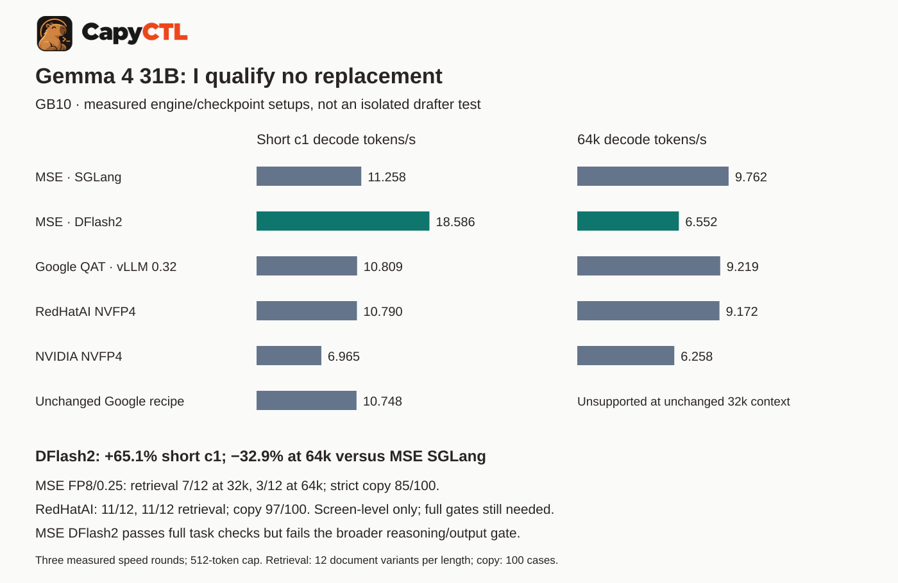

# Gemma 4 31B on GB10: a short-input gain, no replacement

**I publish this comparison without a new recipe. No measured configuration qualified as a replacement.** I leave the [existing Google QAT recipe](../../vllm/gemma-4-31b-w4a16-32gib-gb10/) unchanged; keeping it is not a claim that it passed the broader gates here.

MSE with DFlash2 gains **65.1% one-stream decode**, but loses **32.9% at 64k** against MSE on SGLang. Both have weak exact retrieval/copy. RedHatAI NVFP4 is my more promising fidelity candidate—**11/12 retrieval at both lengths and 97/100 copy**—but that is a screen-level result, not full qualification.

## What I compared

I used published checkpoints, without converting weights, on one GB10, one engine at a time. I distinguish checkpoint, engine and drafter changes: switching from SGLang to vLLM with DFlash2 does **not** isolate the drafter's contribution.

| Label | Checkpoint | Pinned revision | Engine |
|---|---|---|---|
| MSE | `melcheikh/gemma-4-31B-it-qat-NVFP4-mse-Blackwell` | `c9e2f904a6ab66d7cd74d442b6bef95faf9d5393` | SGLang 0.5.22 |
| MSE + DFlash2 | Same MSE checkpoint | Same revision | vLLM 0.32.0 |
| Google QAT | `google/gemma-4-31B-it-qat-w4a16-ct` | `52f3f65bc7a02d555763bc923bd1d9094898219d` | vLLM 0.32.0 |
| RedHatAI NVFP4 | `RedHatAI/gemma-4-31B-it-NVFP4` | `5df75ccad9b74546f5be758a2a68acc2e16bbc9b` | vLLM 0.32.0 |
| NVIDIA NVFP4 | `nvidia/Gemma-4-31B-IT-NVFP4` | `4135a98a9b728a548947683219633b25682223ac` | vLLM 0.32.0 |
| Unchanged Google QAT recipe | Same Google checkpoint | Same revision | vLLM 0.30.0 |

I used [`RedHatAI/gemma-4-31B-it-speculator.dflash2`](https://huggingface.co/RedHatAI/gemma-4-31B-it-speculator.dflash2/tree/b0cd01b4918aae6b6388272950c4f9851734674b) at `b0cd01b4918aae6b6388272950c4f9851734674b`, with seven speculative tokens, only for MSE + DFlash2. The MSE export is QAT-derived; RedHatAI and NVIDIA derive from the original instruct checkpoint. NVIDIA retains unquantized attention. I do not treat those layouts as interchangeable bytes. I retain identities in [download-manifest.json](bench/download-manifest.json) and versions in [engine-packages.json](bench/engine-packages.json).

## Settings and measurement limits

I capped new timing/task rows at 98,304 total context and eight admitted requests. MSE SGLang uses Gemma reasoning/tool parsers, FP8 E4M3 KV, SWA/full-pool ratio **0.25**, 4,096-token chunked prefill, an explicit 98,304-token full pool and static fraction 0.6. Its weighted KV allocation is 13.125 GiB. The vLLM 0.32 rows are text-only with an explicit 12 GiB FP8 KV cache. I retained the unchanged recipe's 32,768 context, two-request admission and 4 GiB FP8 KV.

I used temperature zero, default thinking and a 512-token completion cap for speed: one warmup and three measured rounds per short concurrency, plus three fresh seeded exact-token inputs at each of 8,000, 32,000 and 64,000 tokens. I checked native usage against local token counts. c1 is post-first-token decode; c2/c4/c8 are aggregate completion tokens divided by round wall time, including prefill and queueing. I left engine prefix-cache defaults intact; fresh long prompts avoid intentional repeated-prefix hits.

I screened each loaded timing row on the canonical first 50 GSM8K, all 30 tools and first 50 HumanEval cases. Full task gates use 250/30/164. I requested a 32,768-token quality output cap except for the unchanged 32k recipe's separately approved context-bounded rerun below. Length-limited answers count as wrong. Generated code ran unprivileged with time/address-space limits and a minimal environment.

I required candidate accuracy at least the MSE SGLang two-sided 95% Wilson lower endpoint, truncation no higher than its upper endpoint, 30/30 tools and zero HTTP errors. I also required separated reasoning, three tool round trips, retrieval/copy and explicit output/repetition review. A relative pass against a weak comparator is not absolute fidelity, and a finite gate is not statistical equivalence.

## Measured speed and memory

I report tokens/s and sampled unified-memory footprint, not model-only GPU allocation.

| Setup | c1 decode | c2 aggregate | c4 aggregate | c8 aggregate | 8k / 32k / 64k decode | Peak available-memory drop, GiB |
|---|---:|---:|---:|---:|---|---:|
| MSE · SGLang | 11.258 | 23.803 | 46.653 | 89.878 | 11.028 / 10.473 / 9.762 | 54.137 |
| MSE · DFlash2 | 18.586 | 35.962 | 60.870 | 93.363 | 11.151 / 8.971 / 6.552 | 45.967 |
| Google QAT · vLLM 0.32 | 10.809 | 22.302 | 43.771 | 84.442 | 10.374 / 9.745 / 9.219 | 46.260 |
| RedHatAI NVFP4 | 10.790 | 22.296 | 43.785 | 84.430 | 10.355 / 9.737 / 9.172 | 46.014 |
| NVIDIA NVFP4 | 6.965 | 13.886 | 27.458 | 53.582 | 6.778 / 6.510 / 6.258 | 48.651 |
| Unchanged Google QAT recipe | 10.748 | 22.243 | 22.250 | 22.240 | 10.354 / 9.721 / unsupported | 46.740 |

I observe **+65.1% c1**, **+3.9% c8**, but **−32.9% 64k decode** for MSE + DFlash2 versus MSE SGLang. I would not call that a general long-context upgrade. The unchanged recipe admits only two requests, so its higher offered concurrency mostly adds queueing; I retain those timings.

I sampled MemAvailable every 0.5 seconds from launch to shutdown, under a 95 GiB scope, with a 4 GiB available-memory emergency guard and planned free headroom of at least 20 GiB. No guard triggered. The initial MSE SGLang timing run overlapped checkpoint downloads: I do not describe its 516.123-second readiness or whole-machine memory samples as isolated engine measurements. Its cgroup peak, 21,530,034,176 bytes, is not a substitute for its 54.137 GiB sampled unified-memory drop. Sub-sample peaks are not excluded.

## Task accuracy does not rescue retrieval/copy

| Setup | GSM8K | Tools | HumanEval | Scope |
|---|---:|---:|---:|---|
| MSE · SGLang | 246/250 | 30/30 | 158/164 | Full task gate |
| MSE · DFlash2 | 245/250 | 30/30 | 159/164 | Full task gate |
| Google QAT · vLLM 0.32 | 50/50 | 30/30 | 50/50 | Screen only |
| RedHatAI NVFP4 | 50/50 | 30/30 | 49/50 | Screen only |
| NVIDIA NVFP4 | 50/50 | 30/30 | 50/50 | Screen only |
| Unchanged Google QAT recipe | 50/50 | 30/30 | 49/50 | Context-bounded screen only |

I recorded zero task HTTP errors and zero truncations in these final scored phases. Both MSE rows also score 50/50, 30/30, 49/50 on the canonical screen. MSE + DFlash2 passes the full relative task accuracy/truncation rules, but **fails the broader gate**: both MSE setups return separated reasoning without obeying the final-answer-only-integer instruction. All three tool round trips pass on both. I retain the MSE SGLang repeated code/channel-marker output that reaches the 2,048-token retrieval cap, rather than hiding it behind strong task scores.

I used six seeded documents at each length, each with original and one-line requests, and 100 strict 2k-copy cases. I score all three codes together per document; the three codes are not independent trials.

| Setup | 32k all-three retrieval / codes | 64k all-three retrieval / codes | Strict copy |
|---|---|---|---:|
| MSE · SGLang, FP8 KV, ratio 0.25 | 7/12 · 30/36 | 3/12 · 23/36 | 85/100 |
| MSE · DFlash2, FP8 KV | 5/12 · 28/36 | 4/12 · 27/36 | 86/100 |
| MSE · SGLang, BF16 KV, default ratio | 9/12 · 33/36 | 9/12 · 32/36 | 87/100 |
| Google QAT · vLLM 0.32 | 6/12 · 29/36 | 9/12 · 33/36 | 90/100 |
| RedHatAI NVFP4 | 11/12 · 35/36 | 11/12 · 34/36 | 97/100 |
| NVIDIA NVFP4 | 10/12 · 34/36 | 11/12 · 35/36 | 98/100 |
| Unchanged Google QAT recipe | 6/12 · 30/36 | Unsupported | 86/100 |

I reviewed failed retrieval/copy outputs: missing or changed hexadecimal digits remain, not just formatting differences. All rows have zero retrieval/copy HTTP errors; only the MSE SGLang FP8 row has a retrieval cap hit (one). All copy rows have zero cap hits. I retain the unchanged recipe's smaller 768-token 32k retrieval output budget; other rows use 2,048.

I find RedHatAI's fidelity materially more promising than the MSE rows at approximately Google QAT's speed. Its **11/12, 11/12 and 97/100** remain a screen-level result: I have not run its full 250/30/164 tasks or separated-reasoning/tool-round-trip qualification. NVIDIA is slower; its one additional copy success does not establish a meaningful advantage over RedHatAI from 100 cases.

I retain relative document-level Wilson comparisons in [probe-comparison.json](bench/probe-comparison.json), screen checks in [screen-comparison.json](bench/screen-comparison.json), and full task/output decisions in [summary.json](bench/summary.json). The alternative screens clear the relative task rules, but I do not relabel them full qualification. The unchanged recipe's two-length probe gate is incomplete because 64k is unsupported, not because I measured a failed 64k response.

## What the BF16-KV diagnostic does—and does not—show

I retained the MSE SGLang native warning: **FP8 KV has no supplied scaling factors and defaults to scales of 1.0**. I do not call that dynamic calibration. Its full/SWA pools are 98,304 / 24,576 tokens at ratio 0.25.

I ran a retrieval/copy-only diagnostic on the same checkpoint with **BF16 KV and no SWA ratio override**, whose installed fallback resolves to 0.8. I capped context/full pool at 67,584, one admitted request and one-request decode graphs; native full/SWA pools are 67,584 / 54,067. Its 46.40625 GiB explicit KV pool exceeds the FP8/0.25 pool by 33.28125 GiB. [INFERENCE] Adding that difference to the observed 54.13669 GiB peak gave an 87.41794 GiB planning estimate; I budgeted 90 GiB and required 110 GiB available before launch.

I measured a 75.442 GiB peak drop, 42.636 GiB minimum available and 150.053-second readiness without a guard trigger. **64k retrieval improves from 3/12 to 9/12, but copy only from 85/100 to 87/100.** I changed precision and SWA allocation together; I cannot isolate either cause, attribute every loss to the checkpoint, or claim measured task/speed qualification for this diagnostic.

### Why I skipped the original-BF16 source

I did not download or launch [`google/gemma-4-31B-it@842da3794eaa0b77d5f08bae87a17459d91ff475`](https://huggingface.co/api/models/google/gemma-4-31B-it/revision/842da3794eaa0b77d5f08bae87a17459d91ff475?blobs=true). Its two source shards are 49,784,788,364 and 12,761,549,884 bytes. [INFERENCE] Source weights plus the 46.406 GiB diagnostic KV pool exceed **104 GiB before overhead**, outside 95 GiB.

I also evaluated a smaller 36,864-token BF16 pool: **25.3125 GiB KV**, approximately **83.56 GiB weights plus KV**, leaving **11.44 GiB** inside 95 GiB for all loading transients, workspaces and graphs. [INFERENCE] Transferring the quantized diagnostic's approximately 8.6 GiB overhead gives about **92.2 GiB steady use**, only **2.8 GiB** spare; that does not bound loading the approximately **46.36 GiB largest shard**. I could not demonstrate a loading peak within the envelope, so I skipped this source diagnostic too. I do not substitute the completed quantized-checkpoint BF16-KV diagnostic for an original-BF16 result.

## Unchanged recipe: refusals and the bounded-budget rerun

I kept the recipe's 32,768 total context. A 64,000-token input plus 512 output tokens exceeds it by **31,744 tokens**; the 64k retrieval input alone exceeds it by **31,232**. I mark both unsupported, without extrapolation or a context change.

I initially requested 32,768 output tokens alongside nonempty task prompts: all 130 screen requests returned HTTP 400. I retain those refusals separately, not as model accuracy. With approval, I ran a separate quality-only phase using **`min(32768, context − exact chat-template prompt tokens)`**, recording each budget and native/local prompt count. I did not repeat valid timings or retrieval/copy.

I retained an intervening client cache-initialization failure that sent no tasks, then another 130 refusals caused by counting the chat-template mapping's two keys instead of its `input_ids`. I corrected token extraction, not the recipe. The final **50/50, 30/30, 49/50** screen has zero errors/truncations; all **130** local prompt counts match native usage. Output budgets are **32,599–32,709** for GSM8K, **32,427–32,579** for tools and **32,454–32,695** for HumanEval. I do not claim a full 32,768-token output allowance with a nonempty prompt.

I retain failed client phases under [attempts/](bench/runs/published-vl030/attempts/), the corrected [screen/](bench/runs/published-vl030/screen/) and its separate [qualification accounting](bench/runs/published-vl030/qualification/). Earlier deployment-readiness client failures loaded no engine and are not checkpoint failures. The initial MSE quality client's dataset-cache prerequisite failure likewise sent no task; its corrected quality-only run does not replace valid timing observations.

## Decision and retained evidence

**I recommend no replacement from this comparison and add no recipe.** DFlash2's short-input speed is real, its long-context slowdown is real, and its broader output gate fails. I would investigate RedHatAI NVFP4 without a drafter next, but it still needs full matched gates before any replacement claim. Keeping the existing recipe does not cure its weak exact-string fidelity or extend its supported context.

I retain native records under [bench/runs/](bench/runs/), deterministic retrieval seeds in [retrieval-seeds.json](retrieval-seeds.json), and the measurement/quality harness beside this README. Large deterministic inputs are represented by hashes and generator metadata rather than duplicated bodies. Reporting uses `python -B summarize.py --runs bench/runs --leader mse-dflash2 --output-review fail --out bench/summary.json` and `python -B compare-probes.py --runs bench/runs --out bench/probe-comparison.json`; those reports postprocess evidence rather than qualify another model run.

I record publication provenance and sanitization in [publication-audit.json](publication-audit.json). I archive chronological `NOTES.md` outside the publication under `/var/tmp/capyctl-webui/gemma31/comparison-archive/`. I retained final native observations that all owned engines stopped, no GPU compute process or owned scope remained, and 118.322 GiB was available. I made no checkpoint upload and no commit.

I render the chart and print its timing table with `python3 -B recipe-table.py --chart`; the chart embeds the CapyCTL logo and reads retained summary values, without inference or network access.
