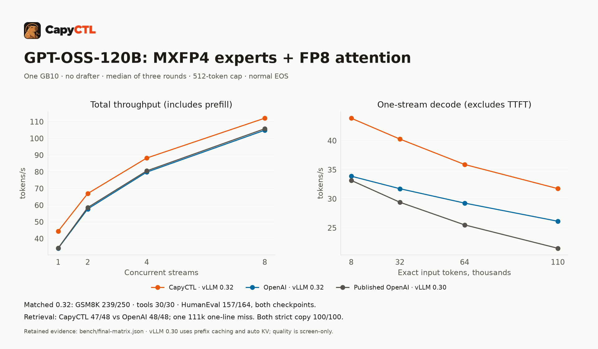

# GPT-OSS-120B checkpoint comparison on GB10

I compare OpenAI's `gpt-oss-120b` at `b5c939de8f754692c1647ca79fbf85e8c1e70f8a` with my MXFP4-expert/FP8-attention conversion on vLLM 0.32.0, and retain a run of the published OpenAI vLLM 0.30 recipe.

## Measured results

All speeds are tokens/s. Short c1 is post-first-token decode; c2/c4/c8 are total completion tokens divided by round wall time. Long columns are one-stream post-first-token decode, not total request throughput. Each timing is the median of three measured rounds after warm-up, fixed chat/code prompts, 512 completion-token cap and normal EOS.

| Setup | Short c1 decode | c2 aggregate | c4 aggregate | c8 aggregate | Decode 8k / 32k / 64k / 110k |
|---|---:|---:|---:|---:|---|
| CapyCTL · vLLM 0.32 | 45.345 | 66.911 | 88.191 | 112.054 | 43.848 / 40.259 / 35.882 / 31.735 |
| OpenAI · vLLM 0.32 | 34.796 | 57.685 | 79.736 | 104.849 | 33.874 / 31.721 / 29.242 / 26.123 |
| Published OpenAI · vLLM 0.30 | 34.591 | 58.534 | 80.504 | 105.733 | 33.153 / 29.393 / 25.493 / 21.472 |

The matched vLLM 0.32 rows use expandable segments, lazy loading, 131072 context, eight sequences, an 8 GiB FP8 E4M3 KV pool, Marlin experts, no drafter, no prefix caching and LMCache off. Final timings come from the shipped-file runs; full quality comes from their completed full rows. Candidate gains are 30.3% short c1 decode, 6.9% c8 aggregate and 21.5% 110k decode. The 28-cell length/concurrency sweep is retained in `bench/final-matrix.json`; every paired candidate aggregate cell is higher, by 5.3–29.6%. These are finite observations, not uncertainty bounds or a universal speed claim.

Both matched checkpoints score GSM8K 239/250, tools 30/30 and HumanEval 157/164, with zero HTTP errors and truncations. Greedy generation uses low reasoning effort, eight concurrent requests, a 32768 total-output-token cap and pinned task records. Length-limited outputs count as wrong. The stated same-engine Wilson/truncation/tool gates pass; this is not statistical equivalence or broad capability qualification.

**One retrieval regression remains:** CapyCTL scores 47/48 observations and 143/144 codes versus OpenAI 48/48 and 144/144. The miss is one of six 111k one-line requests (5/6, 17/18 codes); both pass all six original-format 111k documents. Both checkpoints pass 100/100 strict copy cases. No retrieval/copy request has an HTTP error or output-cap hit.

The published vLLM 0.30 recipe is a serving-setup comparison, not an engine-version-only experiment: it has prefix caching enabled and auto KV, not confirmed FP8 KV. Its quality is only a 50/30/50 screen: GSM8K 48/50, tools 30/30, HumanEval 49/50. Repeated long-document TTFT includes cache hits and must not be compared with uncached prefill on 0.32.

## Loading and allocator finding

Default lazy loading and eager-per-file loading both failed during candidate shard reads before KV allocation or graph capture, hitting the 3 GiB available-memory guard. The retained minima are 2,867,150,848 and 1,277,296,640 bytes. Eager loading did not fix this. Explicit lazy loading plus `PYTORCH_CUDA_ALLOC_CONF=expandable_segments:True` reached readiness without changing checkpoint bytes or installed packages; available memory stayed roughly 49–51 GB during the 37 shard reads, with a 41,606,955,008-byte minimum through readiness.

[INFERENCE] This intervention strongly supports CUDA caching-allocator fragmentation across the 28,263 output tensors, rather than a necessary extra live model copy. Process-local allocated/reserved counters were unavailable; fragmentation was not directly measured. The recipe therefore keeps expandable segments **and lazy loading**. Register the engine with `--approve-env PYTORCH_CUDA_ALLOC_CONF`; do not remove the variable merely because the checkpoint is small enough on disk.

Final shipped-file readiness was 480.64 seconds for CapyCTL versus 529.67 for matched OpenAI, with whole-run minimum MemAvailable 39,686,987,776 versus 25,940,623,360 bytes. These are sampled unified-memory system observations, not model-only GPU allocations. Local-path execution passed; Hub provisioning at `628e2ca15177aaea61dfe8cb4fbe1be9737129dc` has not been exercised.

## Evidence and reproduction

- [Recipe](../../vllm/gpt-oss-120b-capyctl-gb10/), [checkpoint audit](../../vllm/gpt-oss-120b-capyctl-gb10/convert/checkpoint-audit.json), [final matrix](bench/final-matrix.json), [publication audit](bench/publication-audit.json).
- `python3 -B recipe-table.py` prints the timing table; `python3 -B summarize-charts.py` generates light/dark summary images with the shared CapyCTL theme.
- `python3 -B evidence-inputs.py --verify` regenerates every unique long input from filler seeds, exact character slices and literal insertions, checking its original UTF-8 SHA-256. `--source bench/RUN/retrieval.json --out /var/tmp/retrieval.json` hydrates a compact run. No tokenizer, model, network or GPU is required for regeneration.
- `run-host.py`, `accuracy.py` and `sample-loading.py` retain the collection method; they require an appropriately registered local engine and pinned fixtures. No local/offline check substitutes for retained native execution evidence (Quark Cutlass FP8 linears, Marlin MXFP4 experts, FP8 KV).
- Failed load/admission attempts remain under `bench/`; admission-only failures are not failed model loads. Private working notes and untouched originals are archived outside this repository. Public paths use `/home/me`; measurements and numeric metadata are unchanged.

## Limits

One GB10, one engine build, finite prompts and deterministic task screens do not qualify other hardware, sampling, workloads, engine versions or maximum concurrency. The long-input miss is not erased by the passing task gate. Shape-derived bytes/token is not measured memory traffic. CPU tensor checks establish conversion correctness, not engine capability. `628e2ca15177aaea61dfe8cb4fbe1be9737129dc` deliberately remains until weights upload.
