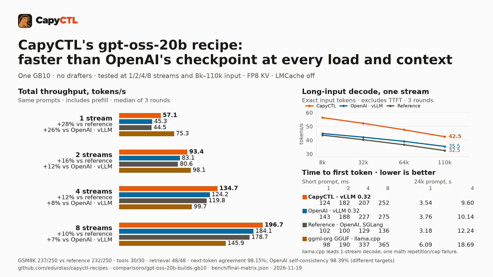

# GPT-OSS-20B builds on one GB10: MXFP4 experts with FP8 attention

**One recipe ships: [CapyCTL's checkpoint on vLLM 0.32.0, without a drafter](../../vllm/gpt-oss-20b-capyctl-gb10/).**
It keeps OpenAI's MXFP4 experts byte-identical, quantizes attention to per-channel
FP8 E4M3 and leaves the head, embedding and routers BF16. The main results:

- **57.77 tokens/s at one stream and 196.71 aggregate at eight**, versus OpenAI's
  45.81 / 184.07 on the same vLLM version: +26.1% / +6.9%. Against **OpenAI's
  checkpoint on SGLang 0.5.22 with 131k-context serving settings, no drafter**,
  44.85 / 178.67, the difference combines engine and checkpoint.
- **Long-input decode improves through 110k:** 56.35 / 52.23 / 47.57 / 42.54 tokens/s
  at 8k / 32k / 64k / 110k input, versus same-engine OpenAI 44.85 / 42.18 / 39.17 / 35.50.
  Retrieval passes all **48/48 document/variant observations** through 111k.
- **237/250 GSM8K, 30/30 tools**, zero accuracy truncations or HTTP errors, and
  passed native output review. One-answer differences do not establish an accuracy gain.
- **No universal speed winner:** llama.cpp gives 76.16 tokens/s at one stream,
  but 145.87 at eight and one retained math-output repetition/cap failure.
  SGLang DFlash8 gives 73.44 / 249.36 on short prompts, then loses decode speed
  between 4k and 8k input. It is a measured alternative, not a shipped recipe.
- **FP8 is not lossless:** offline next-token agreement is 98.14843%. The initial
  99.5% gate failed and was judged too strict before subsequent native qualification.
  OpenAI's 98.39201% generated-ID self-consistency uses a different comparison target.
- **Public builds:** LMSYS loads but executes BF16 MoE, at 28.22 / 70.14 tokens/s.
  Two actual NVFP4 builds fail at the expert-bias loader. RedHatAI's root shards
  are byte-identical to OpenAI's and do not need a duplicate benchmark.



The chart compares serving setups, not a checkpoint-only experiment. Missing cells
are not zeros. [`bench/final-matrix.json`](bench/final-matrix.json) is the numeric
index; [`bench/fp8-attention/`](bench/fp8-attention/), the engine row directories and
[`bench/public-builds/`](bench/public-builds/) retain the observations. Publication
cleanup and numeric-preservation checks are in [`bench/publication-audit.json`](bench/publication-audit.json).

## Setup

| | |
|---|---|
| Hardware | 1x NVIDIA GB10, compute capability 12.1, 128 GB unified memory, aarch64 |
| System | Kernel 6.17.0-1031-nvidia, NVIDIA driver 580.173.02, CUDA 13.0 |
| CapyCTL | 0.1.12 standalone; explicit `lmcache: off`, restart-only residency |
| vLLM 0.32.0 | torch 2.13.0+cu130, flashinfer-python 0.7.0.post1, transformers 5.19.0 |
| Other engines | SGLang 0.5.22; vLLM 0.33.0; llama.cpp b12242, commit `3b4d6ab` (printed package label 0.9.0 is not the build identity) |
| Source identity | Installed Python-engine source commits unknown; package fingerprints and native launch evidence retained per run |
| Measured | 2026-11-18–19; exact run timestamps retained with the evidence |

One deployment at a time, TP1, 131,072-token context, at most 16 running requests.
SGLang requests 80 GiB managed memory, graph max batch 16, SWA/full ratio 0.1 and
keeps the reference's radix-cache defaults. vLLM uses a 40 GiB KV pool, graph capture
through 16 and disables prefix caching. These are admission/cache budgets, not
minimum memory requirements or equal capacities. Both request FP8 E4M3 KV;
llama.cpp uses Q8_0 K/V, its supported 8-bit format, not FP8, with 16 slots and
131,072 tokens per slot. No engine/environment package was installed or patched.

### The checkpoints

| Checkpoint | Revision | Layout and measured status |
|---|---|---|
| **[CapyCTL MXFP4-FP8](https://huggingface.co/capyctl/gpt-oss-20b-MXFP4-FP8)** | `66d5d29bb56ebef0d24c0333b7646d058b581170` | Original MXFP4 experts; FP8 E4M3 attention, BF16 head/embedding/router; Quark. 13.125 GB tensor payload. Qualified vLLM recipe. |
| [OpenAI](https://huggingface.co/openai/gpt-oss-20b) | `6cee5e81ee83917806bbde320786a8fb61efebee` | MXFP4 experts, BF16 rest; 13.761 GB tensor payload. Reference and same-engine control. |
| [ggml-org GGUF](https://huggingface.co/ggml-org/gpt-oss-20b-GGUF) | `41e8a94d15d62070b36cf4553a0250717ecf46b8` | MXFP4 experts; Q8_0 attention/head/embedding, F32 router/norms/biases; 12.110 GB file. Not OpenAI's original numerical layout. |
| [LMSYS](https://huggingface.co/lmsys/gpt-oss-20b-bf16) | `8de8d3dfa4da071323322a4a3049612203a3b1eb` | 22.719 GB tensor payload; E5M2 FP8 expert storage despite the name. No quantization config: vLLM loads BF16 unquantized `TritonExperts`, not native FP8 MoE. |
| [shanjiaz NVFP4](https://huggingface.co/shanjiaz/gpt-oss-20b-nvfp4-modelopt) | `fb9848e169d5b38cbc00ecf3383283ea1fc33a21` | NVFP4 experts and attention; fails before readiness. |
| [mmangkad NVFP4](https://huggingface.co/mmangkad/gpt-oss-20b-nvfp4) | `86940c3e09c00f291dca96580770e4ba81542c9c` | NVFP4 experts, BF16 attention; fails before readiness. |
| [RedHatAI](https://huggingface.co/RedHatAI/gpt-oss-20b) | `9fff8613d547ba9b79bf4604fa9820877d0f6aff` | All three root safetensor shard sizes/hashes match OpenAI exactly; skipped duplicate. |

Both NVFP4 builds select FlashInfer CUTLASS NVFP4 MoE and fail with
`KeyError: layers.0.mlp.experts.w2_bias`. Both files contain all 48 expert biases;
the selected quantized path does not allocate the requested parameter. Shanjiaz
also selects `FlashInferCutlassNvFp4LinearKernel`; mmangkad's attention remains
unquantized. There is no speed, coherence, task or agreement score for either
failed load. Transformers rejects their packed expert shapes and unexpected scale
tensors in the unchanged offline environment; no tensor mismatch was ignored.

Mislabeled all-BF16 and roughly 41-GB attention-only-FP8 builds were not run.
The [public tensor audit](bench/public-builds/tensor-layout-audit.txt) records dtype,
bias and payload arithmetic. [INFERENCE] Estimated serialized weight reads are
2.867 GB/token shanjiaz, 3.072 CapyCTL, 3.708 OpenAI/RedHat, 3.783 mmangkad and
4.828 LMSYS. LMSYS's BF16 loaded path is about 7.217 GB/token. These estimates
exclude KV/activations/reuse and are not measured memory traffic or performance predictions.
Standard NVFP4 expert/local-scale storage is 5.88% larger than MXFP4; representability
alone does not solve the bias loader. See [conversion feasibility](../../vllm/gpt-oss-20b-capyctl-gb10/convert/source-feasibility.md).

### Drafters

| Drafter | Pinned revision | Safetensors/file bytes |
|---|---|---:|
| [z-lab DFlash](https://huggingface.co/z-lab/gpt-oss-20b-DFlash) | `d53f6551543204c859e8bbaaddbd15d11b447af9` | 1,569,547,192 |
| [Nebius EAGLE3](https://huggingface.co/nebius/EAGLE3-gpt-oss-20b) | `9dd45bb1da8b1ddc8cabd52691d9ac170b41484f` | 701,132,248 |
| ggml-org RedHat-derived EAGLE3 Q8_0 GGUF | Same GGUF revision as target above | 921,488,000 |

DFlash and Nebius remain unquantized. SGLang DFlash block B is verification width B;
vLLM requests B−1 speculative tokens. Native block 8 therefore means 7 vLLM draft
tokens, not a separate block-7 experiment. Nebius uses a top-k-1 chain. OpenAI's
checkpoint has no native MTP head. No drafter ships.

## Method

- **Serving:** all local measurements go through CapyCTL, using Harmony's source
  chat template, native GPT-OSS reasoning/tool parsers and explicit effort low.
  Native logs establish actual kernels, KV dtype, cache policy and source identity.
- **Speed:** fixed eight capyctl-bench chat/code prompts; temperature zero, normal
  EOS, 512 total output tokens including reasoning. One warm-up, three measured
  rounds at c1/c2/c4/c8. Native usage supplies completion counts; missing usage
  invalidates a speed row. TTFT starts at the first reasoning or content chunk.
  c1 rankings use median per-request post-first-token decode; c2/c4/c8 use median
  aggregate completion tokens / round wall time. Baseline-relative tables use
  aggregate at every concurrency, including c1, to keep the denominator consistent.
- **Exactly 24k:** independent pseudo-English documents, exact complete chat-template
  counts on the pinned tokenizer; three rounds at c1/c4, 128 output-token cap.
  Every native input count must equal 24,000; no widened tolerance.
- **Long decode:** three single-stream rounds per exact length, 512-total-token cap,
  fixed-document reuse. The reference retains radix caching; vLLM disables
  prefix caching. Decode excludes TTFT. These are not uncached-prefill tests.
- **Native quality:** pinned GSM8K-250 and automatic tools-30, c8, temperature zero,
  no explicit seed, effort low, 8,192 total output tokens. HTTP errors and cap hits
  remain in denominators. Three weather-tool guards use a separate 4,096-token cap.
  Data/helper hashes are retained; these reuse the adjacent Gemma/Qwen scoring method.
- **Drafter gate:** GSM8K must meet the same-engine/checkpoint/settings no-draft
  95% Wilson lower bound, tools must remain 30/30, HTTP errors zero, and outputs
  must pass coherence/nonrepetition review. Higher scores are not rejected for
  exceeding the Wilson upper bound. First-divergence is diagnostic: no-draft
  outputs themselves differ across concurrency, so wording equality is not the gate.
  The selected cross-context recipe additionally permits no measured long-decode loss.
- **Acceptance:** vLLM/llama.cpp mean length is 1 + accepted draft tokens / verification
  calls. SGLang's completed-generation-token/verification-call ratio includes prefill
  emissions; last-window gauges are retained separately. These are not interchangeable
  with accepted/proposed-token fractions. Metrics are sampled outside timed round spans.
- **Resources:** fresh engine process, OS/file/JIT caches not cleared. Host peak is
  `MemTotal - MemAvailable` sampled every 0.5 s, including the rest of the system;
  it is not a model allocation. GPU compute allocation is sampled separately.
  Unavailable unified-memory telemetry is null, never zero. GB is decimal, GiB binary.
- **Offline agreement:** the unchanged 200-record Gemma corpus rendered with GPT-OSS
  Harmony, effort low, 40 each chat/coding/math/multilingual/tool-use. Generate up
  to 512 tokens; teacher-force every one of 52,550 saved answer positions in the
  same eager-attention BF16 graph, torch 2.13.0+cu130 / Transformers 5.14.1.
  The teacher reconstructs OpenAI's released MXFP4 checkpoint, not unavailable
  prequantization weights. This excludes native quantized kernels, FP8 KV and
  dynamic input quantization. See [`tensors/NOTES.md`](tensors/NOTES.md).

## Results

### No-drafter controls and the recipe

Tokens/s; c1 is post-first-token decode, c2/c4/c8 aggregate. — means not measured.

| Checkpoint / engine | c1 | c2 | c4 | c8 | 24k TTFT c1/c4, s | GSM8K / tools |
|---|---:|---:|---:|---:|---|---|
| Reference · OpenAI, SGLang 0.5.22 | 44.85 | 80.58 | 119.81 | 178.67 | 3.180 / 12.236 | 232/250 / 30/30 |
| OpenAI, SGLang Marlin W4A16 | 45.29 | 81.84 | 119.97 | 178.51 | 6.899 / 26.984 | 239/250 / 30/30 |
| OpenAI, vLLM 0.32.0 auto → Marlin | 45.81 | 83.12 | 124.20 | 184.07 | 3.760 / 10.141 | 236/250 / 30/30 |
| OpenAI, vLLM 0.33.0 auto → Marlin | 45.85 | 83.63 | 123.95 | 184.38 | 3.727 / 10.127 | 238/250 / 30/30 |
| **CapyCTL, vLLM 0.32.0, recipe** | **57.77** | **93.37** | **134.68** | **196.71** | 3.543 / 9.601 | 237/250 / 30/30 |
| LMSYS, vLLM 0.32.0, loaded BF16 MoE | 28.22 | — | — | 70.14 | — | 237/250 / 30/30 |
| ggml-org, llama.cpp b12242 | 76.16 | 98.12 | 99.66 | 145.87 | 6.092 / 18.688 | 237/250 / 30/30; one math cap hit |

The reference's default `flashinfer_mxfp4` uses MXFP8 activations; Marlin is
W4A16. The task-score difference is not solely an engine-version comparison.
Marlin adds little short-prompt speed and more than doubles SGLang's 24k TTFT.
vLLM 0.33 is essentially tied with 0.32 here. llama.cpp wins c1 and c2 among
these no-drafter controls, but trails CapyCTL at c4/c8 and has a retained repetition
collapse at GSM8K case 975. It is not promoted as a clean quality recommendation.

### Every measured setup against the reference

Total completion tokens / round wall time, median of three rounds. The 1-stream column is aggregate, not post-first-token decode. ▼ marks a regression; — means not measured.

| Setup | 1 stream | 2 streams | 4 streams | 8 streams |
|---|---:|---:|---:|---:|
| Reference · OpenAI, SGLang | 44.5 | 80.6 | 119.8 | 178.7 |
| OpenAI, SGLang 0.5.22, Marlin | 45.0 (+1.0%) | 81.8 (+1.6%) | 120.0 (+0.1%) | 178.5 (-0.1% ▼) |
| OpenAI, vLLM 0.32.0, Marlin | 45.3 (+1.8%) | 83.1 (+3.2%) | 124.2 (+3.7%) | 184.1 (+3.0%) |
| OpenAI, vLLM 0.33.0, Marlin | 45.3 (+1.8%) | 83.6 (+3.8%) | 123.9 (+3.5%) | 184.4 (+3.2%) |
| ggml-org, llama.cpp b12242, no drafter | 75.3 (+69%) | 98.1 (+22%) | 99.7 (-17% ▼) | 145.9 (-18% ▼) |
| ggml-org, llama.cpp EAGLE3 K3 (rejected) | 79.0 (+77%) | — | — | 126.7 (-29% ▼) |
| OpenAI, SGLang DFlash8 | 72.7 (+63%) | 94.6 (+17%) | 155.3 (+30%) | 249.4 (+40%) |
| OpenAI, SGLang DFlash4 | 64.6 (+45%) | — | — | 242.3 (+36%) |
| OpenAI, SGLang DFlash6 | 67.2 (+51%) | — | — | 243.2 (+36%) |
| OpenAI, SGLang DFlash12 (screen) | 63.6 (+43%) | — | — | 228.6 (+28%) |
| OpenAI, SGLang DFlash16 (screen) | 60.0 (+35%) | — | — | 225.4 (+26%) |
| CapyCTL, vLLM 0.32.0, no drafter (recipe) | 57.1 (+28%) | 93.4 (+16%) | 134.7 (+12%) | 196.7 (+10%) |
| CapyCTL, vLLM Triton attention, no drafter | 57.1 (+28%) | — | — | 196.3 (+9.9%) |
| CapyCTL, vLLM Triton + DFlash8 | 79.4 (+78%) | — | — | 264.4 (+48%) |
| CapyCTL, vLLM Triton + Nebius3 (rejected) | 81.0 (+82%) | — | — | 265.5 (+49%) |
| CapyCTL, vLLM Triton + Nebius5 (rejected) | 69.5 (+56%) | — | — | 253.0 (+42%) |
| LMSYS, vLLM 0.32.0, BF16 loaded MoE | 27.8 (-37% ▼) | — | — | 70.1 (-61% ▼) |

Time to first reasoning or content token; lower is better. Short prompts are the fixed chat/code corpus; 24k inputs are a separate exact-token workload.

| Setup | 1 stream, ms | 2 streams, ms | 4 streams, ms | 8 streams, ms | 24k, 1 stream, s | 24k, 4 streams, s |
|---|---:|---:|---:|---:|---:|---:|
| Reference · OpenAI, SGLang | 102 | 100 | 129 | 136 | 3.180 | 12.236 |
| OpenAI, SGLang 0.5.22, Marlin | 99 (-2.2%) | 119 (+19% ▼) | 125 (-2.7%) | 141 (+3.7% ▼) | 6.899 (+117% ▼) | 26.984 (+121% ▼) |
| OpenAI, vLLM 0.32.0, Marlin | 143 (+41% ▼) | 188 (+88% ▼) | 227 (+76% ▼) | 275 (+102% ▼) | 3.760 (+18% ▼) | 10.141 (-17%) |
| OpenAI, vLLM 0.33.0, Marlin | 143 (+41% ▼) | 140 (+40% ▼) | 205 (+59% ▼) | 279 (+105% ▼) | 3.727 (+17% ▼) | 10.127 (-17%) |
| ggml-org, llama.cpp b12242, no drafter | 98 (-3.5%) | 190 (+90% ▼) | 337 (+161% ▼) | 365 (+168% ▼) | 6.092 (+92% ▼) | 18.688 (+53% ▼) |
| ggml-org, llama.cpp EAGLE3 K3 (rejected) | 95 (-6.4%) | — | — | 383 (+181% ▼) | — | — |
| OpenAI, SGLang DFlash8 | 110 (+8.6% ▼) | 132 (+33% ▼) | 130 (+0.6% ▼) | 144 (+6.0% ▼) | 3.288 (+3.4% ▼) | 12.544 (+2.5% ▼) |
| OpenAI, SGLang DFlash4 | 109 (+6.9% ▼) | — | — | 116 (-15%) | — | — |
| OpenAI, SGLang DFlash6 | 100 (-1.9%) | — | — | 135 (-1.0%) | — | — |
| OpenAI, SGLang DFlash12 (screen) | 129 (+27% ▼) | — | — | 148 (+8.8% ▼) | — | — |
| OpenAI, SGLang DFlash16 (screen) | 90 (-11%) | — | — | 154 (+13% ▼) | — | — |
| CapyCTL, vLLM 0.32.0, no drafter (recipe) | 124 (+22% ▼) | 182 (+82% ▼) | 207 (+61% ▼) | 252 (+85% ▼) | 3.543 (+11% ▼) | 9.601 (-22%) |
| CapyCTL, vLLM Triton attention, no drafter | 127 (+25% ▼) | — | — | 249 (+83% ▼) | — | — |
| CapyCTL, vLLM Triton + DFlash8 | 160 (+58% ▼) | — | — | 340 (+149% ▼) | — | — |
| CapyCTL, vLLM Triton + Nebius3 (rejected) | 137 (+35% ▼) | — | — | 251 (+84% ▼) | — | — |
| CapyCTL, vLLM Triton + Nebius5 (rejected) | 168 (+65% ▼) | — | — | 270 (+98% ▼) | — | — |
| LMSYS, vLLM 0.32.0, BF16 loaded MoE | 286 (+182% ▼) | — | — | 596 (+337% ▼) | — | — |

These are measured alternatives, not additional shipped recipes. `recipe-table.py`
reads retained JSON and prints both tables without altering the matrix. The
CapyCTL row's short TTFT is 22–85% later than the reference; exactly-24k TTFT
is 11% later at one stream and 22% earlier at four. Faster decode is not always
faster time to the first answer token.

### Long-context decode by input length

| Input tokens | CapyCTL, vLLM | OpenAI, same vLLM | Reference · OpenAI, SGLang | OpenAI, SGLang DFlash8 |
|---:|---:|---:|---:|---:|
| 1,000 | Not measured | Not measured | 44.42 | 56.45 |
| 2,000 | Not measured | Not measured | 44.24 | 52.94 |
| 4,000 | Not measured | Not measured | 43.95 | 55.47 |
| 8,000 | 56.35 | 44.85 | 43.67 | 40.53 |
| 32,000 | 52.23 | 42.18 | 40.32 | 17.38 |
| 64,000 | 47.57 | 39.17 | 36.71 | 12.22 |
| 110,000 | 42.54 | 35.50 | 32.48 | 8.83 |

CapyCTL gains 19.8–25.6% against same-engine OpenAI and 29.0–31.0% against
the reference across 8k–110k. The original-checkpoint DFlash crossover is
**between 4k and 8k**, not an exact or universal threshold. At exactly 24k, its
c1/c4 per-request decode is 19.54 / 11.36, versus no-draft OpenAI vLLM 43.95 / 16.29.
Sources: [`long-context-comparison.json`](bench/fp8-attention/long-context-comparison.json)
and [`final-checks/`](bench/final-checks/). The separate shipped sweep below uses
another corpus; its 1k/2k/4k values must not fill the unmeasured cells in this table.

### Drafters on SGLang 0.5.22

OpenAI checkpoint, the reference's MoE/KV/context settings. The first rows are short
screens; DFlash8 also has a full c1/c2/c4/c8 profile (73.44 / 94.58 / 155.32 / 249.36).

| DFlash block | Screen c1 / c8 tokens/s | Acceptance c1/c8 | GSM8K / tools | Verdict |
|---|---|---|---|---|
| 4 | 65.40 / 242.32 | 2.599 / 2.570 | 239/250 / 30/30 | Native task/output gate passes |
| 6 | 67.77 / 243.18 | 2.909 / 2.904 | 242/250 / 30/30 | Native task/output gate passes |
| 8 | 73.64 / 250.20 | 3.174 / 3.045 | 240/250 / 30/30 | Best qualified short screen; full profile retained |
| 12 | 64.53 / 228.58 | 3.254 / 3.117 | Not measured | Slower; conditional task run not needed |
| 16 | 60.79 / 225.44 | 3.122 / 3.117 | Not measured | Slower; conditional task run not needed |

Blocks 4/6/8 have zero HTTP errors or accuracy truncations and pass output review.
First-divergence medians versus no-draft c1 at c1/c8 are 14.5/30, 9.5/22 and
8.5/20 visible tokens respectively; no-draft c1-vs-c8 is 25. These are not proof
of exact speculative equivalence. DFlash8's full profile shares the exact settings
and environment of its original quality run; `sources.json` records that identity.
Its long-decode regression prevents it from being the cross-context recipe.
The conditional SGLang Nebius fallback was not triggered because DFlash loaded
and its c1 acceptance exceeded 2.3; no SGLang Nebius score is inferred.

### Drafters on vLLM: FlashInfer blockers and Triton measurements

The initial OpenAI vLLM auto-attention DFlash8 and Nebius3/5/7 attempts each fail
before readiness: FlashInfer KV warmup requires all layers to share `window_left`,
`logits_soft_cap` and `sm_scale`. FP8 KV was logged, but no speed/acceptance/task
result exists for those launches. Stochastic sampling flags cannot fix that
attention assertion and were not enabled for these greedy tests.

Later controls use **CapyCTL's checkpoint and explicit `TRITON_ATTN`**, leaving
engine packages unchanged. No-draft Triton c1/c8 is 57.90 / 196.32, essentially
tied with the selected auto/FlashInfer path; GSM8K 240/250, tools 30/30.

| CapyCTL / Triton setting | Short c1 / c8 tokens/s | Decode at 4k / 8k / 32k | GSM8K / tools | Verdict |
|---|---|---|---|---|
| No drafter | 57.90 / 196.32 | 57.17 / 56.25 / 52.30 | 240/250 / 30/30 | Control |
| DFlash8 | 81.26 / 264.44 | 60.61 / 49.08 / 22.01 | 240/250 / 30/30 | Tasks/output pass; loses 12.7% / 57.9% at 8k / 32k |
| Nebius3 | 82.59 / 265.55 | 65.67 / 63.41 / 44.41 | 238/250 / 29/30 | `translate_text` emits no call; 32k loses 15.1% |
| Nebius5 | 71.01 / 252.98 | 60.76 / 54.03 / 42.92 | 238/250 / 29/30 | `convert_timezone` emits no call; lighthouse guard repeats through cap; 8k/32k regress |

All task HTTP-error/accuracy-truncation counts are zero. All meet the Triton
baseline's GSM8K lower Wilson bound, 0.927947 (at least 232/250); that alone is
not approval. DFlash passes task/output review but fails long decode. Nebius3
fails tools; Nebius5 fails tools and output review. **None ships.** The recipe
retains auto/FlashInfer attention and no drafter. Sources:
[`drafter-summary.json`](bench/fp8-attention/drafter-summary.json) and its per-run evidence.

llama.cpp EAGLE3 K3 gives 79.88 / 126.71 tokens/s at c1/c8, acceptance length
2.553 / 1.257 and proposal acceptance 51.9% / 8.6%. It improves c1 slightly over
its no-drafter control but regresses c8 and scores 29/30 tools (`translate_text`
missing), so it is rejected. c2/c4/24k are not measured. `sources.json` retains
its separate speed-only session after a harness serialization failure; the completed
quality result was not rerun or replaced.

### Engines, backends and blockers

| Requested path | Observed result |
|---|---|
| SGLang default MXFP4 | FlashInfer MXFP4 MoE, MXFP8 activations, Triton attention; reference |
| SGLang Marlin | W4A16, Triton attention; measured, slower 24k prefill |
| SGLang `triton_kernel` MoE | Before readiness: `InapplicableConstraint: cannot enforce is_persistent=False constraint because persistent kernel is required`; no score |
| Optional explicit SGLang FlashInfer/Triton attention probes | Not measured; defaults in the reference rows are independently logged |
| vLLM 0.32/0.33 auto, OpenAI | Marlin MXFP4; FlashInfer/XQA attention, BF16 queries, FP8 KV |
| vLLM 0.32 `flashinfer_cutlass`, OpenAI | Selects unsupported `FLASHINFER_CUTLASS_MXFP4_BF16`; no score. The internal `_afp8` alias is absent from CLI choices: MXFP8 itself was not measured or shown to fail. |
| CapyCTL Quark, vLLM 0.32 | `CutlassFP8ScaledMMLinearKernel` for `QuarkW8A8Fp8`, Marlin MXFP4 experts; audit maps the FP8 scheme to attention only |
| CapyCTL Quark, SGLang | Not qualified: inspected model does not forward quantization configuration to attention; no checkpoint-only cutover |
| Public NVFP4, vLLM | Expert-bias loader failure described above; no performance or quality result |
| llama.cpp b12242 | MXFP4 experts and Q8_0 dense tensors; Q8_0 K/V confirmed by actual owned-process argv, `/props` context/slot evidence and allocation arithmetic, not a missing log field treated as success |

### Accuracy and agreement

All main no-drafter task results appear above; selected native CapyCTL tasks have
zero errors/truncations and pass output review. Its earlier offline **99.5% gate
failed**, not passed retroactively. The gate was judged too strict, then native
qualification passed and the checkpoint was selected for publication. The agreement
result remains a limitation:

| Weights | Against actual teacher-forced OpenAI reconstruction | Against common generated answer IDs |
|---|---:|---:|
| OpenAI BF16 reconstruction | 100% by definition | 51,705/52,550 = 98.39201% self-consistency |
| CapyCTL FP8 attention | 51,577/52,550 = 98.14843% | 51,381/52,550 = 97.77545% |
| LMSYS | 52,550/52,550 = 100% | 51,705/52,550 = 98.39201% |
| Both packed NVFP4 public builds | Not measured: exact loading unsupported | Not measured |

CapyCTL's chat/coding/math/multilingual/tool-use agreement is
97.64977 / 98.24040 / 98.96924 / 97.95169 / 99.59616%. The 98.15% and OpenAI
98.39% columns do **not** use the same target. On the common generated-ID basis
the gap is about 0.62 points. All 200 records/52,550 positions were scored;
64 hit the generation cap, 136 completed. This is weight-only numerical agreement,
not a native-kernel task score, prequantization comparison or proof of equivalence.

### Retrieval, copying and functional gates

Six documents, three planted codes, four exact original input lengths. Each
observation is serial, temperature zero, effort low, 2,048 total output-token cap.
The one-line variant adds 14 input tokens. Primary is all three exact codes present
in any order; ordered exact is scored separately. Cells below are original / one-line:

| Configuration | 32k | 64k | 96k | 111k |
|---|---|---|---|---|
| CapyCTL, vLLM | 6/6 / 6/6 | 6/6 / 6/6 | 6/6 / 6/6 | 6/6 / 6/6 |
| OpenAI, same vLLM | 6/6 / 6/6 | 6/6 / 6/6 | 6/6 / 6/6 | 6/6 / 5/6 |
| Reference · OpenAI, SGLang | 6/6 / 6/6 | 6/6 / 5/6 | 6/6 / 6/6 | 5/6 / 6/6 |
| OpenAI, SGLang DFlash8 | 6/6 / 6/6 | 6/6 / 5/6 | 6/6 / 6/6 | 6/6 / 5/6 |

Each 6/6 cell finds 18/18 codes; 5/6 finds 15/18. CapyCTL's 48/48 observations
also pass ordered exact, with zero HTTP errors or cap hits. Same-engine OpenAI's
64k one-line has primary 6/6 but ordered exact 5/6; its 111k one-line failure hits
the cap. SGLang's two failures per configuration also hit the cap; ordered exact
matches primary throughout those rows. These are observed completion failures,
not proof that a record was absent from context. The earlier DFlash8 111k gate
remains 11/12 observations and 33/36 codes, not a complete pass.

**Copy-100:** one 16-hex-digit code in each of 100 fixed exactly-2,000-token inputs.
OpenAI SGLang, both no-draft and DFlash8, scores **50/100 strict exact copy**
(Wilson 95% 40.38–59.62%) and **100/100 exact-code presence**. Every strict failure
adds `Code: ` to the unchanged code; no observed digit error, HTTP error, cap hit
or prompt-count mismatch. The strict failures remain failures. **CapyCTL and public
build copy-100 are not measured.**

| Gate | CapyCTL recipe | Earlier OpenAI SGLang controls |
|---|---|---|
| Low/medium effort reasoning separation, final only `157` | Pass | Drafted shipped control passes |
| Required-string-argument tool round trip | Pass | No-draft / DFlash8 each pass 1/1 |
| Forced empty-schema tool round trip | Pass, valid `{}` and returned-code answer | No-draft / DFlash8 each fail 0/3 with invalid name/arguments wrapper; original failure retained |
| All-document retrieval at 111k, both variants | Pass, 12/12 observations | Each 11/12, not a complete pass |
| Offline next-token threshold 99.5% | Fail, 98.14843%; threshold superseded for selection | Not a native-engine gate |

A passed automatic tools-30 score does not erase a separate forced-schema failure.
The earlier empty-schema controls do not isolate model versus parser origin. Current
recipe acceptance is separately measured, not inferred from the OpenAI controls.

### Shipped-file sweep and resources

[`deployment.yaml`](../../vllm/gpt-oss-20b-capyctl-gb10/deployment.yaml) uses an explicit
ten-file source list pinned to the weights commit `66d5d29b`, whose shards have the same
SHA-256 as the measured local checkpoint. Config validation and the local sweep substitute
only that local checkpoint for the Hub source. All 28 exact-token cells pass, three streaming rounds each.
The shared-document sweep is a different workload from the eight-prompt ranking:

| Input tokens | c1 decode | c2 aggregate | c4 aggregate | c8 aggregate | c1 TTFT, s |
|---:|---:|---:|---:|---:|---:|
| 500 | 57.49 | 99.16 | 165.38 | 258.27 | 0.152 |
| 1,000 | 57.23 | 99.97 | 152.96 | 239.86 | 0.200 |
| 2,000 | 56.35 | 95.28 | 146.56 | 225.47 | 0.298 |
| 4,000 | 56.65 | 90.27 | 135.57 | 200.27 | 0.540 |
| 8,000 | 55.88 | 80.80 | 115.43 | 159.76 | 1.038 |
| 16,000 | 54.53 | 66.70 | 88.52 | 112.62 | 2.179 |
| 32,000 | 52.03 | 46.30 | 56.09 | 65.07 | 5.067 |

Local ready **104.19 s**, warm restart **103.30 s**; host/GPU peaks
**67.545 / 58.730 GB**. The native **13.13 GiB model-loading memory** is not
an attention allocation or complete serving footprint. The earlier OpenAI SGLang
DFlash shipped-file experiment remains in `bench/final-checks/shipped`: 990.64 s
first ready included selected-source download/verification, 155.59 s warm restart,
93.428 / 81.976 GB host/GPU peaks. It is historical evidence, not another recipe.
The old full-repository source attempt downloaded duplicate weight representations;
the narrowed OpenAI ten-file selection was 13.79 GB versus 41.30 GB full repository.
Those are **OpenAI source figures, not CapyCTL's download size**.

## Published GB10 numbers: not reproduced here

These are other publishers' workloads and timers. They are **published, not local
replications**, and must not be inserted into the matched ranking above.

| Publisher / setup | Published result | Why it is not the same measurement |
|---|---|---|
| [ggml-org DGX Spark table](https://github.com/ggml-org/llama.cpp/blob/master/benches/dgx-spark/dgx-spark.md), build `11fb327bf` / 7941 | pp2048 4,505.82 ±12.90; tg32 83.43 ±0.59 tokens/s | Raw llama-bench, FA on, all GPU, ubatch 2048; 32-token decode, Q8_0 dense/head GGUF |
| Same table, existing context 4k/8k/16k/32k | tg32 79.22 / 75.22 / 70.36 / 61.65 | Decode timer excludes prompt processing |
| Same table, batch 1/2/4/8/16/32 | Aggregate decode 80.13 / 109.71 / 156.03 / 271.79 / 436.38 / 681.49 | PP512/TG32, not HTTP end-to-end aggregate |
| [LMSYS, 2025-11-03](https://www.lmsys.org/blog/2025-11-03-gpt-oss-on-nvidia-dgx-spark/) | About 70 tokens/s | Long-story example; exact lengths, image digest and timing definition absent |
| [LMSYS, 2025-10-13](https://www.lmsys.org/blog/2025-10-13-nvidia-dgx-spark/) | 2,053 prefill / 49.7 decode tokens/s | Earlier engine configuration, not this SGLang release |
| [2025-10-23 publisher benchmark](https://ollama.com/blog/nvidia-spark-performance), v0.12.6 | 3,224 prefill / 58.27 decode tokens/s | Ten book-summary runs, T=0, 500 output tokens, cache off; another engine |
| [Autobench C32 EAGLE3](https://gauravmm.github.io/autobench/configs/gpt-oss-20b-vllm-mxfp4-eagle3/) | 686.48 aggregate decode versus 535.3 baseline | cu130 nightly, context 65,536, ShareGPT; baseline 108 errors, draft zero, not equal-success comparison |
| [Autobench C16](https://gauravmm.github.io/autobench/configs/gpt-oss-20b-vllm-mxfp4-eagle3-c16/) | 431.75 versus 340.69 aggregate output tokens/s | 993/1,000 successful; author reports losses at c2/c4 and buffered Harmony timing caveats |
| [Autobench C1](https://gauravmm.github.io/autobench/configs/gpt-oss-20b-vllm-mxfp4-eagle3-c1/) | 38.55 tokens/s | Only 49/500 complete before time cap; no valid matched c1 speedup |
| [Independent llama.cpp HTTP result](https://github.com/jvr0x/dgx-spark-bench/blob/main/results/gpt-oss-20b-llamacpp.json), harness `842bbd2` | c1 aggregate/per-session 82.5/90.5; c16 227.6/16.7 | 1,024 input/256 output, 65k context, 32 slots, Q8_0 KV; engine commit absent and checkpoint identifier inconsistent with known publisher path |

The inspected NVIDIA `local-ai-inference-recipes` commit
[`bb515086841e7a81e7d51925561338e7dee35023`](https://github.com/NVIDIA/local-ai-inference-recipes/tree/bb515086841e7a81e7d51925561338e7dee35023)
has no `models/openai/gpt-oss-20b/dgx-spark/` directory; its exact recipe flags and
speed are not known. The vLLM recipes' generic Blackwell guide is not a measured
20B/GB10 result; its cited EAGLE3 example is for 120B. Neither is substituted
for a missing local run.

## Caveats

- One GPU, fixed prompts, three rounds and small task sets: nominal leads are not
  confidence intervals, and scores do not prove broad accuracy equivalence.
- c1 post-first-token decode, c1 aggregate, batched aggregate and publisher TG timers
  have different denominators. Short-prompt, fixed-document and uncached-prefill
  workloads must remain separate. TTFT includes reasoning, not just final text.
- 131,072 tokens is declared capacity, not guaranteed retrieval or decode speed.
  CapyCTL passes the finite retrieval corpus; copy-100 on it is not measured.
- The offline gate failed; native quality does not make FP8 attention lossless.
  The output head stays BF16. KV fallback scales are 1.0 where absent, not calibrated.
- Process-cold readiness is not disk/JIT-cold. Host peaks include the whole system;
  sampled GPU peaks may miss sub-sample transients. Grants are not footprints.
- No SGLang, llama.cpp or drafter recipe ships from this comparison. Their results
  and failed gates remain visible. Hub provisioning is not tested before upload.

## Reproduce

Use the pinned models and existing engine environments above. From this comparison
directory, each run needs a fresh short output directory; never launch rows
concurrently on the single GPU. Runtime directories contain private state and do
not belong in publication evidence.

```bash
python3 run-host.py sg522-default --work /home/me/gptoss-work/sg-default
python3 run-host.py sg522-marlin --work /home/me/gptoss-work/sg-marlin
python3 run-host.py vl032-auto --work /home/me/gptoss-work/vl032
python3 run-host.py vl033-auto --work /home/me/gptoss-work/vl033
python3 run-host.py llama-b12242 --work /home/me/gptoss-work/llama
python3 run-host.py sg522-dflash8 --baseline /home/me/gptoss-work/sg-default --work /home/me/gptoss-work/sg-dflash
```

`run-host.py --help` lists the remaining exact row keys and probe modes. Use
[`convert/mixed_attention.py`](../../vllm/gpt-oss-20b-capyctl-gb10/convert/mixed_attention.py)
and its complete audit to build the checkpoint; the
[recipe](../../vllm/gpt-oss-20b-capyctl-gb10/) provides the validated deployment,
Harmony vocabulary setup and first-request commands. `final-probes.py` regenerates
exact-token long/retrieval/copy fixtures from recorded seeds and hashes. The retained
run/measure JSON identifies model, parser, effort, prompt hashes and actual launch
settings for the later checkpoint/Triton/public-build controls; these must match
before comparing a new run. Do not overwrite old evidence or copy credentials,
controller databases or unfiltered runtime logs.

Print baseline tables and render summaries without running inference:

```bash
python3 recipe-table.py
python3 summarize-charts.py --x-card /var/tmp/capyctl-webui/gptoss/x-card.png \
  --x-card-dark /var/tmp/capyctl-webui/gptoss/x-card-dark.png
```

The chart script uses the adjacent Gemma/capyctl-bench logo, fonts and light/dark
theme. It writes the tracked summary images under `bench/summary/`; optional post
cards stay outside the repository. Publication cleanup retains failed attempts,
selected native evidence and unchanged numeric leaves, with private/noisy input
material replaced by reproducible seed/hash references where appropriate.
