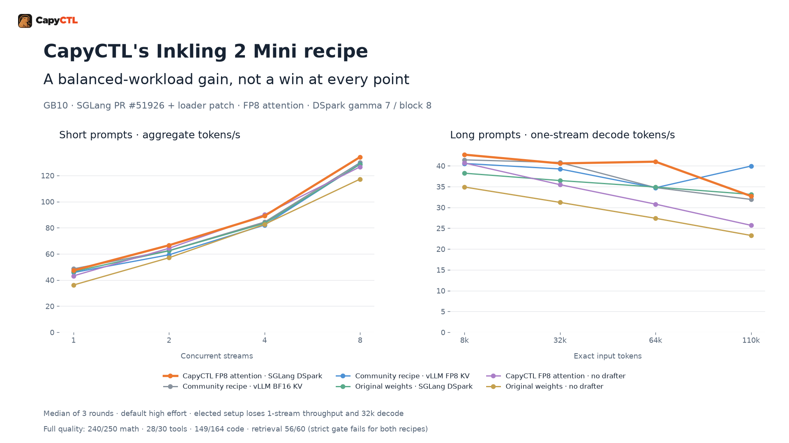

# Inkling 2 Mini builds and recipes on GB10

**The elected setup is CapyCTL's FP8-attention checkpoint on patched SGLang PR #51926, DSpark gamma 7 / block 8, memory share 0.80.** It wins 2/4/8-stream throughput and 8k/64k/110k decode against the published community standard recipe, but loses one stream (about −3%) and 32k (about −1%). This is a balanced-workload choice, not blanket superiority.

[Native recipe](../../sglang/inkling-2-mini-capyctl-fp8-gb10/) · [Model card](../../sglang/inkling-2-mini-capyctl-fp8-gb10/convert/MODEL_CARD.md) · [Matrix](bench/final-matrix.json) · [HumanEval attribution](bench/humaneval-attribution.json) · [Publication audit](bench/publication-audit.json)



## Method and baseline

The baseline is [@tech2wild's published community recipe](https://github.com/tonyd2wild/Inkling-2-Mini-NVFP4-DGX-Spark), pinned at `300942daf6be61f39a7e6c6055bd7cb6e49c4e7c`, run with its published engine flags: standard tier `tv-std` (262,144 context, BF16 KV, 0.80 utilization) and max-FP8 tier `tv-fp8` (1,048,576 context, FP8 KV, 74 GiB KV). Both use DSpark seven speculative tokens with probabilistic sampling and `inkling` reasoning/tool parsers. The vLLM image is pinned as:

```text
vllm/vllm-openai@sha256:c2dc759f5984f69c1e2418c6af7c26eb756f5ed2a8934c768ae1253645d1449e
```

It reports vLLM `0.1.dev25855+g7cb5dae22`, an unreleased 0.35-era build. Operational deviations are immutable image/weight pins, a uniquely owned container, local-only port publication, and omission of the privileged cache-drop step (no sudo). Engine flags were not retuned. Source weights are `thinkingmachines/Inkling-2-Mini@ed40e7da625f594fc9c4990f5f66be24873c22d7`.

SGLang uses [PR #51926](https://github.com/sgl-project/sglang/pull/51926) at `92e894ef904bfdb5c0cf2f2a541cbd4eec023573`, isolated Python 3.12.3, torch 2.14.1+cu130, FlashInfer 0.7.4 and the recorded dependency freeze. The FP8 path adds the approved three-file loader patch (+81/−13), not a different engine release. All ranking rows use native launches, not CapyCTL-managed launches. Baseline and original-plain measurements retain their earlier GB10 machine assignment; later SGLang/FP8 rows and original-vs-FP8 code attribution share the later machine. No hardware-normalized causal engine claim is made.

Short throughput uses fixed chat/code prompts, default high effort (0.9), temperature zero, normal EOS and a 512-total-completion-token cap including reasoning: one warm-up and three measured rounds at 1/2/4/8 streams. Aggregate is native completion-token usage / round wall span, even at one stream. TTFT includes reasoning. Exact-24k TTFT at 1/4 streams uses 128 output tokens. Context decode uses three requests per exact native 8k/32k/64k/110k full-chat input with 512 output tokens and fresh seeded content; it excludes first-token time. Do not mix aggregate and decode.

Full quality is GSM8K-250 / tools-30 / HumanEval-164, a common 32,768-total-token cap, default high effort, concurrency eight and 2,400-second client timeout. Truncations count wrong, HTTP errors must be zero and outputs are reviewed. Every task's accuracy must meet `tv-std`'s ordinary two-sided 95% Wilson lower endpoint and its truncation rate must not exceed the upper endpoint. Tools additionally allow no new failure type; **30/30 is not required**, because the baseline itself is 28/30. Screens use 50/30/50 and never qualify a setup. The separate 20-case high-effort probe is 20/20 with no truncations; it reuses screen observations, not independent repeated requests.

### Published numbers — not reproduced here

| Source | Published setup | Published result |
|---|---|---|
| [Classmethod](https://dev.classmethod.jp/articles/dgx-spark-inkling-2-mini-first-touch/) | Official vLLM 262K recipe, DSpark-7, one stream, forced 256 output tokens, median of three | **37.83 tokens/s**, TTFT 0.212 s |
| [oMLX community benchmark](https://omlx.ai/benchmarks/performance/0z8r79zd) | M5 Ultra (80 GPU cores), 96 GB, oMLX 0.8.1, Inkling-2-Mini-oQ8e 8-bit, 4k context, MTP and affine8 KV | **83.4 generation tokens/s**, 3,225 prompt tokens/s |

These are **published**, not this comparison's measurements. Hardware, model quantization, sampling and timing methods differ. They do not enter the matched-workload election or chart.

## Election and limits

Weights: [capyctl/Inkling-2-Mini-NVFP4-FP8](https://huggingface.co/capyctl/Inkling-2-Mini-NVFP4-FP8) at `f3a7d6f69777e2713adaffbda1460581b1dabf60`. The native experts, head, DSpark draft and tokenizer are byte-identical to Thinking Machines' source. Exactly 144 attention projections become FP8 E4M3 with per-output-channel FP32 scales. The corrected index includes all 1,388 tensors and the 144 new scales; its separate load-only check passed without replacing any speed or quality observation.

The election uses the **equal-weight geometric mean of eight throughput ratios versus `tv-std`**: four short aggregate loads and four exact-context decode points. FP8 DSpark scores **1.0431**; FP8 plain scores **0.9339** and also fails the new-tool-failure-type screen. The elected setup passes the full baseline-relative quality gates, but is worse on full HumanEval and fails strict retrieval completeness. TTFT is reported separately, not mixed into the score.

| Load / context | Elected tokens/s | Community standard tokens/s | Change | Throughput | TTFT |
|---|---:|---:|---:|---|---|
| Short 1 stream | 47.31 | 48.58 | −2.61% | loss | win |
| Short 2 streams | 66.59 | 62.51 | +6.53% | win | win |
| Short 4 streams | 89.06 | 84.34 | +5.59% | win | win, only 0.878 ms |
| Short 8 streams | 134.13 | 129.86 | +3.29% | win | loss |
| 8k decode | 42.67 | 41.42 | +3.02% | win | win |
| 32k decode | 40.57 | 40.79 | −0.55% | loss | win |
| 64k decode | 40.99 | 34.75 | +17.94% | win | win |
| 110k decode | 32.72 | 31.92 | +2.52% | win | win |

Point estimates are not statistical significance or quality-equivalence claims. `tv-fp8` is faster than the elected setup at 110k decode (39.93 versus 32.72), but has only a screen and tighter observed memory headroom. Original-weight SGLang DSpark also slightly leads elected 110k decode (33.12 versus 32.72). The election is not a claim to beat every row at every point.

The elected command adds **no context override**: the limit remains the model's default **1,048,576 tokens**, while the community standard tier caps at 262,144. Decode was measured through 110k and retrieval checked through 220k on the elected setup. **Nothing beyond 220k was tested there**; the default limit alone is not a million-token capability or accuracy claim. The community max-FP8 tier's separate near-million-token needle is not evidence for the elected recipe.

## Failures, continuations and non-results

- Original plain cold start at 0.80 was safety-stopped before ready when sampled MemAvailable reached 2.77 GiB; no request was sent. Preparation at 0.45 then reached ready. Warm 0.80 speed observations remain valid; this does not qualify plain cold startup.
- The initial original-plain screen retained two transport errors. Only those incomplete HumanEval/17 and /41 requests were repaired, both passed, and a composite screen passed. The original failures and separate two-case repair receipt remain; a two-case pass is not a full-code score.
- FP8 plain has 28/30 tools but introduces `wrong-tool`, so its screen fails despite numerically matching the baseline's tool score. The baseline's existing failure types are `unavailable-tool` and `no-call`.
- DSpark's first three-token option failed argument resolution; the configured gamma-2 / block-3 launch then failed the model's exact-block-size guard before ready. Gamma 4 / block 5 is **[INFERENCE]** excluded by that same guard and was not redundantly launched. **Only gamma 7 / block 8 is supported**; no speed or acceptance is invented for smaller blocks.
- Gamma-7 tuning retained a 32k result of 43.93 tokens/s, but it used 128 output tokens because of a client branch. It is excluded from the 512-token ranking; the later complete speed row supplies the valid 32k observation. Neither failure cases nor successful full rows were repeated just to improve scores.
- The first selective export's top-level precision stub shadowed its detailed precision groups and failed loading; removing the obsolete stub fixed the converter. The later stale-index repair changed metadata only, not tensor payloads or numerical settings. The repaired-index load-only start was 231.11 s and sent no benchmark/quality requests.
- Full FP8 quality retains all 50 math / 30 tool / 50 code screen observations, including failures, and sends only 200 new math / zero tool / 114 code requests. Original-weight SGLang full code likewise retains its 50-case screen and adds only 114 requests. Every observation has `launch_run`; continuation receipts preserve both launches. No scored code failure was rerun or effort reduced.

## Every retained launch

Tokens/s are aggregate completion tokens / round wall span, median of three rounds. Quality cells show score and truncations; screens are not full qualification. Ready/minimum memory is absolute system MemAvailable, not an isolated allocation.

| Setup (run) | Gate | 1 stream | 2 streams | 4 streams | 8 streams | Ready s | Ready / min GiB available | GSM8K | Tools | HumanEval |
|---|---|---:|---:|---:|---:|---:|---|---|---|---|
| FP8 DSpark, elected cold-JIT start (`cold-start-elected-host-a`) | not evaluated | — | — | — | — | 881.58 | 22.50 / 4.36 | — | — | — |
| Original DSpark, full code only (`sg-dspark-code-full`) | code only pass | — | — | — | — | 229.11 | 21.04 / 20.60 | — | — | 151/164 (10 trunc) |
| Original DSpark, screen (`sg-dspark-host-a`) | screen pass only | 46.42 | 62.35 | 83.42 | 128.53 | 263.14 | 20.78 / 20.26 | 49/50 (0 trunc) | 30/30 (0 trunc) | 47/50 (2 trunc) |
| FP8 DSpark, gamma 2 rejected by model (`sg-fp8-dspark-3-configured`) | failed before ready | — | — | — | — | — | — / 78.19 | — | — | — |
| FP8 DSpark, unresolved 3-token option rejected (`sg-fp8-dspark-3-tune`) | failed before ready | — | — | — | — | — | — / 117.19 | — | — | — |
| FP8 DSpark gamma 7, tuning only (`sg-fp8-dspark-8-tune`) | not evaluated | 46.95 | — | — | 132.96 | 239.24 | 21.06 / 20.80 | — | — | — |
| FP8 DSpark, full quality continuation (`sg-fp8-dspark-full`) | full pass | — | — | — | — | 239.13 | 20.90 / 20.31 | 240/250 (2 trunc) | 28/30 (0 trunc) | 149/164 (12 trunc) |
| FP8 DSpark gamma 7 (elected speed) (`sg-fp8-dspark-host-a`) | screen pass only | 47.31 | 66.59 | 89.06 | 134.13 | 247.13 | 20.48 / 19.83 | 48/50 (0 trunc) | 28/30 (0 trunc) | 47/50 (2 trunc) |
| FP8 DSpark, repaired-index load only (`sg-fp8-index-load-only`) | not evaluated | — | — | — | — | 231.11 | 20.06 / 20.73 | — | — | — |
| FP8 plain, failed screen (`sg-fp8-plain-host-a`) | screen fail | 43.17 | 64.28 | 90.00 | 126.64 | 241.12 | 11.49 / 10.88 | 48/50 (0 trunc) | 28/30 (0 trunc) | 47/50 (2 trunc) |
| Original plain, cold safety stop (`sg-plain`) | failed before ready | — | — | — | — | — | — / 2.77 | — | — | — |
| Original plain, 0.45 JIT preparation (`sg-plain-jit-warmup`) | not evaluated | — | — | — | — | 569.25 | 51.11 / 30.35 | — | — | — |
| Original plain, composite screen (`sg-plain-screen-completed`) | screen pass only | — | — | — | — | 223.21 | 11.90 / — | 47/50 (1 trunc) | 28/30 (0 trunc) | 48/50 (1 trunc) |
| Original plain, two transport repairs only (`sg-plain-transport`) | not evaluated | — | — | — | — | 223.21 | 11.90 / 11.76 | — | — | 2/2 (0 trunc) |
| Original plain, initial transport failures (`sg-plain-warm`) | screen fail | 36.15 | 57.05 | 82.62 | 117.24 | 273.32 | 12.24 / 11.00 | 47/50 (1 trunc) | 28/30 (0 trunc) | 46/50 (1 trunc; 2 errors) |
| Published community max-FP8 (screen) (`tv-fp8`) | screen pass only | 45.69 | 59.29 | 82.06 | 128.82 | 373.07 | 6.08 / 5.41 | 48/50 (1 trunc) | 29/30 (0 trunc) | 46/50 (3 trunc) |
| Published community standard (baseline) (`tv-std`) | full pass | 48.58 | 62.51 | 84.34 | 129.86 | 334.80 | 19.75 / 17.19 | 241/250 (2 trunc) | 28/30 (0 trunc) | 154/164 (7 trunc) |

## TTFT, acceptance and exact context

TTFT includes reasoning. Context decode excludes TTFT. Accepted length includes the target/bonus token; SGLang span lengths include prefill-emitted tokens and are not exact accepted-draft fractions. The tuning row's 32k point used 128 output tokens and is excluded from the 512-token ranking.

| Setup (run) | Short TTFT 1/2/4/8, s | 24k TTFT 1/4, s | Accepted length 1/2/4/8 | Decode 8k/32k/64k/110k, tokens/s |
|---|---|---|---|---|
| Original DSpark, screen (`sg-dspark-host-a`) | 0.247 / 0.294 / 0.399 / 0.419 | 6.993 / 27.654 | 2.595 / 2.551 / 2.597 / 2.612 | 38.21 / 36.45 / 34.89 / 33.12 |
| FP8 DSpark gamma 7, tuning only (`sg-fp8-dspark-8-tune`) | 0.198 / — / — / 0.390 | — / — | 2.582 / — / — / 2.587 | — / — / — / — |
| FP8 DSpark gamma 7 (elected speed) (`sg-fp8-dspark-host-a`) | 0.195 / 0.245 / 0.302 / 0.447 | 6.780 / 26.767 | 2.582 / 2.610 / 2.618 / 2.628 | 42.67 / 40.57 / 40.99 / 32.72 |
| FP8 plain, failed screen (`sg-fp8-plain-host-a`) | 0.172 / 0.203 / 0.347 / 0.522 | 6.818 / 27.082 | — / — / — / — | 40.66 / 35.47 / 30.78 / 25.69 |
| Original plain, initial transport failures (`sg-plain-warm`) | 0.189 / 0.275 / 0.358 / 0.558 | 6.917 / 27.492 | — / — / — / — | 34.89 / 31.20 / 27.38 / 23.26 |
| Published community max-FP8 (screen) (`tv-fp8`) | 0.222 / 0.298 / 0.398 / 0.468 | 8.502 / 23.353 | 2.709 / 2.520 / 2.586 / 2.621 | 40.55 / 39.24 / 34.72 / 39.93 |
| Published community standard (baseline) (`tv-std`) | 0.231 / 0.274 / 0.303 / 0.384 | 8.151 / 22.631 | 2.666 / 2.614 / 2.619 / 2.599 | 41.42 / 40.79 / 34.75 / 31.92 |

The table lists every final-matrix launch, including preparation, failed starts and composite/continuation receipts. A composite is not another independent sample. Ready and watcher minima are separate observations: a sampled minimum need not include the separate ready snapshot. The initial original-plain row's two transport errors remain visible rather than silently replaced by the composite.

## HumanEval attribution and quality

| Full 164-case setup | Passes | Truncations |
|---|---:|---:|
| Published community standard (`tv-std`), original weights | 154 | 7 |
| SGLang DSpark, original weights | 151 | 10 |
| SGLang DSpark, FP8 attention | 149 | 12 |

**[INFERENCE] Both the engine stack and FP8 contribute to the observed gap.** Original-weight SGLang already has three fewer passes than the community recipe; FP8 adds a further two-pass gap under the same SGLang settings. It is not valid to attribute the entire five-pass gap to FP8, or to infer a statistically proven causal split. The paired SGLang cohort has five FP8-only passes, seven original-only passes, 144 shared passes and eight shared failures. The common math screen is only 49/50 versus 48/50, not full math attribution. See [humaneval-attribution.json](bench/humaneval-attribution.json).

Elected full scores are **240/250 math, 28/30 tools and 149/164 code**, truncations **2/0/12**, zero HTTP errors. All declared baseline-relative gates pass. The observed code truncation rate (7.32%) is below the baseline upper Wilson endpoint (8.55%), but worse than the baseline's observed 7/164 truncations. Passing a relative gate does not erase that regression. The three nontruncated FP8 code misses omit `encode_cyclic`, omit `encode_shift`, or import nonexistent `ROUND_HALF_AWAY_FROM_ZERO`.

## Retrieval and copy: both recipes fail strict completeness

Six seeded documents, original and one-line variants, at each exact original 32k/64k/96k/111k/220k full-chat input give 60 observations. One-line variants add 14 tokens. All-three-code presence is primary; ordered exact extraction is secondary. Both elected and `tv-std` pass **56/60** on both metrics and **fail the strict all-observation retrieval gate**. All 30 original variants pass; four one-line variants exhaust the 2048-token output cap with empty finals. Original native token-count mismatches and HTTP errors are zero.

| Original input | Elected all-three / ordered | Community standard all-three / ordered |
|---:|---|---|
| 32k | 12/12 / 12/12 | 11/12 / 11/12 |
| 64k | 11/12 / 11/12 | 12/12 / 12/12 |
| 96k | 10/12 / 10/12 | 10/12 / 10/12 |
| 111k | 12/12 / 12/12 | 12/12 / 12/12 |
| 220k | 11/12 / 11/12 | 11/12 / 11/12 |

Strict copy passes **100/100** on the same 100 seeded 2000-token documents for both. These finite tests are not general long-context qualification. `tv-fp8` retrieval is 55/60 and also fails completeness; its near-million needle remains a separate sanity result, not a full retrieval gate.

## Cold-JIT finding and recipe form

The elected FP8 DSpark gamma-7 setup passed **one fresh-JIT start at 0.80**, retaining **MAX_JOBS=2**: **881.58 s (about 882 s)** to ready, **4.36 GiB minimum observed MemAvailable** across 444 two-second samples, and 22.50 GiB at ready. The 3 GiB safety floor did not fire. No benchmark or quality request was sent. The entire isolated compilation cache was moved aside (not deleted), then the warm cache restored; new cold-created caches were retained separately. Filesystem page cache was not dropped. This is a cold-JIT finding, not cold-machine/download qualification and not a pass for the earlier plain-mode failure.

The user-facing recipe is **native SGLang**, with the measured command and no context override. CapyCTL 0.1.12 accepted the candidate's schema but explicitly did not resolve the host/runtime or qualify the engine. Its managed policy reserves the static memory fraction and derives it from a byte grant; generic fitting also requires absent `max_position_embeddings` and does not model Inkling's loop visits/local-global/convolution state correctly. Selecting the PR venv through `local_engine.sglang` does not fix those gaps. No managed-controller measurement, parking/waking or controller/native equivalence is claimed.

## Preparation-only evidence, excluded from election

Earlier same-machine selective-FP8 probes used **0.45**, 256 forced output tokens, one warm-up and **one measured round**. They are not the three-round 0.80 ranking above.

| Preliminary row | Short aggregate 1 / 8 streams | 32k decode tokens/s | 32k TTFT s | Ready s | Minimum available GiB |
|---|---|---:|---:|---:|---:|
| Original, unpatched plain | 36.58 / 118.24 | 31.01 | 9.364 | 243.10 | 51.91 |
| FP8 attention, plain | 43.01 / 126.34 | 35.50 | 9.324 | 239.10 | 51.74 |
| FP8 attention, DSpark-8 | 45.41 / 129.79 | 30.05 | 9.527 | 297.12 | 54.79 |

The separate original cold preparation reached ready at 0.45 in 889.28 s (32.38 GiB minimum); a client serialization error happened before any sanity request. A tokenizer `return_dict=False` client correction is not an engine speed result. The original-vs-FP8 50-prompt teacher-forced agreement check and index/config regressions are diagnostics, not full engine qualification. Real SM121 traces record CUTLASS SM120-family dense E4M3×E4M3 GEMM with FP32 accumulation and BF16 output; profile-only launches are not extra performance rounds.

## Reproduce the publication

```bash
python3 -B recipe-table.py
uv run --no-project --with matplotlib --with pillow python3 -B summarize-charts.py
```

Both scripts read retained evidence only; neither runs inference or mutates the matrix. The table includes every final-matrix launch; the charts select the six complete speed configurations, not failed or preparation-only rows. The CapyCTL logo sits top-left and the footer uses plain text. Light and dark images are retained under `bench/summary/`.

[Measured converter](convert-fp8-attention.py), [measured per-tensor manifest](bench/fp8-host-a/checkpoint/fp8-attention-manifest.json), [loader patch](patches/sglang-inkling-fp8-attention.diff) and [installer](install.sh) are the retained evidence copies. The recipe's `convert/`, `install.sh` and `patches/` hold byte-identical user-facing copies. [Publication audit](bench/publication-audit.json) records the evidence boundary and redactions; full generated documents are not published, but seeds, hashes, count manifests, API outputs and reviews remain. Last cleanup receipts record no owned engine remaining.

Only GB10 was measured. Other hardware/engine versions, vision/multimodal quality and parking/waking remain unqualified. CPU/offline checks and load-only starts are not engine qualification. Apache-2.0 derivative of Thinking Machines' model; retain upstream notices. The community recipe's MIT license is retained separately in `community-LICENSE`.
