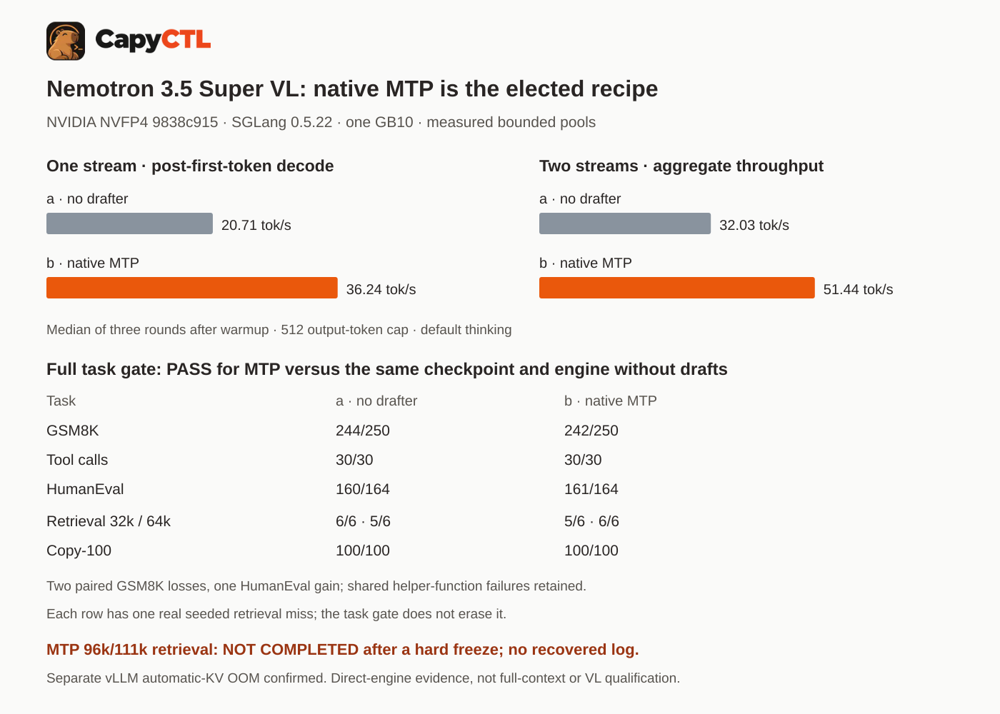

# Nemotron 3.5 Super VL drafter comparison

I elect [NVIDIA NVFP4 at `9838c915` on SGLang 0.5.22 with native MTP](../../sglang/nemotron-3.5-super-vl-120b-a12b-mtp-gb10/), using the measured safety-adjusted pools below. **MTP retrieval was measured only through 64k input tokens. The corrected 96k/111k MTP probes were not completed because the run froze the machine: a hard freeze, with no log recovered for that attempt.** Earlier the same day, vLLM's automatic KV sizing caused a confirmed OOM. These are separate incidents; I do not claim a confirmed OOM for the later freeze.



## Measured full-suite results

These are the **safety-adjusted** SGLang 0.5.22 profiles, not the historical screen. Both serve NVIDIA's `NVIDIA-Nemotron-3.5-Super-VL-120B-A12B-NVFP4` at `9838c91537e6be21dec2f5276b784211a06fbeea`, with a 262,144-token pool, 32 Mamba states, static memory fraction 0.78, two running requests, and a 114,688-token context. Both retain FlashInfer attention, FP8 E4M3 KV, BF16 Mamba state, 1,024-token prefill chunks, 8,192 maximum prefill tokens, and the `nemotron_3`/`qwen3_coder` parsers. b adds native MTP via EAGLE, three steps, top-k one, and four draft-tree tokens. No template override disables thinking. The configured context is not a safety or retrieval qualification.

| Profile | c1 aggregate / decode tok/s | c2 aggregate / per-user decode tok/s | c4 aggregate tok/s | c8 aggregate tok/s | Peak system GiB | Minimum available GiB |
|---|---:|---:|---:|---:|---:|---:|
| a: no drafter | 20.54 / 20.71 | 32.03 / 16.17 | 32.41 | 32.45 | 86.54 | 35.15 |
| b: native MTP | 35.50 / 36.24 | 51.44 / 26.49 | 49.75 | 50.80 | 88.08* | 33.61* |

c4/c8 are client concurrency; the engine still runs at most two requests. Their median TTFTs are 16.13/47.71 seconds on a and 9.76/29.23 seconds on b. c1/c2 TTFTs are 0.24/0.33 seconds on a and 0.26/0.38 seconds on b. The values are medians over three rounds after warmup. Memory is sampled system-wide unified memory, not an isolated GPU weight allocation.

*b's memory figures describe its last completed phases, not the interrupted corrected 96k/111k attempt. They must not be used as proof that the final attempt stayed inside the envelope.*

| Profile | 8,192-input-token decode | 32,768-input-token decode | 65,536-input-token decode | 110,000-input-token decode |
|---|---:|---:|---:|---:|
| a | 20.86 tok/s | 20.66 tok/s | 20.42 tok/s | 20.06 tok/s |
| b | 33.74 tok/s | 35.42 tok/s | 36.43 tok/s | 37.42 tok/s |

Every native input-token count matched its target. Decode outputs are capped at 512 tokens. Decode speed is not retrieval-quality qualification.

## Established quality gate

All suites use the full canonical case sets, a 32,768-output-token cap, a 2,400-second client timeout, greedy decoding, and default thinking. Every truncated response counts as wrong.

The existing comparison rule uses the baseline's **two-sided 95% Wilson interval**, checked on the relevant side: candidate accuracy must meet its lower bound, and candidate truncation rate must not exceed the baseline truncation interval's upper bound. Complete matching methods/cases, zero HTTP errors, tools 30/30, and explicit output review are also required. A lower raw score is not automatically a failed gate.

| Suite | a | b | a accuracy lower bound | b gate |
|---|---:|---:|---:|---|
| GSM8K-250 | 244/250 | 242/250 | 94.86% | Pass |
| tools-30 | 30/30 | 30/30 | 88.65%, plus 30/30 required | Pass |
| HumanEval-164 | 160/164 | 161/164 | 93.90% | Pass |

The matching upper Wilson95 bounds for truncation are 1.5133% (GSM8K), 11.3513% (tools), and 2.2887% (HumanEval); b's observed rate is zero in every suite. a is the checkpoint-and-engine baseline, not an independently qualified maximum-context recipe. The gate is a finite task-screen adoption rule, not a demonstration of statistical equivalence.

Both rows have zero HTTP errors and zero truncations. The full b quality gate **passes**, including output review; see [`quality-gate.json`](results/b-safe-full/quality-gate.json) and [`output-review.json`](results/b-safe-full/output-review.json).

Paired differences are additional information, not another gate: **two GSM8K losses, no GSM8K gains, one HumanEval gain, and no HumanEval/tool losses**. In GSM8K case 1074, a answers the expected 750 while b answers 500 by excluding the first half-puzzle from the stated hour. In case 187, a answers the expected 106 while b compounds monthly interest and answers 106.12. Output review found coherent but incorrect interpretations, not malformed responses or a new refusal/formatting pattern.

The HumanEval gain is **HumanEval/32 (`find_zero`)**. a's returned polynomial-root program expands only the positive side before a left-side fallback it cannot reach while that loop continues; its retained execution failed with return code -9. b brackets both negative and positive sides before bisection and passes. There are no paired coding losses.

Both rows share **HumanEval/38 and /50 failures**: their complete-function programs omit the `encode_cyclic` and `encode_shift` helpers needed by the tests. This exposes a shared helper-function limitation of this complete-function evaluation protocol, not a clean measure of every task's algorithmic correctness. Both also fail HumanEval/145's signed digit-sum assertion. I retain the observed 160/164 and 161/164 scores without silently supplying helpers or rescoring. Tool scores check parsed function names and required argument keys, not arbitrary tool execution or complete argument semantics; all 30 pass, and the reviewed calls show no formatting drift.

## Matched retrieval and copy: MTP measured through 64k

The comparison uses six seeded documents at each of 32k, 64k, 96k, and 111k exact input tokens, plus 100 deterministic 2k-token copy cases. Both rows use the same saved messages and message hashes. The original b responses are retained, not rerun to erase failures; their reconstructed prompt hashes match.

| Probe | a | b |
|---|---:|---:|
| Retrieval 32k | 6/6 | 5/6 |
| Retrieval 64k | 5/6 | 6/6 |
| Retrieval 96k | 6/6 | Not completed: hard freeze |
| Retrieval 111k | 6/6 | Not completed: hard freeze |
| Copy-100 | 100/100 | 100/100 |

a's complete retrieval score is 23/24, with zero HTTP errors, zero truncations, and every native input count exact. b has 11/12 valid completed retrieval responses across 32k/64k; these and copy-100 have zero HTTP errors and truncations. Twelve initial b 96k/111k requests were rejected before inference because the client omitted EAGLE's four reserved output slots. Those rejected attempts are retained in the evidence, not scored as wrong model answers. The corrected budget was `min(32768, 114688 - input_tokens - 4)`; the corrected run froze the machine before completed long-probe evidence could be recovered. Its missing responses and memory samples stay unmeasured. I do not publish a 24-case b score.

The observed b failure is the 32,000-token document with filler seed **730407302**. Expected codes:

```text
GATE426D6145C02D1CCA
GATE1A2EAE87742E6E32
GATEADDB83934D9A45A6
```

b returned:

```text
GATE426D6145C02D1CCA
GATE1A2EAE87742E6E32
GATEADDB83934D9A45A45A
```

The third code is wrong; the first two are correct. **a gets this exact observation right:** it returns all three expected codes, including `GATEADDB83934D9A45A6`. Both rows used the identical prompt with SHA-256 `abfff9f184d97b825ad9f5181be19944251894dc450148e0915563017016bb70`; both returned HTTP 200, exactly 32,000 native input tokens, and no truncation. This is a real paired retrieval miss in b. For balance, a produces the same wrong third code at 64k on seed 730407302, where b returns all three codes correctly. Neither observed miss is erased or treated as a fixture mismatch.

| Paired document, seed 730407302 | Expected third code | a: NVIDIA NVFP4 · SGLang 0.5.22, no drafter | b: same checkpoint/engine, native MTP |
|---|---|---|---|
| 32,000 input tokens | `GATEADDB83934D9A45A6` | Correct | `GATEADDB83934D9A45A45A` — miss |
| 64,000 input tokens | `GATEADDB83934D9A45A6` | `GATEADDB83934D9A45A45A` — miss | Correct |

The 64k prompt hash is `f166f3d04925d7998e5837be384a488e69b73257f6a1ec2eeb720c0fee61cc70` in both rows. Both seeded misses returned HTTP 200, matched native input counts, and were not truncated.

## Other rows and safety

- **c, bounded vLLM 0.32 native MTP:** does not start within a 100 GiB cap on GB10 even with a 4 GiB KV pool. Sampled peak system use was 104.00 GiB; the engine was killed by the cap before readiness. Minimum sampled available memory was 17.69 GiB and the compute-process list was empty afterward. The log confirms that the explicit 4 GiB KV budget was honored, with capacity for 522,196 tokens; this was not another automatic 33.9 GiB KV allocation. No throughput or quality result is claimed.
- **d, vLLM 0.32 LiLiCorr (5 tokens):** skipped on the updated memory evidence. Its already queued startup was stopped before readiness after c showed that the smaller native-MTP configuration could not start within the cap. Sampled peak system use before the stop was 86,725,890,048 bytes, with 43,937,280,000 bytes minimum available; its final compute-process list was empty. The larger drafter cannot be planned safely in that envelope. Raw aborted-startup evidence is retained separately; there is no d performance or quality measurement. The drafter revision is `7c7221aeb4cb3139307aa457f7dce11a8fb6ceb2`.
- **e, published [vLLM 0.31 recipe as written](../../vllm/nemotron-3.5-super-vl-120b-a12b-nvfp4-gb10/):** target revision `579ffa0b659bc681b89e649fa7c2d5089399602e`, the same pinned LiLiCorr drafter, and four running requests; skipped without launch. [INFERENCE] Its conservative estimated footprint is about 111.7 GiB, above the roughly 102 GiB engine envelope after preserving 16 GiB free. Changing its graph settings would no longer measure it as written. The existing recipe ran before, but **needs a memory-safety review** before reuse.

c/d use the fixed NVIDIA target revision above, two running requests, a 4 GiB explicit KV pool and graph capture sizes 1/2; c uses three native-MTP speculative tokens. They retain disabled prefix caching, 64-token blocks, FlashInfer Mamba, FP16 state with stochastic rounding and five Philox rounds, 8,192 batched tokens, and 0.5 video pruning. These differ from SGLang's BF16 state and are not a cross-engine isolated drafter ablation. The 100 GiB cap and 16 GiB planned reserve describe those historical attempts, not the stricter native-launch safeguards below.

### Two operator findings on 2026-11-23

1. **Confirmed OOM, 10:10:** original uncapped vLLM 0.32 native MTP allocated 70.1 GiB for the model, 33.86 GiB for automatically sized KV, and 0.53 GiB for graphs: 104.49 GiB before other runtime and operating-system overhead. Sampled peak system use was 130,663,170,048 bytes and available memory reached zero. Kernel OOM kills and NVIDIA allocation failures establish memory exhaustion; the recorded result was a readiness timeout, not a benchmark. The initial emergency guard could not act.
2. **Hard freeze, 19:47:** corrected SGLang native-MTP 96k/111k retrieval probes froze the machine after the smaller-pool runs had succeeded. No log or final memory sample was recovered for this attempt. Its configured 100 GiB scope and 18 GiB available-memory guard do not prove the workers or unified allocations stayed within the envelope. The cause is not established. Earlier b memory numbers do not cover it, and final owned-process cleanup was not confirmed by the retained local evidence.

I do not relaunch those long probes for publication. The native launcher uses a stricter 95 GiB scope, an inferred 90 GiB planned footprint with at least 20 GiB left available, and a 4 GiB emergency guard. These are operator safeguards, **not newly measured qualification**; neither a scope nor a polling guard guarantees protection from a hard freeze. Keep input at or below 64k tokens and run only one engine at a time.

## Publication decision and evidence

I publish native SGLang MTP for the measured text workloads: **+75.0% c1 decode speed with a passing established full task gate** versus the same NVIDIA checkpoint on SGLang 0.5.22 without a drafter. Both seeded retrieval misses and the paired math losses remain visible. Retrieval through 64k is measured, not perfect; retrieval and safe operation at 96k/111k remain unqualified. vLLM rows c/d/e are not viable within this comparison's conservative memory envelope: c failed to reach readiness, while d/e were safety skips rather than completed engine qualifications.

- [Native recipe and exact file/argument manifest](../../sglang/nemotron-3.5-super-vl-120b-a12b-mtp-gb10/). CapyCTL 0.1.12's document validator accepts the attempted deployment structurally, but its managed memory-share policy cannot reproduce the fixed static fraction. [Issue #264](https://github.com/edurdias/capyctl/issues/264) tracks that limitation. I do not ship a misleading deployment file.
- [Checkpoint hash audit](checkpoint-audit.json): all 88 weight shards match the pinned Hub SHA-256 metadata, totaling 75,010,188,240 file bytes. The fixed revision's processor correction is retained; there is no conversion, checkpoint modification, or upload.
- [Publication audit](publication-audit.json), [full quality gate](results/b-safe-full/quality-gate.json), [paired output review](results/b-safe-full/output-review.json), and raw retained `results/` evidence. Private working notes, collection helpers, and untouched originals are archived outside the repository. Public identity strings are redacted without changing numeric measurements.
- The short timing corpus is chat/code; c1/c2/c4/c8 each have three rounds after warmup. Aggregate throughput includes time to first token. Decode is `(completion_tokens - 1) / (last text chunk - first text chunk)`. Exact-length probes use three serial requests per length and native usage checks. Full task methods and pinned datasets are in [`method.json`](results/b-safe-full/accuracy/method.json). Generated code runs unprivileged with resource limits and bytecode disabled.

These are direct-engine measurements from 2026-11-23, not a CapyCTL launch qualification or a byte-identical packaged-runtime claim. No image/video, endurance, parking, or maximum-context qualification is claimed. CPU/offline checks, including configuration validation, do not establish engine capability.
