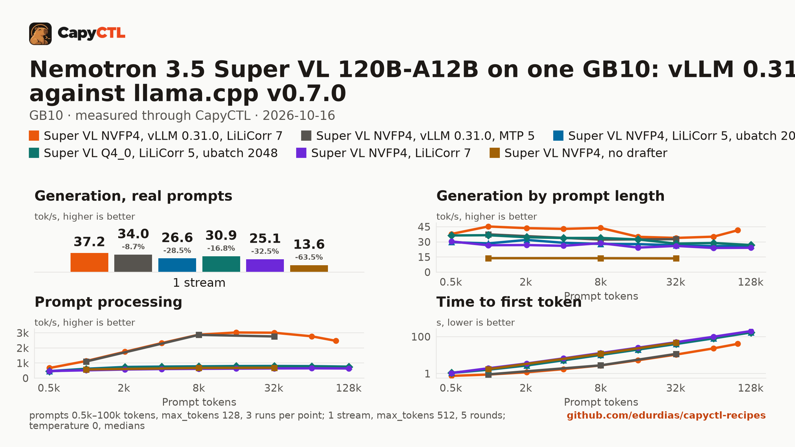

# Nemotron 3.5 Super VL 120B-A12B on one GB10: vLLM, llama.cpp, SGLang

NVIDIA's Super VL ([`nvidia/NVIDIA-Nemotron-3.5-Super-VL-120B-A12B-NVFP4`](https://huggingface.co/nvidia/NVIDIA-Nemotron-3.5-Super-VL-120B-A12B-NVFP4)),
released 2026-10-15, on every engine we could run it on, through CapyCTL 0.1.3 on
one GB10, with every drafter it ships with, measured 2026-10-16.

**vLLM 0.31.0 wins: 38 to 47 tokens/s decoding for one user, about 3,000
tokens/s of prompt processing, 74 tokens/s in total for 4 users.** llama.cpp
v0.7.0 runs it, but decodes 20 to 40% slower and processes prompts at about a
quarter of vLLM's rate, so a 32k-token prompt waits 40 s for its first token
instead of 11 s. SGLang 0.5.21 does not start it with either drafter. The
recipe: [vllm/nemotron-3.5-super-vl-120b-a12b-nvfp4-gb10](../../vllm/nemotron-3.5-super-vl-120b-a12b-nvfp4-gb10/).

[Full report](bench/report.html) (download and open it locally),
[tables](bench/summary.md), [every point](bench/data.csv). The deployment files
as they ran are in [deployments/](deployments/).

## Setup

| | |
|---|---|
| Hardware | 1x NVIDIA GB10, 128 GB unified memory, aarch64; driver 580.173.02, CUDA 13.0 |
| CapyCTL | 0.1.3 release (`345806a5`), `capyctl start standalone`, managed limit 108 GiB, free reserve 8 GiB |
| vLLM | 0.31.0 (torch 2.13.0+cu130), `VLLM_USE_V2_MODEL_RUNNER=1` for LiLiCorr |
| llama.cpp | `llama-server` v0.7.0 (`620d222`), CUDA, `121a-real` |
| SGLang | 0.5.21 |
| Checkpoints | vLLM and SGLang: `nvidia/NVIDIA-Nemotron-3.5-Super-VL-120B-A12B-NVFP4` at `579ffa0b659bc681b89e649fa7c2d5089399602e` and the drafter `nvidia/NVIDIA-Nemotron-3.5-Super-VL-120B-A12B-NVFP4-LiLiCorr` at `7c7221aeb4cb3139307aa457f7dce11a8fb6ceb2`. llama.cpp: `ggml-org/NVIDIA-Nemotron-3.5-Super-VL-120B-A12B-GGUF` at `3c91ad1be60865386af92e8147dafb32470b097d` (NVFP4 76.9 GB, Q4_0 71.8 GB, its LiLiCorr and MTP drafter GGUFs) |
| Benchmark | capyctl-bench: context sweep, the prompt set at one stream, 1 to 4 streams |

## Engines

| Engine, drafter | Decode, 1k / 8k / 32k prompt | Prompt processing, 8k / 32k | Time to first token, 8k / 32k | One user, prompt set |
|---|---|---|---|---|
| **vLLM 0.31.0, LiLiCorr 7** | **45.3 / 43.9 / 33.9 tokens/s** | **2,875 / 3,005 tokens/s** | **2.8 / 10.7 s** | 38.1 tokens/s, 0.35 s |
| vLLM 0.31.0, MTP 5 | 37.5 / 32.3 / 32.7 | 2,862 / 2,759 | 2.8 / 11.7 s | 34.6, 0.37 s |
| llama.cpp v0.7.0, Q4_0, LiLiCorr 5, prompt batch 2048 | 36.6 / 33.9 / 28.3 | 761 / 781 | 10.5 / 41.3 s | 31.9, 0.53 s |
| llama.cpp v0.7.0, NVFP4, LiLiCorr 5, prompt batch 2048 | 28.5 / 28.0 / 26.6 | 779 / 803 | 10.2 / 40.2 s | 27.2, 0.58 s |
| llama.cpp v0.7.0, NVFP4, LiLiCorr 7, prompt batch 512 | 26.7 / 28.7 / 26.0 | 618 / 642 | 12.9 / 50.3 s | 25.5, 0.55 s |
| llama.cpp v0.7.0, NVFP4, no drafter | 13.8 / 13.8 / 13.6 | 672 / 688 | 11.9 / 47.1 s | 13.8, 0.53 s |
| SGLang 0.5.21, MTP (NEXTN) | does not start: `ModuleNotFoundError: No module named 'cutlass'` | | | |
| SGLang 0.5.21, LiLiCorr (DFLASH) | does not start: `DFLASH fc.weight shape mismatch` (expects `(4096, 20480)` for 5 context features, the drafter has `(4096, 10240)`) | | | |

- **vLLM is the engine for this model on a GB10.** It processes prompts 3.7
  times faster than llama.cpp, which is what an agent re-reading its context
  every turn waits on, and decodes 20 to 60% faster.
- **LiLiCorr beats the model's own MTP head on vLLM** (38.1 against 34.6
  tokens/s for one user). On llama.cpp they are within 3% of each other
  (MTP 3: 27.4, LiLiCorr 4: 27.9). On vLLM, LiLiCorr 5 and 7 are within
  the run-to-run spread of each other for one user (two samples each, 37.2 to
  40.5); with 4 users LiLiCorr 5 is 3 to 10% ahead, so the recipe takes 5.
- **4 running requests cost one user nothing on vLLM:** 41 tokens/s alone,
  73.7 in total for 4 ([vLLM drafter report](bench/vllm-drafters/report.html)).
- **On llama.cpp, Q4_0 decodes about 20% faster than NVFP4** (36.6 against
  28.5 tokens/s at 1k), and takes 5 GB less; prompt processing is the same.
  Tuning llama.cpp helped prompts (+30% with a 2048-token prompt batch) and
  decode (+6 to 9% with 4 or 5 LiLiCorr tokens against 7, or MTP 3); see the
  [llama.cpp tuning report](bench/llamacpp-tuning/report.html).
- **No drafter halves decode** on any engine.

## Parking

CapyCTL parks a vLLM model deeply by default (weights and KV cache released,
a canary checked on wake). Super VL parked in 4 s and released 81 GiB (13 GiB
used in total afterwards), but every wake failed CapyCTL's wake canary
(`wake_mismatch`: after reloading the weights for about 100 s the model's
greedy answer to the canary prompt differed from its first one), with LiLiCorr,
without any drafter, without vLLM's stochastic rounding of the Mamba cache and
without its shared prefix checkpoints. CapyCTL then stops the model rather than
serve it, as designed. The recipe declares `residency: restart_only`: when
CapyCTL needs the memory it stops the model, and the next request starts it
again.

## Other engines

- **TensorFold 0.6.6** runs the Nemotron-H family only as Nemotron 3.5
  Lightning: its kernels have no path for Super VL's latent mixture-of-experts
  projections (`fc1_latent_proj`, `fc2_latent_proj`).
- **SGLang 0.5.21** needs the `cutlass` Python package for the MTP path and a
  newer DFlash loader for the LiLiCorr drafter; NVIDIA lists SGLang for GB200
  and H100 only.
- **A vLLM nightly or 0.32.0**, which NVIDIA's model card names, was not
  installed: 0.31.0 already has the architecture, the LiLiCorr speculator and
  every option NVIDIA's DGX Spark recipe uses.
