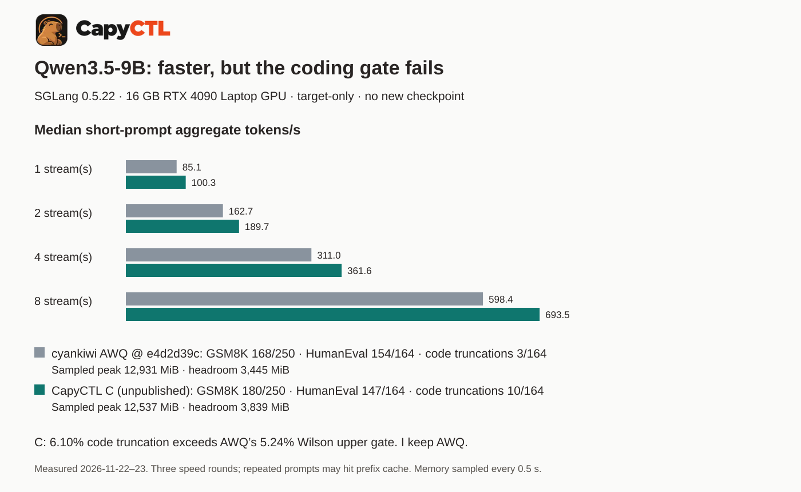

# Qwen3.5-9B: faster INT4 builds, but no replacement

I keep **cyankiwi/Qwen3.5-9B-AWQ-4bit @ e4d2d39c on SGLang 0.5.22 with the measured settings below**. My CapyCTL builds are faster and candidate C leaves more memory headroom on the 16 GB laptop, but it fails the full coding-truncation gate. Neither build is uploaded or published. This is a comparison, not a new recipe or checkpoint release.

## What I tried and why

The AWQ build leaves the output head in BF16. It is the largest individual BF16 weight read in its target decoder; reducing that read was the reason to try a quantized head, rather than just repack the existing AWQ weights. [INFERENCE] Fewer weight bytes per generated token could improve memory-bound decoding; actual speed and quality still need runtime measurements.

I built independently from `Qwen/Qwen3.5-9B @ c202236235762e1c871ad0ccb60c8ee5ba337b9a`, not from AWQ. Calibration used 384 conversations: 128 UltraChat, 128 Glaive function-calling transcripts and 128 Python examples, capped at 2,048 tokens. Dataset commits and rows are in [calibration-manifest.json](calibration-manifest.json); checkpoint identities are in [download-manifest.json](download-manifest.json).

| Build | Decoder / output head | Outcome |
|---|---|---|
| CapyCTL G32 | Symmetric INT4, group 32 / INT4, group 32 | Built and executed on GB10; failed the coding screen |
| CapyCTL C | Symmetric INT4, group 32 / INT8 per-channel | Built and executed on GB10 and the 16 GB laptop; failed the full coding-truncation gate |
| Planned G128 | Symmetric INT4, group 128 / INT4 | Not built; no measurements |

The 200 decoder targets cover MLP, full-attention and large DeltaNet QKV/Z/output matrices; the head is an explicit additional target. Activations remain BF16, with no activation ordering. Embeddings, vision, norms, small DeltaNet/state parameters and source MTP tensors remain unchanged. Candidate C's [tensor audit](bench/c-int8head-tensor-audit.json) records 574 byte-identical retained tensors, including all 15 BF16 MTP tensors; checkpoint shards total 8,353,438,208 bytes. Its architecture-based target weight-read estimate is 4,920,443,536 bytes/token, not a measured memory-bandwidth result: it excludes state/cache, activations, workspaces and speculation.

Builder versions: llmcompressor 0.13.0, compressed-tensors 0.18.0, Transformers 5.14.1 and Torch 2.13.0. [build.py](build.py) and the retained manifests describe the build. Runtime evidence confirms `CompressedTensorsWNA16` / `gptq_marlin`, including `ParallelLMHead`. C executes an INT8 head (`uint8b128`, pack factor four, channel group size minus one), not a BF16 fallback. Target-only launches skip MTP tensors even though the checkpoint preserves them. vLLM compatibility was not measured.

## Measured settings and limits

Measurements were collected on 2026-11-22–23 on GB10 and a 16 GB RTX 4090 Laptop GPU, using SGLang 0.5.22. The matched target-only launch requests context 32,768, eight running requests, 49,152 cached tokens, 2,048-token prefill chunks, decode graph batch limit eight, BF16 Mamba state and 48 Mamba cache slots, with `qwen3` reasoning and `qwen3_coder` tool parsers. Static memory fraction is automatic, not overridden. Requested context/cache capacity is not proof of admitted input capacity.

Speed uses greedy default thinking, forced 128-token output, one warm-up per concurrency and three measured short-prompt rounds. Tables use median aggregate tokens/s. Long-input points have one measured request each. Repeated prompts can benefit from prefix caching. Quality uses greedy default thinking, eight clients, a 3,600-second timeout and a 32,768-minus-exact-chat-prompt-token output budget. Every length-limited answer counts as wrong. Successful responses, including wrong answers and truncations, were never resampled; only missing/failed requests were retried.

## GB10 screens, not full qualification

Here AWQ means the pinned cyankiwi checkpoint on SGLang 0.5.22 with the settings above.

| Build | c1 aggregate tok/s | c4 | c8 | GSM8K | Tools | HumanEval pass@1 | Math / tools / code truncations |
|---|---:|---:|---:|---:|---:|---:|---|
| AWQ, BF16 head | 33.6 | 137.9 | 266.2 | 35/50 | 30/30 | 49/50 | 15 / 0 / 1 |
| G32, INT4 head | 48.8 | 175.3 | 337.6 | 36/50 | 30/30 | 41/50 | 14 / 0 / 8 |
| C, INT8 head | 44.9 | 164.5 | 317.8 | 35/50 | 30/30 | 45/50 | 14 / 0 / 4 |

C improves aggregate speed by 33.5% / 19.3% / 19.4% at c1/c4/c8 (about **+34% / +19%**), but recovers only four of G32's eight lost coding passes. G32 fails both coding screen gates: 82% accuracy is below AWQ's 89.50% Wilson lower endpoint, and 16% code truncation exceeds its 10.50% upper endpoint. C narrowly clears those small-screen thresholds (90% and 8%); the full laptop run below is the replacement decision, not this screen.

| Build | Actual 8,154-token input: decode / TTFT | Actual 32,299-token input: decode / TTFT |
|---|---|---|
| AWQ | 32.8 tok/s / 2.010 s | 29.6 tok/s / 8.704 s |
| G32 | 47.6 tok/s / 2.016 s | 40.7 tok/s / 8.572 s |
| C | 42.9 tok/s / 1.951 s | 37.6 tok/s / 8.479 s |

GB10 weight-loading reports were 9.04 GB for AWQ, 7.81 GB for G32 and 7.80 GB for C. Process snapshots were 13,211 MiB for AWQ before speed, 12,013 MiB for G32 overlapping speed startup, and 12,501 MiB for C after its quality screen. These are differently timed snapshots, **not matched idle or peak memory measurements**.

Evidence: [G32 speed](bench/g32-speed.json), [AWQ speed](bench/incumbent-speed.json), [C speed](bench/c-int8head-speed.json), and the final [G32](bench/g32-quality-3600/), [AWQ](bench/incumbent-quality-3600/), [C](bench/c-int8head-quality-3600/) screens. Final scored screens have zero HTTP errors. Initial protocol failures and timeout attempts remain separate and unscored.

## Full laptop gates: faster does not pass

| Build | GSM8K-250 | Tools-30 | HumanEval-164 | Math / tools / code truncations | Quality HTTP errors |
|---|---:|---:|---:|---|---:|
| AWQ | 168/250 | 30/30 | 154/164 | 80 / 0 / 3 | 0 |
| C | 180/250 | 30/30 | 147/164 | 66 / 0 / 10 | 0 |

These are the full requested sets, not the earlier GB10 screens. I use the ordinary two-sided 95% Wilson endpoints of AWQ for the gates. C's math accuracy (72.00%) clears the 61.16% lower bound; math truncation (26.40%) is below the 38.02% upper bound. Tools pass without truncation. Coding accuracy (89.63%) narrowly clears the 89.14% lower bound, but **10/164 code truncations (6.10%) exceed the 5.24% upper bound**, against AWQ's 3/164. C therefore fails the required gate despite passing the accuracy threshold.

| Build | c1 aggregate tok/s | c2 | c4 | c8 | Startup / sampled peak MiB | Peak headroom MiB |
|---|---:|---:|---:|---:|---|---:|
| AWQ | 85.09 | 162.67 | 310.95 | 598.44 | 12,605 / 12,931 | 3,445 |
| C | 100.3 | 189.7 | 361.6 | 693.5 | 12,338 / 12,537 | 3,839 |

C's median short-prompt gains are 17.9% / 16.6% / 16.3% / 15.9%: roughly **+16–18% on the 16 GB laptop**. Total-device memory was sampled every 0.5 seconds from before launch to shutdown; headroom is 16,376 MiB minus sampled peak, including the idle device baseline. Sub-sample spikes are not excluded. C's first quality launch took 527.14 seconds to ready; that observation is not a repeated startup benchmark.

Evidence: [laptop-summary.json](bench/laptop-summary.json), [AWQ full quality](bench/laptop-incumbent-quality/), [C full quality](bench/laptop-candidate-c-quality/), [AWQ speed](bench/laptop-incumbent-speed.json), [corrected C speed](bench/laptop-candidate-c-corrected-speed.json), and their memory records. C's original speed invocation returned HTTP 404 throughout; it is retained as a protocol failure, not a speed result.

## The context finding: a 32k setting is not 30k input capacity

In the first laptop launch, AWQ profiles only 29,683 cached tokens rather than the requested 49,152. Its automatic static memory fraction is 0.69542375. A **30,000-token input is rejected with maximum allowed input 29,677**. C accepts that exact input and decodes at 86.53 tok/s with 5.603 s TTFT. AWQ has no 30k speed result. At the earlier accepted 8,000-token point, C measures 97.42 tok/s / 1.677 s versus AWQ 83.06 / 1.692 s.

A later AWQ long-only launch has a still lower maximum input of 28,202, so even the proposed 29,000-token matched point is rejected. Capacity is launch-profile dependent. I therefore retain a separate exact **27,000-token accepted comparison**, without substituting it for rejected points:

| Build, later matched phase | 8k decode / TTFT | 27k decode / TTFT | 29k | 30k |
|---|---|---|---|---|
| AWQ | 57.96 tok/s / 2.283 s | 54.72 tok/s / 6.391 s | Rejected | Rejected |
| C | 68.02 tok/s / 2.279 s | 62.14 tok/s / 6.413 s | 61.85 tok/s / 0.769 s | 60.97 tok/s / 1.099 s |

The later 27k decode gain is about 13.6%. C's later 29k/30k TTFT can benefit from the preceding shared-prefix 27k request; it is not isolated prefill timing. Both later 8k results are slower than the earlier phase. [INFERENCE] Sustained laptop operating conditions may contribute, but clocks and thermal causes were not measured; I do not merge the phases into one speed claim. AWQ's cache admission/retraction behavior also remains part of the unchanged full quality run, rather than a claim of identical effective cache capacity.

Evidence: `bench/laptop-*-long-speed.json`, `bench/laptop-*-matched-speed.json` and corresponding runtime logs. Long inputs are represented by deterministic generator descriptions, seeds where applicable, and hashes in [input-manifest.json](bench/input-manifest.json), not duplicated text bodies.

## NEXTN did not become runnable under the 16 GB launch policy

I tried one NEXTN draft step, top-k one and two draft tokens, keeping the same target arguments and automatic memory policy. C preserves its own 15 BF16 MTP tensors, but the loader fails before ready because compressed-tensors has no matching target for `mtp.layers.0.self_attn.qkv_proj`.

Using AWQ's 29 packed/retained MTP tensors as the draft loads the weights, then fails the engine's memory gate before useful cache allocation: target plus draft weights leave no KV budget at automatic static fraction 0.69542375; the engine reports a minimum viable fraction above 0.758. I made no memory-policy override or engine patch. There is **no NEXTN throughput or acceptance measurement**.

[INFERENCE] Going from two draft tokens to one cannot fix that weight-only pre-cache failure; the one-token row was not run. This is a failure under the measured policy, not proof that every alternative policy exceeds physical 16 GB. Evidence: [MTP inventory](bench/laptop-mtp-inventory.json), `bench/laptop-candidate-c-nextn2-*` and `bench/laptop-candidate-c-incumbent-nextn2-*`.

## Decision and possible next experiments

I keep **cyankiwi/Qwen3.5-9B-AWQ-4bit @ e4d2d39c on SGLang 0.5.22 with the measured settings**. The finding is the deliverable: smaller weight reads, more sampled laptop headroom and higher throughput did not recover the required stopping behavior. Both CapyCTL builds stay unpublished; there is no recipe folder, upload plan or new default.

[INFERENCE] A BF16 head with INT4 decoder weights could isolate the head contribution, and a higher-precision or selectively retained head might trade some speed for fewer code truncations. The unbuilt G128 could test another accuracy/size tradeoff, but has no result. More representative calibration might help; this experiment does not establish that it will. Any next candidate needs the full matched coding and truncation gates again, not only a small screen. NEXTN would separately need a compatible MTP quantization configuration and an explicitly tested memory policy before any speed claim.

## Evidence and reproduction

- [recipe-table.py](recipe-table.py) prints tables from retained evidence and renders `summary.svg`; run `python3 -B recipe-table.py --chart`. No model inference or network is needed.
- [publication-audit.json](publication-audit.json) records original/published hashes, numeric JSON equality, sanitization and compact input provenance. Runtime addresses and user paths are scrubbed; examples use `/home/me
- The chronological working notes and the original comparison evidence were archived outside the repository under `/var/tmp/capyctl-webui/qwen35/comparison-archive/`. `NOTES.md` is not part of the publication.
- All owned engines were stopped. [Final laptop release](bench/laptop-release.json) records no GPU compute processes and 113 MiB device usage out of 16,376 MiB. No checkpoint was uploaded.
