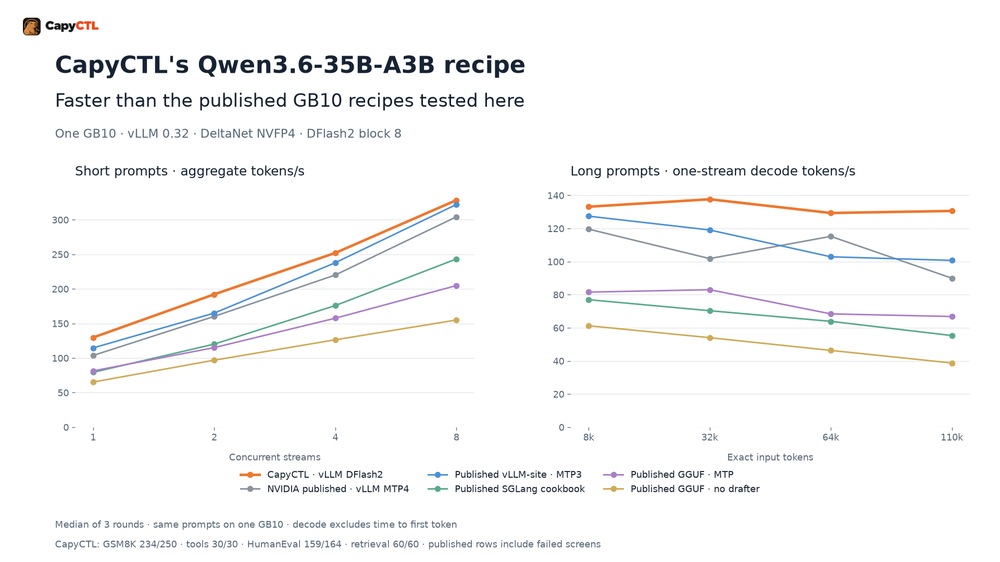

# Qwen3.6-35B-A3B builds and recipes on GB10

**The elected recipe is CapyCTL's DeltaNet NVFP4 checkpoint on vLLM 0.32.0 with DFlash2 block 8, through CapyCTL 0.1.12.** It beats the published GB10 recipes tested here at every measured short load and context. That does not mean it beats every alternative: NVIDIA's checkpoint with our DFlash2 settings is faster at eight short-prompt streams, and DSpark leads its own single-stream screen.

[Use the recipe](../../vllm/qwen3.6-35b-a3b-capyctl-nvfp4-gb10/) · [Model card](../../vllm/qwen3.6-35b-a3b-capyctl-nvfp4-gb10/convert/MODEL_CARD.md) · [Matrix](bench/final-matrix.json) · [Run evidence](bench/runs/)



## Method and baseline

The baseline is NVIDIA's published GB10 vLLM MTP4 recipe, pinned at [`bb515086`](https://github.com/NVIDIA/local-ai-inference-recipes/tree/bb515086841e7a81e7d51925561338e7dee35023/models/qwen/qwen3.6-35b-a3b/dgx-spark/linux/vllm/128gb), using NVIDIA's NVFP4 checkpoint. Its published runtime differs from the approved vLLM 0.32.0 used for this reproduction. The vLLM-site recipe was published for 0.28.0 and reproduced on 0.32.0. These are recipe reproductions on the stated engines, not measurements of the original environments. Pinned commands and sources are in [published-recipes.json](bench/published-recipes.json).

Short throughput uses the same fixed chat/code corpus, default thinking, temperature zero, normal EOS and a 512-total-completion-token cap: one warm-up, three measured rounds at 1/2/4/8 streams. Aggregate uses native completion-token usage divided by round wall span. TTFT includes reasoning. Exact-24k TTFT uses 128 output tokens at 1/4 streams. The context sweep uses three requests per exact native 8k/32k/64k/110k input, 512 output tokens and UUID-derived seeds to avoid prefix reuse. These are distinct workloads; do not mix aggregate and decode.

Full quality is GSM8K-250, tools-30 and HumanEval-164, with a common 32768-total-token cap, unchanged thinking, truncations wrong, zero HTTP errors and explicit output review. Candidates must reach the baseline's ordinary two-sided 95% Wilson lower accuracy endpoint and not exceed its upper truncation endpoint; only the worse direction is gated. Tools additionally require 30/30. This is not a 90% interval. Other rows first receive 50/30/50 screens; published checkpoints within 5% of elected c1 or c8 receive full gates. HumanEval execution uses resource-limited unprivileged temporary directories, not a claimed security sandbox. Screens never qualify a recipe.

### Published GB10 numbers, not our measurements

| Source | Published workload | Published result |
|---|---|---|
| [vLLM recipes](https://recipes.vllm.ai/Qwen/Qwen3.6-35B-A3B.md?hardware=dgx_spark_gb10&variant=nvfp4&features=tool_calling,reasoning,spec_decoding,text_only) | SPEED-Bench, 8000 input / 256 output, one stream | 97.7 decode tokens/s; 6265 prefill tokens/s; 3.95 s end to end |
| [SGLang cookbook](https://docs.sglang.io/cookbook/autoregressive/Qwen/Qwen3.6.md) | Input/output lengths and timing method unspecified | 75 output tokens/s |

These published figures are retained in `bench/published-recipes.json`, not remeasured observations. They are not mixed into the matched-workload ranking or charts. The NVIDIA source's original runtime and the reproduced runtime differ as stated above.

## Election and trade-offs

The elected checkpoint is [`capyctl/Qwen3.6-35B-A3B-NVFP4`](https://huggingface.co/capyctl/Qwen3.6-35B-A3B-NVFP4) at `cb64dfd952ed32865b3a7420d02d730522f498d8`. NVIDIA's experts and head remain NVFP4; DeltaNet `in_proj_qkv`, `in_proj_z` and `out_proj` become searched W4A16 NVFP4; full attention stays NVIDIA's FP8. Recurrent DeltaNet arithmetic is not claimed to be NVFP4. DFlash2 is `incoai/Qwen3.6-35B-A3B-DFlash2@51ef7b6923ad6c14cb1bb41c37a9041446496ab6`, block 8 (seven speculative tokens plus bonus).

The combined checkpoint also changes full attention to NVFP4. It passes full gates and is a measured alternative, not the elected checkpoint: HumanEval is 154/164 with five truncations versus elected 159/164 with one; it loses to NVIDIA DFlash2 at 32k and 110k. It leads c2/c4/c8 and 8k/64k among the two CapyCTL checkpoints. The elected checkpoint loses c8 to NVIDIA DFlash2 (328.4 versus 336.5 aggregate tokens/s). Small margins are not statistical-significance claims.

Target-only isolation (`cd0` versus `v0`) improves all four short loads without any drafter. [INFERENCE] reduced weight traffic helps explain that gain, while lower c8 accepted length erodes the DFlash2 gain; this does not separately measure bandwidth or establish causality.

## Failed gates and non-results

Every final published checkpoint/recipe row loaded; there are no final checkpoint load failures. RedHatAI, Unsloth standard and official FP8 pass screens only and are too slow to trigger full gates. Intel mixed and both GGUF rows fail HumanEval accuracy/truncation screens. SGLang cookbook fails tools: `play_music` repeats in reasoning until the cap without a structured call. Unsloth Fast passes its screen but fails full tools (29/30): `check_inventory` splits required arguments into two calls. These remain failures, not scores to discard. Old `e1` uses a shorter cap and cannot qualify.

Preparation failures are not benchmark rows: a tokenizer-path error and missing staged helper stopped before launch; an interrupted vLLM-site startup was not a load failure; a missing client `datasets` dependency left the successful baseline speed run intact and accuracy was recovered separately. A transfer reconstruction error was resolved with the existing client's non-Xet transport and pinned checksum audits, before timing began. No successful measurements were repeated merely to attach full gates.

## Every measured setup

Aggregate completion tokens / round wall time, median of three rounds. All columns use aggregate throughput, including one stream. Screens are not qualification. Ready memory is the system-used-memory delta, not total footprint.

| Setup (run) | Gate | 1 stream | 2 streams | 4 streams | 8 streams | Ready s | Ready Δ GiB | GSM8K | Tools | HumanEval |
|---|---|---:|---:|---:|---:|---:|---:|---:|---:|---:|
| CapyCTL combined · vLLM DFlash2 (`cc`) | full pass | 127.1 | 209.2 | 257.0 | 338.7 | 253.0 | 52.3 | 231/250 (14 trunc) | 30/30 (0 trunc) | 154/164 (5 trunc) |
| CapyCTL DeltaNet · vLLM DFlash2 (elected) (`cd`) | full pass | 129.7 | 192.1 | 252.0 | 328.4 | 241.2 | 52.5 | 234/250 (10 trunc) | 30/30 (0 trunc) | 159/164 (1 trunc) |
| CapyCTL DeltaNet · vLLM, no drafter (isolation) (`cd0`) | not evaluated | 89.0 | 130.1 | 195.5 | 266.7 | 194.5 | 49.9 | — | — | — |
| NVIDIA · SGLang, no drafter (old capped screen) (`e1`) | old capped screen | 79.1 | 120.0 | 178.4 | 245.7 | 168.4 | 56.9 | 233/250 (12 trunc) | 29/30 (1 trunc) | 158/164 (4 trunc) |
| NVIDIA published GB10 recipe · vLLM MTP4 (baseline) (`n1`) | full pass | 103.7 | 160.2 | 220.1 | 304.3 | 308.2 | 101.0 | 231/250 (14 trunc) | 30/30 (0 trunc) | 159/164 (2 trunc) |
| Published MXFP4_MOE GGUF · llama.cpp v0.7.0 (`pg`) | screen fail | 65.2 | 96.9 | 126.4 | 155.0 | 28.0 | 26.7 | 47/50 (3 trunc) | 30/30 (0 trunc) | 45/50 (4 trunc) |
| Published MTP GGUF · llama.cpp b12242 (`pgm`) | screen fail | 81.3 | 115.0 | 157.6 | 204.8 | 26.0 | 30.4 | 47/50 (2 trunc) | 30/30 (0 trunc) | 44/50 (5 trunc) |
| Intel mixed · vLLM DFlash2 (`pi`) | screen fail | 86.7 | 149.2 | 204.6 | 287.4 | 286.7 | 54.6 | 46/50 (4 trunc) | 30/30 (0 trunc) | 43/50 (5 trunc) |
| Qwen official FP8 · vLLM DFlash2 (`pq`) | screen pass only | 78.3 | 133.1 | 160.3 | 228.3 | 352.2 | 66.8 | 48/50 (0 trunc) | 30/30 (0 trunc) | 48/50 (0 trunc) |
| RedHatAI · vLLM DFlash2 (`pr`) | screen pass only | 83.9 | 152.3 | 199.6 | 295.8 | 240.2 | 50.9 | 46/50 (2 trunc) | 30/30 (0 trunc) | 47/50 (2 trunc) |
| Published SGLang cookbook · NVIDIA, no drafter (`ps`) | screen fail | 79.3 | 120.1 | 175.9 | 243.3 | 173.1 | 102.4 | 47/50 (2 trunc) | 29/30 (1 trunc) | 49/50 (0 trunc) |
| Unsloth standard · vLLM DFlash2 (`pu`) | screen pass only | 111.5 | 171.5 | 215.3 | 306.7 | 225.1 | 55.9 | 46/50 (3 trunc) | 30/30 (0 trunc) | 48/50 (0 trunc) |
| Unsloth Fast · vLLM DFlash2 (`puf`) | full fail | 120.6 | 198.7 | 247.2 | 326.4 | 236.3 | 53.0 | 231/250 (13 trunc) | 29/30 (0 trunc) | 158/164 (0 trunc) |
| Published vLLM-site recipe · NVIDIA MTP3 (`pv1`) | screen pass only | 114.6 | 165.0 | 237.9 | 322.1 | 76.1 | 65.1 | 47/50 (3 trunc) | 30/30 (0 trunc) | 48/50 (0 trunc) |
| NVIDIA · CapyCTL vLLM, no drafter (`v0`) | screen pass only | 75.8 | 115.8 | 179.2 | 251.0 | 212.5 | 50.0 | 46/50 (2 trunc) | 30/30 (0 trunc) | 48/50 (0 trunc) |
| NVIDIA · CapyCTL vLLM MTP2 (`v2`) | screen pass only | 109.4 | 160.7 | 234.3 | 333.7 | 224.5 | 53.0 | 48/50 (1 trunc) | 30/30 (0 trunc) | 49/50 (0 trunc) |
| NVIDIA · CapyCTL vLLM MTP3 (`v3`) | screen pass only | 113.0 | 160.5 | 231.3 | 325.2 | 253.4 | 54.2 | 47/50 (3 trunc) | 30/30 (0 trunc) | 48/50 (1 trunc) |
| NVIDIA · CapyCTL vLLM MTP4 (`v4`) | screen pass only | 111.8 | 162.7 | 221.3 | 311.2 | 222.9 | 53.2 | 46/50 (3 trunc) | 30/30 (0 trunc) | 48/50 (0 trunc) |
| NVIDIA · CapyCTL vLLM DFlash2 (`vd`) | full pass | 119.0 | 185.5 | 246.2 | 336.5 | 241.3 | 54.2 | 229/250 (16 trunc) | 30/30 (0 trunc) | 156/164 (2 trunc) |
| NVIDIA · CapyCTL vLLM 0.33 DSpark8 (`vs`) | full pass | 125.2 | 179.5 | 223.2 | 303.1 | 343.7 | 54.7 | 232/250 (14 trunc) | 30/30 (0 trunc) | 160/164 (0 trunc) |

## TTFT, draft acceptance and context

TTFT includes reasoning tokens. Accepted length is accepted draft tokens per verification call plus its bonus token; it is not a probability. Context columns are post-first-token decode at exact native input lengths, not aggregate throughput.

| Setup (run) | Short TTFT 1/2/4/8, s | 24k TTFT 1/4, s | Accepted length 1/2/4/8 | Decode 8k/32k/64k/110k, tokens/s |
|---|---|---|---|---|
| CapyCTL combined · vLLM DFlash2 (`cc`) | 0.086 / 0.141 / 0.203 / 0.269 | 4.019 / 12.674 | 3.835 / 3.992 / 3.976 / 3.928 | 140.8 / 133.0 / 143.4 / 114.0 |
| CapyCTL DeltaNet · vLLM DFlash2 (elected) (`cd`) | 0.087 / 0.141 / 0.202 / 0.269 | 3.873 / 12.271 | 3.765 / 4.099 / 3.911 / 3.770 | 133.1 / 137.6 / 129.4 / 130.6 |
| CapyCTL DeltaNet · vLLM, no drafter (isolation) (`cd0`) | 0.061 / 0.100 / 0.141 / 0.189 | 3.753 / 10.734 | — / — / — / — | 86.8 / 79.1 / 70.8 / 61.8 |
| NVIDIA · SGLang, no drafter (old capped screen) (`e1`) | 0.064 / 0.100 / 0.159 / 0.190 | 3.675 / 9.311 | — / — / — / — | — / — / — / — |
| NVIDIA published GB10 recipe · vLLM MTP4 (baseline) (`n1`) | 0.065 / 0.484 / 0.211 / 0.204 | 3.709 / 10.477 | 3.240 / 3.323 / 3.250 / 3.249 | 119.6 / 101.8 / 115.2 / 90.0 |
| Published MXFP4_MOE GGUF · llama.cpp v0.7.0 (`pg`) | 0.147 / 0.402 / 0.752 / 1.516 | 8.278 / 26.233 | — / — / — / — | 61.2 / 54.0 / 46.3 / 38.7 |
| Published MTP GGUF · llama.cpp b12242 (`pgm`) | 0.147 / 0.265 / 0.455 / 0.879 | 8.788 / 24.758 | 2.986 / 3.026 / 2.965 / 2.916 | 81.6 / 83.0 / 68.4 / 66.8 |
| Intel mixed · vLLM DFlash2 (`pi`) | 0.112 / 0.174 / 0.242 / 0.301 | 3.981 / 12.459 | 3.995 / 4.039 / 3.888 / 3.865 | 81.6 / 77.2 / 92.2 / 95.6 |
| Qwen official FP8 · vLLM DFlash2 (`pq`) | 0.135 / 0.215 / 0.304 / 0.377 | 4.308 / 13.572 | 3.717 / 4.263 / 3.913 / 3.966 | 86.3 / 72.4 / 74.6 / 84.9 |
| RedHatAI · vLLM DFlash2 (`pr`) | 0.111 / 0.173 / 0.241 / 0.301 | 3.863 / 12.113 | 3.867 / 4.158 / 3.929 / 4.006 | 79.5 / 74.5 / 86.1 / 89.6 |
| Published SGLang cookbook · NVIDIA, no drafter (`ps`) | 0.062 / 0.094 / 0.143 / 0.175 | 3.735 / 9.356 | — / — / — / — | 77.0 / 70.3 / 63.9 / 55.3 |
| Unsloth standard · vLLM DFlash2 (`pu`) | 0.101 / 0.164 / 0.231 / 0.289 | 3.865 / 12.209 | 3.758 / 3.874 / 3.918 / 4.003 | 100.4 / 111.3 / 103.6 / 89.5 |
| Unsloth Fast · vLLM DFlash2 (`puf`) | 0.095 / 0.153 / 0.216 / 0.269 | 3.869 / 12.071 | 3.979 / 4.286 / 4.002 / 3.966 | 126.5 / 105.4 / 115.3 / 112.2 |
| Published vLLM-site recipe · NVIDIA MTP3 (`pv1`) | 0.073 / 0.483 / 0.142 / 0.184 | 3.674 / 10.263 | 2.933 / 3.024 / 2.930 / 2.905 | 127.4 / 119.1 / 102.9 / 100.7 |
| NVIDIA · CapyCTL vLLM, no drafter (`v0`) | 0.064 / 0.110 / 0.143 / 0.189 | 3.413 / 9.669 | — / — / — / — | 74.3 / 68.7 / 62.3 / 55.3 |
| NVIDIA · CapyCTL vLLM MTP2 (`v2`) | 0.074 / 0.436 / 0.428 / 0.199 | 3.713 / 10.359 | 2.507 / 2.501 / 2.509 / 2.502 | 117.3 / 113.6 / 106.0 / 92.6 |
| NVIDIA · CapyCTL vLLM MTP3 (`v3`) | 0.079 / 0.115 / 0.167 / 0.208 | 3.701 / 10.316 | 2.958 / 2.986 / 2.939 / 2.938 | 128.5 / 109.9 / 109.7 / 100.5 |
| NVIDIA · CapyCTL vLLM MTP4 (`v4`) | 0.087 / 0.106 / 0.176 / 0.203 | 3.723 / 10.442 | 3.224 / 3.241 / 3.224 / 3.235 | 118.0 / 121.7 / 102.2 / 94.0 |
| NVIDIA · CapyCTL vLLM DFlash2 (`vd`) | 0.091 / 0.146 / 0.204 / 0.266 | 3.605 / 11.344 | 3.906 / 4.085 / 3.892 / 3.949 | 129.0 / 135.0 / 116.7 / 114.3 |
| NVIDIA · CapyCTL vLLM 0.33 DSpark8 (`vs`) | 0.078 / 0.097 / 0.122 / 0.231 | 3.503 / 9.630 | 3.754 / 3.911 / 3.610 / 3.687 | 117.0 / 123.5 / 116.1 / 91.3 |

## Long-context accuracy and drafter acceptance

Six seeded documents, original and one-line variants, at each exact original 32k/64k/96k/111k/220k input give 60 observations. One-line variants add 14 tokens. All-three-code presence is primary; ordered exact extraction is secondary. The elected run passes both 60/60 (180/180 codes), with no retrieval truncations, HTTP errors or original-count mismatches. The baseline passes 12/12 at every level except 96k (11/12): one one-line prompt copies filler in reasoning through the 2048-token cap, with an empty final. It therefore fails the finite all-document gate despite passing 111k and 220k. Both pass strict copy 100/100 on the same 100 seeded 2000-token documents (Wilson95 96.30–100%). This does not establish arbitrary 262k accuracy.

| Exact input | Elected all-three / ordered | Baseline all-three / ordered | Elected accepted length | Draft-token acceptance |
|---:|---|---|---:|---:|
| 8k | — | — | 3.513 | 35.89% |
| 32k | 12/12 / 12/12 | 12/12 / 12/12 | 3.770 | 39.57% |
| 64k | 12/12 / 12/12 | 12/12 / 12/12 | 3.784 | 39.77% |
| 96k | 12/12 / 12/12 | 11/12 / 11/12 | — | — |
| 110k | — | — | 4.231 | 46.16% |
| 111k | 12/12 / 12/12 | 12/12 / 12/12 | — | — |
| 220k | 12/12 / 12/12 | 12/12 / 12/12 | — | — |

Acceptance comes from the three-round speed sweep, not the retrieval run. It varies with workload; accepted length is not the draft-token fraction.

## Shipped-file reproduction

The pinned deployment was schema-validated offline and run with only weights/drafter sources replaced by audited local copies. Hub materialization remains untested while the repository is private until merge; links above use its final public URL. Shipped-file c1/c8 aggregate is 128.6/336.3 tokens/s, c1 decode 131.2; its separate single 110k request decodes at 140.3 tokens/s with 31.542 s TTFT. Do not replace the three-round ranking/context medians with those observations.

## Operator findings and limits

- SGLang's cold FlashInfer MoE JIT exhausted system memory with concurrent compiler jobs. `MAX_JOBS=2` allowed the retry to complete. This is cold-JIT memory pressure, not a measured steady-state footprint or a checkpoint incompatibility.
- CapyCTL reserves `--gpu-memory-utilization` and sizes KV in bytes. The published vLLM recipes therefore ran natively to preserve their flags; our recipes ran through CapyCTL. No controller/native equivalence is claimed.
- A CapyCTL context run (`v3-long`) and the shipped-file run (`cd-final`) left an owned engine behind after shutdown. Only confirmed owned parents/children were terminated; separate cleanup evidence records the empty final GPU list. Restart-only is the shipped policy; parking/waking is not qualified.
- Only one GB10 was measured. CPU format checks, reconstructed-weight agreement and short native compatibility probes are not engine quality qualification. Other hardware, engine versions, vision and general multimodal accuracy are unqualified.

## Reproduce the publication

```bash
python3 recipe-table.py
python3 summarize-charts.py --x-card /var/tmp/capyctl-webui/qwen36/x-card.png \
  --x-card-dark /var/tmp/capyctl-webui/qwen36/x-card-dark.png
```

These scripts only read retained evidence. The table includes every measured setup, including failed screens and full gates. Charts select the elected setup and published recipe rows, not all tuning alternatives. Neither script runs inference or changes the matrix. The published historical GB10 figures in the root index are **published**, not this comparison's measurements; use the reproduced rows here for ranking.
