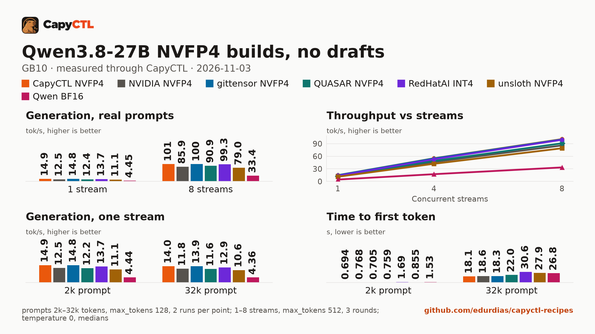
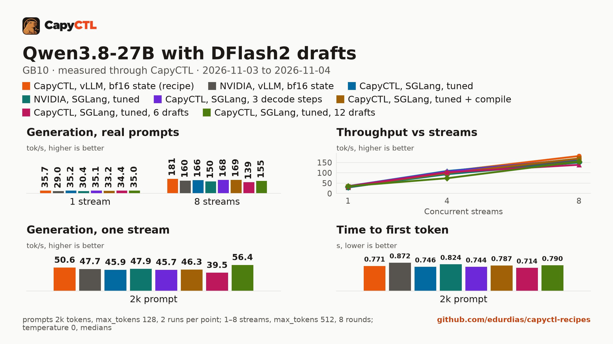
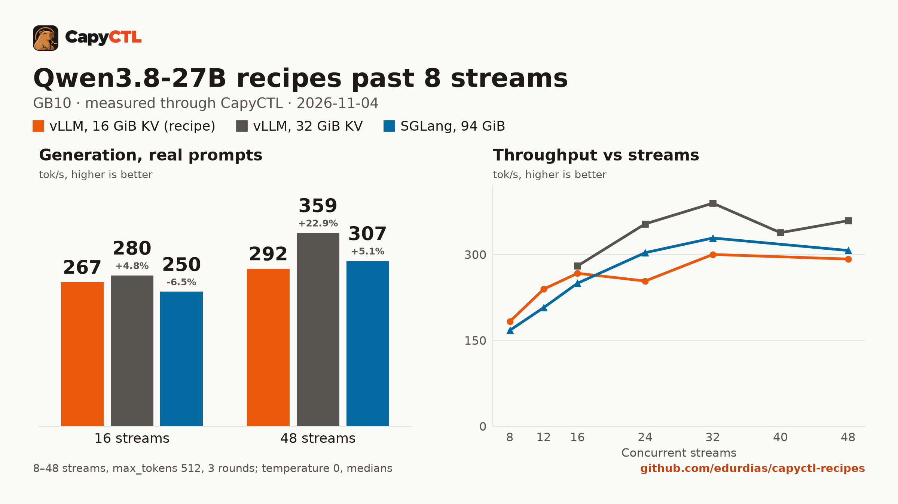

# Qwen3.8-27B builds on one GB10: CapyCTL NVFP4 against the published ones

`capyctl/Qwen3.8-27B-NVFP4` is Qwen3.8-27B with every large Linear in NVFP4, made with
[`convert/`](../../vllm/qwen3.8-27b-capyctl-nvfp4-gb10/convert/). This comparison measures it
through CapyCTL on one GB10 against the BF16 source and five published 4-bit builds, on
SGLang 0.5.22 and vLLM 0.32.0, with and without the DFlash2 drafter, and against
MiaAI-Lab's EXL3 build on their exllamav3 server. It then searches the engine settings for
the recipe. The results:

- **Fastest without drafts:** CapyCTL NVFP4 at 14.9 tokens/s on one stream, 19% above
  NVIDIA's NVFP4 (12.5) on SGLang. Its layout matches gittensor's build (14.8), which
  removed the MTP head. Decode reads 14.45 GB a token against NVIDIA's 17.61 GB.
- **Fastest with DFlash2:** vLLM 0.32.0 with the DeltaNet state cache in bf16, at 36.1
  tokens/s on one stream and 181 at 8 streams, 23% and 13% above NVIDIA's checkpoint on
  the same settings. It is the
  [vLLM recipe](../../vllm/qwen3.8-27b-capyctl-nvfp4-gb10/); the best SGLang settings are
  the [SGLang recipe](../../sglang/qwen3.8-27b-capyctl-nvfp4-gb10/).
- **Past 8 streams** (run 6, cap raised to 48): vLLM peaks at 390 tokens/s at 32 streams with
  a 32 GiB KV cache (300 with the recipe's 16 GiB, which holds 22 requests at most), SGLang at
  329. CapyCTL 0.1.10 keeps at most 32 requests in flight per deployment, so 32 is as far as
  this goes through CapyCTL.
- **No measurable cost in accuracy:** every build scores 97.9% to 98.4% on the GSM8K
  answers it finished, against 98.3% for BF16, and 29 or 30 of 30 tool calls.
  Quantization changes the exact wording sooner than run-to-run noise does (see
  [Accuracy](#accuracy)).







The full reports are [bench/builds/report.html](bench/builds/report.html),
[bench/dflash2/report.html](bench/dflash2/report.html) and
[bench/concurrency/report.html](bench/concurrency/report.html): download them and open them
locally (GitHub shows the HTML source). [bench/results/](bench/results/) has every
capyctl-bench results file, [bench/accuracy/](bench/accuracy/) every accuracy answer, and
[bench/runs/](bench/runs/) each run's log, start times and versions. Run 5's results, each
recipe as it ships, are in the recipes' own `bench/`.

## Setup

| | |
|---|---|
| Hardware | 1x NVIDIA GB10, unified memory (121.7 GiB), aarch64 |
| System | Ubuntu 24.04.5, kernel 6.17.0-1031-nvidia, NVIDIA driver 580.173.02, CUDA 13.0 (`nvcc` 13.0.88) |
| CapyCTL | 0.1.10 release (linux-aarch64, SHA-256 checked), `capyctl start standalone` |
| SGLang | 0.5.22 (torch 2.14.1, triton 3.8.0, flashinfer-python 0.7.1, sglang-kernel 0.4.9, transformers 5.19.0), Python 3.12.14 |
| vLLM | 0.32.0 (torch 2.13.0+cu130, triton 3.7.1, flashinfer-python 0.7.0.post1, transformers 5.19.0), Python 3.12.14 |
| exllamav3 | MiaAI-Lab's fork at `63b32f00` (torch 2.13.0+cu130, triton 3.7.1) with their deployment kit at `12421873`, registered as a CapyCTL custom engine ([`manifests/`](manifests/), [`mia-setup.sh`](mia-setup.sh)) |
| Drafter | [`z-lab/Qwen3.8-27B-DFlash2`](https://huggingface.co/z-lab/Qwen3.8-27B-DFlash2) at `50307d4c`; MiaAI-Lab's EXL3 build uses [`Mia-AiLab/Qwen3.8-27B-DFlash2-EXL3-5.0bpw`](https://huggingface.co/Mia-AiLab/Qwen3.8-27B-DFlash2-EXL3-5.0bpw) at `4f043626` |
| Benchmark | capyctl-bench from this repository (results written by 0.3.0, reports by 0.3.1) |
| Measured | 2026-11-03 and 2026-11-04 |

CapyCTL ran standalone with its own state directory for each run, the managed limit
raised to 100 GiB and the free reserve to 10 GiB:

```bash
capyctl start standalone --listen 127.0.0.1:18543 --management-listen 127.0.0.1:18544 \
  --set host.resource_policy.memory.system.managed_limit=100GiB \
  --set host.resource_policy.memory.system.free_reserve=10GiB \
  --set host.resource_policy.memory.system.parked_limit=45GiB
```

### The checkpoints

| Checkpoint | Revision | Format | Read a token (GB) |
|---|---|---|---|
| **[`capyctl/Qwen3.8-27B-NVFP4`](https://huggingface.co/capyctl/Qwen3.8-27B-NVFP4)** | `4a47ea5e` (measured as `8b03c818`, the same weights before the model card) | NVFP4 W4A4 on every large Linear; MTP head BF16 | **14.45** |
| [`nvidia/Qwen3.8-27B-NVFP4`](https://huggingface.co/nvidia/Qwen3.8-27B-NVFP4) | `482ca0f3` | NVFP4 MLP and head; attention and DeltaNet projections FP8 | 17.61 |
| [`gittensor-model-hub/Qwen3.8-27B-NVFP4-RTX5090`](https://huggingface.co/gittensor-model-hub/Qwen3.8-27B-NVFP4-RTX5090) | `5b7a687f` | NVFP4 on every large Linear; MTP head removed | 14.45 |
| [`QUASAR-QAT/Qwen3.8-27B-QUASAR-NVFP4`](https://huggingface.co/QUASAR-QAT/Qwen3.8-27B-QUASAR-NVFP4) | `4a22293a` | NVFP4 on the large Linears, BF16 head | 16.25 |
| [`RedHatAI/Qwen3.8-27B-INT4`](https://huggingface.co/RedHatAI/Qwen3.8-27B-INT4) | `91bd022d` | INT4 weights (compressed-tensors), BF16 head | 15.14 |
| [`unsloth/Qwen3.8-27B-NVFP4`](https://huggingface.co/unsloth/Qwen3.8-27B-NVFP4) | `f0b7c9e7` | NVFP4 MLP; FP8 attention, DeltaNet and head | 19.10 |
| [`Mia-AiLab/Qwen3.8-27B-EXL3-3.5bpw`](https://huggingface.co/Mia-AiLab/Qwen3.8-27B-EXL3-3.5bpw) | `19441ac8` | EXL3 3.5 bits a weight | not computed (15.4 GB on disk) |
| [`Qwen/Qwen3.8-27B`](https://huggingface.co/Qwen/Qwen3.8-27B) | `1d4bf0f2` | BF16, the source | about 51 |

"Read a token" is the bytes of the tensors decode reads for every token (the language
model's Linears and head, not the embedding, vision tower or MTP head), from each
checkpoint's safetensors headers. One-stream decode is bound by memory bandwidth, so it
predicts the order without drafts: CapyCTL NVFP4 at 14.9 tokens/s reads 215 GB/s,
NVIDIA's at 12.5 reads 220 GB/s, about 80% of the GB10's 273 GB/s.

## Method

- Every request went through the CapyCTL inference endpoint: streaming chat completions,
  `temperature: 0`, thinking on (the model's default). Thinking and answer tokens both count.
- Each deployment: `context_length: 32768`, `max_concurrent_requests: 8`, an FP8 KV cache
  of 16 GiB, `residency: restart_only` (this SGLang 0.5.22 environment has no memory saver,
  and the comparison measures serving, not parking). SGLang NVFP4 builds state
  `quantization: modelopt`; vLLM ones `language_model_only: true`. One deployment at a
  time, each deleted before the next.
- **Speed**: capyctl-bench, 1, 4 and 8 streams of its eight prompts at `max_tokens: 512`
  (3 rounds in runs 1 and 2, 8 in run 3), and one stream at 2k and 32k prompt tokens
  (2 runs, `max_tokens: 128`). Medians.
- **DFlash2**: SGLang `--speculative-algorithm DFLASH`, 8 draft tokens, the drafter
  unquantized; vLLM `{"method":"dflash","num_speculative_tokens":7}`.
- **Accuracy** ([`../qwen3.8-27b-sglang-dflash2-vs-mtp-eagle-gb10/b18.py`](../qwen3.8-27b-sglang-dflash2-vs-mtp-eagle-gb10/b18.py)),
  non-streaming, `temperature: 0`, 8 at a time:
  - agreement: 200 prompts (chat, coding, math, multilingual, tool use), 256 tokens, each
    reply compared with the BF16 source's reply to the same prompt;
  - GSM8K: 250 test questions ([selection](../qwen3.8-27b-sglang-dflash2-vs-mtp-eagle-gb10/accuracy/sources.json)),
    `max_tokens: 2048`, the final `\boxed{}` number;
  - tool calls: 30 cases, right function with valid JSON arguments and the required keys.
- **MiaAI-Lab's exllamav3 server** streams without a token count, so
  [`mia_speed.py`](mia_speed.py) times its streamed replies through CapyCTL and counts
  their tokens with the checkpoint's tokenizer.
- Runs ([`run-host.sh`](run-host.sh)): 1, the two checkpoints on both engines with and
  without DFlash2, and BF16; 2, a second BF16 launch, the published builds and MiaAI-Lab's;
  3 ([`run-3.sh`](run-3.sh)), the DFlash2 settings sweep; 4 ([`run-4.sh`](run-4.sh)),
  MiaAI-Lab's speed and the two recipes' accuracy as they ship; 5 ([`run-5.sh`](run-5.sh)),
  each recipe's `deployment.yaml` with capyctl-bench's full sweeps; 6 ([`run-6.sh`](run-6.sh)),
  the same files with the concurrency cap raised to 48, at 8 to 48 streams.

## Results

### Without drafts

| Checkpoint (SGLang 0.5.22) | 1 stream | 4 streams | 8 streams | 2k: decode, time to first token | 32k: decode, time to first token |
|---|---|---|---|---|---|
| **CapyCTL NVFP4** | **14.9** | **55.2** | **100.9** | **14.9, 0.69 s** | **14.0, 18.1 s** |
| gittensor NVFP4 | 14.8 | 54.8 | 100.3 | 14.8, 0.71 s | 13.9, 18.3 s |
| RedHatAI INT4 | 13.7 | 52.9 | 99.3 | 13.7, 1.69 s | 12.9, 30.6 s |
| NVIDIA NVFP4 | 12.5 | 46.2 | 85.9 | 12.5, 0.77 s | 11.8, 18.6 s |
| QUASAR NVFP4 | 12.4 | 48.8 | 90.9 | 12.2, 0.76 s | 11.6, 22.0 s |
| unsloth NVFP4 | 11.1 | 42.0 | 79.0 | 11.1, 0.86 s | 10.6, 27.9 s |
| Qwen BF16 | 4.5 | 17.2 | 33.4 | 4.4, 1.53 s | 4.4, 26.8 s |

Tokens/s; 4 and 8 streams are the total. On vLLM 0.32.0: CapyCTL NVFP4 14.6 / 53.6 / 100.1,
NVIDIA NVFP4 12.1 / 45.1 / 85.5. MiaAI-Lab's EXL3 build on its exllamav3 server: 15.4
tokens/s at 1, 4 and 8 streams, since the server decodes one request at a time.

### With DFlash2: the settings sweep

| Engine, checkpoint, settings | 1 stream | 4 streams | 8 streams | 2k: decode | Drafted tokens accepted per round |
|---|---|---|---|---|---|
| **vLLM, CapyCTL NVFP4, DeltaNet state cache bf16 (recipe)** | **36.1** | 106.4 | **181.4** | 50.6 | 3.32 |
| vLLM, NVIDIA NVFP4, DeltaNet state cache bf16 | 29.3 | 96.5 | 160.3 | 47.7 | 3.26 |
| SGLang, CapyCTL NVFP4, MiaAI-Lab flags (recipe) | 35.6 | **108.7** | 165.8 | 45.9 | 3.28 |
| SGLang, NVIDIA NVFP4, MiaAI-Lab flags | 30.6 | 93.3 | 150.1 | 47.9 | 3.32 |
| SGLang, CapyCTL NVFP4, 3 continuous decode steps | 35.5 | 105.2 | 168.0 | 45.7 | 3.30 |
| SGLang, CapyCTL NVFP4, MiaAI-Lab flags + torch.compile | 33.4 | 98.7 | 169.3 | 46.3 | 3.25 |
| SGLang, CapyCTL NVFP4, MiaAI-Lab flags, 6 draft tokens | 34.8 | 102.7 | 138.8 | 39.5 | 3.14 |
| SGLang, CapyCTL NVFP4, MiaAI-Lab flags, 12 draft tokens | 35.3 | 73.8 | 154.7 | 56.4 | 3.39 |
| exllamav3, MiaAI-Lab EXL3 3.5bpw, its DFlash2 EXL3 drafter | 36.2 | 38.1 | 36.0 | | |

Tokens/s, run 3 (8 rounds a point); exllamav3 from run 4. MiaAI-Lab's flags are
`--mamba-ssm-dtype bfloat16 --num-continuous-decode-steps 2`, from their
[SGLang GB10 recipe](https://github.com/MiaAI-Lab/Qwen3.8-27B-SGLang-DGX-Spark). Drafts
accepted per round come from the engine logs.

Stock settings (run 1, 3 rounds): vLLM CapyCTL NVFP4 35.6 / 98.7 / 150.4, NVIDIA
29.3 / 91.1 / 139.8; SGLang CapyCTL NVFP4 34.5 / 93.2 / 140.3, NVIDIA 34.3 / 85.3 / 127.2.

- **The weights, not the drafter:** on the same settings both checkpoints accept the
  same number of drafted tokens per round (3.26 to 3.37), so the 10% to 23% gap is the
  cheaper verify step of a checkpoint that reads fewer bytes.
- **What moved:** vLLM's DeltaNet state cache in bf16 (`--mamba-ssm-cache-dtype bfloat16`)
  raised 8 streams from 150 to 181 tokens/s. MiaAI-Lab's SGLang flags raised it from 140 to
  166.
- **What did not:** a third continuous decode step and torch.compile stayed within the
  spread (torch.compile also took 522 s to start against 306 s); 6 and 12 draft tokens
  lost at 4 and 8 streams.
- **Spread:** the SGLang recipe settings gave 38.1 tokens/s on one stream in run 2 and
  35.6 in run 3, with 4 and 8 streams within 3%. One-stream differences of 2 tokens/s are
  inside that spread.
- **exllamav3** is level with the vLLM recipe on one stream, but serves one request at a
  time, so 8 streams total 36 tokens/s against 181.

### Past 8 streams

Run 6: each recipe file with `max_concurrent_requests: 48` instead of 8, at 8 to 48 streams,
three rounds each, `max_tokens: 512`. CapyCTL refused SGLang at the file's 65 GiB request and
at 85 GiB: SGLang keeps 49.7 GB of DeltaNet and draft-token state for 48 running requests, so
it needs 93.5 GiB; it ran with 94 GiB. vLLM ran once with the file's 16 GiB KV cache and once
with 32 GiB. Total tokens/s:

| Recipe, change | 8 | 12 | 16 | 24 | 32 | 40 | 48 | Startup peak |
|---|---|---|---|---|---|---|---|---|
| vLLM, cap 48, 16 GiB KV cache | 183 | 240 | 267 | 254 | 300 | | 292 | 49.6 GiB |
| vLLM, cap 48, 32 GiB KV cache | | | 280 | 354 | **390** | 338 | 359 | 63.3 GiB |
| SGLang, cap 48, 94 GiB request | 168 | 207 | 250 | 303 | **329** | | 307 | 94.3 GiB |

- **vLLM's 16 GiB cache holds 22 requests at most.** It holds the DeltaNet state blocks too;
  the log shows 20 to 22 running and up to 12 waiting, so total throughput levels off near
  300. With 32 GiB all 32 run, and the total still grows 10% from 24 to 32 streams.
- **SGLang is nearly saturated at 32**: 8% more from 24 to 32 streams, for twice vLLM's
  memory.
- **CapyCTL's bound ends the curve at 32.** CapyCTL 0.1.10 keeps at most 32 requests in
  flight per deployment (`MAX_REQUESTS_PER_DEPLOYMENT` in `capyctl-domain`), whatever
  `max_concurrent_requests` says; at 40 and 48 streams the rest wait in its queue (worst
  first token 37 to 48 s), while the engines' logs show at most 32 running on vLLM (32 GiB)
  and 33 on SGLang, neither queuing. The 40- and 48-stream totals are not engine
  throughput.
- The run 6c results file's label was changed to `rcp-vl-hi-kv32` when it was copied here,
  to tell it from run 6's `rcp-vl-hi`.

### Accuracy

| Checkpoint (no drafts unless noted) | GSM8K | Cut at 2048 tokens | GSM8K, finished answers | Tool calls | Same reply as BF16 (of 200) |
|---|---|---|---|---|---|
| Qwen BF16 | 234/250 (93.6%) | 12 | 234/238 (98.3%) | 29/30 | 139, a second BF16 launch |
| NVIDIA NVFP4 | 240/250 (96.0%) | 6 | 240/244 (98.4%) | 30/30 | 17 |
| **CapyCTL NVFP4** | 237/250 (94.8%) | 9 | 237/241 (98.3%) | 30/30 | 9 |
| gittensor NVFP4 | 238/250 (95.2%) | 8 | 238/242 (98.3%) | 29/30 | 5 |
| QUASAR NVFP4 | 237/250 (94.8%) | 10 | 236/240 (98.3%) | 29/30 | 17 |
| RedHatAI INT4 | 238/250 (95.2%) | 7 | 238/243 (97.9%) | 29/30 | 12 |
| unsloth NVFP4 | 235/250 (94.0%) | 11 | 235/239 (98.3%) | 30/30 | 14 |
| MiaAI-Lab EXL3 3.5bpw (exllamav3, DFlash2) | 238/250 (95.2%) | 8 | 238/242 (98.3%) | 30/30 | 1 |
| **vLLM recipe** (CapyCTL NVFP4, DFlash2, bf16 state cache) | 238/250 (95.2%) | 9 | 237/241 (98.3%) | 30/30 | 1 |
| **SGLang recipe** (CapyCTL NVFP4, DFlash2, MiaAI-Lab flags) | 240/250 (96.0%) | 5 | 240/245 (98.0%) | 29/30 | 4 |

All on SGLang 0.5.22 unless the row names another engine; BF16 is the SGLang reference.

- On 250 questions one answer is 0.4 points, so the GSM8K rows are level; their headline
  differences come from answers cut at the 2,048-token limit.
- Two launches of the BF16 source give the same 256-token reply to 139 of 200 prompts.
  The 4-bit builds give BF16's exact reply to 5 to 17, and builds that keep more layers in
  FP8 or BF16 (NVIDIA, QUASAR) stay identical a few tokens longer (first difference at
  token 16 to 19, median, against 10 to 11 for the all-NVFP4 builds). The task scores
  above do not move with it.
- A reply from another engine (vLLM, exllamav3) is rarely identical to SGLang's even with
  the same weights; for those rows the task scores are the measure.

### Memory and starts

| | Peak memory CapyCTL measured | Ready |
|---|---|---|
| vLLM, CapyCTL NVFP4, DFlash2, bf16 state cache (recipe) | **48.1 GiB** | 326 s |
| vLLM, NVIDIA NVFP4, DFlash2, bf16 state cache | 50.2 GiB | 316 s |
| SGLang, CapyCTL NVFP4, DFlash2, MiaAI-Lab flags (recipe) | 58.8 GiB | **306 s** |
| SGLang, NVIDIA NVFP4, DFlash2, MiaAI-Lab flags | 60.8 GiB | 323 s |
| SGLang, CapyCTL NVFP4, no drafts | 50.9 GiB | |
| SGLang, NVIDIA NVFP4, no drafts | 54.1 GiB | |
| SGLang, Qwen BF16, no drafts | 81.9 GiB | |
| exllamav3, MiaAI-Lab EXL3 3.5bpw, its DFlash2 | 20.3 GiB (`MemAvailable` drop; status, read 10 s after ready, held no measured peak yet) | 10 s |

The four DFlash2 rows come from run 3, back to back on warm kernel caches; the rows without
drafts from run 1. The recipes' own cold and warm starts are in their READMEs.

## Caveats

- One GB10, one request shape (512 tokens out of eight short prompts), `temperature: 0`.
- The accuracy sets are small: 250 GSM8K questions and 30 tool calls measure a large loss,
  not a small one.
- The EXL3 build was measured with another tool ([`mia_speed.py`](mia_speed.py)): its token
  counts come from encoding the replies again, within about 1% of the generated count.
- Parking was not measured: every deployment ran `restart_only`.
- CapyCTL NVFP4 keeps its MTP head, but no MTP recipe was measured here.

## Reproduce

[`mia-setup.sh`](mia-setup.sh) builds the exllamav3 environment; the run scripts expect
the checkpoints and drafters under `~/models`, `~/drafters` and `~/q38-requant/ckpts`
(their headers name every path and variable), and [`speed.py`](speed.py) and
[`summarize.py`](summarize.py) turn a results directory into the tables above.
