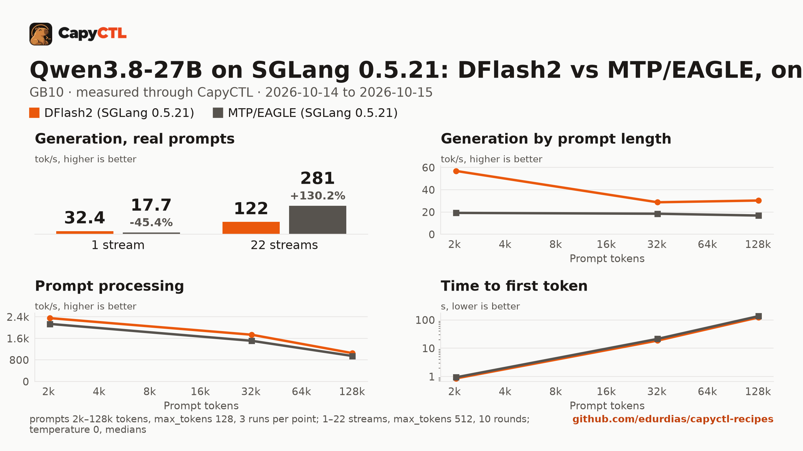
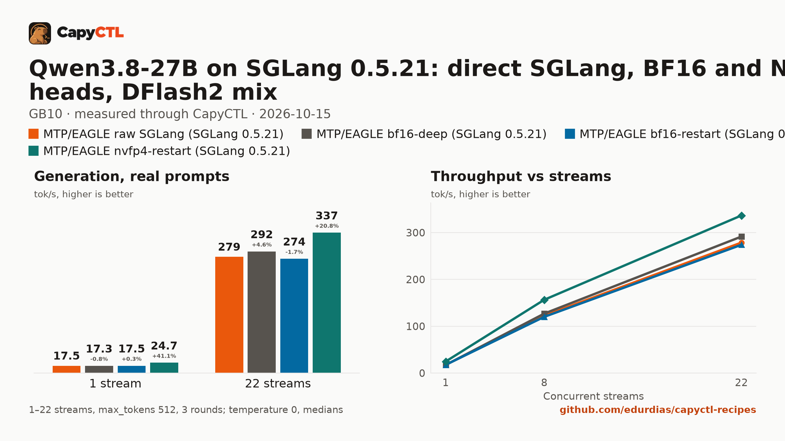
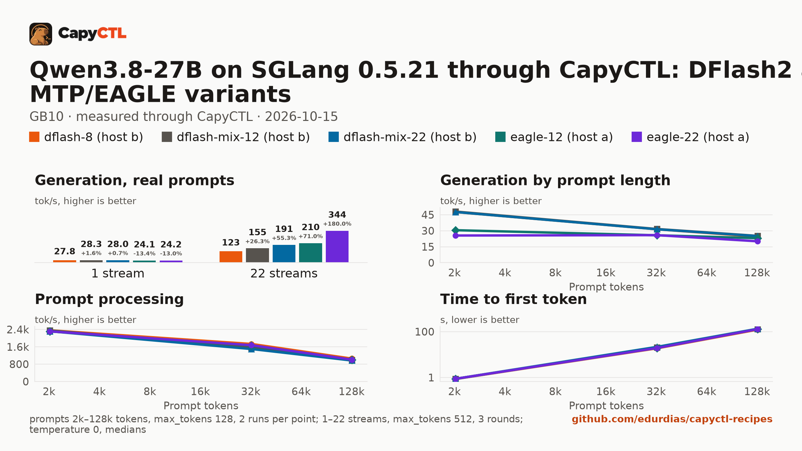

# SGLang 0.5.21, Qwen3.8-27B: DFlash2 drafter against the MTP/EAGLE recipe, one GB10

## Summary

Three runs of Qwen3.8-27B (NVFP4) on SGLang 0.5.21 through CapyCTL, one GB10 machine per
deployment:

1. **Run 1, 2026-10-14: the two recipes.** The catalog DFlash2 recipe (8 running requests,
   65 GiB) against the MTP/EAGLE recipe (a BF16-LM-head checkpoint, 22 running requests,
   79 GiB). DFlash2 was faster at 1 to 8 streams (32.4 against 17.7 tokens/s at one), and
   MTP/EAGLE at 16 and 22 (281 against 122 tokens/s at 22). Its mixed chunked prefill also
   held a long prompt's stall to 9 s against 57 s. MTP/EAGLE's one-stream decode, 17.9
   tokens/s, was well below the 26 to 27 reported for it.
2. **[Run 2](#run-2-2026-10-15-sglang-direct-capyctl-residency-the-nvfp4-lm-head), 2026-10-15: why.**
   SGLang launched directly decodes the same 17.5 tokens/s, so CapyCTL costs no throughput.
   The BF16 LM head does: the catalog checkpoint (NVFP4 head) with the same options is 41%
   faster at one stream (24.7 tokens/s) and 23% at 22 (337), with GSM8K at 93.2% against
   93.6%. It became the catalog MTP/EAGLE recipe, at the 84 GiB CapyCTL 0.1.3 names.
3. **[Run 3](#run-3-2026-10-15-the-sweet-spot), 2026-10-15: the sweet spot.** Five variants
   between the two, on the catalog checkpoint. There is no single sweet spot:

| Users at once | Best | Recipe |
|---|---|---|
| 1 to 4 | DFlash2: 28 tokens/s per stream against 24, 48 against 26 to 31 after a 2k prompt | [sglang/qwen3.8-27b-nvfp4-gb10](../../sglang/qwen3.8-27b-nvfp4-gb10/) (65 GiB, 32k context) |
| up to about 12, mixed work | DFlash2 with mixed chunks at 12 running: the DFlash2 speed at one stream, a 9 s long-prompt stall instead of 56 s, 262k context | [sglang/qwen3.8-27b-nvfp4-dflash2-mix-gb10](../../sglang/qwen3.8-27b-nvfp4-dflash2-mix-gb10/) (75 GiB) |
| about 8 to 12, throughput | MTP/EAGLE at 12 running: 163 tokens/s at 8 streams, 0.32 s to first token at 22 | eagle-12 in [run 3](#run-3-2026-10-15-the-sweet-spot) (75 GiB), not a catalog recipe |
| 16 to 22 | MTP/EAGLE at 22 running: 344 tokens/s at 22 streams | [sglang/qwen3.8-27b-nvfp4-mtp-eagle-gb10](../../sglang/qwen3.8-27b-nvfp4-mtp-eagle-gb10/) (84 GiB) |

DFlash2 does not scale to 22 running requests (9.5 tokens/s per stream at 22 and a 94 GiB
request). With CapyCTL 0.1.3 every variant parks (`deep`, weights resident) in about 1.2 s
to 34 to 36 GiB, above the default parked limit (about 30 GiB on a GB10; the runs used
45 GiB), and wakes to a correct answer in 2.6 to 3.6 s.

The rest of this page: run 1 from here to [Checks](#checks), then run 2 and run 3.

<!-- b18.py readme: run 1 begins -->
## Run 1, 2026-10-14: the two recipes

Two SGLang 0.5.21 recipes for Qwen3.8-27B on the same machine, through CapyCTL,
measured with capyctl-bench and interleaved pass by pass:

- **DFlash2** (this repository's catalog recipe, [sglang/qwen3.8-27b-nvfp4-gb10](../../sglang/qwen3.8-27b-nvfp4-gb10/)):
  `nvidia/Qwen3.8-27B-NVFP4`, the DFlash2 drafter with 8 draft tokens, FP8 KV cache
  of 16 GiB, 8 running requests, a 65 GiB memory request.
- **MTP/EAGLE**: `RadixArk/Qwen3.8-27B-NVFP4-BF16-LMHead`, an NVFP4 checkpoint with a BF16 LM head,
  drafting with its own MTP layer (EAGLE, 3 steps, top-1, 4 draft tokens) and SGLang's
  ReplaySSM speculative verify; a 110-slot state cache for 22 running requests, mixed
  chunked prefill, a 262144-token context and a 79 GiB memory request with a 29 GiB FP8 KV pool.



The full report is [bench/report.html](bench/report.html): download it and open
it locally (GitHub shows the HTML source). [bench/summary.md](bench/summary.md)
has every table, [bench/data.csv](bench/data.csv) every point, and
[bench/results/](bench/results/) the capyctl-bench results files with every
request. [results/](results/) holds the lifecycle, check and stall-test records of the run.

## Setup

| | |
|---|---|
| Hardware | 1x NVIDIA GB10, unified memory, aarch64 |
| System | NVIDIA driver 580.173.02, CUDA 13.0, kernel 6.17.0-1031-nvidia |
| CapyCTL | `main` at `e5219a7` plus the ReplaySSM state sizing fix (`d4b8684`, prints `capyctl 0.1.2`), release build, `capyctl start standalone` |
| SGLang | 0.5.21 (torch 2.13.0, flashinfer-python 0.6.18, sglang-kernel 0.4.7, transformers 5.12.1, torch-memory-saver 0.0.10), Python 3.12.14 |
| DFlash2 model | [`nvidia/Qwen3.8-27B-NVFP4`](https://huggingface.co/nvidia/Qwen3.8-27B-NVFP4) at `482ca0f3832238542f8f5295dde86b5f22711d80` |
| Drafter | [`z-lab/Qwen3.8-27B-DFlash2`](https://huggingface.co/z-lab/Qwen3.8-27B-DFlash2) at `50307d4c4cde6860d4eee73e2547cd786fe8e8a4` |
| MTP/EAGLE model | [`RadixArk/Qwen3.8-27B-NVFP4-BF16-LMHead`](https://huggingface.co/RadixArk/Qwen3.8-27B-NVFP4-BF16-LMHead) at `009632fef96dd349150baa780c984e62e70e91fe`, its own MTP layer, no separate drafter |
| Benchmark | capyctl-bench from this repository at `b68d77d` |
| Measured | 2026-10-14 |

CapyCTL ran standalone with its own state directory, the managed memory limit
raised to 100GiB, the free reserve lowered to
10GiB (the limit and the reserve together must fit the
machine's memory) and the parked limit raised to 45GiB:

```bash
capyctl start standalone --listen 127.0.0.1:18543 \
  --set host.resource_policy.memory.system.managed_limit=100GiB \
  --set host.resource_policy.memory.system.free_reserve=10GiB \
  --set host.resource_policy.memory.system.parked_limit=45GiB
```

Each recipe ran under its own profile of the same SGLang venv, so that each
had its own, initially empty, kernel caches (`SGLANG_CACHE_DIR` and the
FlashInfer, Triton, TVM-FFI, Inductor and CUDA cache variables in the profile's
`env`); the DFlash2 profile approves the drafter path:

```bash
capyctl engine add ~/sglang-0.5.21-venv --name b18a \
  --approve-option=--speculative-draft-model-path --approve-path ~/drafters --env SGLANG_CACHE_DIR=<dir a> ...
capyctl engine add ~/sglang-0.5.21-venv --name b18b --env SGLANG_CACHE_DIR=<dir b> ...
```

## Deployments

- [deployment-dflash2.yaml](deployment-dflash2.yaml): the catalog recipe, short-prompt runs
  (`context_length: 32768`); [deployment-dflash2-ctx.yaml](deployment-dflash2-ctx.yaml) the same with
  `context_length: 262144`, for the 128k point and the stall test.
- [deployment-mtp-eagle.yaml](deployment-mtp-eagle.yaml): the MTP/EAGLE recipe, every run;
  [deployment-mtp-eagle-nomix.yaml](deployment-mtp-eagle-nomix.yaml) the same without
  `--enable-mixed-chunk`, for the stall test only.

Only one deployment ran at a time.

| | DFlash2 | MTP/EAGLE |
|---|---|---|
| Speculative decoding | `DFLASH`, separate drafter, 8 draft tokens, drafter unquantized | `EAGLE` on the checkpoint's MTP layer, 3 steps, top-1, 4 draft tokens, `--enable-linear-replayssm-spec` |
| Running requests | `max_concurrent_requests: 8`; engine `max_running_requests=8` | `max_concurrent_requests: 22`, `--max-mamba-cache-size 110`; engine `max_running_requests=22` |
| KV cache | `fp8_e4m3`, 16 GiB; engine 399457 tokens | `fp8_e4m3` (the checkpoint's calibrated default, stated), 29 GiB; engine 776670 tokens |
| Chunked prefill, max prefill | 8192, 16384 | 8192, 16384 |
| State cache | sized by CapyCTL for 8 requests | 110 slots |
| Memory request | 65 GiB | 79 GiB |
| Parsers | `qwen3_coder`, `qwen3` (CapyCTL's choice for the family) | `qwen3_coder`, `qwen3` (declared) |
| Residency | CapyCTL default (`deep`, weights kept resident while parked) | the same |

## Method

- Every request went through the CapyCTL inference endpoint: OpenAI streaming
  chat completions, `temperature: 0`, thinking on (the model's default).
- **Short prompts**: 1, 4, 8, 16, 22 streams, `max_tokens: 512`, capyctl-bench's
  `prompts.json`, 5 measured rounds after one warm-up round per stream count, in
  2 passes interleaved DFlash2, MTP/EAGLE, DFlash2, MTP/EAGLE; each pass a fresh warm
  start. The DFlash2 recipe runs 8 requests at once, so at 16 and 22 streams the rest wait.
- **Context**: one stream, 2k, 32k, 128k prompt tokens, 3 runs each, `max_tokens: 128`.
- **Long-prompt stall**: 4 streams decode (`max_tokens: 3072`, `ignore_eos`), then one cold
  prompt of about 80000 tokens arrives; the figure is the longest gap between token
  chunks on the running streams while that prompt is prefilled, 2 trials per variant.
- **Lifecycle**: a first start with empty kernel caches (cold), warm starts after `stop`,
  the ready footprint (drop in `MemAvailable` from before the start to Ready),
  one park and wake (a request wakes it) with CapyCTL's parked charge, and stop.
- Engine figures come from the engine's own log, which CapyCTL keeps redacted
  (`<state dir>/logs/<deployment>/<launch>.log`), and CapyCTL's load read.

## Results

### Lifecycle and memory

| | DFlash2 | MTP/EAGLE |
|---|---|---|
| First start, empty kernel caches | 726 s | 604 s |
| `MAX_JOBS` CapyCTL derived for that start | 6 | 4 |
| Kernel caches after the first start | 344M | 313M |
| Warm start (`start` after `stop`) | 260 to 279 s | 263 to 295 s |
| Ready footprint (`MemAvailable` drop) | 67.8 GiB | 81.5 GiB |
| CapyCTL measured startup peak | 70.3 GiB | 81.9 GiB |
| Park, parked charge, parked footprint | n/a (the park was refused) | n/a (the park was refused) |
| Wake by request, to the answer | n/a | n/a |
| Engine KV tokens / running requests | 399457 / 8 | 776670 / 22 |
| CapyCTL load read `max_running` | 8 (engine) | 22 (engine) |
| Mean accept length (engine log, short-prompt passes) | 3.29 | 2.60 |

Neither park happened. Both were refused at once as "the engine is not quiescent":
the run's state directory put SGLang's saver observation socket over the 107 bytes a
Unix socket address holds, so the engine served without the saver observation every
park needs. That is a CapyCTL bug, fixed on `main` in
[capyctl#119](https://github.com/edurdias/capyctl/pull/119); the park and wake
figures are therefore n/a here.

### Short prompts

| Streams | DFlash2 aggregate, tok/s | MTP/EAGLE aggregate | DFlash2 per stream p50 | MTP/EAGLE per stream p50 | DFlash2 TTFT p50 | MTP/EAGLE TTFT p50 | Errors |
|---|---|---|---|---|---|---|---|
| 1 | 32.4 | 17.7 (-45%) | 33.1 | 17.9 | 0.21 s | 0.27 s | 0 / 0 |
| 4 | 81.4 | 66.9 (-18%) | 22.4 | 17.9 | 0.23 s | 0.27 s | 0 / 0 |
| 8 | 123.4 | 119.4 (-3%) | 17.6 | 17.2 | 0.27 s | 0.31 s | 0 / 0 |
| 16 | 124.1 | 214.7 (+73%) | 17.7 | 15.3 | 9.76 s | 0.42 s | 0 / 0 |
| 22 | 122.0 | 280.7 (+130%) | 17.4 | 14.4 | 29.29 s | 0.51 s | 0 / 0 |

### Context

| Prompt | DFlash2 TTFT | MTP/EAGLE TTFT | DFlash2 decode, tok/s | MTP/EAGLE decode | DFlash2 prompt, tok/s | MTP/EAGLE prompt |
|---|---|---|---|---|---|---|
| 2k | 0.86 s | 0.94 s | 56.9 | 19.3 | 2349 | 2134 |
| 32k | 18.67 s | 21.41 s | 28.8 | 18.5 | 1734 | 1509 |
| 128k | 122.39 s | 135.95 s | 30.4 | 16.9 | 1051 | 946 |

### Long-prompt stall

Longest gap between token chunks on the running streams while the cold prompt
is prefilled, per trial (the gap before it arrives in brackets):

| | DFlash2 | MTP/EAGLE | MTP/EAGLE without mixed chunks |
|---|---|---|---|
| Longest gap, s | 56.5 / 57.1 | 9.0 / 9.0 | 60.8 / 59.1 |
| Before the prompt, s | (0.15 / 0.15) | (0.16 / 0.15) | (0.15 / 0.15) |
| Long prompt: tokens, time to first token | 79045 / 80024, 61.1 / 61.7 s | 78607 / 80783, 67.7 / 69.5 s | 81124 / 79590, 65.6 / 63.8 s |

### Checks

| | DFlash2 | MTP/EAGLE |
|---|---|---|
| Tool call (`get_weather`, structured `tool_calls`) | pass: HTTP 200, finish tool_calls, calls ['get_weather'], reasoning 108 chars, markup in content none | pass: HTTP 200, finish tool_calls, calls ['get_weather'], reasoning 89 chars, markup in content none |
| Reasoning stream (trace in `reasoning_content`, none in `content`) | pass: 17 reasoning chunks, 2 content chunks, markup in content none, answer 391, usage yes, metrics comment yes | pass: 17 reasoning chunks, 2 content chunks, markup in content none, answer 391, usage yes, metrics comment yes |

<!-- b18.py readme: run 1 ends -->

## Run 2, 2026-10-15: SGLang direct, CapyCTL residency, the NVFP4 LM head

`run.sh --experiment`, CapyCTL `e6e5c92` (0.1.3 development), capyctl-bench `2a602dc`,
standalone with `managed_limit: 100GiB` and `free_reserve: 10GiB`. One pass, 3 rounds
at 1, 8 and 22 streams, `max_tokens: 512`, thinking on, all with the MTP/EAGLE flags
(EAGLE 3 steps, top-1, 4 draft tokens, ReplaySSM, 110 state slots, mixed chunks, 22 running):

- **raw**: `RadixArk/Qwen3.8-27B-NVFP4-BF16-LMHead` launched directly with SGLang's
  `launch_server`, no CapyCTL, `--mem-fraction-static 0.65`, before CapyCTL started.
- **bf16-deep** and **bf16-restart**: the same checkpoint through CapyCTL with
  `residency` left default (`deep`, SGLang's memory saver on) and `restart_only`.
- **nvfp4-restart**: `nvidia/Qwen3.8-27B-NVFP4` (the catalog checkpoint, NVFP4 LM head,
  `quantization: modelopt`) with the same flags, `restart_only`.

Every CapyCTL variant asks for `memory.request: 84GiB`: CapyCTL 0.1.3 refuses the 79 GiB
of [deployment-mtp-eagle.yaml](deployment-mtp-eagle.yaml) before launch and names 84 GiB.



[bench-experiment/report.html](bench-experiment/report.html) is the report (download it),
[bench-experiment/summary.md](bench-experiment/summary.md) its tables,
[bench-experiment/data.csv](bench-experiment/data.csv) every point and
[bench-experiment/results/](bench-experiment/results/) the capyctl-bench results files.
[results/experiment/](results/experiment/) holds the run's summary
([experiment.md](results/experiment/experiment.md)), the resolved server arguments
([experiment.json](results/experiment/experiment.json)) and the accuracy records.

### Variants

| Variant | C1 aggregate / per stream, tok/s | C8 aggregate / per stream | C22 aggregate / per stream | TTFT p50, C1 | Accept length | Memory saver | `mem_fraction_static` | KV dtype | Engine KV tokens / running |
|---|---|---|---|---|---|---|---|---|---|
| raw | 17.5 / 17.8 | 122.5 / 16.5 | 278.6 / 14.0 | 0.36 s | 2.65 | off | 0.65 | auto (the checkpoint's FP8) | 884688 / 22 |
| bf16-deep | 17.3 / 17.7 | 127.0 / 18.0 | 291.5 / 15.2 | 0.35 s | 2.73 | on | 0.6502 | fp8_e4m3 | 894373 / 22 |
| bf16-restart | 17.5 / 17.7 | 120.1 / 17.2 | 273.9 / 14.3 | 0.27 s | 2.62 | off | 0.6501 | fp8_e4m3 | 894373 / 22 |
| nvfp4-restart | 24.7 / 24.9 | 156.5 / 20.9 | 336.6 / 17.2 | 0.21 s | 2.60 | off | 0.6468 | fp8_e4m3 | 894373 / 22 |

### Sizing

| Variant | Memory request | Static pool (CapyCTL) | `--max-total-tokens` rendered | Ready footprint (`MemAvailable` drop) | CapyCTL Ready charge | Start |
|---|---|---|---|---|---|---|
| raw | none | n/a | n/a | 83.9 GiB | n/a | 614 s (empty kernel caches) |
| bf16-deep | 84 GiB | 76.0 GiB | 894373 | 82.9 GiB | 85.2 GiB | 370 s |
| bf16-restart | 84 GiB | 76.0 GiB | 894373 | 79.4 GiB | 85.2 GiB | 256 s |
| nvfp4-restart | 84 GiB | 76.0 GiB | 894373 | 78.9 GiB | 85.2 GiB | 261 s |

### Long-prompt stall

| Variant | Longest gap while an 80292-token prompt prefills | Before it | Its time to first token |
|---|---|---|---|
| nvfp4-restart (one trial, 4 streams) | 8.5 s | 0.12 s | 64.6 s |

Mixed chunked prefill keeps the stall at the 9 s the BF16-head recipe showed above.

### Accuracy: BF16 LM head against NVFP4 LM head

Both through CapyCTL, `restart_only`, the same EAGLE MTP flags, greedy (temperature 0),
thinking on. The checkpoints may differ beyond the head (the BF16-head one also carries
calibrated FP8 KV scales; the NVFP4-head one has none and runs FP8 KV unscaled).

| Token agreement (`max_tokens: 256`) | Prompts | Exact match | First divergence, tokens (p25 / median / p75) | By category (exact) |
|---|---|---|---|---|
| BF16 head vs NVFP4 head | 200 | 7 (3.5%) | 3 / 16 / 25 | chat 0/40, coding 0/40, math 2/40, multilingual 0/40, tool-use 5/40 |
| BF16 head vs itself (the first 50 prompts again) | 50 | 9 (18.0%) | 28 / 66 / 92 | coding 3/40, math 6/10 |

| Check | BF16 head | NVFP4 head |
|---|---|---|
| GSM8K test subset, final number in `\boxed{}` (`max_tokens: 2048`) | 234/250 (93.6%), 9 cut at `max_tokens` | 233/250 (93.2%), 13 cut at `max_tokens` |
| Tool calls (JSON object arguments, expected function, required arguments) | 29/30 | 30/30 |

### Conclusions

- **CapyCTL and the memory saver cost no throughput.** SGLang launched directly decodes
  17.5 tokens/s at one stream; through CapyCTL, 17.3 (`deep`, memory saver on) and 17.5
  (`restart_only`). At 8 and 22 streams the CapyCTL variants are within 5% of raw, both ways.
- **The NVFP4 LM head is faster at every concurrency**: against the BF16 head
  (`restart_only`) +41% at one stream (24.7 against 17.5 tokens/s), +30% at 8 (156.5
  against 120.1) and +23% at 22 (336.6 against 273.9; +21% against raw).
- **Its accuracy holds on these checks**: GSM8K 93.2% against 93.6% (one question of 250)
  and tool calls 30/30 against 29/30. Token agreement between the two is low (3.5% exact),
  but SGLang's greedy decoding is not batch-invariant: the BF16 checkpoint against itself
  matches only 18% of replies exactly, so agreement does not separate the heads.
  The catalog recipe [sglang/qwen3.8-27b-nvfp4-mtp-eagle-gb10](../../sglang/qwen3.8-27b-nvfp4-mtp-eagle-gb10/)
  takes this configuration.
- **DFlash2 with 22 running requests and mixed chunks does not fit.** SGLang's DFLASH keeps
  intermediate states for every slot (ReplaySSM applies only to EAGLE and MTP), so 110 slots
  hold 42.3 GiB of recurrent state beside 24.0 GiB of weights and the 16 GiB KV pool:
  CapyCTL refused the launch before any effect and named a 94 GiB request (about 100 GB with
  its margin). The retry at 94 GiB never started (see the next point), so there is no figure.
- **The draft-depth sweep did not run.** After the DFlash2 refusal the refused deployment
  stayed queued and the previous one was only stopped, so the retry's redeploy was refused
  as a route conflict and each sweep start was blocked on capacity (86.5 GiB needed, 14.8 GiB
  free). [remote.sh](remote.sh) now deletes each variant (stopping it) after it runs or fails
  to start, and deletes a refused deployment before redeploying it at the named request.

## Run 3, 2026-10-15: the sweet spot

`run.sh --sweetspot`, CapyCTL `52e264c` (0.1.3 development), capyctl-bench from this
repository, standalone with `managed_limit: 100GiB`, `free_reserve: 10GiB` and
`parked_limit: 45GiB`. Five variants between the two catalog recipes, all on the catalog
checkpoint `nvidia/Qwen3.8-27B-NVFP4` at `482ca0f3` (NVFP4 LM head), FP8 KV, a
262,144-token context, the `qwen3_coder` and `qwen3` parsers and CapyCTL's default
residency (`deep`: SGLang's memory saver on, so each variant parks). One variant ran at a
time and was deleted before the next. Short prompts at 1, 4, 8, 16 and 22 streams, 3 rounds,
one pass, `max_tokens: 512`; one stream at 2k, 32k and 128k prompt tokens, 2 runs,
`max_tokens: 128`; one stall trial (4 running streams, then a cold prompt of about 80,000
tokens); one park and a wake by request; `temperature: 0`, thinking on.

The variants were split across two GB10 machines: host a ran the MTP/EAGLE variants and the
depth sweep, host b the DFlash2 variants and, first, eagle-22 again as a calibration of the
two hosts. eagle-12 ran a second time on host a: its first start was refused at the 65 GiB
probe with CapyCTL's reason cut short before the request it names, so the rerun asked for
75 GiB directly (`--request eagle-12=75GiB`).



[bench-sweetspot/report.html](bench-sweetspot/report.html) is the report (download it),
[bench-sweetspot/summary.md](bench-sweetspot/summary.md) its tables and
[bench-sweetspot/data.csv](bench-sweetspot/data.csv) every point.
[results/sweetspot/sweetspot.md](results/sweetspot/sweetspot.md) has every figure of the run,
with run 1 and run 2 as reference rows, and [sweetspot.json](results/sweetspot/sweetspot.json)
the same as data; [host-a/](results/sweetspot/host-a/), [host-a-2/](results/sweetspot/host-a-2/)
(the eagle-12 rerun) and [host-b/](results/sweetspot/host-b/) hold each run's records
(resolved server arguments, starts, park, wake and stall).

### Variants

| Variant | Algorithm | Drafter | Draft shape | ReplaySSM | Mixed chunk | Running requests | Mamba cache slots | KV | Request | Engine KV tokens | Ready charge | Parked charge (measured) |
|---|---|---|---|---|---|---|---|---|---|---|---|---|
| dflash-8: the catalog DFlash2 recipe at 262,144 context | `DFLASH` | DFlash2, separate, unquantized | 8 draft tokens | no | no | 8 | 40 (not set) | 16 GiB | 65 GiB | 399,457 | 66.2 GiB | 34.4 GiB |
| dflash-mix-22 | `DFLASH` | DFlash2 | 8 draft tokens | no | yes | 22 | 110 | 16 GiB | 94 GiB (65 GiB refused, 94 named) | 399,457 | 95.2 GiB | 34.9 GiB |
| dflash-mix-12 | `DFLASH` | DFlash2 | 8 draft tokens | no | yes | 12 | 60 | 16 GiB | 75 GiB (65 GiB refused, 75 named) | 399,457 | 76.2 GiB | 34.7 GiB |
| eagle-22: the catalog MTP/EAGLE recipe | `EAGLE` | the checkpoint's MTP layer | 3 steps, top-1, 4 draft tokens | yes | yes | 22 | 110 | 29 GiB | 84 GiB | 894,373 | 85.2 GiB | 35.9 GiB |
| eagle-12 | `EAGLE` | the checkpoint's MTP layer | 3 steps, top-1, 4 draft tokens | yes | yes | 12 | 60 | 29 GiB | 75 GiB | 894,373 | 76.2 GiB | 34.2 GiB |

### Results

| Variant | Host | C1 aggregate, tok/s | C8 aggregate | C22 aggregate | Per stream C1 / C22 | TTFT p50, C22 | Decode after a 2k prompt | Stall: longest gap | Park | Wake, first token |
|---|---|---|---|---|---|---|---|---|---|---|
| dflash-8 | b | 27.8 | 127.4 | 122.7 | 28.3 / 17.6 | 29.51 s | 47.5 tok/s | 55.7 s | 1.2 s | 2.57 s, correct |
| dflash-mix-22 | b | 28.0 | 125.5 | 190.7 | 28.3 / 9.5 | 0.46 s | 47.6 tok/s | 8.8 s | 1.2 s | 3.58 s, correct |
| dflash-mix-12 | b | 28.3 | 118.1 | 155.0 | 28.6 / 15.5 | 0.33 s | 48.0 tok/s | 8.6 s | 1.2 s | 2.78 s, correct |
| eagle-22 | a | 24.2 | 150.4 | 343.7 | 24.8 / 17.2 | 0.46 s | 25.5 tok/s | 8.5 s | 1.2 s | 3.19 s, correct |
| eagle-12 | a | 24.1 | 163.0 | 209.9 | 24.7 / 20.8 | 0.32 s | 30.5 tok/s | 8.5 s | 1.1 s | 2.85 s, correct |

A variant with 8 or 12 running requests holds the rest of 22 streams in CapyCTL's queue:
dflash-8's 29.5 s time to first token at 22 streams is that wait.

### Draft depth on eagle-22

Host a, the eagle-22 deployment with the EAGLE shape changed:

| Steps / top-k / draft tokens | C1 per stream, tok/s | C8 aggregate | Accept length |
|---|---|---|---|
| 3 / 1 / 4 (the catalog recipe) | 24.8 | 150.4 | 2.60 |
| 2 / 1 / 3 | 24.1 | 154.8 | 2.31 |
| 5 / 1 / 6 | 27.6 | 135.0 | 2.96 |

Deeper drafts raise one-stream decode by 11% and cost 10% at 8 streams; shallower ones gain
3% at 8 streams and lose 3% at one. The catalog's 3 / 1 / 4 stays.

### Host comparability

| Figure | Host b (calibration, eagle-22) | Host a (eagle-22) | Difference |
|---|---|---|---|
| C1 per-stream decode, tok/s | 25.6 | 24.8 | +3.0% |
| C8 aggregate, tok/s | 169.2 | 150.4 | +12.5% |

The same deployment ran up to 12.5% faster on host b, where the DFlash2 variants ran: between
a DFlash2 and an MTP/EAGLE variant, a difference smaller than that is not established. It
favours DFlash2, so the MTP/EAGLE leads below hold.

### Conclusions

- **There is no single sweet spot**: the best variant depends on how many users share the
  machine.
- **1 to 4 users: DFlash2.** It decodes 28 tokens/s per stream at one against MTP/EAGLE's 24,
  and 48 against 26 to 31 after a 2k prompt. By 4 streams MTP/EAGLE has caught up (88 against
  80 to 86 tokens/s).
- **About 8 to 12 users: eagle-12.** 163 tokens/s at 8 streams against 150 for eagle-22 and
  118 to 127 for DFlash2, and the lowest time to first token at 22 streams (0.32 s), in 75 GiB.
- **16 to 22 users: eagle-22**, the catalog MTP/EAGLE recipe: 344 tokens/s at 22 streams,
  against 210 for eagle-12 and at most 191 for DFlash2.
- **Mixed chunking fixes DFlash2's stall**: the longest gap while a long prompt prefills falls
  from 56 s to 9 s, the same as MTP/EAGLE's.
- **DFlash2 does not scale to 22 running requests.** dflash-mix-22 drops to 9.5 tokens/s per
  stream at 22 and needs a 94 GiB request (95.2 GiB charged), because DFlash keeps
  intermediate states for every slot. dflash-mix-12 is the better DFlash2 configuration:
  the same one-stream speed, a 9 s stall and a 262,144-token context in 75 GiB. Up to about
  12 users it is the best all-rounder, and it is the catalog recipe
  [sglang/qwen3.8-27b-nvfp4-dflash2-mix-gb10](../../sglang/qwen3.8-27b-nvfp4-dflash2-mix-gb10/).
- **Parking works for every variant**: with CapyCTL 0.1.3 speculative SGLang deployments
  resolve `deep` (weights resident) and park. About 1.2 s to park, 34 to 36 GiB parked, 2.6
  to 3.6 s from a request to the first token of the wake, and a correct answer each time.
  34 to 36 GiB is above a standalone's default parked limit (a quarter of memory, about
  30 GiB on a GB10): raise `host.resource_policy.memory.system.parked_limit` (these runs
  used 45 GiB).

## Caveats

- One machine, 2 passes for the short prompts and one for the context sweep.
  Thinking was on, so most of each 512-token reply is reasoning.
- The two recipes differ in checkpoint (the MTP/EAGLE checkpoint keeps a BF16 LM head
  and carries the MTP layer), drafter, KV pool, running requests and context: this
  compares recipes, not one setting.
- The kernel caches started empty for each recipe's first start; later starts reused them.
- CapyCTL passed the MTP/EAGLE recipe's 29 GiB KV cache to SGLang as 950,272 tokens
  (`--max-total-tokens`, 32 KiB a token in FP8); the engine held 776,670.
- The MTP/EAGLE configuration has been reported at about 26 to 27 tokens/s per stream at
  one stream, about 387 tokens/s at 22, with an accept length of 2.8 to 2.9. Here, through
  CapyCTL, it decoded 17.9 tokens/s per stream at one stream and 280.7 tokens/s at 22,
  with an accept length of 2.60. The 2026-10-15 experiment above shows that SGLang launched
  directly, without CapyCTL, decodes the same 17.5 tokens/s at one stream on this machine:
  CapyCTL is not the cause.
