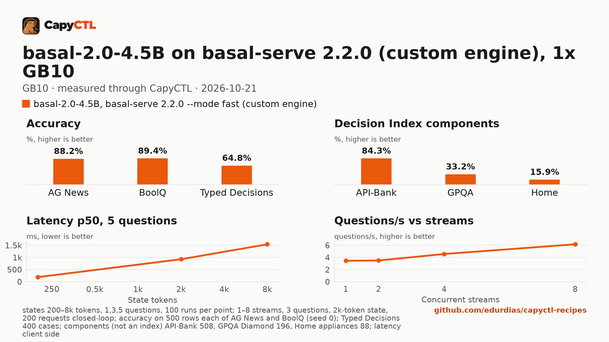

# basal-2.0-4.5B on basal-serve 2.2.0 (custom engine), one GB10

| | |
|---|---|
| Hardware | 1x NVIDIA GB10 (DGX Spark class), compute capability 12.1, 128 GB unified memory, aarch64 |
| System | Ubuntu 24.04, CUDA 13.0 |
| Engine | basal 2.2.0 ([github.com/rkinas/basal](https://github.com/rkinas/basal)) with its `media` extra and PyTorch 2.11.0 for CUDA 13.0, in a virtual environment (`~/basal-2.2.0-venv`), run as a CapyCTL custom engine: `basal-serve --mode fast --template-prefix off` |
| Model | [`Remek/basal-2.0-4.5B`](https://huggingface.co/Remek/basal-2.0-4.5B) at `e5ba9149760d99b73b1963d8e0ccf948b58afacb`, bf16 |
| CapyCTL | 0.1.6 (a build of `main` equal to the release, reporting `0.1.6-dev`); `capyctl start standalone` |
| Measured | 2026-10-21 |

basal-2.0-4.5B is a 4.5B decision model served by basal's own server,
`basal-serve`. No engine CapyCTL supports serves it, so it runs as a custom
engine: you state the command in a manifest and CapyCTL keeps the rest (the
process, its memory, the readiness check, the API key on its own endpoint). It
is a decision model: it does not generate text, it answers typed questions
about a text (`POST /v1/systemone`) with a probability for each answer.

It answers one question about a 200-token text in **90 ms** (about 67 ms for
the short request below), holds **34.9 GiB**, and scores **84.3% on API-Bank**,
88.2% on AG News, 89.4% on BoolQ and 64.8% on Typed Decisions. Its weakness is
the start: `--mode fast` compiles the model each time, so it is ready after
**11 to 12 minutes**.

## Run it

Custom engines need CapyCTL 0.1.6 or later. Install basal 2.2.0 and PyTorch
2.11.0 for CUDA 13.0 in a virtual environment:

```bash
uv venv --python 3.12 ~/basal-2.2.0-venv
uv pip install --python ~/basal-2.2.0-venv/bin/python torch==2.11.0 torchvision==0.26.0 \
  --index-url https://download.pytorch.org/whl/cu130
uv pip install --python ~/basal-2.2.0-venv/bin/python \
  "basal[media] @ https://github.com/rkinas/basal/archive/refs/tags/v2.2.0.tar.gz"
```

Download the model into the models directory (the pinned command is in
`deployment.yaml`) and register the engine with the manifest in this
directory, [`manifest.yaml`](manifest.yaml):

```yaml
kind: custom_engine
schema_version: 1
api: decisions
version: "2.2.0"
args: [--mode, fast, --template-prefix, "off", --host, "{host}", --port, "{port}", --model, "{model_dir}", --name, "{served_name}"]
health: /health
```

```bash
capyctl engine add --custom ~/basal-2.2.0-venv/bin/basal-serve --name basal-serve \
  --manifest manifest.yaml
```

`engine add --custom` runs nothing. It prints what it would register and asks
`register this custom engine? [y/N]` on a terminal; without one, pass `--yes`
after reading the summary. With `--yes`:

```text
custom engine basal-serve
  executable:   /home/me/basal-2.2.0-venv/bin/basal-serve
  arguments:    --mode fast --template-prefix off --host {host} --port {port} --model {model_dir} --name {served_name}
  api:          decisions
  version:      2.2.0
  environment:  none
  approved env: none
  pinned root:  /home/me/basal-2.2.0-venv (virtual environment)
  interpreter:  /home/me/.local/share/uv/python/cpython-3.12.14-linux-aarch64-gnu/bin/python3.12
  installation: sha256:04d26e16f5c99fd6893ae8b31b0fe50bac9a5f64d3ef58dafdeb0f5010c66a0b (23021 files, 4865159464 bytes)
  idle signal:  none
  engine key:   none (the engine listens unauthenticated on loopback; any local process can reach its port)
  drift:        warn
Registered basal-serve (custom 2.2.0)

  Executable     /home/me/basal-2.2.0-venv/bin/basal-serve
  Arguments      --mode fast --template-prefix off --host {host} --port {port} --model {model_dir} --name {served_name}
  API            decisions
  Pinned root    /home/me/basal-2.2.0-venv (virtual environment)
  Interpreter    /home/me/.local/share/uv/python/cpython-3.12.14-linux-aarch64-gnu/bin/python3.12
  Installation   sha256:04d26e16f5c99fd6893ae8b31b0fe50bac9a5f64d3ef58dafdeb0f5010c66a0b (23021 files, 4865159464 bytes)
  Idle signal    none
  Engine key     none
  Deep park      disabled
  Engines file   /home/me/.config/capyctl/custom-engines.yaml (revision 1)
  Published      yes
```

The `installation` digest covers every file of the virtual environment and the
Python interpreter it runs. Yours will differ unless your environment is
identical; CapyCTL compares each later start with the digest you confirmed here
and reports any change.

```bash
capyctl engine list
```

```text
PROFILE       SOURCE                ENGINE   VERSION   CUSTOM   DEEP PARK   IDLE SIGNAL   ENGINE KEY   PUBLISHED   DEPLOYMENTS
basal-serve   custom-engines.yaml   custom   2.2.0     yes      disabled    none          none         published   -
```

Then deploy and start it:

```bash
capyctl deploy model --file deployment.yaml
capyctl start deployment basal-20 --wait
```

The run deployed with `--wait` and `--json`; it returned after 703 s with the
deployment ready on `gpu-box`, the checkpoint digest measured
(`sha256:824ac7fc3b61fdbdd6a18a194fe0914b22af43b5bc246a662f0cdc1b1ca23389`,
9,514,629,496 bytes of weights), `residency: restart_only` and
`timeouts.initialize_ms: 1800000`. The engine's only listener was on loopback:

```text
LISTEN 0      2048                   127.0.0.1:38500      0.0.0.0:*    users:(("basal-serve",pid=3963550,fd=57))
```

A one-question decision (route a ticket to `billing`, `shipping` or
`technical`) through CapyCTL's endpoint:

```text
{"answers":{"route":{"choice":"technical","confidence":0.963867485523224,"probabilities":{"billing":0.02267517521977425,"shipping":0.013457341119647026,"technical":0.963867485523224},"type":"choice"}},"capyctl":{"metrics":{"input_tokens":{"source":"engine","value":127},"time_to_response_ms":{"source":"router","value":62.232},"total_ms":{"source":"router","value":65.123}}},"model":"basal-20","usage":{"branches":1,"input_tokens":127,"latency_ms":61.49,"longest_prompt_tokens":127,"output_tokens":0,"questions":1}}
HTTP 200 0.066534s
```

The request format is in CapyCTL's
[requests guide](https://github.com/edurdias/capyctl/blob/main/docs/guide/requests.md).
`choice` questions come back with a probability for each option. A field
basal does not take is refused by CapyCTL before it reaches the engine:

```text
{"code":"invalid_request","message":"decision request field `bad` is not accepted"}
HTTP 400 0.000292s
```

After `capyctl stop deployment basal-20`, `capyctl start deployment basal-20
--wait` was ready again in 691 s, and the same decision gave the same
probabilities in 62 ms:

```text
{"answers":{"route":{"choice":"technical","confidence":0.963867485523224,"probabilities":{"billing":0.02267517521977425,"shipping":0.013457341119647026,"technical":0.963867485523224},"type":"choice"}},"capyctl":{"metrics":{"input_tokens":{"source":"engine","value":127},"time_to_response_ms":{"source":"router","value":60.899},"total_ms":{"source":"router","value":61.66}}},"model":"basal-20","usage":{"branches":1,"input_tokens":127,"latency_ms":60.19,"longest_prompt_tokens":127,"output_tokens":0,"questions":1}}
HTTP 200 0.062596s
```

## Numbers

| Number | Value |
|---|---|
| Ready time, cold | 703 s (first deploy, including the checkpoint digest; basal's compile cache already held this model). The first start on an empty compile cache took 843 s, measured with `basal-serve` alone |
| Ready time, warm | 691 s after `capyctl stop deployment basal-20` |
| First decision | 65 ms after the first start, 62 ms after the restart (the request above, 127 input tokens) |
| Peak memory | 34.9 GiB measured by CapyCTL (`startup.measured`) against the 32 GiB the measured run reserved (`gpu: 24GiB` and `ram: 8GiB` on unified memory) |
| Decisions/s, 1 / 2 / 4 / 8 users | 1.15 / 1.17 / 1.52 / 2.06 (3 questions, a 2k-token text each) |
| Questions/s, 1 / 2 / 4 / 8 users | 3.45 / 3.50 / 4.57 / 6.17 |
| Repeated text | 795 ms p50 against 895 ms for new texts (3 questions, 2k tokens) |
| AG News (500 test rows) | 88.2% accuracy, macro-F1 88.3%, Brier 0.185, ECE 0.034 |
| BoolQ (500 validation rows) | 89.4% accuracy, macro-F1 88.9%, Brier 0.096 (binary), ECE 0.109 |
| Typed Decisions (400 cases) | 64.8% accuracy, KL from gold 0.255, Brier 0.133 (soft gold), ECE 0.038 |
| Decision Index components | API-Bank 84.3%, GPQA Diamond 33.2%, Home appliances 15.9% (all 100% coverage) |

Latency, one request at a time, request sent to the whole answer read, p50 / p95 in ms:

| Questions | 200-token text | 2k-token text | 8k-token text |
|---|---|---|---|
| 1 | 90 / 103 | 793 / 799 | 1,844 / 1,902 |
| 3 | 166 / 169 | 894 / 902 | 1,514 / 2,045 |
| 5 | 188 / 198 | 926 / 936 | 1,542 / 2,071 |

100 timed requests per point after 5 warm-up requests. Each request's text is
new, except in the repeated-text row.

[Full report](bench/report.html) (download and open it locally),
[tables](bench/summary.md), [every point](bench/data.csv).



The capyctl-bench run was `capyctl_bench.py run --decisions --accuracy
--accuracy-sets all --concurrency 1,2,4,8`, with no `--extra-body`. Its README
defines every metric, and the report lists the pinned dataset revisions and row
hashes.

## Notes

- **Decision settings.** basal's `--mode fast` serves the bf16 checkpoint
  through a compiled model; `--template-prefix off` is basal's option for its
  prompt template. `--mode fp8` needs the `torchao` package, which this
  environment does not have, so it was not measured.
- **Slow start.** `--mode fast` compiles the model at every start, 11 to 14
  minutes on a GB10, so the deployment sets `timeouts.initialize: 30m`. A
  deployment's `request_deadline` must be at least its `timeouts.initialize`.
- **Reservation.** The measured run stated `gpu: 24GiB` and `ram: 8GiB`
  (32 GiB reserved) and peaked at 34.9 GiB, so this recipe states `gpu: 30GiB`
  (with `ram: 8GiB`, 38 GiB reserved: the peak plus about 3 GiB). The numbers above are from the 32 GiB run.
- **No parking.** Decision models start and stop (`residency: restart_only`).
  With this engine a start takes about 11 minutes, so stopping it is expensive.
- **Unauthenticated loopback port.** basal has no key option, so the engine
  listens on `127.0.0.1` without one; CapyCTL's endpoint still requires a key,
  and CapyCTL stops the engine if it listens anywhere but loopback.
- **A request whose client hangs up is still computed.** basal finishes it, and
  the next request waits for it: after a client dropped a 12 s decision, the
  next short one took 9.6 s.
- **Every basal failure is HTTP 422.** basal answers a malformed request and an
  engine failure alike with 422 (reported upstream as rkinas/basal#22); read the
  end of the engine log to tell them apart.
- **Long texts are cut.** A 56k-token text was answered in 12.3 s with basal
  keeping 32,743 tokens (a third from the head, the rest from the tail), shown
  in `usage.truncated`.
