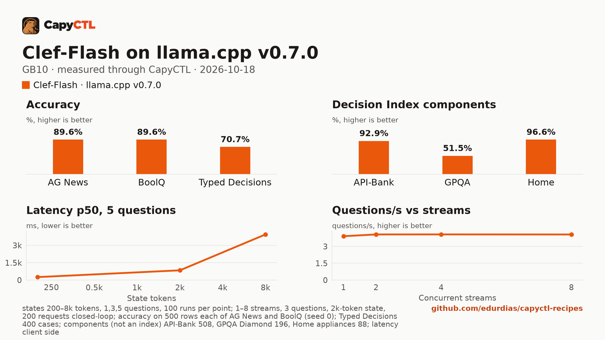

# Clef-Flash (Q8_0 GGUF) on llama.cpp v0.7.0, one GB10

| | |
|---|---|
| Hardware | 1x NVIDIA GB10 (DGX Spark class), compute capability 12.1, 128 GB unified memory, aarch64 |
| System | Ubuntu 24.04, NVIDIA driver 580.173.02, CUDA 13.0 toolkit in `/usr/local/cuda` |
| Engine | llama.cpp `llama-server` built from tag `v0.7.0` (commit `620d222`, `-DGGML_CUDA=ON -DCMAKE_CUDA_ARCHITECTURES=121a-real`) |
| Model | [`ggml-org/Clef-Flash-GGUF`](https://huggingface.co/ggml-org/Clef-Flash-GGUF) at `6b4fe4c59098479652d94f0fe11a40facbebd1ec`: `Clef-Flash-Q8_0.gguf` |
| CapyCTL | `main` at `8824b622` for the commands below; `main` at `075023d7` for the capyctl-bench run; `capyctl start standalone` |
| Measured | 2026-10-18 |

Clef-Flash is Cloudflare's 9B decision model (Qwen3.5-9B), 9.7 GB as a Q8_0 GGUF. On a GB10 it is the best balance in the [decision-model comparison](../../comparisons/decision-models-gb10/): within 3 points of Clef 27B on every test and ahead of it on three, about three times as fast, and less than half the memory. It is a decision model: it does not generate text, it answers typed
questions about a text (`POST /v1/systemone`) with a probability for each answer.

It answers one question about a 200-token text in **203 ms**, starts in 21 s, holds **15.8 GiB**, and scores **92.9% on API-Bank** (Cloudflare reports 93.1% for Clef-Flash on Decision Index 0.2.1), 96.6% on Home appliances, 70.7% on Typed Decisions and 89.6% on both AG News and BoolQ. Its probabilities are among the best calibrated in the field (Typed Decisions ECE 0.013; 0.012 for the same model on SGLang).

## Run it

Decision models need CapyCTL 0.1.5 or later (`api: decisions`).
Download the model into the models directory (the pinned command is in
`deployment.yaml`) and register the engine:

```bash
capyctl engine add ~/llamacpp-v0.7.0/build/bin/llama-server --name llamacpp
```

```text
Registered llamacpp (llamacpp 0.7.0)

  Executable     /home/me/llamacpp-v0.7.0/build/bin/llama-server
  Deep park      disabled
  Engines file   /home/me/.config/capyctl/engines.yaml (revision 1)
  Published      yes
```

```bash
capyctl deploy model --file deployment.yaml
```

```text
Request identity: 01M57B5H5XC8A103X4PVMEF0RB (reuse --request-id 01M57B5H5XC8A103X4PVMEF0RB to recover this command)
Deployment clef-flash created (revision 1)

  Deployment ID       01M57B5H6HX1A650ZVBAH53NR7
  Operation           01M57B5H6HJMM5SA4VRNDVRR2T
  Checkpoint digest   being measured
the checkpoint digest of clef-flash is being measured; `capyctl start deployment clef-flash --wait` waits for it and starts the deployment
```

```bash
capyctl start deployment clef-flash --wait
```

```text
Request identity: 01M57B5H6VKV8HDHB6TXDFSC2P (reuse --request-id 01M57B5H6VKV8HDHB6TXDFSC2P to recover this command)
Waiting for the checkpoint digest of clef-flash to be measured (at most 900s)
Started clef-flash: ready

  Ready       1/1
  Hosts       gpu-box
  Operation   initialize succeeded
```

Ask it something:

```bash
KEY=$(sed -n 's/^api_key: //p' ~/.local/state/capyctl/identity/credentials)
curl -s http://127.0.0.1:8443/v1/systemone \
  -H "Authorization: Bearer $KEY" -H 'Content-Type: application/json' \
  -d '{"model": "clef-flash", "state": "The ticket says: my card was charged twice for one order.", "questions": {"team": {"type": "choice", "instructions": "Which team should handle this ticket?", "criteria": {"billing": "charges, refunds, invoices", "shipping": "deliveries and tracking", "technical": "bugs and errors"}}, "urgent": {"type": "noul", "instructions": "Is the customer losing money right now?"}}}' \
  | python3 -m json.tool
```

```text
{
    "answers": {
        "team": {
            "choice": "billing",
            "confidence": 0.7957394171098366,
            "probabilities": {
                "billing": 0.8638262780732245,
                "shipping": 0.02482438689795755,
                "technical": 0.11134933502881789
            },
            "type": "choice"
        },
        "urgent": {
            "noul": 0.8966828348997972,
            "type": "noul"
        }
    },
    "model": "clef-flash",
    "usage": {
        "input_tokens": 247,
        "output_tokens": 0
    }
}
```

`choice` questions come back with a probability for each option, `noul` (yes or
no) questions with the probability of yes. Chat completions are refused:

```text
{"code":"api_mismatch","message":"model clef-flash serves the decisions API, which /v1/chat/completions does not answer; send its requests to POST /v1/systemone"}
HTTP 400
```

## Numbers

| Number | Value |
|---|---|
| Ready time, cold | 21.3 s (first deploy, including the checkpoint digest) |
| Ready time, warm | 3.6 s after `capyctl stop deployment clef-flash` |
| First decision | 150 ms after a cold start, 139 ms after a warm one (the request above) |
| Peak memory | 15.8 GiB measured by CapyCTL (`startup.measured`) against the 18 GiB it reserves |
| Decisions/s, 1 / 2 / 4 / 8 users | 1.30 / 1.36 / 1.36 / 1.35 (3 questions, a 2k-token text each) |
| Questions/s, 1 / 2 / 4 / 8 users | 3.91 / 4.07 / 4.07 / 4.06 |
| Repeated text | 757 ms p50 against 766 ms for new texts (3 questions, 2k tokens) |
| AG News (500 test rows) | 89.6% accuracy, Brier 0.165 |
| BoolQ (500 validation rows) | 89.6% accuracy, Brier 0.075 |
| Typed Decisions (400 cases, 2,000 decisions) | 70.7% accuracy, KL from gold 0.209, ECE 0.013 |
| Decision Index components | API-Bank 92.9%, GPQA Diamond 51.5%, Home appliances 96.6% |

Latency, one request at a time, request sent to the whole answer read, p50 / p95 in ms:

| Questions | 200-token text | 2k-token text | 8k-token text |
|---|---|---|---|
| 1 | 203 / 207 | 718 / 729 | 3,813 / 3,874 |
| 3 | 239 / 252 | 769 / 780 | 3,903 / 3,937 |
| 5 | 256 / 259 | 839 / 860 | 3,934 / 4,046 |

100 timed requests per point after 5 warm-up requests. Each request's text is new,
so no cache helps.

[Full report](bench/report.html) (download and open it locally),
[tables](bench/summary.md), [every point](bench/data.csv).



The capyctl-bench run was `capyctl_bench.py run --decisions --accuracy
--accuracy-sets all --concurrency 1,2,4,8`. Its README defines every metric,
and the report lists the pinned dataset revisions and row hashes. The same run
for seven more deployments is in the
[decision-model comparison](../../comparisons/decision-models-gb10/).

## Notes

- **SGLang.** The same model in BF16 on SGLang 0.5.22 ([its recipe](../../sglang/clef-flash-gb10/)) is 24% faster on short texts and twice as fast on 8k-token ones, but holds 52 GiB and takes 3 minutes to start.
- **No parking.** Decision models start and stop (`residency: restart_only`);
  when CapyCTL needs the memory it stops the model, and the next request starts
  it again in about 4 seconds.
- **Unauthenticated loopback surfaces.** As for every llama.cpp deployment,
  `capyctl status deployment` notes that llama-server's own routes answer
  without a key on its loopback listener; CapyCTL's endpoint still requires one.
