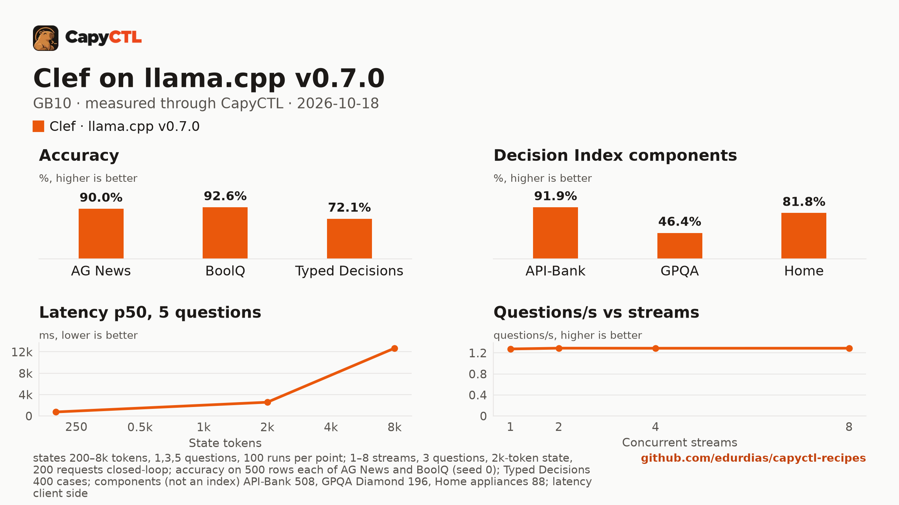

# Clef (Q8_0 GGUF) on llama.cpp v0.7.0, one GB10

| | |
|---|---|
| Hardware | 1x NVIDIA GB10 (DGX Spark class), compute capability 12.1, 128 GB unified memory, aarch64 |
| System | Ubuntu 24.04, NVIDIA driver 580.173.02, CUDA 13.0 toolkit in `/usr/local/cuda` |
| Engine | llama.cpp `llama-server` built from tag `v0.7.0` (commit `620d222`, `-DGGML_CUDA=ON -DCMAKE_CUDA_ARCHITECTURES=121a-real`) |
| Model | [`ggml-org/Clef-GGUF`](https://huggingface.co/ggml-org/Clef-GGUF) at `d2aa75cb425ae922b5c3c15ef3157d417b7f7641`: `Clef-Q8_0.gguf` |
| CapyCTL | `main` at `8824b622` for the commands below; `main` at `075023d7` for the capyctl-bench run; `capyctl start standalone` |
| Measured | 2026-10-18 |

Clef is Cloudflare's 27B decision model (Qwen3.8-27B), 28.7 GB as a Q8_0 GGUF. It is a decision model: it does not generate text, it answers typed
questions about a text (`POST /v1/systemone`) with a probability for each answer.

It answers one question about a 200-token text in **560 ms**, starts in 78 s, holds **35.4 GiB**, and gets **91.9% on API-Bank**, the number Cloudflare reports for Clef on Decision Index 0.2.1, the best BoolQ in the field (92.6%) and 72.1% on Typed Decisions (72.4% on SGLang, 73.0% for Julia-1). Clef-Flash beats it on API-Bank, GPQA and Home appliances at a third of the latency.

## Run it

Decision models need CapyCTL 0.1.5 or later (`api: decisions`).
Download the model into the models directory (the pinned command is in
`deployment.yaml`) and register the engine:

```bash
capyctl engine add ~/llamacpp-v0.7.0/build/bin/llama-server --name llamacpp
```

```text
Registered llamacpp (llamacpp 0.7.0)

  Executable     /home/me/llamacpp-v0.7.0/build/bin/llama-server
  Deep park      disabled
  Engines file   /home/me/.config/capyctl/engines.yaml (revision 1)
  Published      yes
```

```bash
capyctl deploy model --file deployment.yaml
```

```text
Request identity: 01M57B6DAFA10FTB6SNSPF26Z4 (reuse --request-id 01M57B6DAFA10FTB6SNSPF26Z4 to recover this command)
Deployment clef created (revision 1)

  Deployment ID       01M57B6DB1JDEGS3PYR4VY474Q
  Operation           01M57B6DB1T0P4JACMK6FG8M1X
  Checkpoint digest   being measured
the checkpoint digest of clef is being measured; `capyctl start deployment clef --wait` waits for it and starts the deployment
```

```bash
capyctl start deployment clef --wait
```

```text
Request identity: 01M57B6DBAW0H8G6S641DJJTDQ (reuse --request-id 01M57B6DBAW0H8G6S641DJJTDQ to recover this command)
Waiting for the checkpoint digest of clef to be measured (at most 900s)
Started clef: ready

  Ready       1/1
  Hosts       gpu-box
  Operation   initialize succeeded
```

Ask it something:

```bash
KEY=$(sed -n 's/^api_key: //p' ~/.local/state/capyctl/identity/credentials)
curl -s http://127.0.0.1:8443/v1/systemone \
  -H "Authorization: Bearer $KEY" -H 'Content-Type: application/json' \
  -d '{"model": "clef", "state": "The ticket says: my card was charged twice for one order.", "questions": {"team": {"type": "choice", "instructions": "Which team should handle this ticket?", "criteria": {"billing": "charges, refunds, invoices", "shipping": "deliveries and tracking", "technical": "bugs and errors"}}, "urgent": {"type": "noul", "instructions": "Is the customer losing money right now?"}}}' \
  | python3 -m json.tool
```

```text
{
    "answers": {
        "team": {
            "choice": "billing",
            "confidence": 0.9441845139481706,
            "probabilities": {
                "billing": 0.9627896759654472,
                "shipping": 0.007904083289718623,
                "technical": 0.029306240744834237
            },
            "type": "choice"
        },
        "urgent": {
            "noul": 0.961804807681514,
            "type": "noul"
        }
    },
    "model": "clef",
    "usage": {
        "input_tokens": 247,
        "output_tokens": 0
    }
}
```

`choice` questions come back with a probability for each option, `noul` (yes or
no) questions with the probability of yes. Chat completions are refused:

```text
{"code":"api_mismatch","message":"model clef serves the decisions API, which /v1/chat/completions does not answer; send its requests to POST /v1/systemone"}
HTTP 400
```

## Numbers

| Number | Value |
|---|---|
| Ready time, cold | 78.4 s (first deploy, including the checkpoint digest) |
| Ready time, warm | 6.1 s after `capyctl stop deployment clef` |
| First decision | 410 ms after a cold start, 381 ms after a warm one (the request above) |
| Peak memory | 35.4 GiB measured by CapyCTL (`startup.measured`) against the 38 GiB it reserves |
| Decisions/s, 1 / 2 / 4 / 8 users | 0.425 / 0.430 / 0.430 / 0.430 (3 questions, a 2k-token text each) |
| Questions/s, 1 / 2 / 4 / 8 users | 1.28 / 1.29 / 1.29 / 1.29 |
| Repeated text | 2,322 ms p50 against 2,353 ms for new texts (3 questions, 2k tokens) |
| AG News (500 test rows) | 90.0% accuracy, Brier 0.168 |
| BoolQ (500 validation rows) | 92.6% accuracy, Brier 0.061 |
| Typed Decisions (400 cases, 2,000 decisions) | 72.1% accuracy, KL from gold 0.191, ECE 0.020 |
| Decision Index components | API-Bank 91.9%, GPQA Diamond 46.4%, Home appliances 81.8% |

Latency, one request at a time, request sent to the whole answer read, p50 / p95 in ms:

| Questions | 200-token text | 2k-token text | 8k-token text |
|---|---|---|---|
| 1 | 560 / 567 | 2,202 / 2,233 | 12,176 / 12,387 |
| 3 | 693 / 734 | 2,356 / 2,387 | 12,414 / 12,627 |
| 5 | 751 / 761 | 2,567 / 2,657 | 12,672 / 12,926 |

100 timed requests per point after 5 warm-up requests. Each request's text is new,
so no cache helps.

[Full report](bench/report.html) (download and open it locally),
[tables](bench/summary.md), [every point](bench/data.csv).



The capyctl-bench run was `capyctl_bench.py run --decisions --accuracy
--accuracy-sets all --concurrency 1,2,4,8`. Its README defines every metric,
and the report lists the pinned dataset revisions and row hashes. The same run
for seven more deployments is in the
[decision-model comparison](../../comparisons/decision-models-gb10/).

## Notes

- **Long inputs are slow.** One question about an 8k-token text (8,250 tokens with the question) takes 12.2 s: llama.cpp reads about 680 tokens/s of this model's input. SGLang reads about 1,440 ([its recipe](../../sglang/clef-gb10/)).
- **The vision projector** in the GGUF repository is not needed for decisions; the download command fetches only the model.
- **No parking.** Decision models start and stop (`residency: restart_only`);
  when CapyCTL needs the memory it stops the model, and the next request starts
  it again in about 6 seconds.
- **Unauthenticated loopback surfaces.** As for every llama.cpp deployment,
  `capyctl status deployment` notes that llama-server's own routes answer
  without a key on its loopback listener; CapyCTL's endpoint still requires one.
