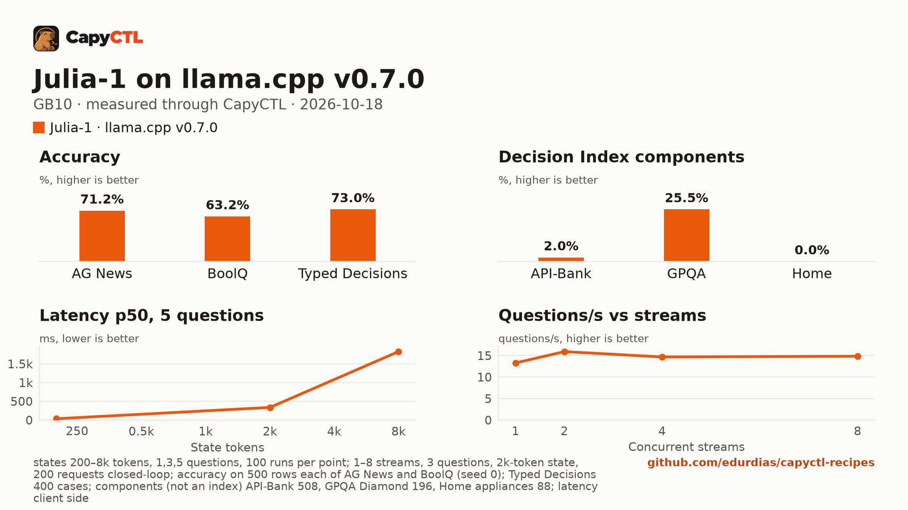

# Julia-1 (Q8_0 GGUF) on llama.cpp v0.7.0, one GB10

| | |
|---|---|
| Hardware | 1x NVIDIA GB10 (DGX Spark class), compute capability 12.1, 128 GB unified memory, aarch64 |
| System | Ubuntu 24.04, NVIDIA driver 580.173.02, CUDA 13.0 toolkit in `/usr/local/cuda` |
| Engine | llama.cpp `llama-server` built from tag `v0.7.0` (commit `620d222`, `-DGGML_CUDA=ON -DCMAKE_CUDA_ARCHITECTURES=121a-real`) |
| Model | [`ggml-org/Julia-1-GGUF`](https://huggingface.co/ggml-org/Julia-1-GGUF) at `16fee17949206fbf58da9347daea44d792a81211`: `Julia-1-Q8_0.gguf` |
| CapyCTL | `main` at `8824b622` for the commands below; a PR #148 build (`a33c4f0d`, the change merged as `8824b622`) for the capyctl-bench run; `capyctl start standalone` |
| Measured | 2026-10-18 |

Julia-1 is SupersonicLabs' decision model: 144M parameters on an mmBERT-small encoder, 0.17 GB as a Q8_0 GGUF. It is the fastest model in the [decision-model comparison](../../comparisons/decision-models-gb10/), and on the Typed Decisions test it scores as well as the 27B Clef. It is a decision model: it does not generate text, it answers typed
questions about a text (`POST /v1/systemone`) with a probability for each answer.

It answers one question about a 200-token text in **20 ms** through CapyCTL, peaks at **1.4 GiB**, and starts in 3 s. On the 400-case Typed Decisions test it gets **73.0%** (its model card reports 73.15%). Outside that kind of task it is weak: 2.0% on API-Bank tool selection, 0% on the Home appliances forms, chance on GPQA, and its probabilities are overconfident (Typed Decisions ECE 0.224, against 0.012 to 0.092 for the Clef, Kev-4B and lev deployments).

## Run it

Decision models need CapyCTL 0.1.5 or later (`api: decisions`).
Download the model into the models directory (the pinned command is in
`deployment.yaml`) and register the engine:

```bash
capyctl engine add ~/llamacpp-v0.7.0/build/bin/llama-server --name llamacpp
```

```text
Registered llamacpp (llamacpp 0.7.0)

  Executable     /home/me/llamacpp-v0.7.0/build/bin/llama-server
  Deep park      disabled
  Engines file   /home/me/.config/capyctl/engines.yaml (revision 1)
  Published      yes
```

```bash
capyctl deploy model --file deployment.yaml
```

```text
Request identity: 01M57B4KDA15M6CGJHATJF25QQ (reuse --request-id 01M57B4KDA15M6CGJHATJF25QQ to recover this command)
Deployment julia-1 created (revision 1)

  Deployment ID       01M57B4KE9EQEPKJVBSZYFSTM0
  Operation           01M57B4KE9HEJN719ZHM9MK9XS
  Checkpoint digest   being measured
the checkpoint digest of julia-1 is being measured; `capyctl start deployment julia-1 --wait` waits for it and starts the deployment
```

```bash
capyctl start deployment julia-1 --wait
```

```text
Request identity: 01M57B4KEK57ZK35D3Y142MPNF (reuse --request-id 01M57B4KEK57ZK35D3Y142MPNF to recover this command)
Waiting for the checkpoint digest of julia-1 to be measured (at most 900s)
Started julia-1: ready

  Ready       1/1
  Hosts       gpu-box
  Operation   initialize succeeded
```

Ask it something:

```bash
KEY=$(sed -n 's/^api_key: //p' ~/.local/state/capyctl/identity/credentials)
curl -s http://127.0.0.1:8443/v1/systemone \
  -H "Authorization: Bearer $KEY" -H 'Content-Type: application/json' \
  -d '{"model": "julia-1", "state": "The ticket says: my card was charged twice for one order.", "questions": {"team": {"type": "choice", "instructions": "Which team should handle this ticket?", "criteria": {"billing": "charges, refunds, invoices", "shipping": "deliveries and tracking", "technical": "bugs and errors"}}, "urgent": {"type": "noul", "instructions": "Is the customer losing money right now?"}}}' \
  | python3 -m json.tool
```

```text
{
    "answers": {
        "team": {
            "choice": "billing",
            "confidence": 0.9964915833112908,
            "probabilities": {
                "billing": 0.9976610555408606,
                "shipping": 0.002055699886910949,
                "technical": 0.00028324457222851526
            },
            "type": "choice"
        },
        "urgent": {
            "noul": 0.9776168594286752,
            "type": "noul"
        }
    },
    "model": "julia-1",
    "usage": {
        "input_tokens": 74,
        "output_tokens": 0
    }
}
```

`choice` questions come back with a probability for each option, `noul` (yes or
no) questions with the probability of yes. Chat completions are refused:

```text
{"code":"api_mismatch","message":"model julia-1 serves the decisions API, which /v1/chat/completions does not answer; send its requests to POST /v1/systemone"}
HTTP 400
```

## Numbers

| Number | Value |
|---|---|
| Ready time, cold | 3.1 s (first deploy, including the checkpoint digest) |
| Ready time, warm | 1.6 s after `capyctl stop deployment julia-1` |
| First decision | 40 ms after a cold start, 24 ms after a warm one (the request above) |
| Peak memory | 1.4 GiB measured by CapyCTL (`startup.measured`) against the 2 GiB it reserves |
| Decisions/s, 1 / 2 / 4 / 8 users | 4.43 / 5.31 / 4.90 / 4.95 (3 questions, a 2k-token text each) |
| Questions/s, 1 / 2 / 4 / 8 users | 13.3 / 15.9 / 14.7 / 14.9 |
| Repeated text | 211 ms p50 against 221 ms for new texts (3 questions, 2k tokens) |
| AG News (500 test rows) | 71.2% accuracy, Brier 0.465 |
| BoolQ (500 validation rows) | 63.2% accuracy, Brier 0.318 |
| Typed Decisions (400 cases, 2,000 decisions) | 73.0% accuracy, KL from gold 2.96, ECE 0.224 |
| Decision Index components | API-Bank 2.0%, GPQA Diamond 25.5%, Home appliances 0.0% |

Latency, one request at a time, request sent to the whole answer read, p50 / p95 in ms:

| Questions | 200-token text | 2k-token text | 8k-token text |
|---|---|---|---|
| 1 | 20.0 / 23.8 | 56.2 / 59.8 | 392 / 424 |
| 3 | 26.3 / 30.0 | 229 / 237 | 1,119 / 1,220 |
| 5 | 35.6 / 38.8 | 337 / 375 | 1,822 / 1,996 |

100 timed requests per point after 5 warm-up requests. Each request's text is new,
so no cache helps.

[Full report](bench/report.html) (download and open it locally),
[tables](bench/summary.md), [every point](bench/data.csv).



The capyctl-bench run was `capyctl_bench.py run --decisions --accuracy
--accuracy-sets all --concurrency 1,2,4,8`. Its README defines every metric,
and the report lists the pinned dataset revisions and row hashes. The same run
for seven more deployments is in the
[decision-model comparison](../../comparisons/decision-models-gb10/).

## Notes

- **Context 8,192 tokens.** llama.cpp reads a decision request's whole input in one batch, so the batch equals the context. A longer input is refused: in the 8k-token latency points 8, 9 and 14 of 100 inputs ran just over 8,192 tokens, and each was answered `502 engine_error` with llama.cpp's message ("input (8195 tokens) is too large to process. increase the physical batch size"). Their latencies are left out of the table.
- **Its probabilities.** Julia-1 picks the right answer as often as Clef on Typed Decisions, but it is far more sure of itself than it should be: KL from the gold distributions 2.96 against Clef's 0.19. Use its `choice`, and treat its `confidence` with care.
- **No parking.** Decision models start and stop (`residency: restart_only`);
  when CapyCTL needs the memory it stops the model, and the next request starts
  it again in about 2 seconds.
- **Unauthenticated loopback surfaces.** As for every llama.cpp deployment,
  `capyctl status deployment` notes that llama-server's own routes answer
  without a key on its loopback listener; CapyCTL's endpoint still requires one.
