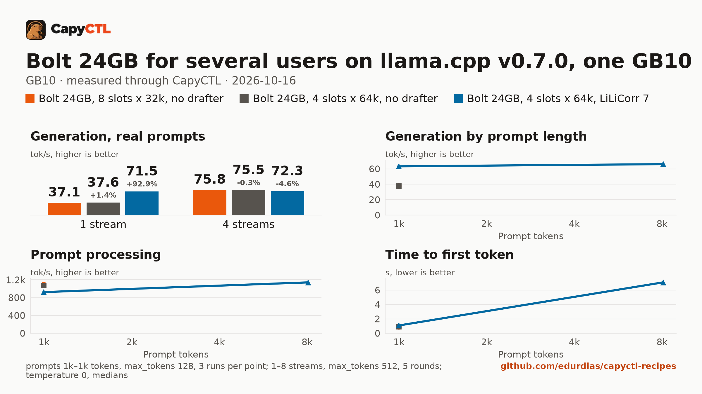

# Nemotron 3.5 Bolt 74B-A9B 24GB for several users, llama.cpp v0.7.0, one GB10

| | |
|---|---|
| Hardware | 1x NVIDIA GB10 (DGX Spark class), compute capability 12.1, 128 GB unified memory, aarch64 |
| System | Ubuntu 24.04, NVIDIA driver 580.173.02, CUDA 13.0 toolkit in `/usr/local/cuda` |
| Engine | llama.cpp `llama-server` built from tag `v0.7.0` (commit `620d222`) |
| Model | [`nvidia/NVIDIA-Nemotron-3.5-Bolt-74B-A9B-24GB-GGUF`](https://huggingface.co/nvidia/NVIDIA-Nemotron-3.5-Bolt-74B-A9B-24GB-GGUF) at `e0fecb69cb3e5e4c5e8a056fa2aec98c78e91246` |
| Drafter | none |
| CapyCTL | 0.1.3 release (`345806a5`), `capyctl start standalone` |
| Measured | 2026-10-16 |

The same model as [the single-user recipe](../nemotron-3.5-bolt-74b-a9b-24gb-gb10/),
set up for a team: 8 requests decoded together, 32,768 tokens each, and no
drafter. With two or more requests decoding together the LiLiCorr drafter stops
paying off (below), so this recipe spends the memory on slots instead. It holds
30 GiB, starts in 5 seconds and reaches **97 tokens/s** in total with 8 users.

## Run it

```bash
capyctl engine add ~/llamacpp-v0.7.0/build/bin/llama-server --name llamacpp
capyctl deploy model --file deployment.yaml
capyctl start deployment nemotron-bolt-shared --wait
```

The model directory is the single-user recipe's; no drafter is needed.

## Numbers

| Number | Value |
|---|---|
| Ready time, cold | 5.7 s (checkpoint digest already recorded) |
| Ready time, warm | 4.6 s |
| Time to first token, one user | 0.30 s (median, capyctl-bench's prompt set) |
| Decode, one user | 37.8 tokens/s |
| Peak memory | 27.8 GiB measured by CapyCTL against the 30 GiB it reserves |

Text, tool calls (`get_weather {"city":"Lisbon"}`), images ("Red") and
streaming pass through CapyCTL, as in the single-user recipe.

## Users at once

[Full report](bench/report.html), [tables](bench/summary.md).



| Users | 8 slots, no drafter: total, per user | 4 slots, no drafter | 4 slots, LiLiCorr 7 |
|---|---|---|---|
| 1 | 37.1, 37.8 tokens/s | 37.6, 38.3 | 71.5, 74.9 |
| 2 | 56.0, 29.0 | 57.5, 29.6 | 64.3, 34.3 |
| 4 | 75.8, 19.8 | 75.5, 19.7 | 72.3, 21.0 |
| 8 | 97.2, 12.4 | – | – |

Time to first token stays between 0.3 and 1.3 s up to 8 users on short
prompts; prompt processing is about 1,100 tokens/s, as for one slot.

## Which Bolt recipe

- **One person, or an agent working alone:** the single-user recipe. Twice the
  speed for that one stream (79 tokens/s) and the full 262,144-token context.
- **Several people or agents at once:** this one. From 3 users up the totals are
  the same with or without the drafter, and without it 8 fit in 30 GiB.

## Notes

- **Stated memory.** A hybrid (Mamba) model: the recipe states `resources`;
  28 GiB on the GPU and 2 GiB of RAM hold the 27.8 GiB peak.
- **No parking.** llama.cpp restarts instead of parking, in about 5 seconds.
