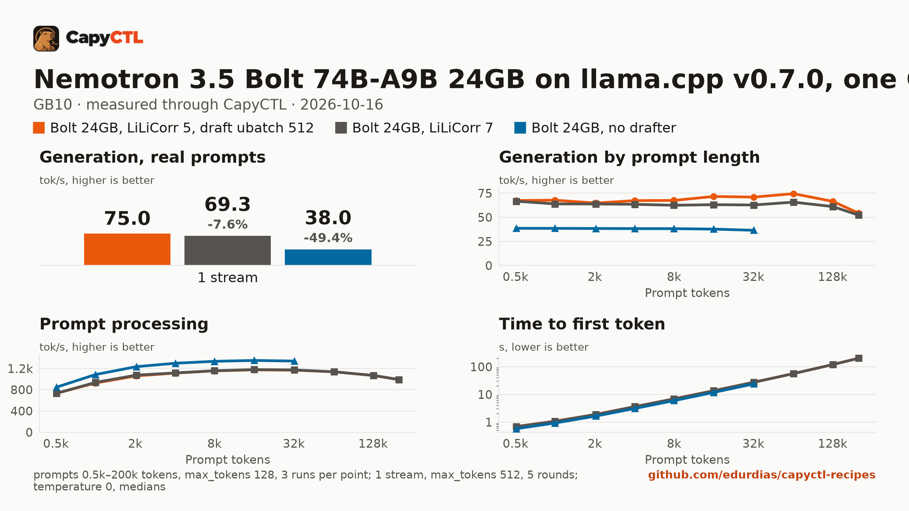

# Nemotron 3.5 Bolt 74B-A9B 24GB on llama.cpp v0.7.0, one GB10

| | |
|---|---|
| Hardware | 1x NVIDIA GB10 (DGX Spark class), compute capability 12.1, 128 GB unified memory, aarch64 |
| System | Ubuntu 24.04, NVIDIA driver 580.173.02, CUDA 13.0 toolkit in `/usr/local/cuda` |
| Engine | llama.cpp `llama-server` built from tag `v0.7.0` (commit `620d222`, `-DGGML_CUDA=ON -DCMAKE_CUDA_ARCHITECTURES=121a-real`) |
| Model | [`nvidia/NVIDIA-Nemotron-3.5-Bolt-74B-A9B-24GB-GGUF`](https://huggingface.co/nvidia/NVIDIA-Nemotron-3.5-Bolt-74B-A9B-24GB-GGUF) at `e0fecb69cb3e5e4c5e8a056fa2aec98c78e91246`: the 2-bit model (22.0 GB) and its vision projector (1.7 GB) |
| Drafter | [`nvidia/NVIDIA-Nemotron-3.5-Bolt-74B-A9B-24GB-LiLiCorr-GGUF`](https://huggingface.co/nvidia/NVIDIA-Nemotron-3.5-Bolt-74B-A9B-24GB-LiLiCorr-GGUF) at `182d2987939e12f458298b5d5f6ef98912f4ad6c` (1.0 GB), 5 draft tokens |
| CapyCTL | 0.1.3 release (`345806a5`), `capyctl start standalone` |
| Measured | 2026-10-16 |

Bolt is NVIDIA's 74B-A9B mixture-of-experts vision-language model, compressed
from Nemotron 3.5 Super VL and quantized to 2 bits so it fits in 24 GB. This is
NVIDIA's "32GB recipe" for llama.cpp (the full 262,144-token context, one
request at a time, the LiLiCorr drafter) run through CapyCTL and tuned: 5 draft
tokens instead of 7, and a 512-token batch for the drafter. llama.cpp v0.7.0 is
the first release that runs it; v0.6.0 has neither the model nor the drafter.

For one user it decodes **79 tokens/s** (2.0 times what it does without the
drafter), answers a short question in a third of a second, and holds 35 GiB.
Text, tool calls, images and streaming work through CapyCTL. For several users
at once, see [the shared recipe](../nemotron-3.5-bolt-74b-a9b-24gb-8x32k-gb10/).

## Run it

Download the model and projector into the models directory, and the drafter
into a directory you approve for it (the pinned commands are in
`deployment.yaml`). Register the v0.7.0 build with that approval:

```bash
capyctl engine add ~/llamacpp-v0.7.0/build/bin/llama-server --name llamacpp \
  --approve-option=--spec-draft-model --approve-path ~/drafters
```

```text
Registered llamacpp (llamacpp 0.7.0)

  Executable     /home/me/llamacpp-v0.7.0/build/bin/llama-server
  Deep park      disabled
  Engines file   /home/me/.config/capyctl/engines.yaml (revision 1)
  Published      yes
```

Set the drafter path in `deployment.yaml` to yours, then:

```bash
capyctl deploy model --file deployment.yaml
capyctl start deployment nemotron-bolt --wait
```

```text
Request identity: 01M51CTR50A59BA7M4S6XVB4S9 (reuse --request-id 01M51CTR50A59BA7M4S6XVB4S9 to recover this command)
Waiting for the checkpoint digest of nemotron-bolt to be measured (at most 1800s)
Started nemotron-bolt: ready

  Ready       1/1
  Hosts       gpu-box
  Operation   initialize succeeded
```

```bash
KEY=$(sed -n 's/^api_key: //p' ~/.local/state/capyctl/identity/credentials)
curl -s http://127.0.0.1:8443/v1/chat/completions \
  -H "Authorization: Bearer $KEY" -H 'Content-Type: application/json' \
  -d '{"model": "nemotron-bolt", "messages": [{"role": "user", "content": "What is the capital of Australia? Answer in one sentence."}], "temperature": 0}' \
  | jq -r '.choices[0].message.content'
```

```text
The capital of Australia is Canberra.
```

The model thinks first; the thinking comes back in `reasoning_content`.

## Numbers

| Number | Value |
|---|---|
| Ready time, cold | 27–49 s on a first deploy, which measures the 24 GB checkpoint's digest; 8 s once it is recorded |
| Ready time, warm | 6.7 s |
| Time to first token | 0.34 s (median, capyctl-bench's prompt set, `max_tokens: 512`, one request at a time) |
| Decode, one stream | 78.8 tokens/s (same requests); 38.7 without the drafter |
| Peak memory | 31.2 GiB measured by CapyCTL (`startup.measured`) against the 35 GiB it reserves |
| GSM8K (250 questions, final number in `\boxed{}`, `max_tokens: 4096`) | 94.4% (236 of 250; 9 answers cut at `max_tokens`) |
| Tool calls (30 cases: valid JSON, the expected function, its required arguments; `max_tokens: 256`) | 29 of 30; the miss ran out of its 256 tokens while still reasoning |

Thinking on (the model's default). Temperature 0 for the checks and the
accuracy runs, capyctl-bench's defaults for the sweeps. The drafter accepted
59.7% of its draft tokens on capyctl-bench's prompt set.

## Checks through CapyCTL

| Check | Result |
|---|---|
| Short answer | "The capital of Australia is Canberra.", 165 characters of reasoning |
| Tool call (`get_weather`) | finish `tool_calls`, `get_weather {"city":"Lisbon"}` |
| Image (a red 64x64 PNG as `image_url`) | "Red" |
| Streaming with usage | 182 chunks; llama.cpp's `timings` (with `draft_n` and `draft_n_accepted`) and CapyCTL's per-request metrics on the last |

## Long prompts

[Full report](bench/report.html) (download and open it locally),
[tables](bench/summary.md), [every point](bench/data.csv).



| Prompt | Decode | Time to first token |
|---|---|---|
| 1k tokens | 67.7 tokens/s | 1.08 s |
| 8k | 67.5 | 6.9 s |
| 32k | 70.9 | 27.7 s |
| 128k | 66.5 | 120 s |
| 200k | 54.3 | 204 s |

Decoding holds up to 128k. Prompt processing is the slow part on a GB10:
about 1,100 tokens/s (1,300 without the drafter), so a cold 128k-token prompt
takes two minutes to its first token. A prompt that repeats an earlier one's
prefix reuses llama.cpp's cache for it.

## What was tuned

[Tuning report](bench/tuning/report.html), [tables](bench/tuning/summary.md).
Each setting was changed alone from NVIDIA's recipe:

| Setting | One user, decode | Peak memory | Result |
|---|---|---|---|
| NVIDIA's recipe: 7 draft tokens, prompt batch 2048 | 72.4 tokens/s | 34.9 GB | baseline |
| 6 draft tokens | 74.4 | 34.6 GB | |
| **5 draft tokens** | **77.0** | 34.4 GB | taken |
| 4 draft tokens | 76.1 | 34.3 GB | |
| Prompt batch (`--ubatch-size`) 512 | 75.0 | 31.5 GB | prompts 8–14% slower |
| Prompt batch 1024 | 73.7 | 32.5 GB | prompts 1–3% slower |
| Prompt batch 4096 | 72.8 | 39.4 GB | no faster, 4.5 GB more |
| **Drafter batch (`--spec-draft-n-ubatch`) 512** | 74.2 | 33.8 GB | taken: about 1 GB less, no cost |
| 2 slots of 131,072 tokens | 75.5 (one user), 68.1 in total (two) | 35.2 GB | no gain |

Together (this recipe): 78.8 tokens/s, 31.2 GiB. Fewer draft tokens are
accepted more often (59.7% at 5 against 48.6% at 7), which more than makes up
for the shorter drafts. Prompt processing does not move with any of these: it
is llama.cpp's limit on this model on a GB10.

## Notes

- **Stated memory.** Bolt is a hybrid model (Mamba layers beside attention):
  CapyCTL cannot size its cache from the GGUF header, so the recipe states
  `resources`. 33 GiB on the GPU and 2 GiB of RAM hold the 31.2 GiB peak.
- **No parking.** llama.cpp cannot free its memory while it runs: when CapyCTL
  needs the memory it stops the model, and the next request starts it again in
  about 7 seconds.
- **No vLLM or SGLang recipe yet.** NVIDIA's vLLM recipe for Bolt needs a vLLM
  nightly and its b12x kernels for the 2-bit experts; vLLM 0.31.0 cannot load
  the packed checkpoint.
- **Unauthenticated loopback surfaces.** As for every llama.cpp deployment,
  `capyctl status deployment` notes that llama-server's own routes answer
  without a key on its loopback listener; CapyCTL's endpoint still requires one.
