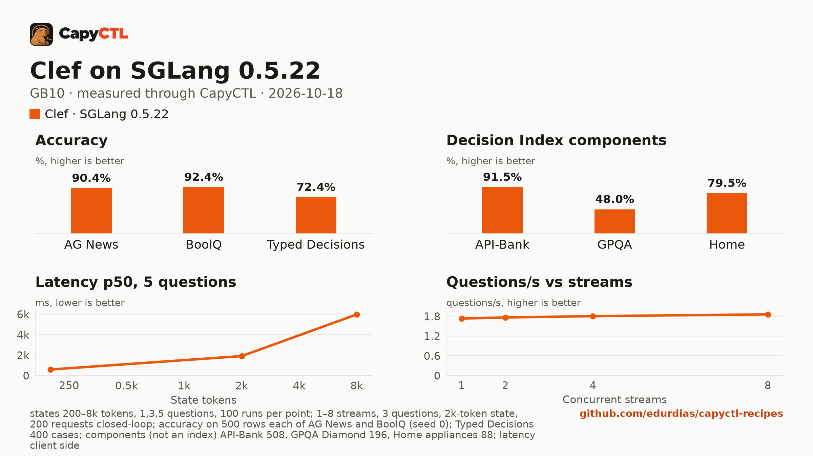

# Clef (BF16) on SGLang 0.5.22, one GB10

| | |
|---|---|
| Hardware | 1x NVIDIA GB10 (DGX Spark class), compute capability 12.1, 128 GB unified memory, aarch64 |
| System | Ubuntu 24.04, NVIDIA driver 580.173.02, CUDA 13.0 toolkit in `/usr/local/cuda` |
| Engine | SGLang 0.5.22 (`pip install sglang==0.5.22` in a virtual environment; it pulls `smg-grpc-servicer` 0.14.0) |
| Model | [`Cloudflare/clef`](https://huggingface.co/Cloudflare/clef) at `0b331204bb13fbd2ca93a64df1956f5b55478ce5` (safetensors, BF16) |
| CapyCTL | `main` at `8824b622` for the commands below; `main` at `075023d7` for the capyctl-bench run; `capyctl start standalone` |
| Measured | 2026-10-18 |

Clef is Cloudflare's 27B decision model (Qwen3.8-27B). This recipe serves its BF16 checkpoint (55 GB) on SGLang 0.5.22. It is a decision model: it does not generate text, it answers typed
questions about a text (`POST /v1/systemone`) with a probability for each answer.

It answers one question about a 200-token text in **395 ms**, and an 8k-token text in 5.7 s (llama.cpp's Q8_0 takes 12.2 s). It gets **72.4% on Typed Decisions**, 92.4% on BoolQ and 91.5% on API-Bank. It holds **87.5 GiB** and takes 7 minutes to start, so it needs the standalone's managed limit raised (below).

## Run it

Decision models need CapyCTL 0.1.5 or later (`api: decisions`).
Download the model into the models directory (the pinned command is in
`deployment.yaml`) and register the engine:

```bash
capyctl engine add ~/sglang-0.5.22-venv --name sglang
```

```text
Registered sglang (sglang 0.5.22)

  Executable     /home/me/sglang-0.5.22-venv/bin/python3
  Deep park      enabled
  CUDA           /usr/local/cuda
  Engines file   /home/me/.config/capyctl/engines.yaml (revision 2)
  Published      yes
```

```bash
capyctl deploy model --file deployment.yaml
```

```text
Request identity: 01M57BJX9424N26X775NNMVNEY (reuse --request-id 01M57BJX9424N26X775NNMVNEY to recover this command)
Deployment clef created (revision 1)

  Deployment ID       01M57BJX9N5XCJ95S02EF2M8MK
  Operation           01M57BJX9NV2EMP658KY3TSY1T
  Checkpoint digest   being measured
the checkpoint digest of clef is being measured; `capyctl start deployment clef --wait` waits for it and starts the deployment
```

```bash
capyctl start deployment clef --wait
```

```text
Request identity: 01M57BJXA2EQ3R62HNYQ7KJ23A (reuse --request-id 01M57BJXA2EQ3R62HNYQ7KJ23A to recover this command)
Waiting for the checkpoint digest of clef to be measured (at most 900s)
Started clef: ready

  Ready       1/1
  Hosts       gpu-box
  Operation   initialize succeeded
```

Ask it something:

```bash
KEY=$(sed -n 's/^api_key: //p' ~/.local/state/capyctl/identity/credentials)
curl -s http://127.0.0.1:8443/v1/systemone \
  -H "Authorization: Bearer $KEY" -H 'Content-Type: application/json' \
  -d '{"model": "clef", "state": "The ticket says: my card was charged twice for one order.", "questions": {"team": {"type": "choice", "instructions": "Which team should handle this ticket?", "criteria": {"billing": "charges, refunds, invoices", "shipping": "deliveries and tracking", "technical": "bugs and errors"}}, "urgent": {"type": "noul", "instructions": "Is the customer losing money right now?"}}}' \
  | python3 -m json.tool
```

```text
{
    "answers": {
        "team": {
            "choice": "billing",
            "confidence": 0.9459283203230824,
            "probabilities": {
                "billing": 0.9639522135487216,
                "shipping": 0.007834536546554749,
                "technical": 0.02821324990472372
            },
            "type": "choice"
        },
        "urgent": {
            "noul": 0.9633686333603796,
            "type": "noul"
        }
    },
    "model": "clef",
    "usage": {
        "input_tokens": 247,
        "output_tokens": 0
    }
}
```

`choice` questions come back with a probability for each option, `noul` (yes or
no) questions with the probability of yes. Chat completions are refused:

```text
{"code":"api_mismatch","message":"model clef serves the decisions API, which /v1/chat/completions does not answer; send its requests to POST /v1/systemone"}
HTTP 400
```

## Numbers

| Number | Value |
|---|---|
| Ready time, cold | 423.6 s (first deploy, including the checkpoint digest) |
| Ready time, warm | 385.8 s after `capyctl stop deployment clef` |
| First decision | 340 ms after a cold start, 334 ms after a warm one (the request above) |
| Peak memory | 87.5 GiB measured by CapyCTL (`startup.measured`) against the 88 GiB it reserves |
| Decisions/s, 1 / 2 / 4 / 8 users | 0.577 / 0.588 / 0.602 / 0.620 (3 questions, a 2k-token text each) |
| Questions/s, 1 / 2 / 4 / 8 users | 1.73 / 1.77 / 1.81 / 1.86 |
| Repeated text | 1,719 ms p50 against 1,733 ms for new texts (3 questions, 2k tokens) |
| AG News (500 test rows) | 90.4% accuracy, Brier 0.168 |
| BoolQ (500 validation rows) | 92.4% accuracy, Brier 0.061 |
| Typed Decisions (400 cases, 2,000 decisions) | 72.4% accuracy, KL from gold 0.191, ECE 0.023 |
| Decision Index components | API-Bank 91.5%, GPQA Diamond 48.0%, Home appliances 79.5% |

Latency, one request at a time, request sent to the whole answer read, p50 / p95 in ms:

| Questions | 200-token text | 2k-token text | 8k-token text |
|---|---|---|---|
| 1 | 395 / 403 | 1,581 / 1,607 | 5,731 / 5,876 |
| 3 | 473 / 497 | 1,734 / 1,744 | 5,918 / 5,964 |
| 5 | 594 / 601 | 1,904 / 1,920 | 5,975 / 6,029 |

100 timed requests per point after 5 warm-up requests. Each request's text is new,
so no cache helps.

[Full report](bench/report.html) (download and open it locally),
[tables](bench/summary.md), [every point](bench/data.csv).



The capyctl-bench run was `capyctl_bench.py run --decisions --accuracy
--accuracy-sets all --concurrency 1,2,4,8`. Its README defines every metric,
and the report lists the pinned dataset revisions and row hashes. The same run
for seven more deployments is in the
[decision-model comparison](../../comparisons/decision-models-gb10/).

## Notes

- **Memory.** SGLang sizes its cache from the memory it is given, so the peak follows the reservation: 84 GiB is what was measured, not a minimum. The weights are 55 GB. The standalone's default managed limit on a GB10 (50%, 60.8 GiB) is too small; the runs used `--set host.resource_policy.memory.system.managed_limit=108GiB`.
- **Start time.** 424 s cold and 386 s warm: SGLang compiles and captures CUDA graphs at every start.
- **SGLang 0.5.22 needs CapyCTL 0.1.5 or later.** Earlier releases refused its launch (`plugin_closure_failed`).
- **No parking.** Decision models start and stop (`residency: restart_only`);
  when CapyCTL needs the memory it stops the model, and the next request starts
  it again in about 386 seconds.
