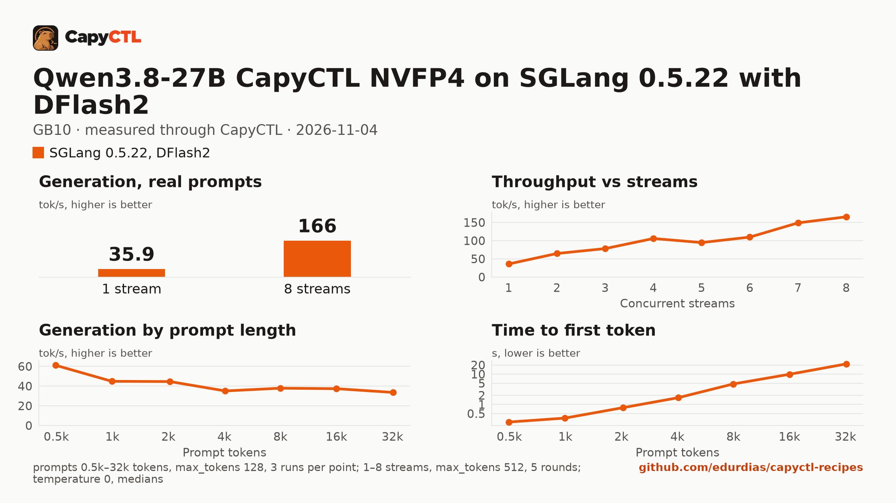

# Qwen3.8-27B CapyCTL NVFP4 on SGLang 0.5.22 with DFlash2 drafts, one GB10

| | |
|---|---|
| Hardware | 1x NVIDIA GB10 (DGX Spark class), compute capability 12.1, 128 GB unified memory, aarch64 |
| System | Ubuntu 24.04.5, kernel 6.17.0-1031-nvidia, NVIDIA driver 580.173.02, CUDA 13.0 toolkit in `/usr/local/cuda` |
| Engine | SGLang 0.5.22 in a venv (torch 2.14.1, flashinfer 0.7.1, sglang-kernel 0.4.9) |
| Model | [`capyctl/Qwen3.8-27B-NVFP4`](https://huggingface.co/capyctl/Qwen3.8-27B-NVFP4) at `4a47ea5eaf0bbc80ede6b392aa94e0dcc1980ab6`, every large Linear in NVFP4, MTP head BF16, 18.8 GB |
| Drafter | [`z-lab/Qwen3.8-27B-DFlash2`](https://huggingface.co/z-lab/Qwen3.8-27B-DFlash2) at `50307d4c4cde6860d4eee73e2547cd786fe8e8a4`, 3.8 GB |
| CapyCTL | 0.1.10 release; `capyctl start standalone` |
| Measured | 2026-11-04 |

The alternative to the [vLLM recipe](../../vllm/qwen3.8-27b-capyctl-nvfp4-gb10/) for the same
checkpoint: level with it up to 4 streams (36.3 tokens/s on one, 106 at four) and 11% behind
at 8 (166 against 187 tokens/s), with a slower first token on long prompts (21.7 s at 32k
against 13.6 s) and about 7 GiB more memory. Use it where SGLang is the engine you run. The
checkpoint, how it was made, and the [comparison](../../comparisons/qwen3.8-27b-nvfp4-builds-gb10/)
that chose these settings are in the vLLM recipe and the comparison.

### The settings

- **DFlash2 with 8 draft tokens** and `--speculative-draft-model-quantization unquant`, so
  the BF16 drafter is not given the target's `modelopt` quantization.
  6 and 12 draft tokens lost at 4 and 8 streams in the sweep.
- **MiaAI-Lab's GB10 flags**
  ([MiaAI-Lab/Qwen3.8-27B-SGLang-DGX-Spark](https://github.com/MiaAI-Lab/Qwen3.8-27B-SGLang-DGX-Spark)):
  `--mamba-ssm-dtype bfloat16` (the Gated DeltaNet state in bf16) and
  `--num-continuous-decode-steps 2`. Against stock DFlash2 on this checkpoint they took 8
  streams from 140 (run 1) to 166 tokens/s (run 3) and the startup peak from 67.9 to 58.8 GiB,
  with GSM8K and tool calls unchanged. A third decode step and torch.compile were within the
  spread.
- **`quantization: modelopt`** and an FP8 KV cache of 16 GiB. SGLang held 399,457 tokens and
  40 DeltaNet state slots for 8 running requests (`max_running_requests=8`).
- **`residency: restart_only`**: this SGLang environment has no `torch_memory_saver`, so
  CapyCTL cannot park it; a stop frees everything and a start loads again. Install the memory
  saver and drop the line to get CapyCTL's default.
- The **65 GiB memory request** is above the standalone's default managed limit (50%, 60.8
  GiB on a GB10). The measured run started the standalone with
  `--set host.resource_policy.memory.system.managed_limit=100GiB`.

## Run it

Download the drafter into a directory of drafters (CapyCTL does not download drafters):

```bash
hf download z-lab/Qwen3.8-27B-DFlash2 \
  --revision 50307d4c4cde6860d4eee73e2547cd786fe8e8a4 \
  --local-dir ~/drafters/Qwen3.8-27B-DFlash2
```

Register the engine and allow the drafter option for paths inside that directory:

```bash
capyctl engine add ~/sglang-0.5.22-venv \
  --approve-option=--speculative-draft-model-path --approve-path /home/me/drafters
```

```text
Registered sg522 (sglang 0.5.22)

  Executable     /home/me/sglang-0.5.22-venv/bin/python3
  Deep park      enabled
  CUDA           /usr/local/cuda
```

`Deep park enabled` is the profile's setting; without the memory saver CapyCTL reports the
capability missing when the deployment runs, which is why the file says `restart_only`.

```bash
capyctl start standalone --set host.resource_policy.memory.system.managed_limit=80%
capyctl deploy model --file deployment.yaml
```

The measured run profiled the engine as `sg522` and deployed this file with the model path
of its local copy of the checkpoint (the same files as the pinned revision, checked by
SHA-256) under the name `q38-rcp-sg`:

```text
Deployment q38-rcp-sg created (revision 1)
the checkpoint digest of q38-rcp-sg is being measured; `capyctl start deployment q38-rcp-sg --wait` waits for it and starts the deployment
```

```bash
capyctl start deployment q38-rcp-sg --wait
```

```text
Started q38-rcp-sg: ready

  Ready       1/1
  Hosts       host-a
  Operation   initialize succeeded
```

## Measured through CapyCTL

| | |
|---|---|
| Ready, cold | 255 s (a new state directory; kernel caches from earlier runs on this machine) |
| Ready, warm | 246 s (`start` after `stop`; a restart, not an unpark) |
| Time to first token | 0.188 s median |
| Decode, one stream | 36.3 tokens/s median (27.5 to 44.3), DFlash2 drafts on |
| Peak memory | 58.1 GiB measured by CapyCTL (`startup.measured`); system memory in use peaked at 64.3 GiB during the sweeps |
| Concurrency | up to 8 requests decoded together (`max_concurrent_requests: 8`) |
| Context | 32,768 tokens, declared |

The method is the vLLM recipe's: capyctl-bench's prompts, streaming chat completions through
the CapyCTL endpoint, `max_tokens: 512`, `temperature: 0`, thinking on.

### Accuracy

The deployment as this file states it, on the comparison's 250 GSM8K test questions and 30
tool-call cases:

| | This recipe | vLLM recipe | Qwen BF16, SGLang, no drafts |
|---|---|---|---|
| GSM8K | 240/250 (96.0%) | 238/250 (95.2%) | 234/250 (93.6%) |
| GSM8K, answers that finished in 2,048 tokens | 240/245 (98.0%) | 237/241 (98.3%) | 234/238 (98.3%) |
| Tool calls | 29/30 | 30/30 | 29/30 |

## Benchmark

[`bench/`](bench/) has the capyctl-bench results and report
([`report.html`](bench/report.html), [`summary.md`](bench/summary.md),
[`data.csv`](bench/data.csv)). Context sweep 0.5k to 32k tokens, three runs per point,
`max_tokens: 128`; concurrency 1 to 8 streams, five rounds each, `max_tokens: 512`. No request
failed (180 concurrency and 21 context requests).

| Context | Time to first token | Decode, one stream | Prompt processing |
|---|---|---|---|
| 0.5k | 0.26 s | 61.1 tokens/s | 1,893 tokens/s |
| 1k | 0.35 s | 44.8 tokens/s | 2,828 tokens/s |
| 2k | 0.78 s | 44.6 tokens/s | 2,566 tokens/s |
| 4k | 1.67 s | 35.1 tokens/s | 2,434 tokens/s |
| 8k | 4.73 s | 37.9 tokens/s | 1,686 tokens/s |
| 16k | 9.88 s | 37.4 tokens/s | 1,629 tokens/s |
| 32k | 21.7 s | 33.6 tokens/s | 1,491 tokens/s |

Decode after a long prompt depends on how well the drafter predicts the reply to it; the
0.5k point's 61 tokens/s is that, not a faster engine. From 8k up SGLang processes prompts at
about 60% of vLLM's rate.

| Streams | Together | Each | Time to first token |
|---|---|---|---|
| 1 | 35.9 tokens/s | 36.3 tokens/s | 0.19 s |
| 2 | 64.7 tokens/s | 32.9 tokens/s | 0.19 s |
| 3 | 78.2 tokens/s | 28.5 tokens/s | 0.19 s |
| 4 | 105.9 tokens/s | 29.7 tokens/s | 0.20 s |
| 5 | 94.7 tokens/s | 20.2 tokens/s | 0.21 s |
| 6 | 109.8 tokens/s | 19.9 tokens/s | 0.24 s |
| 7 | 148.9 tokens/s | 24.2 tokens/s | 0.22 s |
| 8 | 165.6 tokens/s | 23.3 tokens/s | 0.24 s |

As on vLLM, five and six streams decode slower each than four, seven or eight, in every
round, on both engines with the same prompts; the cause was not investigated.
[Higher concurrency](#higher-concurrency) goes past 8 streams.



### Higher concurrency

This file serves 8 requests at once. To find where SGLang saturates, run 6 of the
[comparison](../../comparisons/qwen3.8-27b-nvfp4-builds-gb10/) raised
`max_concurrent_requests` to 48 and changed nothing else but the memory request: SGLang
keeps DeltaNet and draft-token state for every running request (49.7 GB for 48), and
CapyCTL refused the launch until the request was 93.5 GiB or more. With `request: 94GiB`
(three rounds per stream count, `max_tokens: 512`, no request failed):

| Streams | Together | Each | Time to first token, median (worst) |
|---|---|---|---|
| 8 | 167.7 tokens/s | 23.1 tokens/s | 0.23 s (0.27 s) |
| 12 | 207.4 tokens/s | 19.6 tokens/s | 0.30 s (0.32 s) |
| 16 | 250.0 tokens/s | 17.5 tokens/s | 0.32 s (0.33 s) |
| 24 | 303.3 tokens/s | 13.6 tokens/s | 0.41 s (0.48 s) |
| 32 | **328.9 tokens/s** | 11.3 tokens/s | 0.52 s (0.54 s) |
| 48 | 307.2 tokens/s | 11.7 tokens/s | 0.52 s (47.9 s) |

- **The peak is 329 tokens/s at 32 streams**, twice the 8-stream total, with each stream
  down to 11 tokens/s. From 24 to 32 streams the total grows 8%: SGLang is close to
  saturated there.
- **48 streams measure CapyCTL, not SGLang.** CapyCTL 0.1.10 keeps at most 32 requests in
  flight per deployment (`MAX_REQUESTS_PER_DEPLOYMENT`), whatever `max_concurrent_requests`
  says; the other 16 wait in CapyCTL's queue, hence the 48 s worst first token. SGLang's log
  shows at most 33 running and none queued.
- **Memory:** CapyCTL measured a 94.3 GiB startup peak, and system memory in use reached
  107.6 GiB during the sweep, against 58.1 and 64.3 GiB for this file. That leaves little on
  a 128 GB machine; a cap of 32 needs less state, and CapyCTL names the request it needs
  when it refuses one.
