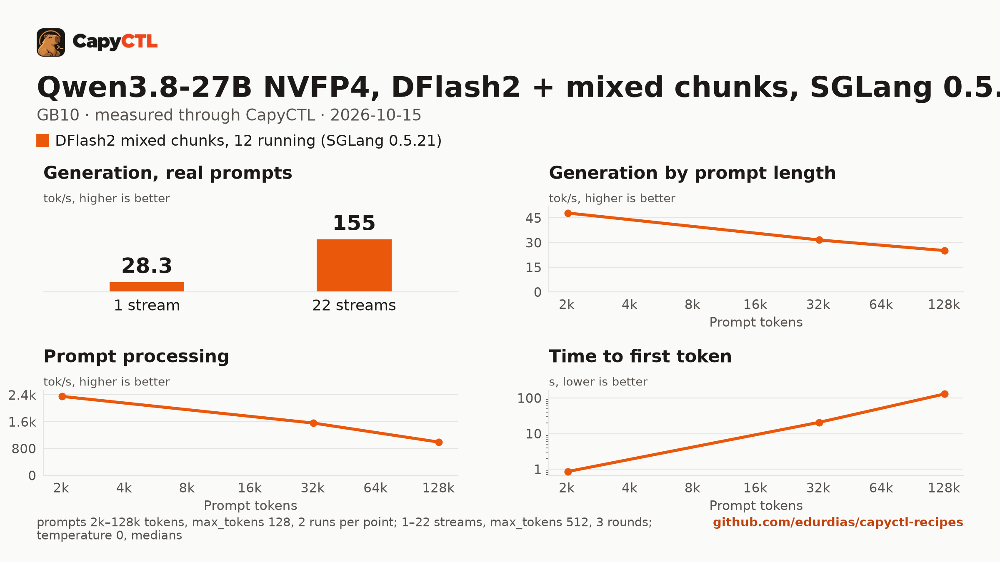

# Qwen3.8-27B NVFP4 on SGLang 0.5.21 with DFlash2 drafts and mixed chunked prefill, 12 running requests, one GB10

| | |
|---|---|
| Hardware | 1x NVIDIA GB10 (DGX Spark class), compute capability 12.1, 128 GB unified memory, aarch64 |
| System | Ubuntu 24.04, NVIDIA driver 580.173.02, CUDA 13.0 toolkit in `/usr/local/cuda`, kernel 6.17.0-1031-nvidia |
| Engine | SGLang 0.5.21 in a venv (torch 2.13.0+cu130, FlashInfer 0.6.18, sglang-kernel 0.4.7) |
| Model | [`nvidia/Qwen3.8-27B-NVFP4`](https://huggingface.co/nvidia/Qwen3.8-27B-NVFP4) at `482ca0f3832238542f8f5295dde86b5f22711d80`, NVFP4 with FP8 layers and an NVFP4 LM head, 21.9 GB |
| Drafter | [`z-lab/Qwen3.8-27B-DFlash2`](https://huggingface.co/z-lab/Qwen3.8-27B-DFlash2) at `50307d4c4cde6860d4eee73e2547cd786fe8e8a4`, 3.8 GB |
| CapyCTL | `52e264c` (0.1.3 development, prints `capyctl 0.1.2`), release build; standalone with `managed_limit=100GiB`, `free_reserve=10GiB`, `parked_limit=45GiB` |
| Measured | 2026-10-15 |

This recipe needs CapyCTL 0.1.3 or later. CapyCTL 0.1.3 sizes SGLang's
recurrent state for the 60 slots `--max-mamba-cache-size` fixes, refuses a
smaller request before launch and names the one it needs: 75 GiB here (the
65 GiB of the DFlash2 recipe was refused). Earlier releases accept a request
that does not hold that state.

It is the DFlash2 recipe ([sglang/qwen3.8-27b-nvfp4-gb10](../qwen3.8-27b-nvfp4-gb10/))
with mixed chunked prefill, 12 running requests instead of 8 and the full
262,144-token context. It keeps DFlash2's one-stream speed, and a long prompt
stalls the running streams for about 9 s instead of about 56 s. It is the
best all-rounder of the 27B SGLang recipes up to about 12 users.

### Which Qwen3.8-27B SGLang recipe

Three SGLang recipes serve this checkpoint; the comparison
[comparisons/qwen3.8-27b-sglang-dflash2-vs-mtp-eagle-gb10](../../comparisons/qwen3.8-27b-sglang-dflash2-vs-mtp-eagle-gb10/)
(run 3, the sweet spot) measured them side by side:

| Workload | Recipe | Request |
|---|---|---|
| 1 to 4 users, short prompts, least memory | [sglang/qwen3.8-27b-nvfp4-gb10](../qwen3.8-27b-nvfp4-gb10/): DFlash2, 8 running, 32,768-token context | 65 GiB |
| up to about 12 users, long prompts beside running ones | this recipe: DFlash2, mixed chunks, 12 running, 262,144-token context | 75 GiB |
| 16 to 22 users | [sglang/qwen3.8-27b-nvfp4-mtp-eagle-gb10](../qwen3.8-27b-nvfp4-mtp-eagle-gb10/): MTP drafts (EAGLE), 22 running | 84 GiB |

The options, beside the DFlash2 recipe's:

- `--enable-mixed-chunk` decodes the running requests while a long prompt
  prefills.
- `--max-mamba-cache-size 60` holds 12 running requests at 5 state slots each
  (`max_concurrent_requests: 12`). SGLang's DFLASH keeps intermediate states
  for every slot (ReplaySSM applies only to EAGLE and MTP), so each slot costs
  memory: 22 running requests need a 94 GiB request and fall to 9.5 tokens/s
  per stream at 22 streams.
- `context_length: 262144`, and the typed `qwen3_coder` tool-call and `qwen3`
  reasoning parsers.

`residency` is left to CapyCTL's default. CapyCTL 0.1.3 resolves it to `deep`
for speculative SGLang deployments: SGLang's memory saver is on, the weights
stay resident while the deployment is parked, and it parks and wakes (figures
below).

### Memory

A 16 GiB FP8 KV pool (`memory.kv_cache: 16GiB`, passed as SGLang's
`--max-total-tokens`, 399,457 tokens), the float32 recurrent state for 60
slots, the weights and the drafter fit in a 75 GiB request; CapyCTL renders
the static pool as `--mem-fraction-static 0.5704`. CapyCTL charges the start
76.2 GiB; `MemAvailable` fell by 76.5 GiB once it was ready.

That is above a standalone's default managed limit (50 % of memory, 60.8 GiB
on a GB10): the managed limit has to be above 75 GiB (the charge is 76.2 GiB).
Parked, it holds 34.7 GiB, above the default parked limit (a quarter of
memory, about 30 GiB on a GB10), so raise that too. The measurements ran with
a 100 GiB managed limit, a 10 GiB free reserve and a 45 GiB parked limit:

```bash
capyctl start standalone \
  --set host.resource_policy.memory.system.managed_limit=100GiB \
  --set host.resource_policy.memory.system.free_reserve=10GiB \
  --set host.resource_policy.memory.system.parked_limit=45GiB
```

or in the standalone document:

```yaml
host:
  resource_policy:
    memory:
      system:
        managed_limit: 100GiB
        free_reserve: 10GiB
        parked_limit: 45GiB
```

## Run it

CapyCTL does not download drafters. Download it into a directory of drafters:

```bash
hf download z-lab/Qwen3.8-27B-DFlash2 \
  --revision 50307d4c4cde6860d4eee73e2547cd786fe8e8a4 \
  --local-dir ~/drafters/Qwen3.8-27B-DFlash2
```

Register the engine, allowing `--speculative-draft-model-path` for drafters
inside that directory, then deploy and start (change the drafter path in
`deployment.yaml` to yours):

```bash
capyctl engine add ~/sglang-0.5.21-venv \
  --approve-option=--speculative-draft-model-path --approve-path /home/me/drafters
capyctl deploy model --file deployment.yaml
capyctl start deployment qwen38-27b-dflash2-mix --wait
```

The API key comes from the credentials file the start banner names:

```bash
KEY=$(sed -n 's/^api_key: //p' ~/.local/state/capyctl/identity/credentials)
curl -s http://127.0.0.1:8443/v1/chat/completions \
  -H "Authorization: Bearer $KEY" -H 'Content-Type: application/json' \
  -d '{"model": "qwen38-27b-dflash2-mix", "messages": [{"role": "user", "content": "Name the largest planet in one sentence."}]}' \
  | jq -r '.choices[0].message.content'
```

Qwen3.8 thinks before it answers: SGLang returns the thinking in
`reasoning_content` and the answer in `content`.

## Measured through CapyCTL

The run was the comparison's `run.sh --sweetspot` (variant `dflash-mix-12`),
with the deployment named `qwen38-w-dm12` and the kernel caches already
filled by earlier variants. Its first start, at 65 GiB, was refused before
launch with 75 GiB named; the figures are from the start at 75 GiB.

| | |
|---|---|
| Ready, warm kernel caches | 288 s (SGLang's full startup, CUDA graph capture included) |
| Time to first token, one stream | 0.21 s median |
| Decode, one stream | 28.6 tokens/s per stream (28.3 aggregate), mean accept length 3.34 |
| 4 streams | 85.5 tokens/s together, 23.1 each |
| 8 streams | 118.1 tokens/s together, 16.9 each |
| 22 streams | 155.0 tokens/s together, 15.5 each; 12 run and the rest wait in CapyCTL (time to first token 0.33 s median, 41.2 s p95) |
| Memory | 76.2 GiB CapyCTL charge for the 75 GiB request; `MemAvailable` fell by 76.5 GiB |
| Park and wake | parked in 1.2 s to a measured 34.7 GiB (`MemAvailable` 36.6 GiB below idle); a request woke it with its first token after 2.78 s and a correct answer |
| Long prompt | a 79,331-token prompt arriving beside 4 running streams: longest gap between their chunks 8.6 s, its time to first token 65.3 s |
| Context | 262,144 tokens, declared |

capyctl-bench, 3 rounds at 1, 4, 8, 16 and 22 streams, `max_tokens: 512`,
`temperature: 0`, thinking on; one stream at 2k, 32k and 128k prompt tokens,
2 runs each, `max_tokens: 128`; machine memory in use (`MemTotal -
MemAvailable`) sampled every 0.5 s:

| Context | Time to first token | Decode, one stream | Memory in use, peak |
|---|---|---|---|
| 2k | 0.86 s | 48.0 tokens/s | 83.9 GiB |
| 32k | 20.74 s | 31.6 tokens/s | 83.9 GiB |
| 128k | 129.96 s | 25.2 tokens/s | 84.0 GiB |

## Benchmark

[`bench/`](bench/) has the capyctl-bench results and report
([`report.html`](bench/report.html), [`summary.md`](bench/summary.md),
[`data.csv`](bench/data.csv)).


