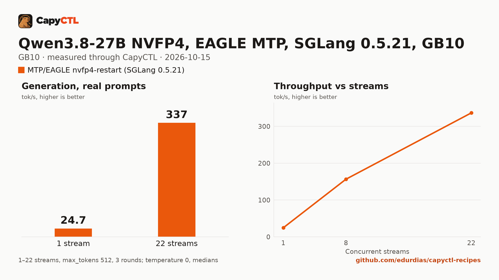

# Qwen3.8-27B NVFP4 on SGLang 0.5.21 with MTP drafts (EAGLE), 22 running requests, one GB10

| | |
|---|---|
| Hardware | 1x NVIDIA GB10 (DGX Spark class), compute capability 12.1, 128 GB unified memory, aarch64 |
| System | Ubuntu 24.04, NVIDIA driver 580.173.02, CUDA 13.0 toolkit in `/usr/local/cuda` |
| Engine | SGLang 0.5.21 in a venv (torch 2.13.0+cu130, FlashInfer 0.6.18, sglang-kernel 0.4.7) |
| Model | [`nvidia/Qwen3.8-27B-NVFP4`](https://huggingface.co/nvidia/Qwen3.8-27B-NVFP4) at `482ca0f3832238542f8f5295dde86b5f22711d80`, NVFP4 with FP8 layers and an NVFP4 LM head, 21.9 GB |
| Drafter | none: the checkpoint's own MTP layer, as SGLang's EAGLE (3 steps, top-1, 4 draft tokens) |
| CapyCTL | `e6e5c92` (0.1.3 development), release build; standalone with `managed_limit=100GiB`, `free_reserve=10GiB` |
| Measured | 2026-10-15 |

This recipe needs CapyCTL 0.1.3 or later. CapyCTL 0.1.3 sizes SGLang's
recurrent state for the 110 slots `--max-mamba-cache-size` fixes (with the
speculative decoding scratch), refuses a smaller request before launch and
names the one it needs: 84 GiB here. Earlier releases accept 79 GiB, which
does not hold it.

Against the DFlash2 recipe ([sglang/qwen3.8-27b-nvfp4-gb10](../qwen3.8-27b-nvfp4-gb10/))
this one serves 22 requests at once instead of 8, with a 262,144-token context
and mixed chunked prefill, so a long prompt stalls the running streams for
about 9 s instead of about 57 s. DFlash2 is faster at one stream; this recipe
is faster from 8 streams up. The measurements, the BF16-head checkpoint it was
chosen over and the accuracy checks are in the comparison
[comparisons/qwen3.8-27b-sglang-dflash2-vs-mtp-eagle-gb10](../../comparisons/qwen3.8-27b-sglang-dflash2-vs-mtp-eagle-gb10/).

### Which Qwen3.8-27B SGLang recipe

Three SGLang recipes serve this checkpoint; the comparison (run 3, the sweet
spot) measured them side by side:

| Workload | Recipe | Request |
|---|---|---|
| 1 to 4 users, short prompts, least memory | [sglang/qwen3.8-27b-nvfp4-gb10](../qwen3.8-27b-nvfp4-gb10/): DFlash2, 8 running, 32,768-token context | 65 GiB |
| up to about 12 users, long prompts beside running ones | [sglang/qwen3.8-27b-nvfp4-dflash2-mix-gb10](../qwen3.8-27b-nvfp4-dflash2-mix-gb10/): DFlash2, mixed chunks, 12 running, 262,144-token context | 75 GiB |
| 16 to 22 users | this recipe: MTP drafts (EAGLE), 22 running | 84 GiB |

At 22 streams this recipe decoded 344 tokens/s together in that run, against
at most 191 for DFlash2. At 8 streams, the same options with 12 running
requests (`--max-mamba-cache-size 60`, `max_concurrent_requests: 12`, a
75 GiB request) did best, at 163 tokens/s.

The options:

- `--speculative-algorithm EAGLE` with 3 steps, top-1 and 4 draft tokens drafts
  with the checkpoint's MTP layer; `--enable-linear-replayssm-spec` makes
  SGLang verify drafts by replaying the recurrent state instead of keeping
  intermediate states per draft token (EAGLE and MTP only).
- `--max-mamba-cache-size 110` holds 22 running requests at 5 state slots each.
- `--enable-mixed-chunk` decodes the running requests while a long prompt
  prefills.
- `quantization: modelopt`, an FP8 KV cache (`kv_cache_dtype: fp8_e4m3`;
  the checkpoint carries no KV scales, so it runs unscaled) and the typed
  `qwen3_coder` tool-call and `qwen3` reasoning parsers.

`residency` is left to CapyCTL's default for speculative SGLang deployments
(`restart_only`): the deployment restarts instead of parking.

### Memory

A 29 GiB FP8 KV pool (`memory.kv_cache: 29GiB`, passed as SGLang's
`--max-total-tokens`, 894,373 tokens), the float32 recurrent state for 110
slots and the weights fit in an 84 GiB request; CapyCTL renders the static
pool as `--mem-fraction-static 0.6468`. CapyCTL charges the start 85.2 GiB;
`MemAvailable` fell by 78.9 GiB once it was ready.

That is above a standalone's default managed limit (50 % of memory, 60.8 GiB
on a GB10). Start CapyCTL with a 100 GiB limit and a 10 GiB free reserve:

```bash
capyctl start standalone \
  --set host.resource_policy.memory.system.managed_limit=100GiB \
  --set host.resource_policy.memory.system.free_reserve=10GiB
```

or in the standalone document:

```yaml
host:
  resource_policy:
    memory:
      system:
        managed_limit: 100GiB
        free_reserve: 10GiB
```

Nothing else can run beside it on a 128 GB GB10. Fewer running requests (a
smaller `--max-mamba-cache-size` and `max_concurrent_requests`) need less.

## Run it

```bash
capyctl engine add ~/sglang-0.5.21-venv
capyctl deploy model --file deployment.yaml
capyctl start deployment qwen38-27b-mtp --wait
```

The API key comes from the credentials file the start banner names:

```bash
KEY=$(sed -n 's/^api_key: //p' ~/.local/state/capyctl/identity/credentials)
curl -s http://127.0.0.1:8443/v1/chat/completions \
  -H "Authorization: Bearer $KEY" -H 'Content-Type: application/json' \
  -d '{"model": "qwen38-27b-mtp", "messages": [{"role": "user", "content": "Name the largest planet in one sentence."}]}' \
  | jq -r '.choices[0].message.content'
```

Qwen3.8 thinks before it answers: SGLang returns the thinking in
`reasoning_content` and the answer in `content`.

## Measured through CapyCTL

The run was the comparison's `run.sh --experiment`, with the deployment named
`qwen38-e-nvfp4` and the kernel caches already filled by earlier variants.

| | |
|---|---|
| Ready, warm kernel caches | 261 s (SGLang's full startup, CUDA graph capture included) |
| Time to first token, one stream | 0.21 s median |
| Decode, one stream | 24.9 tokens/s per stream (24.7 aggregate), mean accept length 2.60 |
| 8 streams | 156.5 tokens/s together, 20.9 each |
| 22 streams | 336.6 tokens/s together, 17.2 each |
| Memory | 85.2 GiB CapyCTL charge for the 84 GiB request; `MemAvailable` fell by 78.9 GiB |
| Long prompt | an 80,292-token prompt arriving beside 4 running streams: longest gap between their chunks 8.5 s, its time to first token 64.6 s |
| Context | 262,144 tokens, declared |

capyctl-bench, 3 rounds at 1, 8 and 22 streams, `max_tokens: 512`,
`temperature: 0`, thinking on. The BF16-head checkpoint
(`RadixArk/Qwen3.8-27B-NVFP4-BF16-LMHead`) with the same options decoded 17.5,
120.1 and 273.9 tokens/s together: this checkpoint is 41%, 30% and 23% faster.

### Accuracy

Greedy, thinking on, against the BF16-head checkpoint with the same options:

| Check | This checkpoint | BF16-head checkpoint |
|---|---|---|
| GSM8K test subset, final number in `\boxed{}` (`max_tokens: 2048`) | 233/250 (93.2%) | 234/250 (93.6%) |
| Tool calls (JSON object arguments, expected function, required arguments) | 30/30 | 29/30 |

Token-for-token agreement between the two is low (7 of 200 replies identical),
but SGLang's greedy decoding is not batch-invariant: the BF16-head checkpoint
repeats only 9 of 50 of its own replies exactly.

## Benchmark

[`bench/`](bench/) has the capyctl-bench results and report
([`report.html`](bench/report.html), [`summary.md`](bench/summary.md),
[`data.csv`](bench/data.csv)).


