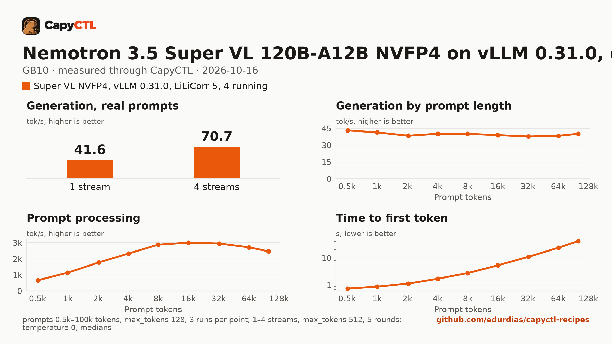

# Nemotron 3.5 Super VL 120B-A12B NVFP4 on vLLM 0.31.0, one GB10

| | |
|---|---|
| Hardware | 1x NVIDIA GB10 (DGX Spark class), compute capability 12.1, 128 GB unified memory, aarch64 |
| System | Ubuntu 24.04, NVIDIA driver 580.173.02, CUDA 13.0 toolkit in `/usr/local/cuda` |
| Engine | vLLM 0.31.0 in a venv (torch 2.13.0+cu130, flashinfer-python 0.7.0.post1), Python 3.12 |
| Model | [`nvidia/NVIDIA-Nemotron-3.5-Super-VL-120B-A12B-NVFP4`](https://huggingface.co/nvidia/NVIDIA-Nemotron-3.5-Super-VL-120B-A12B-NVFP4) at `579ffa0b659bc681b89e649fa7c2d5089399602e` (70 GB) |
| Drafter | [`nvidia/NVIDIA-Nemotron-3.5-Super-VL-120B-A12B-NVFP4-LiLiCorr`](https://huggingface.co/nvidia/NVIDIA-Nemotron-3.5-Super-VL-120B-A12B-NVFP4-LiLiCorr) at `7c7221aeb4cb3139307aa457f7dce11a8fb6ceb2` (1.3 GB), 5 draft tokens |
| CapyCTL | 0.1.3 release (`345806a5`), `capyctl start standalone`, managed limit 108 GiB, free reserve 8 GiB |
| Measured | 2026-10-16 |

Super VL is NVIDIA's 120B-A12B vision-language model (Mamba-2, mixture of
experts and attention layers, a vision encoder), released 2026-10-15. This is
NVIDIA's DGX Spark recipe for vLLM run through CapyCTL, changed after testing:
4 running requests instead of 1 (one user loses nothing) and 5 LiLiCorr draft
tokens instead of 7. vLLM 0.31.0 already has the architecture, the LiLiCorr
speculator and every option NVIDIA's recipe uses; no nightly is needed.

For one user it decodes **43 tokens/s** and answers a short question in 0.35 s;
four users get **71 tokens/s** in total. It processes prompts at about 3,000
tokens/s, so a 32k-token prompt waits 11 s for its first token. GSM8K 97.2%.
It is the fastest way we found to run this model on a GB10: llama.cpp v0.7.0
decodes it 15 to 40% slower and processes prompts at a quarter of this rate
([comparison](../../comparisons/nemotron-3.5-super-vl-engines-gb10/)).

## Run it

Download the model into the models directory and the drafter into a directory
you approve for it (the pinned commands are in `deployment.yaml`). Register
vLLM 0.31.0 with that approval and the V2 model runner LiLiCorr needs:

```bash
capyctl engine add ~/vllm-0.31.0-venv --approve-option=--speculative-config \
  --approve-path ~/drafters --env VLLM_USE_V2_MODEL_RUNNER=1
```

```text
Registered vllm (vllm 0.31.0)

  Executable     /home/me/vllm-0.31.0-venv/bin/vllm
  Deep park      enabled
  CUDA           /usr/local/cuda
  Engines file   /home/me/.config/capyctl/engines.yaml (revision 2)
  Published      yes
```

The checkpoint ships its configuration code, so the profile must allow it: in
`engines.yaml`, set `"trust_remote_code": true` in the profile's `security`
(`capyctl engine add` has no option for it), then start CapyCTL with room for
the 96 GiB this holds:

```bash
capyctl start standalone \
  --set host.resource_policy.memory.system.managed_limit=108GiB \
  --set host.resource_policy.memory.system.free_reserve=8GiB
```

Set the drafter path in `deployment.yaml` to yours, then:

```bash
capyctl deploy model --file deployment.yaml
capyctl start deployment nemotron-super-vl --wait
```

```text
Request identity: 01M523CYB246732S0P96VPX6SY (reuse --request-id 01M523CYB246732S0P96VPX6SY to recover this command)
Waiting for the checkpoint digest of nemotron-super-vl to be measured (at most 1800s)
Started nemotron-super-vl: ready

  Ready       1/1
  Hosts       gpu-box
  Operation   initialize succeeded
```

The very first start on a machine builds vLLM's and FlashInfer's kernels for
the GB10 and took longer than the 1800 s `--wait` allows (`activation_timeout`;
the start goes on). Run the start again; the next one took 23 minutes, and
every start after that 3 to 15 minutes.

```bash
KEY=$(sed -n 's/^api_key: //p' ~/.local/state/capyctl/identity/credentials)
curl -s http://127.0.0.1:8443/v1/chat/completions \
  -H "Authorization: Bearer $KEY" -H 'Content-Type: application/json' \
  -d '{"model": "nemotron-super-vl", "messages": [{"role": "user", "content": "What is the capital of Australia? Answer in one sentence."}], "temperature": 0}' \
  | jq -r '.choices[0].message.content'
```

```text
The capital of Australia is Canberra.
```

The thinking comes back in `reasoning`.

## Numbers

| Number | Value |
|---|---|
| Ready time, cold | over 30 minutes the first time on a machine (kernel builds); 685 s on a new deployment once they are built |
| Ready time, warm | 540 s (166 to 892 s across this model's runs) |
| Time to first token | 0.35 s (median, capyctl-bench's prompt set, `max_tokens: 512`, one request at a time) |
| Decode, one stream | 42.7 tokens/s (same requests) |
| Peak memory | 96.7 GiB measured by CapyCTL (`startup.measured`) against the 97.2 GiB it reserves |
| GSM8K (250 questions, final number in `\boxed{}`, `max_tokens: 8192`, 4 at a time) | 97.2% (243 of 250; 2 answers cut at `max_tokens`) |
| Tool calls (30 cases, `max_tokens: 256`) | 27 of 30; the right function in all 30, and the 3 misses hit the 256-token limit while writing the call's arguments (invalid JSON) |

Thinking on (the model's default), temperature 0 for the checks and accuracy,
capyctl-bench's defaults for the sweeps.

## Checks through CapyCTL

| Check | Result |
|---|---|
| Short answer | "The capital of Australia is Canberra.", 309 characters of reasoning |
| Tool call (`get_weather`) | finish `tool_calls`, `get_weather {"city": "Lisbon"}` |
| Image (a red 64x64 PNG as `image_url`) | "Red" |
| Streaming with usage | vLLM's per-request `metrics` and CapyCTL's per-request metrics on the usage chunk |

## Prompts and users

[Full report](bench/report.html) (download and open it locally),
[tables](bench/summary.md), [every point](bench/data.csv).



| Prompt | Decode | Prompt processing | Time to first token |
|---|---|---|---|
| 1k tokens | 41.5 tokens/s | 1,137 tokens/s | 0.88 s |
| 8k | 40.3 | 2,875 | 2.8 s |
| 32k | 37.9 | 2,949 | 10.9 s |
| 64k | 38.6 | 2,710 | 23.8 s |
| 100k | 40.3 | 2,460 | 41.0 s |

| Users | Total | Per user | Time to first token |
|---|---|---|---|
| 1 | 41.6 tokens/s | 42.7 tokens/s | 0.35 s |
| 2 | 52.5 | 28.8 | 0.51 s |
| 3 | 63.1 | 23.1 | 0.70 s |
| 4 | 70.7 | 20.1 | 0.75 s |

## What was tested

Everything below ran through CapyCTL on the same GB10; the
[comparison](../../comparisons/nemotron-3.5-super-vl-engines-gb10/) has the
reports.

| Variant | One user, decode | Result |
|---|---|---|
| NVIDIA's recipe: LiLiCorr 7, 1 running | 38.1 and 39.9 tokens/s (two runs) | baseline |
| LiLiCorr 5, 1 running | 40.5 and 39.4 | within the spread |
| The model's own MTP head, 5 or 3 tokens | 34.6, 36.7 | slower |
| LiLiCorr 7, 4 running | 41.1; 71.7 in total at 4 | |
| **LiLiCorr 5, 4 running** | **41.4; 73.7 in total at 4** | **taken** (42.7 and 70.7 in the verification run) |
| llama.cpp v0.7.0, best settings (Q4_0, LiLiCorr 5) | 31.9 | prompts 3.7 times slower |
| SGLang 0.5.21, MTP or LiLiCorr | does not start | |

## Notes

- **No parking.** CapyCTL parked the model in 4 s and released 81 GiB, but
  every wake (with LiLiCorr, without a drafter, without the Mamba cache's
  stochastic rounding and without its shared prefix checkpoints) failed
  CapyCTL's wake canary: the reloaded model's greedy answer differed from its
  first one (`wake_mismatch`), and CapyCTL stops a model in that state instead
  of serving it. vLLM alone does the same, with no CapyCTL: after
  `/sleep?level=2`, `/wake_up` and `reload_weights`, a greedy prompt that
  answered in prose before the sleep repeated `</think>` to its token limit.
  The recipe says `residency: restart_only` (CapyCTL newer than 0.1.3 refuses
  to park this model on vLLM); when CapyCTL needs the memory it stops the
  model, and the next request starts it again.
- **Development mode.** CapyCTL starts vLLM with its sleep endpoints on for
  deep parking unless the host turns deep parking off; `capyctl status
  deployment` says so. With `restart_only` they are never used.
- **Video.** `--video-pruning-rate` is NVIDIA's setting; this recipe was
  checked with text and images only.
