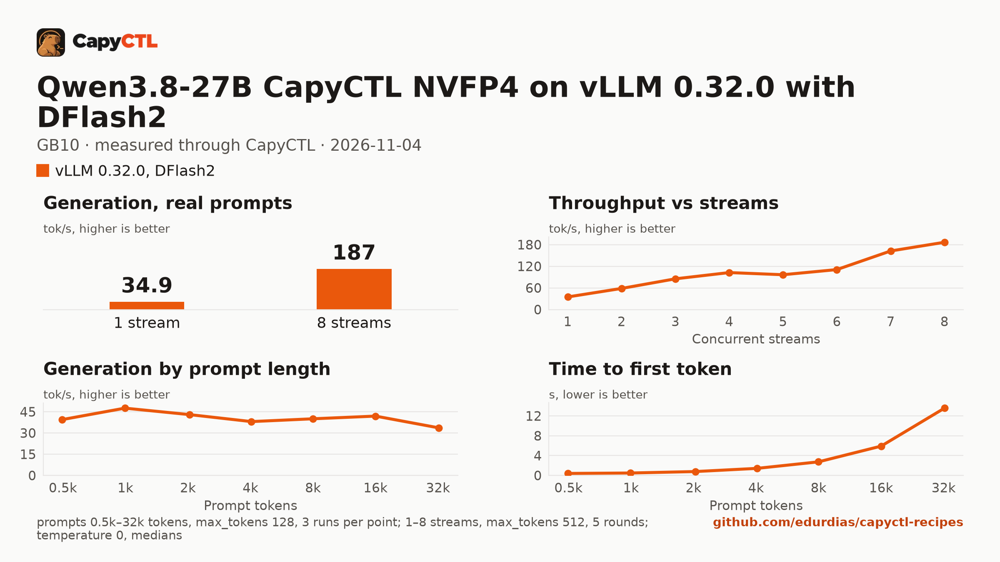

# Qwen3.8-27B CapyCTL NVFP4 on vLLM 0.32.0 with DFlash2 drafts, one GB10

| | |
|---|---|
| Hardware | 1x NVIDIA GB10 (DGX Spark class), compute capability 12.1, 128 GB unified memory, aarch64 |
| System | Ubuntu 24.04.5, kernel 6.17.0-1031-nvidia, NVIDIA driver 580.173.02, CUDA 13.0 toolkit in `/usr/local/cuda` |
| Engine | vLLM 0.32.0 in a venv (torch 2.13.0+cu130, triton 3.7.1, flashinfer-python 0.7.0.post1, transformers 5.19.0), Python 3.12.14 |
| Model | [`capyctl/Qwen3.8-27B-NVFP4`](https://huggingface.co/capyctl/Qwen3.8-27B-NVFP4) at `4a47ea5eaf0bbc80ede6b392aa94e0dcc1980ab6`, every large Linear in NVFP4, MTP head BF16, 18.8 GB; made from [`Qwen/Qwen3.8-27B`](https://huggingface.co/Qwen/Qwen3.8-27B) by [`convert/`](convert/) |
| Drafter | [`z-lab/Qwen3.8-27B-DFlash2`](https://huggingface.co/z-lab/Qwen3.8-27B-DFlash2) at `50307d4c4cde6860d4eee73e2547cd786fe8e8a4`, 3.8 GB |
| CapyCTL | 0.1.10 release; `capyctl start standalone` |
| Measured | 2026-11-04 |

This recipe decodes 35.3 tokens/s on one stream and 187 tokens/s at 8, with a 32,768-token context and up to 8
requests decoded together. Against `nvidia/Qwen3.8-27B-NVFP4` with the same settings it is
23% faster on one stream and 13% faster at 8 streams, at the same accuracy; the
[comparison](../../comparisons/qwen3.8-27b-nvfp4-builds-gb10/) measures it against NVIDIA's
build, four other published builds and the BF16 source, and holds the settings sweep that
chose this file. The [SGLang recipe](../../sglang/qwen3.8-27b-capyctl-nvfp4-gb10/) serves
the same checkpoint on SGLang 0.5.22. The
[TensorFold recipe](../../tensorfold/qwen3.8-27b-nvfp4-gb10/) for NVIDIA's checkpoint
(TensorFold 0.6.5, measured 2026-10-04) was not run again with this one.

### The checkpoint

NVIDIA's NVFP4 build keeps the attention and Gated DeltaNet projections (208 tensors, 7.2 GB)
in FP8. This one quantizes them to NVFP4 too, so decode reads 14.45 GB a token instead of
17.61 GB; the embeddings, the DeltaNet gates and convolutions, the norms, the vision tower and
the MTP head stay BF16, as in the source. It was made with NVIDIA Model Optimizer 0.47.0 on a
GB10 in about 30 minutes ([`convert/`](convert/)):

```bash
python convert/make_calib.py \
  --chat test_sft-00000-of-00001-f7dfac4afe5b93f4.parquet \
  --code data-oss_instruct-decontaminated.jsonl \
  --per-split 256 --out calib-chat-code-512.jsonl

python convert/convert_qwen3_8_27b_nvfp4.py \
  --source ~/models/qwen3.8-27b --source-revision 1d4bf0f2ff6012fd82039f2fa52739d0dd7c60c0 \
  --out ~/models/Qwen3.8-27B-NVFP4 \
  --hf-ptq-dir ~/Model-Optimizer-0.47.0/examples/hf_ptq \
  --calib calib-chat-code-512.jsonl --gpu-gib 100 --skip-generate
```

- **Recipe**: [`convert/qwen3_5-nvfp4_all_linear-kv_none.yaml`](convert/qwen3_5-nvfp4_all_linear-kv_none.yaml),
  NVFP4 W4A4 (group 16, static input scales) on the MLP, `lm_head`, self-attention and the
  DeltaNet `in_proj_qkv`, `in_proj_z` and `out_proj`; `max` calibration; no KV-cache scales.
- **Calibration**: 512 conversations of up to 1,024 tokens, 256 from
  [`HuggingFaceH4/ultrachat_200k`](https://huggingface.co/datasets/HuggingFaceH4/ultrachat_200k)
  and 256 from [`ise-uiuc/Magicoder-OSS-Instruct-75K`](https://huggingface.co/datasets/ise-uiuc/Magicoder-OSS-Instruct-75K)
  (both MIT), taken at an even stride by [`convert/make_calib.py`](convert/make_calib.py)
  (set SHA-256 `a3e005c39c3c71918ffff53504091ed32bd02baf3d37241072e5a616b0dc31eb`).
- **`--gpu-gib 100`**: `hf_ptq.py` places the model with accelerate, which reads the GPU's
  free memory; on unified memory that excludes the page cache, so part of the 55.6 GB model
  went to disk offload until the budget was fixed.
- **Audit**: the converter reads every tensor header of the output and fails unless each
  tensor has the layout above (2,402 tensors passed), and writes `conversion-manifest.json`
  (source revision, tool versions, and the SHA-256 of the recipe, calibration set and
  converter) into the checkpoint. [`convert/MODEL_CARD.md`](convert/MODEL_CARD.md) is its
  Hugging Face card.

The environment was nvidia-modelopt 0.47.0, torch 2.13.0+cu130 and transformers 5.14.1, with
the `0.47.0` tag of [NVIDIA/Model-Optimizer](https://github.com/NVIDIA/Model-Optimizer) for
`examples/hf_ptq` (commit `c10fb3bf`). FP4 hardware is not needed to convert.

### The settings

- **DFlash2 with 7 speculative tokens**, the drafter's own block. 6 and 12 lost at 4 and 8
  streams in the sweep.
- **`--mamba-ssm-cache-dtype bfloat16`**: the DeltaNet state cache in bf16 instead of the
  checkpoint's float32. In the sweep it took 8 streams from 150 to 181 tokens/s, with GSM8K
  and tool calls unchanged ([Accuracy](#accuracy)).
- **`kv_cache_dtype: fp8`** with a 16 GiB cache: vLLM held 184,235 tokens, enough for 5.6
  requests of the full 32,768 tokens at once.
- vLLM chose `FlashInferCutlassNvFp4LinearKernel` for the NVFP4 GEMMs and the FLASHINFER
  attention backend, from its log.

## Run it

CapyCTL does not download drafters. Download it into a directory of drafters:

```bash
hf download z-lab/Qwen3.8-27B-DFlash2 \
  --revision 50307d4c4cde6860d4eee73e2547cd786fe8e8a4 \
  --local-dir ~/drafters/Qwen3.8-27B-DFlash2
```

Register the engine and allow `--speculative-config` for drafters inside that directory:

```bash
capyctl engine add ~/vllm-0.32.0-venv \
  --approve-option=--speculative-config --approve-path /home/me/drafters
```

```text
Registered vl032 (vllm 0.32.0)

  Executable     /home/me/vllm-0.32.0-venv/bin/vllm
  Deep park      enabled
  CUDA           /usr/local/cuda
```

The measured run registered the profile as `vl032` and deployed this file with the model
path of its local copy of the checkpoint (the same files as the pinned revision, checked by
SHA-256) under the name `q38-rcp-vl`; the outputs below are from that run. With the file as
it is, `capyctl deploy model` downloads the checkpoint into the model store first.

```bash
capyctl deploy model --file deployment.yaml
```

```text
Deployment q38-rcp-vl created (revision 1)

  Deployment ID       01M6JDYXWJ47KZVJBQCTBQ7978
  Operation           01M6JDYXWJ6RWB86S55PZTXEHM
  Checkpoint digest   being measured
the checkpoint digest of q38-rcp-vl is being measured; `capyctl start deployment q38-rcp-vl --wait` waits for it and starts the deployment
```

```bash
capyctl start deployment q38-rcp-vl --wait
```

```text
Waiting for the checkpoint digest of q38-rcp-vl to be measured (at most 1800s)
Started q38-rcp-vl: ready

  Ready       1/1
  Hosts       host-a
  Operation   initialize succeeded
```

Qwen3.8 thinks before it answers; CapyCTL picks the `qwen3` reasoning parser for the family,
so the thinking comes back in `reasoning_content` and the answer in `content`.

## Measured through CapyCTL

| | |
|---|---|
| Ready, cold | 248 s (the first start in a new state directory: the checkpoint digest, the load, compiles and CUDA graph capture; kernel caches from earlier runs on this machine) |
| Ready, warm | 181 s (`start` after `stop` finished) |
| Time to first token | 0.207 s median (0.206 to 0.211) |
| Decode, one stream | 35.3 tokens/s median (29.4 to 49.5), DFlash2 drafts on |
| Peak memory | 51.2 GiB measured by CapyCTL (`startup.measured`); system memory in use peaked at 51.9 GiB during the sweeps |
| Concurrency | up to 8 requests decoded together (`max_concurrent_requests: 8`) |
| Context | 32,768 tokens, declared |

Five streaming chat completions through the CapyCTL endpoint, one at a time, capyctl-bench's
prompts (`python-lru`, `history-printing`, `plan-garden`, `sql-design`,
`story-lighthouse`), `max_tokens: 512`, `temperature: 0`, thinking on; every request
generated all 512 tokens. The decode range is the drafter: a reply it predicts well (code)
runs faster than prose.

### Accuracy

The deployment as this file states it, on the 250 GSM8K test questions and 30 tool-call cases
of the [comparison](../../comparisons/qwen3.8-27b-nvfp4-builds-gb10/#accuracy):

| | This recipe | NVIDIA NVFP4, SGLang, no drafts | Qwen BF16, SGLang, no drafts |
|---|---|---|---|
| GSM8K | 238/250 (95.2%) | 240/250 (96.0%) | 234/250 (93.6%) |
| GSM8K, answers that finished in 2,048 tokens | 237/241 (98.3%) | 240/244 (98.4%) | 234/238 (98.3%) |
| Tool calls | 30/30 | 30/30 | 29/30 |

## Benchmark

[`bench/`](bench/) has the capyctl-bench results and report
([`report.html`](bench/report.html), [`summary.md`](bench/summary.md),
[`data.csv`](bench/data.csv)). Context sweep 0.5k to 32k tokens, three runs per point,
`max_tokens: 128`; concurrency 1 to 8 streams, five rounds each, `max_tokens: 512`;
`temperature: 0`, thinking on; machine memory in use sampled every 0.5 s. No request failed
(180 concurrency and 21 context requests).

| Context | Time to first token | Decode, one stream | Prompt processing |
|---|---|---|---|
| 0.5k | 0.40 s | 39.5 tokens/s | 1,250 tokens/s |
| 1k | 0.48 s | 47.5 tokens/s | 2,059 tokens/s |
| 2k | 0.78 s | 43.0 tokens/s | 2,591 tokens/s |
| 4k | 1.42 s | 38.0 tokens/s | 2,857 tokens/s |
| 8k | 2.73 s | 40.0 tokens/s | 2,916 tokens/s |
| 16k | 5.90 s | 41.9 tokens/s | 2,729 tokens/s |
| 32k | 13.6 s | 33.6 tokens/s | 2,389 tokens/s |

| Streams | Together | Each | Time to first token |
|---|---|---|---|
| 1 | 34.9 tokens/s | 35.3 tokens/s | 0.21 s |
| 2 | 58.5 tokens/s | 31.6 tokens/s | 0.29 s |
| 3 | 85.2 tokens/s | 32.3 tokens/s | 0.37 s |
| 4 | 102.5 tokens/s | 29.4 tokens/s | 0.43 s |
| 5 | 96.5 tokens/s | 20.9 tokens/s | 0.49 s |
| 6 | 110.8 tokens/s | 20.1 tokens/s | 0.51 s |
| 7 | 162.5 tokens/s | 25.1 tokens/s | 0.49 s |
| 8 | 186.6 tokens/s | 25.3 tokens/s | 0.52 s |

Eight streams decode 5.3 times as many tokens as one. The total dips at five streams and
stays near four's at six before rising at seven and eight, in every one of the five rounds
(five: 89 to 98 tokens/s; eight: 180 to 190); the cause was not investigated.
[Higher concurrency](#higher-concurrency) goes past 8 streams.



A downloaded copy needs about 18.8 GB in the model store and 3.8 GB for the drafter; with the
download, the first start takes as long as the download plus the time above.

### Higher concurrency

This file serves 8 requests at once. To find where vLLM saturates, run 6 of the
[comparison](../../comparisons/qwen3.8-27b-nvfp4-builds-gb10/) raised
`max_concurrent_requests` to 48, first with the file's 16 GiB KV cache and then with 32 GiB,
changing nothing else (three rounds per stream count, `max_tokens: 512`, no request failed):

| Streams | 16 GiB KV cache: together | each | first token | 32 GiB KV cache: together | each | first token |
|---|---|---|---|---|---|---|
| 8 | 183.2 tokens/s | 26.5 tokens/s | 0.50 s | | | |
| 12 | 239.7 tokens/s | 23.5 tokens/s | 0.75 s | | | |
| 16 | 267.3 tokens/s | 20.3 tokens/s | 0.80 s | 280.2 tokens/s | 20.5 tokens/s | 0.79 s |
| 24 | 253.8 tokens/s | 17.3 tokens/s | 1.03 s (worst 29 s) | 353.6 tokens/s | 17.2 tokens/s | 1.06 s |
| 32 | 300.2 tokens/s | 18.6 tokens/s | 1.04 s (worst 31 s) | **389.7 tokens/s** | 13.9 tokens/s | 1.32 s |
| 40 | | | | 338.2 tokens/s | 14.0 tokens/s | 1.30 s (worst 37 s) |
| 48 | 292.2 tokens/s | 17.4 tokens/s | 28.9 s | 359.2 tokens/s | 14.1 tokens/s | 1.53 s (worst 41 s) |

(First token: the median, and the worst where requests waited.)

- **With this file's 16 GiB cache, vLLM runs at most 22 requests at once**, whatever the cap:
  the cache holds vLLM's DeltaNet state blocks as well as attention, and its log shows 20 to
  22 running with up to 12 waiting. Total throughput levels off near 300 tokens/s, and the
  requests past 22 wait (29 to 31 s for a first token).
- **With a 32 GiB cache, all 32 run, and the peak is 390 tokens/s at 32 streams**, 2.1 times
  the 8-stream total, each stream at 14 tokens/s, for a startup peak of 63.3 GiB (51.2 GiB for
  this file; system memory in use reached 66.8 GiB). From 24 to 32 streams the total still
  grows 10%, so vLLM is not saturated there.
- **Past 32 streams the measurement is CapyCTL's limit, not vLLM's.** CapyCTL 0.1.10 keeps at
  most 32 requests in flight per deployment (`MAX_REQUESTS_PER_DEPLOYMENT`), whatever
  `max_concurrent_requests` says, and the others wait in its queue: at 40 and 48 streams the
  worst first token is 37 and 41 s, and vLLM's log shows 32 running and none waiting.

For more than 8 users at once, set `max_concurrent_requests: 32` and `memory: {kv_cache:
32GiB}`. Run 6 started vLLM for 48 sequences, of which CapyCTL used 32 at a time; a cap of 32
itself was not measured.
