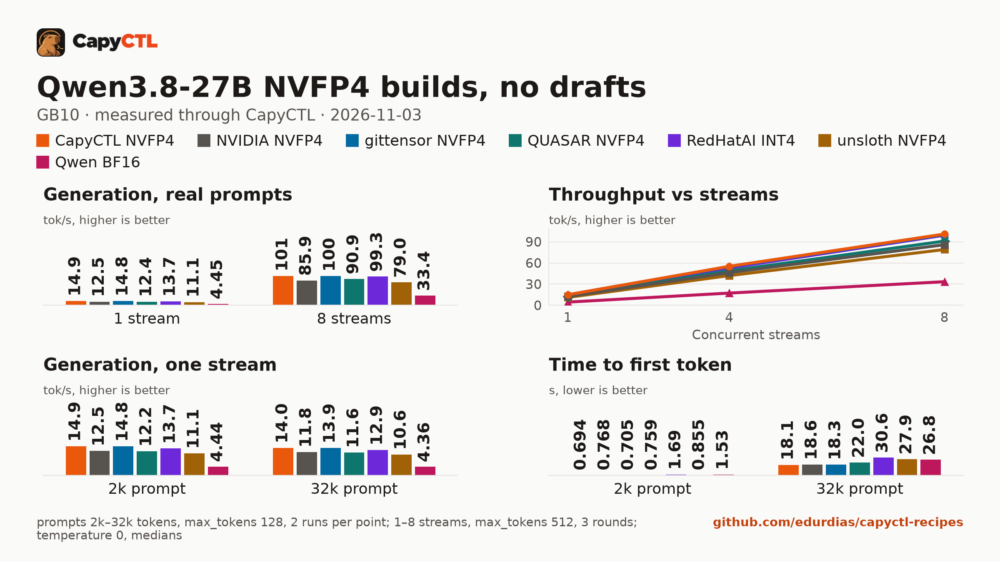

# Qwen3.8-27B-NVFP4

[Qwen/Qwen3.8-27B](https://huggingface.co/Qwen/Qwen3.8-27B) at
`1d4bf0f2ff6012fd82039f2fa52739d0dd7c60c0`, quantized with NVIDIA Model Optimizer
0.47.0 so that every large Linear of the language model is NVFP4 (W4A4, group 16):
the MLP, `lm_head`, self-attention q/k/v/o and the Gated DeltaNet `in_proj_qkv`,
`in_proj_z` and `out_proj`. [`nvidia/Qwen3.8-27B-NVFP4`](https://huggingface.co/nvidia/Qwen3.8-27B-NVFP4)
keeps those attention and DeltaNet projections (208 tensors, 7.2 GB) in FP8; here
they are NVFP4 too.

One-stream decode reads every weight once a token, so it is bound by memory
bandwidth. This checkpoint reads 14.45 GB a token, where NVIDIA's reads 17.61 GB.

| | This checkpoint | nvidia/Qwen3.8-27B-NVFP4 |
|---|---|---|
| MLP gate/up/down (64 layers) | NVFP4, 9.63 GB | NVFP4, 9.63 GB |
| DeltaNet qkv/z/out (48 layers) | NVFP4, 3.17 GB | FP8, 5.59 GB |
| Attention q/k/v/o (16 layers) | NVFP4, 0.94 GB | FP8, 1.68 GB |
| `lm_head` | NVFP4, 0.72 GB | NVFP4, 0.72 GB |
| Read a token | 14.45 GB | 17.61 GB |
| BF16, as the source: embeddings, DeltaNet `in_proj_a/b`, `conv1d`, `A_log`, `dt_bias`, norms, vision tower, MTP head | 4.31 GB | 4.31 GB |
| KV cache | not quantized (serve with an FP8 KV cache if you want one) | the same |
| On disk | 18.77 GB | 21.92 GB |

The MTP head stays, in BF16, so engines can draft with it.

## Measured on one GB10

Through [CapyCTL](https://github.com/edurdias/capyctl) 0.1.10 on one NVIDIA GB10, `temperature: 0`,
thinking on, 512 tokens out; tokens/s, and at several streams the total:

| Recipe, as its file ships | 1 stream | 8 streams | 32 streams (cap raised) | Peak memory |
|---|---|---|---|---|
| [vLLM 0.32.0 with DFlash2](https://github.com/edurdias/capyctl-recipes/tree/main/vllm/qwen3.8-27b-capyctl-nvfp4-gb10) | **35.3** | **187** | **390** with a 32 GiB KV cache | 51.2 GiB |
| [SGLang 0.5.22 with DFlash2](https://github.com/edurdias/capyctl-recipes/tree/main/sglang/qwen3.8-27b-capyctl-nvfp4-gb10) | 36.3 | 166 | 329 with a 94 GiB request | 58.1 GiB |

Against `nvidia/Qwen3.8-27B-NVFP4` on the same engine and settings:

| | This checkpoint | nvidia/Qwen3.8-27B-NVFP4 |
|---|---|---|
| vLLM 0.32.0 with DFlash2 ([`z-lab/Qwen3.8-27B-DFlash2`](https://huggingface.co/z-lab/Qwen3.8-27B-DFlash2)), DeltaNet state cache bf16: 1 / 8 streams | **35.7 / 181** (+23% / +13%) | 29.0 / 160 |
| SGLang 0.5.22 with DFlash2, bf16 DeltaNet state, two decode steps a round: 1 / 8 streams | **35.2 / 166** (+16% / +10%) | 30.4 / 150 |
| SGLang 0.5.22, no drafts: 1 / 8 streams | **14.9 / 101** (+19% / +18%) | 12.5 / 85.9 |
| GSM8K, 250 test questions, answers that finished in 2,048 tokens | 98.3% | 98.4% |
| Tool calls, 30 cases | 30/30 | 30/30 |

The BF16 source scores 98.3% on the same GSM8K answers, and both recipes as they ship score
98.3% (vLLM) and 98.0% (SGLang). The DFlash2 drafter accepts the same number of drafted tokens
a round on both checkpoints, so the gain is the cheaper verify step.



The [comparison](https://github.com/edurdias/capyctl-recipes/tree/main/comparisons/qwen3.8-27b-nvfp4-builds-gb10)
measures it against NVIDIA's, gittensor's, QUASAR's, RedHatAI's and unsloth's builds, the BF16
source and MiaAI-Lab's EXL3, with and without DFlash2, and holds the settings sweep, the
accuracy answers and every results file. gittensor's build has the same layout without the MTP
head and is as fast.

## Run it with CapyCTL

[Install CapyCTL](https://edurdias.github.io/capyctl/docs/install/) and
[register a vLLM 0.32.0 environment](https://edurdias.github.io/capyctl/docs/install-engines/),
allowing the drafter option for a directory of drafters, then download the drafter (CapyCTL
does not download drafters):

```bash
capyctl engine add ~/vllm-0.32.0-venv \
  --approve-option=--speculative-config --approve-path ~/drafters
hf download z-lab/Qwen3.8-27B-DFlash2 \
  --revision 50307d4c4cde6860d4eee73e2547cd786fe8e8a4 \
  --local-dir ~/drafters/Qwen3.8-27B-DFlash2
```

Start CapyCTL on the machine and leave it running
([Run on one machine](https://edurdias.github.io/capyctl/docs/one-machine/)):

```bash
capyctl start standalone
```

In a second terminal, deploy the recipe's
[`deployment.yaml`](https://github.com/edurdias/capyctl-recipes/blob/main/vllm/qwen3.8-27b-capyctl-nvfp4-gb10/deployment.yaml)
(change the drafter path in it to yours). CapyCTL downloads this checkpoint, pinned to its
commit, and serves it on its OpenAI-compatible endpoint:

```bash
capyctl deploy model --file deployment.yaml
capyctl start deployment qwen38-27b-capyctl-nvfp4-vllm --wait
```

[Deploy a model](https://edurdias.github.io/capyctl/docs/deploy/) explains the file. The
[SGLang recipe](https://github.com/edurdias/capyctl-recipes/tree/main/sglang/qwen3.8-27b-capyctl-nvfp4-gb10)
does the same on SGLang 0.5.22. The checkpoint is in ModelOpt's NVFP4 format, as NVIDIA's
is; only vLLM 0.32.0 and SGLang 0.5.22 were measured with it.

## How it was made

[`convert/`](https://github.com/edurdias/capyctl-recipes/tree/main/vllm/qwen3.8-27b-capyctl-nvfp4-gb10/convert)
in that recipe rebuilds it: ModelOpt 0.47.0 `examples/hf_ptq/hf_ptq.py` with the
recipe `qwen3_5-nvfp4_all_linear-kv_none.yaml`, `max` calibration on 512
conversations of up to 1024 tokens (256 from `HuggingFaceH4/ultrachat_200k`, 256
from `ise-uiuc/Magicoder-OSS-Instruct-75K`, both MIT), then an audit of every
tensor's format. `conversion-manifest.json` records the source revision, the tools
and their versions, and the SHA-256 of the recipe, the calibration set and the
converter.

## License

Apache 2.0, as the base model.
